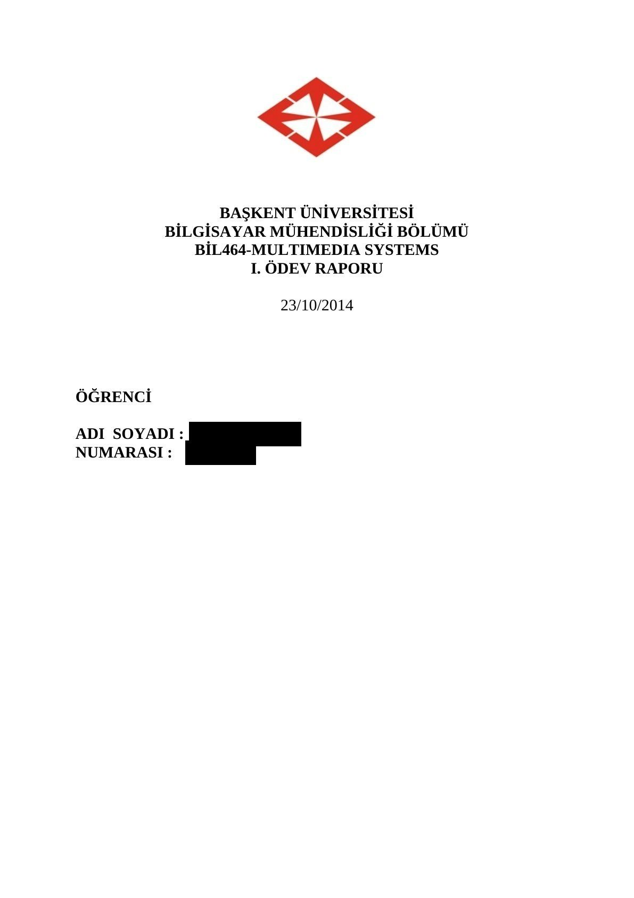

This post contains the content of a report a classmate prepared for Assignment 1 of the **BIL464 Multimedia Systems** course (October 23, 2014); personal information (first name, surname, student number) has been removed. Since I do not have the assignment text, the scope of the questions can only be inferred from the answers. The masked report pages are below; the masked PDF can be downloaded at the end of the post.

## Answers

1. **Innovative multimedia applications.**
   - **Twitter**: it appeals to very broad audiences; the basis of its innovation is that users are extremely free within the application. Ideas include sharing materials such as images and videos that illustrate a topic, and it stays constantly up to date under the heading of internet/multimedia applications.
   - **Mobile GPS**: it is a space-based application that provides location and time information by combining audio and video through one or more satellites; it is kept up to date so that information stays accurate as the surrounding environment changes.
   - **Instagram**: it has become very popular thanks to its innovative structure in video and image sharing environments; its ease of use and the orderly structure of its interface play an important role in its popularity.
2. **Polycom EagleEye Director**: it is a communication tool with face recognition and sound source localization features; it allows individuals to communicate more comfortably in crowded meetings (source: polycom.com).
3. **Frequency and angular frequency.** Frequency is found by counting how many times an event repeats within a given time interval and dividing by that interval; angular frequency is the number of radians per unit time (ω). The question gives 6 repetitions in 10 ms: f = 6 / 10 ms = 600 Hz, ω = 2πf = 2π·600 = 1200π.
   *Note: The unit of ω is rad/s, not Hz (1200π ≈ 3770 rad/s); the report writes "Hz".*
4. **Quantization.** The problem in the question is a quantization problem: assigning new (discrete) values to analog signals that vary continuously over a given range. The analog signal is sampled and rounded to predetermined values; if not enough samples are taken, the new image converted from the original image suffers losses.
5. **RGB to grayscale.** The given equation is used to convert an RGB image to grayscale. The coefficients differ because the human eye has different sensitivity to colors depending on wavelength and frequency: the green (G) coefficient is high because the eye is more sensitive to green than to the other colors; the blue (B) coefficient is low because the eye is less sensitive to blue; red (R), despite having a longer wavelength and... 

Correction on the last item — here is the full, accurate version of item 5:

5. **RGB to grayscale.** The given equation is used to convert an RGB image to grayscale. The coefficients differ because the human eye has different sensitivity to colors depending on wavelength and frequency: the green (G) coefficient is high because the eye is more sensitive to green than to the other colors; the blue (B) coefficient is low because the eye is less sensitive to blue; red (R) has a higher wavelength and frequency, yet its perceptibility lies between the other two colors.
   *Note: The classical formula is gray = 0.2989·R + 0.5870·G + 0.1140·B; it also appears in the BIL437 laboratory handout. The report's statement that "red has a higher frequency" is incorrect: red has a longer wavelength and a lower frequency.*

