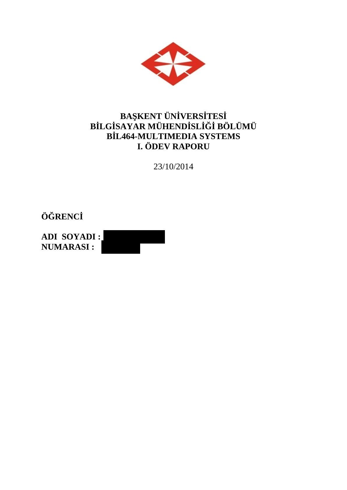

Bu yazı, **BIL464 Multimedia Systems** dersinin 1. ödevi için bir arkadaşın hazırladığı raporun içeriğidir (23 Ekim 2014); kişisel bilgiler (ad, soyad, numara) çıkarıldı. Ödev metni elimde olmadığından soruların kapsamı yanıtlardan anlaşılmaktadır. Maskelenmiş rapor sayfaları aşağıdadır; maskelenmiş PDF yazının sonunda indirilebilir.

## Yanıtlar

1. **Yenilikçi çoklu ortam uygulamaları.**
   - **Twitter**: çok geniş kitlelere hitap eder; yeniliğinin temeli kullanıcıların uygulama içinde son derece özgür olmasıdır. Fikirler, bir konuyu anlatan resim ve videolar gibi paylaşım materyallerini barındırır ve internet/multimedya uygulamaları başlığı altında sürekli güncel kalır.
   - **Mobil GPS**: bir ya da birden fazla uydu aracılığıyla ses ve görüntüyü birleştirerek yer ve zaman bilgisi sağlayan, uzay tabanlı bir uygulamadır; değişen çevre yapısına göre doğru bilgi için güncel tutulur.
   - **Instagram**: video ve resim paylaşma ortamlarında yenilikçi yapısı sayesinde çok tutulmuştur; kolaylığı ve arayüzünün düzenli yapısı beğenilmesinde önemli rol oynar.
2. **Polycom EagleEye Director**: yüz tanıma ve sesin kaynağını bulabilme özelliklerine sahip bir iletişim aracıdır; kalabalık toplantılarda bireylerin daha rahat iletişim kurmasına olanak verir (kaynak: polycom.com).
3. **Frekans ve açısal frekans.** Frekans, olayın belirli zaman aralığında kaç kez tekrarlandığının sayılıp bu aralığa bölünmesiyle bulunur; açısal frekans birim zamandaki radyan sayısıdır (ω). Soruda 10 ms'de 6 tekrar verilmiştir: f = 6 / 10 ms = 600 Hz, ω = 2πf = 2π·600 = 1200π.
   *Not: ω'nın birimi Hz değil rad/s'dir (1200π ≈ 3770 rad/s); raporda "Hz" yazılmıştır.*
4. **Nicemleme (quantization).** Sorudaki problem bir nicemleme problemidir: belirli bir aralıkta sürekli değişen analog sinyallere yeni (ayrık) değerler atanması. Analog işaret örneklenip (sampling) önceden belirlenmiş değerlere yuvarlanır; örnekler yeterli sayıda alınmazsa orijinal resimden çevrilen yeni resimde kayıplar olur.
5. **RGB'den gri tonlamaya.** Verilen denklem, RGB bir resmi gri tonlamaya çevirmek için kullanılır. Katsayıların farklı olmasının nedeni, insan gözünün renklere dalga boyu ve frekansa göre farklı duyarlılıkta olmasıdır: yeşil (G) katsayısı yüksektir çünkü göz yeşile diğer renklerden daha duyarlıdır; mavi (B) katsayısı düşüktür çünkü göz maviye daha az duyarlıdır; kırmızı (R) daha yüksek dalga boyu ve frekansa sahip olmasına rağmen algılanabilirliği diğer iki renk arasındadır.
   *Not: Klasik formül gri = 0,2989·R + 0,5870·G + 0,1140·B'dir; bu BIL437 laboratuvar föyünde de geçer. Raporda "kırmızı daha yüksek frekansa sahip" denmesi hatalıdır: kırmızının dalga boyu daha uzun, frekansı daha düşüktür.*

