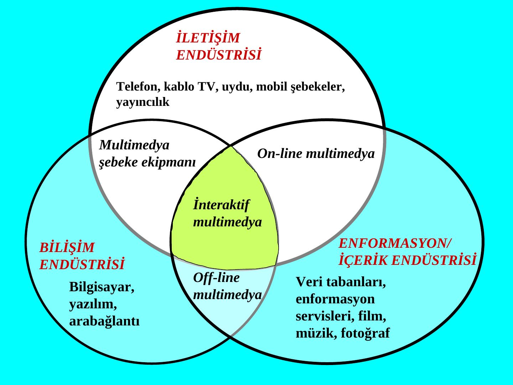
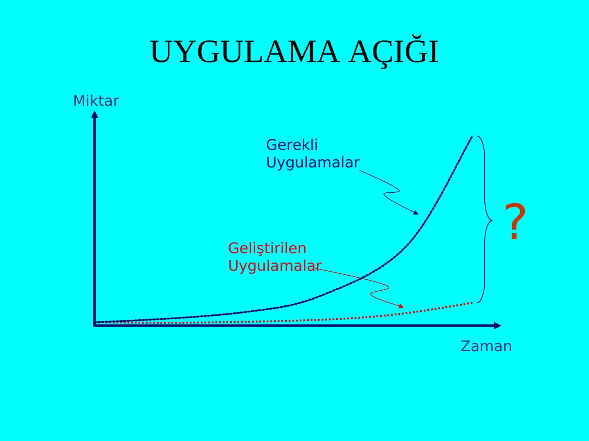

This post is the content of the second presentation shown in the **EEM101 Introduction to Electrical and Electronics Engineering** course at Başkent University in 2009. The text on the slides has been transcribed as is; the graphs have been written out as tables and descriptions. The original file of the presentation can be downloaded at the end of the post.

## Mechanization in the Middle Ages

The Middle Ages witnessed a degree of mechanization unseen in earlier eras. This was in fact one of the fundamental factors that led to the West's dominance over the whole world.

- Toward the end of the 1st century BC, Roman engineers had built a wheel that turned a millstone by means of gears set at 90 degrees. This wheel could grind 1.5 tons of corn in 10 hours.
- To grind 1.5 tons of corn with a millstone attached directly to a shaft, more than 40 slaves would work for 10 hours.
- In 1268, a paper mill with 7 wheels was in operation in the Fabriano region of Italy.

In the 13th century, great profits were made in England from fulling mills. Just as feudal lords had compelled sharecropping peasants to grind the grain they produced at the mills belonging to the manors, they also compelled them to have their cloth fulled at these mills. This had one single meaning: **monopoly**.

Corporations, dam (water weir) construction, mills turned by the energy of falling water, and tide mills were later transformed into power plants. These companies were nationalized in the early 20th century. From the early 12th century onward, harnessing wind energy came onto the agenda.

## Agriculture: horsepower, the plow, and wool

The first effects of the new energy sources and mechanization were seen in agriculture. Throughout the Middle Ages, more than 90% of Europe's population earned its living from the land.

The Romans (the Theodosian law) had forbidden a pair of horses from pulling loads heavier than 500 kg. In those times, harnesses pressed on the horse's neck, and, unable to breathe, the horse would throw its head back. The modern harness method, on the other hand, placed the force on the horse's shoulders. This method was first used in Europe in the 8th century. The first pictures depicting horses at work in the field were encountered in the 11th century. In addition, horseshoes were nailed onto horses' hooves for the first time as a widespread practice. Thus "horsepower" came into being. Nevertheless, just as in the later switch to the tractor, the transition from ox to horse in agriculture was not easy, owing both to habits and to cost concerns.

The most comprehensive change in medieval agriculture was the plow (the heavy wheeled plow), which emerged through a development that had been ongoing since the late Roman period. Small farmers, who had difficulty acquiring so many expensive machines and animals, turned to mutual aid, solidarity, and forming associations (cooperatives).

In the eyes of the medieval farmer, the sheep was more valuable than any other animal. Milk and meat aside, parchment was made from its hide (the education boom of the 12th century), and its manure was regarded as the best fertilizer. But the truly valuable thing was its wool: in the Middle Ages, Europe's foremost raw material was wool.

## Wine, stone, and iron

- The intense demand for wine in the 12th and 13th centuries was linked to the rise in the quality of life in Europe. Many of the famous vineyards in Germany and France today date from the Middle Ages.
- Stone quarrying formed the backbone of Europe's mining sector in the Middle Ages. Stone extraction in the Middle Ages was comparable to coal extraction in the 19th century and oil extraction in the 20th century.
- It can be said that the Iron Age truly began only in the Middle Ages. The importance of bronze had declined since the Roman period; every village had a blacksmith's shop.
- Furnaces in which iron ore was smelted with powerful bellows were built in the years 1320–1380.

As in agriculture, the church also played an active role in industrial technology: every monastery generally had a model factory the size of a church. The Germans had taken the lead in mining, and most of the mining terms in use were German.

In the Middle Ages, industrialization did great damage to the environment in Western Europe; extensive forest areas were destroyed. Toward the end of the 13th century, London became the first city in the world to be affected by air pollution.

## The first strikes and architect-engineers

Since the medieval employer was always striving to increase production, he had to bring his attitudes and behavior toward his workers into order. Mine workers in particular had been granted privileged rights.

- The first strike took place in 1245. By the end of the 13th century, strikes had become routine actions.
- In textiles, labor made up 60% of the cost of the goods produced.
- A master builder could buy a sheep every day with his daily earnings. For manual laborers, the situation was not so bright.
- Real master wages in the 17th century were only about half of those in the 14th century.

Among those receiving high wages was a professional group that also held other privileges: they were called **architect-engineers**. In the 13th and 14th centuries, there were none of today's professional and institutional distinctions such as structural engineering, architecture, mechanical engineering, contracting, and subcontracting. In the Middle Ages, the master builder was a true expert who knew well the operations relating to every stage of a structure.

The need for architects in the Middle Ages was so great that architects were able to impose their own terms on the employer. Medieval architect-engineers could be buried together with their wives in the courtyards of the churches they built, and praises were written on their gravestones.

Medieval people gave this profession the greatest honor that could be given, by depicting Christ in the miniatures of the 13th and 14th centuries as an architect-engineer measuring the universe with an enormous compass; much like a film today that shows God programming a computer. Medieval people were so fond of machines that they believed angels turned the wheel of the universe, which they perceived as a machine.

The mechanical clocks first built by Su Sung in China in the 11th century and by Giovanni di Dondi in Italy in the 14th century were regarded as the most advanced machines on Earth, both in their own times and over the following centuries.

## From the center to the internet: access to information

Moving from the Middle Ages to the present, the presentation compares two models of access to information. In the old model, information sources are gathered in a single **information bank or library**, and users reach the information through this center. In the internet model, on the other hand, each information source resides on its own **web server**; users and servers are connected to one another over the **internet backbone**.

| | Access to information at the center | Access to information on the internet |
|---|---|---|
| Where? | Information repositories, information banks, data processing centers | Web servers |
| Source | Cannot be obtained from the source | Obtained from the source |
| Access | Cannot be accessed remotely | Accessed remotely |
| Sharing | Generally cannot be shared | Open to sharing |
| Search | Weak search facilities | Powerful search engines |

## The four elements that made the information revolution possible

1. Increase in capacity
2. Digitization
3. Being present at every point (ubiquity)
4. Convergence

 signal and its sampled, digital counterpart.")

In the presentation, information technology and communications are first shown as two separate fields; then they intersect, and finally merge into a single field: **information/communications**.

## Convergence

**Convergence** refers to the rapid merging and fusing of a broad group of industries that were once separate. In the presentation, three industries and their intersections are shown as follows:

- **Communications industry:** telephone, cable TV, satellite, mobile networks, broadcasting
- **Information technology industry:** computers, software, interconnection
- **Information/content industry:** databases, information services, film, music, photography
- At the intersections: multimedia network equipment, on-line multimedia, off-line multimedia; at the center of the three, **interactive multimedia**

**ATM network carrying all traffic types:** The network carries data, voice, and video with fixed-length cells; the end devices convert these data back into their original form at the source.

**Multi-service capability:** voice, fax, internet, e-mail, WWW, video, intranet, e-commerce, home shopping, telebanking.

**Convergence in devices and equipment:** In our daily lives we carry and use many devices and tools. In the future, most of these will find their functionality in a single product.

"Convergence" is a phenomenon being experienced collectively along many lines:

1. In content
2. In technologies
3. In sectors
4. In services
5. In networks
6. In devices
7. In market structure and forms of delivery
8. In the manufacturer–operator–user triangle
9. In legislation

**The internet: the technology convergence point.** Information technology (computers, software, on-line information), telecom (transport, cable/distribution), consumer electronics, and traditional media (entertainment, broadcasting) meet on the internet. The English note in the presentation likewise says: *"Many businesses are being drawn together via the Internet. The growth of the internet applications, use and the global coverage of the operations make for a common platform to pull together industries."*

## Traffic carried on the European backbone

The presentation gives the distribution of traffic carried on the European backbone for three years. Source: European Telecom Newsletter, October 1998; the 2002 and 2005 values are therefore forecasts made at that date.

| Year | Voice | Other data | Internet |
|---|---|---|---|
| 1997 | 90% | 10% | – |
| 2002 | 48% | 36% | 16% |
| 2005 | 11% | 27% | 62% |

 traffic declines while IP (data/voice/video) traffic grows.")

As a result of this transformation, communication takes on a structure that begins with message exchange and rises through e-banking, e-business, and e-commerce toward **e-everything**.

**Global access, global market:** A photograph in the presentation shows this strikingly: Jerusalem, December 1998. Shimon Biton holds his cell phone against the Wailing Wall so that a relative in France can take part in the prayer. (Photo: Menahem Kahana, Agence France-Presse)

## Technology, market, and change

.")

The **technology-driven business development process** (Gartner Group) passes through five stages: technology trigger, peak of inflated expectations, trough of disillusionment, slope of enlightenment, and plateau of productivity.

The presentation describes technology and the market through two loops that feed each other: *purpose-driven technology* and *market-driven technology*, *advancing technology* and *growing market*. And immediately afterward it reminds us: **Technology is not everything!**

**Drivers in our changing world:** competition, technology, regulation, and customers. While the global communications industry is on the one hand becoming the heart of an economic and cultural revolution, on the other it is itself undergoing a sharp process of transformation.

- **Increasing variability:** Yesterday, the future was a linear extension of the past. Today, the future is an unpredictable extension of the past.
- **Shrinking marketing process:** By keeping the time perspective short, the model can be made to contain facts. Excessive uncertainty prevents the future from being included in the model.
- **Continuing creativity:** The shortened model window and continuing renewals extend the total life of the application.

**Driving forces in the market:** efficiency, mobile workforce, communications, compatibility, portability, e-commerce, information, and e-business.

## The driving force of the global market: information

Throughout history, people have needed information and wanted to obtain it; but they made do with what was offered and could not be selective. Modern people, however, want to access the information they are looking for whenever they need it, from whatever location they are in, and to be selective.

While digitization paved the way for the **mobile information society** and for a richness of applications, the internet provided the ability to access them from anywhere and to be mobile.

In the presentation, this is followed by two examples of "creativity in design"; then comes the **application gap**: over time, the number of required applications increases rapidly while the applications developed lag far behind. And a note: every application needs to be supported by hardware suited to that application.

## Management, time, and the system

The last part of the presentation moves on to management and time, in the words of Nevin Oktay.

> What we suffer from, we suffer from managers who have "ideas without knowledge." The prerequisite for a manager: KNOWLEDGE! And what comes after?..

**Time traps:**

- Lack of planning
- Being unable to determine and rank priorities
- Procrastination
- Devoting oneself to work more than necessary
- Haste
- Red tape and inefficient reading

Lack of planning and lack of time feed each other in a vicious circle. **Procrastination**, on the other hand, is a bad habit that keeps us from dealing with truly important and vital work, prevents success in every field, and does hidden damage in secret.

### System! System! System!

The answer to the question "When will these things get better?" is this: When today's human-centered world turns into a system-centered world...

Let us not be fooled when we look at the works humankind has produced (knowledge, technology, institutions, culture, art, etc.). The human being as an individual has changed and developed very little over thousands of years. The evolutionary development process of a person is limited by their biological lifespan; their nature cannot go beyond the genetic patterns belonging to humans. This process works separately for each person, starting from zero.

Over time, what continuously rises and develops by building on the previous one is not the individual, but the environment humankind has created and the works it has created within that environment. Every individual contributes to this rise. In the presentation, this difference is explained with a staircase: while social development rises step by step, individual development starts over from the beginning each time.

The functionality of the aforementioned works in life is ensured by the systems that are established. The less the weight of the individual (the human) within a system, the more error-free, lasting, and open to development that system will be. Hence a manager's fundamental duty is to create systems that make use of all modern facilities, and to take care to continuously reduce the weight of individuals, beginning with themselves, within these systems.

> Wanting is necessary to succeed; but to finish, one must begin.

## Closing words

In this process of dizzying transformations and developments, we need to learn to live with the greatest technological anarchy imaginable and to be able to achieve **"Unity in Diversity."**
