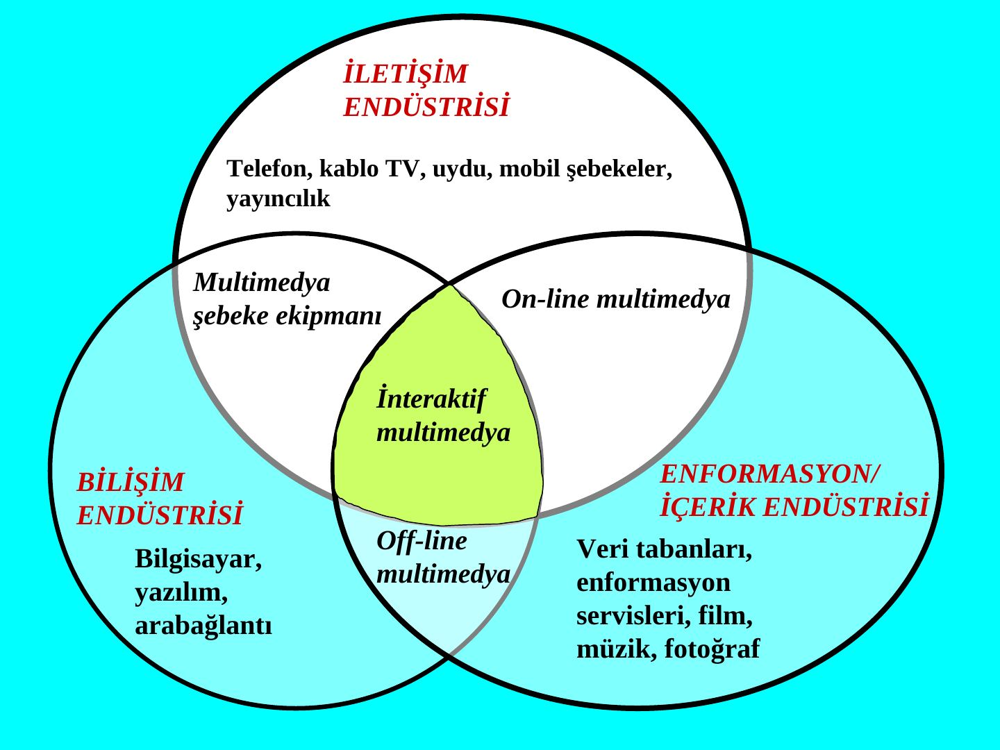
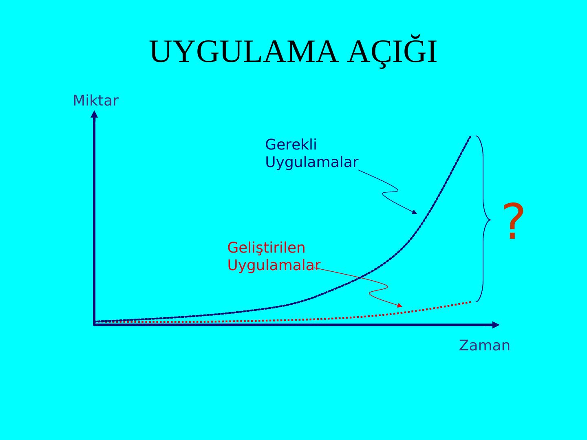

Bu yazı, Başkent Üniversitesi'nde 2009 yılında **EEM101 Elektrik-Elektronik Mühendisliğine Giriş** dersinde gösterilen ikinci sunumun içeriğidir. Slaytlardaki metinler olduğu gibi aktarıldı; grafikler tablo ve açıklama olarak yazıya döküldü. Sunumun orijinal dosyası yazının sonunda indirilebilir.

## Ortaçağda makineleşme

Ortaçağ, önceki çağlarda görülmedik derecede makineleşmeye tanık olmuştur. Batı'nın tüm dünya üzerinde egemenlik kurmasına yol açan temel etmenlerden birisi aslında buydu.

- M.Ö. 1. yüzyılın sonlarına doğru, Romalı mühendisler 90 derece konumlu dişliler yardımıyla değirmen taşını döndürecek bir çark yapmışlardı. Bu çark 10 saatte 1,5 ton mısır öğütebiliyordu.
- 1,5 ton mısırı doğrudan şafta bağlı değirmen taşı ile öğütebilmek için 40'ın üzerinde köle 10 saat çalışırdı.
- 1268'de İtalya'nın Fabriano yöresinde 7 adet çarklı kâğıt fabrikası işler durumdaydı.

13. yüzyılda İngiltere'de çırpma fabrikalarından büyük kazançlar sağlanıyordu. Feodal beyler, nasıl yarıcı köylülere ürettikleri tahılı beyliklere ait değirmenlerde öğütme zorunluluğu getirmişlerse, kumaşlarını da yine bu fabrikalarda çırpmalarını zorunlu kılıyorlardı. Bunun tek bir anlamı vardı: **tekelcilik**.

Şirketleşmeler, baraj (su bendi) inşaatları, düşen su enerjisi ile dönen değirmenler ve gelgit değirmenleri sonradan enerji santrallerine dönüştü. Bu şirketler 20. yüzyıl başlarında kamulaştırıldı. 12. yüzyıl başlarından itibaren rüzgâr enerjisinden yararlanma gündeme geldi.

## Tarım: beygirgücü, pulluk ve yün

Yeni enerji kaynaklarının ve makineleşmenin ilk etkileri tarım alanında görüldü. Ortaçağ boyunca Avrupa nüfusunun %90'ından çoğu geçimini topraktan sağlıyordu.

Romalılar (Theodosius yasası) bir çift atın 500 kg'dan ağır yük çekmesini yasaklamışlardı. O dönemlerde koşumlar atın boynuna baskı yapıyor, at hava alamayınca başını geriye atıyordu. Modern koşum yöntemi ise kuvveti atın omuzlarına bindirmekti. Bu yöntem Avrupa'da ilk kez 8. yüzyılda kullanıldı. Atları tarlada çalışır konumda betimleyen ilk resimlere 11. yüzyılda rastlandı. Ayrıca atların ayağına ilk kez yaygın bir uygulama ile nal çakıldı. Böylece "beygirgücü" ortaya çıkmış oldu. Bununla birlikte, tıpkı traktöre geçişte olduğu gibi, tarımda öküzden ata geçiş de gerek alışkanlıklar gerekse maliyet endişeleri nedeniyle kolay olmadı.

Ortaçağ tarımındaki en kapsamlı değişiklik, geç Roma döneminden beri süregelen bir gelişimle ortaya çıkan pulluk (ağır tekerlekli sapan) oldu. Bunca pahalı makine ve hayvanı edinmekte güçlük çeken küçük çiftçiler yardımlaşma, dayanışma ve birlikler (kooperatifler) oluşturmaya yöneldiler.

Ortaçağ çiftçisinin gözünde koyun, başka herhangi bir hayvandan daha değerliydi. Sütü, eti bir yana, derisinden parşömen kâğıdı yapılıyor (12. yüzyıldaki eğitim patlaması), gübresi en iyi gübre sayılıyordu. Ama asıl değerli olan şey yünüydü: Ortaçağda Avrupa'nın başta gelen hammaddesi yündü.

## Şarap, taş ve demir

- 12. ve 13. yüzyıllarda şaraba olan yoğun istek, Avrupa'da yaşam kalitesinin yükselmesiyle ilintiliydi. Bugün Almanya ve Fransa'daki ünlü bağların pek çoğu Ortaçağdan kalmadır.
- Ortaçağda Avrupa madencilik sektörünün bel kemiğini taşçılık oluşturuyordu. Ortaçağdaki taş işletmeciliği, 19. yüzyıldaki kömür ve 20. yüzyıldaki petrol işletmeciliği ile kıyaslanabilir durumdaydı.
- Demir çağının gerçekte ancak Ortaçağda başladığı söylenebilir. Bronzun Roma dönemindeki önemi azalmıştı; her köyde bir demirhane vardı.
- Güçlü körüklerle demir cevherinin eritildiği fırınlar 1320–1380 yıllarında yapıldı.

Tarımda olduğu gibi endüstriyel teknolojide de kilise aktif rol aldı: her manastırın genellikle kilise büyüklüğünde bir model fabrikası vardı. Almanlar madencilikte başı çekmişlerdi ve kullanılan madencilik terimlerinin çoğu Almancaydı.

Ortaçağda endüstrileşme Batı Avrupa'da çevreye çok zarar verdi; geniş orman alanları yok edildi. 13. yüzyıl sonlarına doğru Londra, dünyada hava kirliliğinden etkilenen ilk kent oldu.

## İlk grevler ve mimar-mühendisler

Ortaçağ işvereni hep üretimi artırma çabası içinde olduğundan, işçisine yönelik tutum ve davranışlarına çeki düzen vermesi gerekti. Özellikle maden işçilerine ayrıcalıklı haklar verilmişti.

- İlk grev 1245'te yapıldı. 13. yüzyılın sonlarında grevler olağan eylemler hâline gelmişti.
- Tekstilde üretilen malın maliyetinin %60'ını işçilik oluşturuyordu.
- Bir yapı ustası günlük kazancıyla her gün bir koyun alabilirdi. Kol işçileri için durum öyle parlak değildi.
- 17. yüzyıldaki reel usta ücretleri, 14. yüzyıldakilerin ancak yarısı kadardı.

Yüksek ücret alanlar arasında başka ayrıcalıklara da sahip olan bir meslek grubu yer alıyordu: bunlara **mimar-mühendis** deniliyordu. 13. ve 14. yüzyıllarda, günümüzdeki yapı mühendisliği, mimarlık, makine mühendisliği, yüklenicilik, taşeronluk gibi mesleki ve kurumsal ayrımlar yoktu. Ortaçağda yapı ustabaşısı, yapının her aşamasına ilişkin işlemleri iyi bilen gerçek bir uzmandı.

Ortaçağda mimarlara olan ihtiyaç öylesine fazlaydı ki mimarlar kendi koşullarını işverene kabul ettirebiliyorlardı. Ortaçağ mimar-mühendisleri, inşa ettikleri kiliselerin avlusuna eşleriyle birlikte gömülebilir, mezar taşlarına övgüler yazılırdı.

Ortaçağ insanı, 13. ve 14. yüzyıl minyatürlerinde İsa'yı elinde kocaman bir pergelle evreni ölçmekte olan bir mimar-mühendis olarak betimleyerek bu mesleğe verilebilecek en büyük onuru vermiştir; tıpkı günümüzde Tanrı'yı bir bilgisayarı programlarken gösteren bir filmde olduğu gibi. Ortaçağ insanı makinelere öylesine düşkündü ki, bir makine gibi algıladığı evrenin çarkını meleklerin döndürdüğüne inanıyordu.

Su Sung'un 11. yüzyılda Çin'de, Giovanni di Dondi'nin 14. yüzyılda İtalya'da ilk kez yaptıkları mekanik saatler, gerek kendi dönemlerinde gerekse sonraki yüzyıllar boyunca yeryüzündeki en gelişmiş makineler olarak kabul edildi.

## Merkezden internete: bilgiye erişim

Sunum, Ortaçağdan bugüne geçerken bilgiye erişimin iki modelini karşılaştırıyor. Eski modelde bilgi kaynakları tek bir **bilgi bankasında ya da kütüphanede** toplanır, kullanıcılar bilgiye bu merkez üzerinden ulaşır. İnternet modelinde ise her bilgi kaynağı kendi **web sunucusunda** durur; kullanıcılar ve sunucular **internet omurgası** üzerinden birbirine bağlanır.

| | Merkezdeki bilgiye erişim | İnternetteki bilgiye erişim |
|---|---|---|
| Nerede? | Bilgi depoları, bilgi bankaları, bilgi işlem merkezleri | Web sunucuları |
| Kaynak | Kaynağından alınamaz | Kaynağından alınır |
| Erişim | Uzaktan erişilemez | Uzaktan erişilir |
| Paylaşım | Genellikle paylaşılamaz | Paylaşıma açıktır |
| Arama | Güçlü olmayan arama olanakları | Güçlü arama motorları |

## Bilgi devrimini olanaklı kılan dört öge

1. Kapasite artışı
2. Sayısallaşma
3. Her noktada bulunur olma (ubiquity)
4. Yakınsama (convergence)

 sinyal ve onun örneklenmiş, sayısal karşılığı.")

Bilişim ve iletişim, sunumda önce iki ayrı alan olarak gösteriliyor; ardından kesişiyor ve sonunda tek bir alanda birleşiyor: **bilişim/iletişim**.

## Yakınsama

**Yakınsama (convergence)**, bir zamanlar ayrı ayrı olan geniş bir endüstri grubunun hızla birleşip kaynaşmasını ifade eder. Sunumda üç endüstri ve kesişimleri şöyle gösteriliyor:

- **İletişim endüstrisi:** telefon, kablo TV, uydu, mobil şebekeler, yayıncılık
- **Bilişim endüstrisi:** bilgisayar, yazılım, ara bağlantı
- **Enformasyon/içerik endüstrisi:** veri tabanları, enformasyon servisleri, film, müzik, fotoğraf
- Kesişimlerde: multimedya şebeke ekipmanı, on-line multimedya, off-line multimedya; üçünün ortasında **interaktif multimedya**

**Tüm trafik tiplerini taşıyan ATM şebekesi:** Şebeke veri, ses ve video verilerini sabit uzunluklu hücrelerle taşır; uç cihazlar bu verileri kaynaktaki kalıbına geri çevirir.

**Çoklu servis özelliği:** ses, faks, internet, e-posta, WWW, video, intranet, e-ticaret, evden alışveriş, telebanka.

**Araç-gereçlerde yakınsama:** Günlük yaşamımızda pek çok araç-gereç taşır ve kullanırız. Bu araç-gereçlerin çoğu gelecekte tek bir üründe işlevsellik bulacak.

"Yakınsama" pek çok çizgide topluca yaşanan bir olgudur:

1. İçeriklerde
2. Teknolojilerde
3. Sektörlerde
4. Servislerde
5. Şebekelerde
6. Gereçlerde
7. Pazar yapısı ve sunum biçimlerinde
8. Üretici-operatör-kullanıcı üçgeninde
9. Mevzuatta

**İnternet: teknoloji yakınsama noktası.** Bilgi teknolojisi (bilgisayar, yazılım, on-line bilgi), telekom (transport, kablo/dağıtım), tüketici elektroniği ve geleneksel medya (eğlence, yayıncılık) internette buluşur. Sunumdaki İngilizce notta da şöyle deniyor: *"Many businesses are being drawn together via the Internet. The growth of the internet applications, use and the global coverage of the operations make for a common platform to pull together industries."*

## Avrupa omurgasında iletilen trafik

Sunum, Avrupa omurgasında taşınan trafiğin dağılımını üç yıl için veriyor. Kaynak: European Telecom Newsletter, Ekim 1998; dolayısıyla 2002 ve 2005 değerleri o tarihteki öngörülerdir.

| Yıl | Ses | Diğer veri | İnternet |
|---|---|---|---|
| 1997 | %90 | %10 | – |
| 2002 | %48 | %36 | %16 |
| 2005 | %11 | %27 | %62 |

 trafiği azalırken IP (veri/ses/video) trafiği büyüyor.")

Bu dönüşümün sonucunda iletişim, mesaj alışverişinden başlayıp e-bankacılık, e-iş ve e-ticaret üzerinden **e-herşey**e doğru yükselen bir yapı kazanıyor.

**Global erişim, global pazar:** Sunumdaki bir fotoğraf bunu çarpıcı biçimde gösteriyor: Kudüs, Aralık 1998. Shimon Biton cep telefonunu Ağlama Duvarı'na dayayarak Fransa'daki yakınının duaya katılmasını sağlıyor. (Fotoğraf: Menahem Kahana, Agence France-Presse)

## Teknoloji, pazar ve değişim

.")

**Teknoloji güdümlü iş geliştirme süreci** (Gartner Group) beş aşamadan geçer: teknoloji tetiklemesi, aşırı beklentiler doruğu, düş kırıklığı çukuru, gerçeğe tırmanış ve verimli üretim platosu.

Sunum, teknoloji ile pazarı birbirini besleyen iki döngüyle anlatıyor: *amaç güdümlü teknoloji* ile *pazar güdümlü teknoloji*, *ilerleyen teknoloji* ile *büyüyen pazar*. Ve hemen ardından hatırlatıyor: **Teknoloji her şey değildir!**

**Değişen dünyamızdaki sürücüler:** rekabet, teknoloji, regülasyon ve müşteriler. Küresel iletişim endüstrisi bir yandan ekonomik ve kültürel devrimin kalbi konumuna gelirken, diğer yandan bizzat kendisi keskin bir dönüşüm süreci yaşamaktadır.

- **Artan değişkenlik:** Dün, gelecek geçmişin doğrusal bir uzantısıydı. Bugün ise gelecek, geçmişin öngörülemeyen bir uzantısıdır.
- **Küçülen pazarlama süreci:** Zaman perspektifi küçük tutularak modelin gerçekleri içermesi sağlanabilir. Belirsizlikteki aşırılık, geleceğin model içinde yer almasını engellemektedir.
- **Sürüp giden yaratıcılık:** Küçültülen model penceresi ve sürüp giden yenilemeler, uygulamanın toplam ömrünü uzatır.

**Pazardaki sürücü güçler:** verimlilik, mobil işgücü, iletişim, uyumluluk, taşınabilirlik, e-ticaret, bilgi ve e-iş.

## Küresel pazarın itici gücü: bilgi

Tarih boyunca insan bilgiye gereksinim duydu ve bilgi edinmek istedi; ancak sunulanla yetindi, seçici olamadı. Oysa çağdaş insan aradığı bilgiye her gereksinim duyduğu an, içinde bulunduğu her konumdan erişebilmek ve seçici olmak istiyor.

Sayısallaşma, **mobil bilgi toplumunun** ve uygulama zenginliğinin yolunu açarken, internet bunlara her yerden erişebilirlik ve hareketlilik yeteneği sağladı.

Sunumda bunu iki "tasarımda yaratıcılık" örneği izliyor; ardından **uygulama açığı** geliyor: zaman içinde gerekli uygulamaların sayısı hızla artarken geliştirilen uygulamalar onun çok gerisinde kalıyor. Ve bir not: her uygulamanın, o uygulamaya uygun donanımla desteklenmesi gerekir.

## Yönetim, zaman ve sistem

Sunumun son bölümü Nevin Oktay'ın sözleriyle yönetime ve zamana geçiyor.

> Ne çekiyorsak, "bilgisi olmadan fikri olan" yöneticilerden çekiyoruz. Bir yönetici için ön koşul: BİLGİ! Ya sonrası?..

**Zaman tuzakları:**

- Plansızlık
- Öncelikleri belirleyememek ve sıralayamamak
- Ertelemek
- Kendini gereğinden fazla işe adamak
- Acelecilik
- Kırtasiyecilik ve verimsiz okuma

Plansızlık ile zaman yetersizliği birbirini besleyen bir kısır döngüdür. **Ertelemek** ise gerçekten önemli ve yaşamsal işlerle uğraşmaktan alıkoyan, her alanda başarıyı önleyen, gizli gizli zararlar veren kötü bir alışkanlıktır.

### Sistem! Sistem! Sistem!

"Bu işler ne zaman düzelecek?" sorusunun yanıtı şudur: Bugünün insan ağırlıklı dünyası, sistem ağırlıklı bir dünyaya dönüştüğü zaman...

İnsanoğlunun ürettiği eserlere (bilgi, teknoloji, kurum, kültür, sanat vb.) bakıp da yanılmayalım. Birey olarak insan binlerce yıldır çok az değişmiş ve gelişmiştir. Bir insanın evrimsel gelişim süreci biyolojik ömrüyle sınırlıdır; doğası ise insana ait genetik kalıpların ötesine geçemez. Bu süreç her insan için sıfırdan başlayarak ayrı ayrı işler.

Zaman içinde, bir öncekinin üzerine inşa olarak sürekli biçimde yükselen ve gelişen şey birey değil, insanoğlunun yarattığı çevre ve o çevre içinde yarattığı eserlerdir. Bu yükselişe her birey katkıda bulunur. Sunumda bu fark bir merdivenle anlatılıyor: toplumsal gelişim basamak basamak yükselirken bireysel gelişim her seferinde baştan başlıyor.

Sözü edilen eserlerin yaşam içindeki işlevselliği, oluşturulan sistemlerle sağlanır. Sistem içinde bireyin (insanın) ağırlığı ne denli az olursa, o sistem de o denli hatasız, kalıcı ve gelişime açık olacaktır. O hâlde bir yöneticinin temel görevi, tüm çağdaş olanaklardan yararlanan sistemler oluşturmak ve başta kendisi olmak üzere bireylerin bu sistemler içindeki ağırlıklarını sürekli bir biçimde azaltmaya özen göstermektir.

> İstemek, başarmak için gereklidir; ama bitirmek için başlamak gerekir.

## Son söz

Bu baş döndürücü dönüşümler ve gelişimler sürecinde, düşünülebilecek en büyük teknolojik anarşiyle yaşamayı öğrenmemiz ve **"Farklılıklar İçinde Bütünselliği"** (Unity in Diversity) yakalayabilmemiz gerekmektedir.
