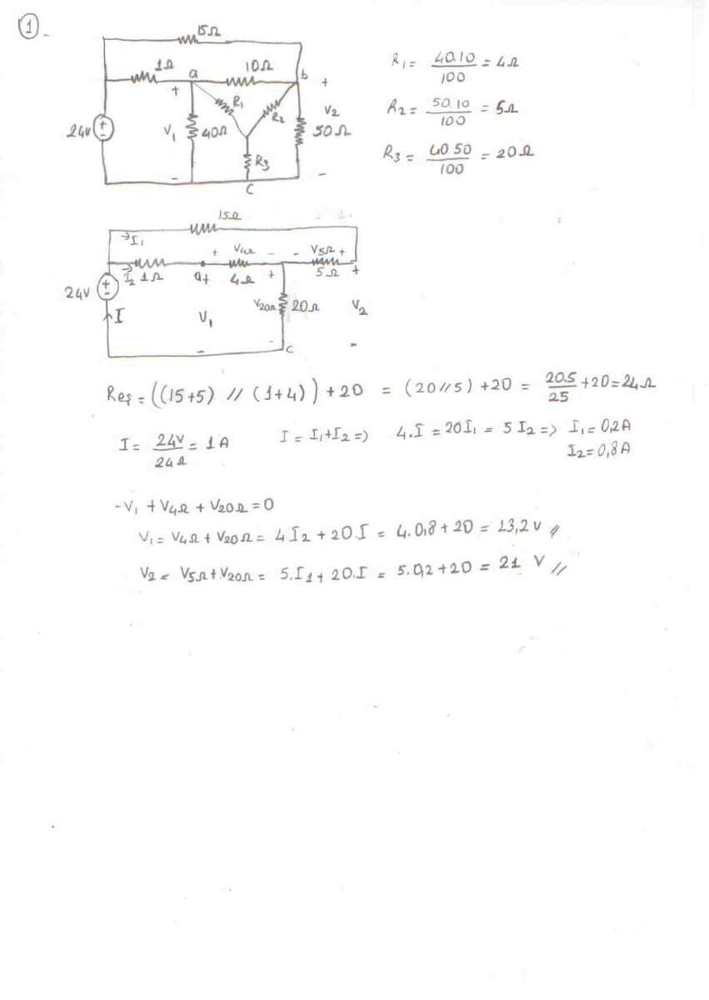
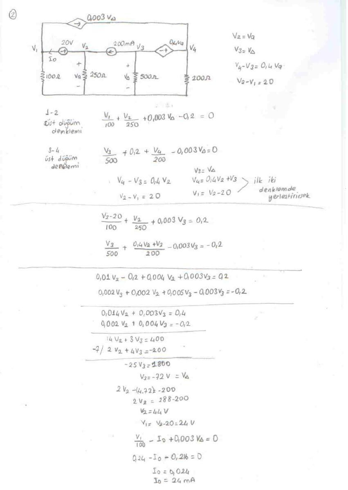
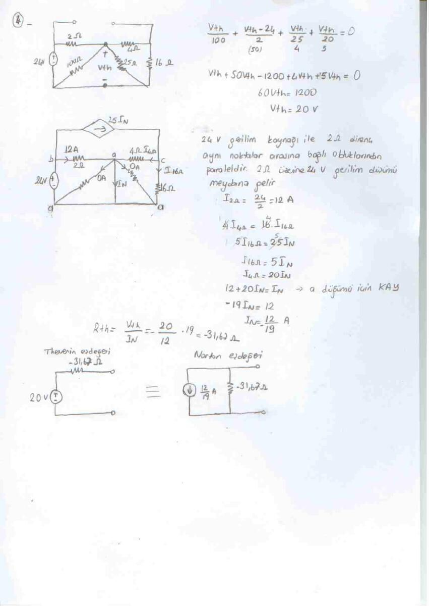
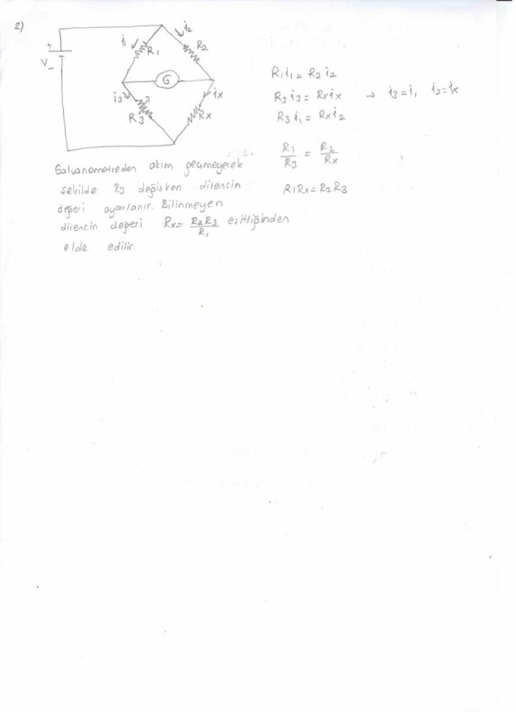
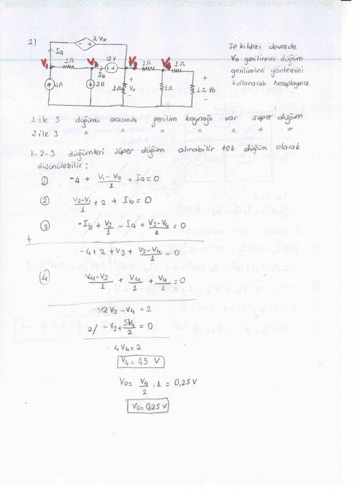
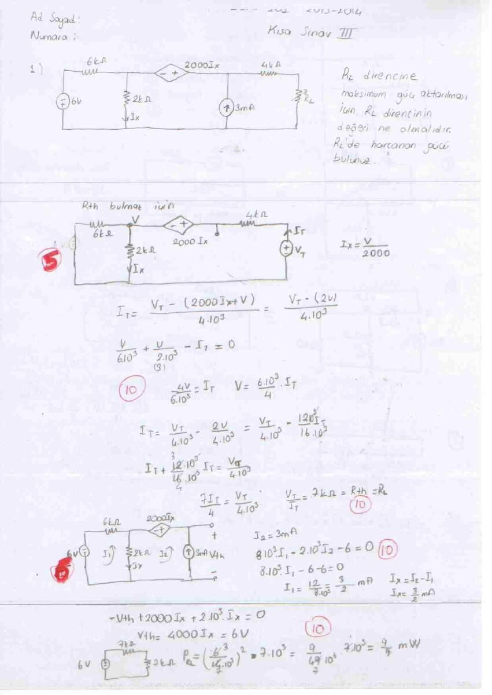
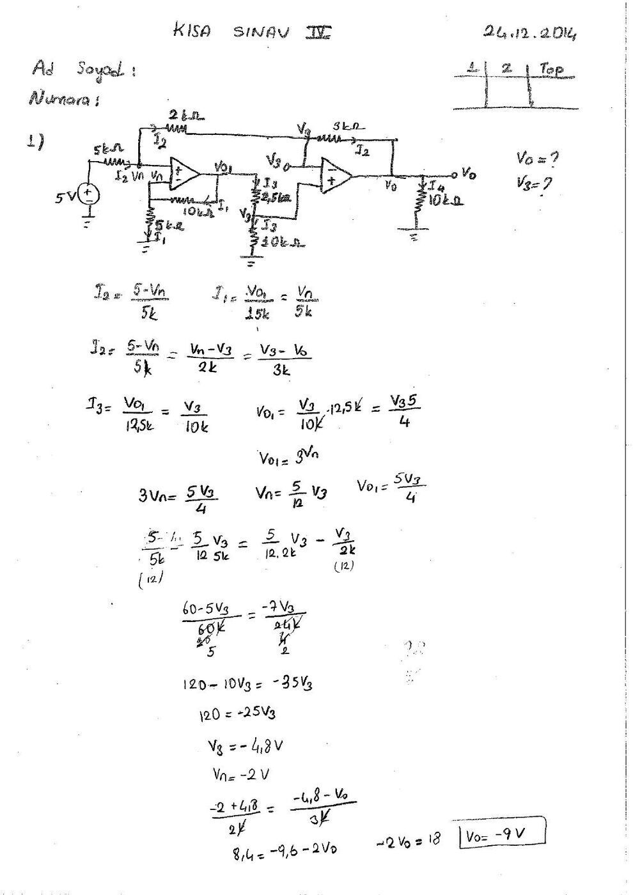
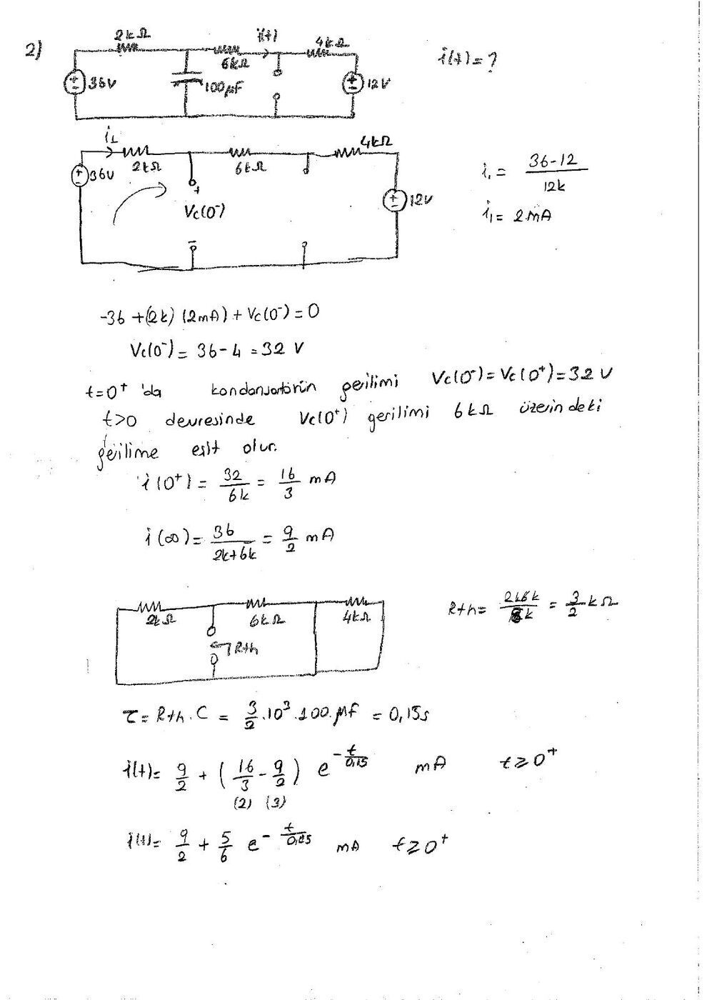

This group of **EEM201 Circuit Theory I** solutions, stored in the EEM202 folder, contains the quizzes from the 2013–2014 and 2014–2015 fall semesters along with a four-page midterm exam solution. The EEM201 code is written explicitly in the Quiz II heading; the other pages belong to the same DC circuit solution group. The handwritten solutions were prepared by a friend, and their ID fields are blank; the name of the unnamed solver has not been added to the text. Quiz IV is dated 24 December 2014; the file date of the other scans is 21 January 2015. PDFs prepared with neutral names can be downloaded as a ZIP at the end of the post.

## Midterm Exam: Resistance Transformation and Dependent Sources

### Solution of the Resistor Network

Wye equivalents of the delta formed by 40 Ω, 10 Ω, and 50 Ω:

- R₁ = 40·10/100 = **4 Ω**
- R₂ = 10·50/100 = **5 Ω**
- R₃ = 40·50/100 = **20 Ω**

The equivalent resistance seen by the source is **R_eq = (15 + 5) ∥ (1 + 4) + 20 = 24 Ω**, and the current of the 24 V source is **I = 1 A**. By current division, I₁ = 0.2 A and I₂ = 0.8 A. The handwritten results are **V₁ = 23.2 V** and **V₂ = 21 V**.

### Node Voltages

In the circuit with dependent sources, the relations V₂ = Vₐ, V₃ = VΔ, V₄ − V₃ = 0.4Vₐ, and V₂ − V₁ = 20 are used. Supernode equations:

- 14V₂ + 3V₃ = 400
- 2V₂ + 4V₃ = −200

From these, **V₃ = VΔ = −72 V**, **V₂ = Vₐ = 44 V**, and **V₁ = 24 V**. The current calculation is 0.24 − I₀ − 0.216 = 0; **I₀ = 24 mA**.

### Mesh Currents

For the 2 mA current source, I₂ = 2 mA. Because of the dependent source, I₃ = 2Iₓ and Iₓ = I₂ − I₁. The mesh equation is 6 + 3·10³I₁ − 2·10³I₂ − 10³I₃ = 0. Substituting gives **I₁ = 0.4 mA**; the requested branch current is **I₀ = I₃ − I₁ = 2.8 mA**.

### Thevenin and Norton

With the load open, the node solution gives **V_Th = 20 V**. Source transformations are carried out for the Norton current; **I_N = 12/19 A**, **R_Th = 95/3 Ω ≈ 31.66 Ω**.

## Resistive Circuit and Wheatstone Bridge

In the separate two-page solution, the voltage produced by the 0.5 mA current in the 6 kΩ branch is **3 V**. From the current division in the circuit, **V₀ = 36 V** was found, and the power of the source is **P = −108 mW**.

In the Wheatstone bridge, if the galvanometer current is zero, the bridge is balanced. With the labeling in the drawing, R₁i₁ = R₂i₂ and R₃i₁ = Rₓi₂; hence **R₁/R₃ = R₂/Rₓ**, **Rₓ = R₂R₃/R₁**.

## Quiz II: Mesh and Node Methods

In the first problem, Iₓ is requested using the mesh current method. I₁ = 2 mA, I₂ = Iₓ, and I₃ − I₂ = 2 mA. The equations reduce to **3·10³ I₃ = 8**:

**Iₓ = I₃ − 2 mA = (8/3 − 2) mA = 2/3 mA.**

In the second problem, a supernode is set up for the two nodes connected by a voltage source. In the handwritten solution, **V₂ = 0.5 V**, and from the resistor divider **V₀ = V₂/2 = 0.25 V**.

## Quiz III: Maximum Power and Superposition

In the calculation with a test source applied while keeping the dependent source, **R_Th = 7 kΩ** was found. For maximum power, R_L = 7 kΩ was chosen; the open-circuit voltage is **V_Th = 6 V**, and the load power is given as **9/7 mW**.

In the second problem, the contributions of the 6 mA, 3 mA, and 12 V sources are calculated separately. The results in the handwritten solution are **I₀′ = 0**, **I₀″ = 4/5 mA**, **I₀‴ = −6/5 mA**. The total is **I₀ = −2/5 mA**.

## Quiz IV: Two Op-Amps and RC Transient

### Op-Amp Circuit

There is a 5 V source, a 5 kΩ input resistor, 2 kΩ and 3 kΩ connection resistors, and two op-amps. In the first stage, V_o1 = 3V_n; from the divider of the second stage, V_o1 = 5V₃/4. Therefore V_n = 5V₃/12.

The equation (5 − V_n)/5k = (V_n − V₃)/2k gives **V₃ = −4.8 V**, **V_n = −2 V**. In the last connection, (V_n − V₃)/2k = (V₃ − V_o)/3k; from this, **V_o = −9 V**.

### RC Circuit

There are 36 V and 12 V sources, series 2 kΩ, 6 kΩ, and 4 kΩ resistors, and a 100 µF capacitor. In the steady state before the switch changes:

- i₁ = (36 − 12)/12k = 2 mA
- V_C(0⁻) = 36 − 2k·2 mA = **32 V**
- V_C(0⁺) = V_C(0⁻)
- i(0⁺) = 32/6k = **16/3 mA**
- i(∞) = 36/(2k + 6k) = **9/2 mA**
- R_Th = 2k ∥ 6k = **1.5 kΩ**; τ = R_Th C = **0.15 s**.

**i(t) = 9/2 + (5/6)e^(−t/0.15) mA**, t ≥ 0.

*Note: This last expression gives 16/3 mA initially and 9/2 mA at infinite time. It is consistent with the initial and final values of the handwritten solution.*
