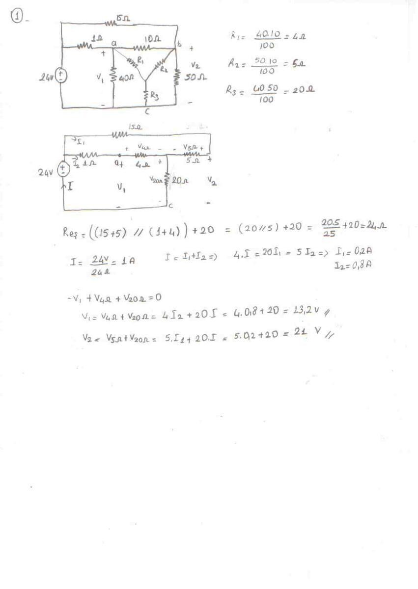
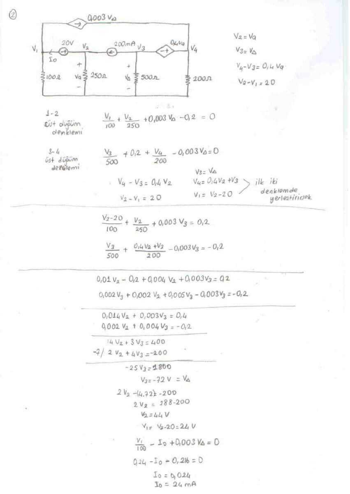
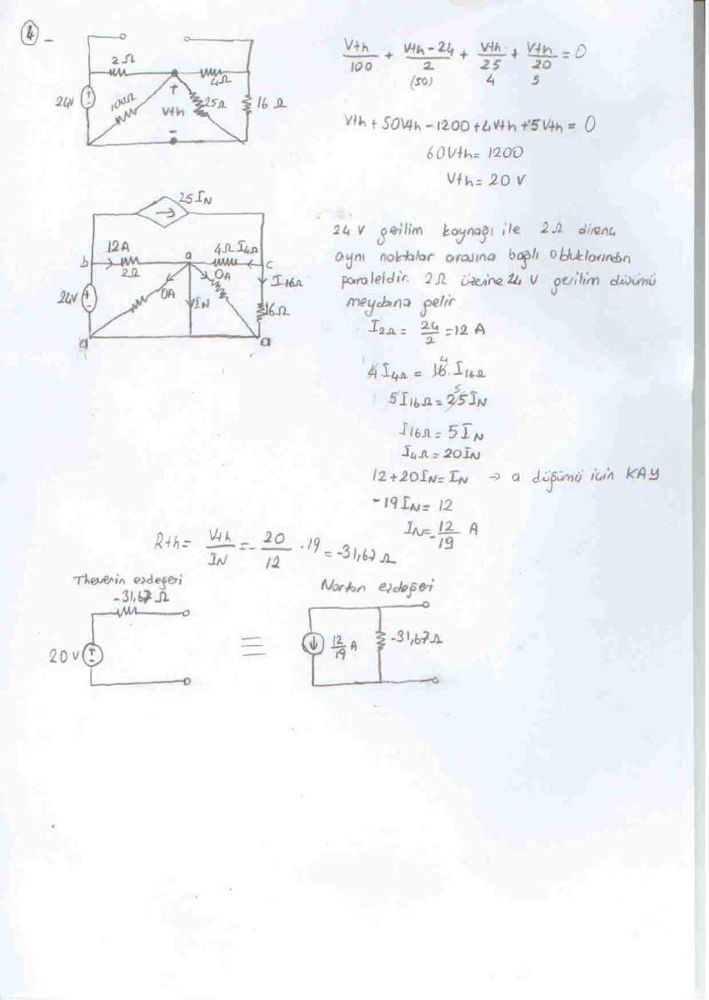
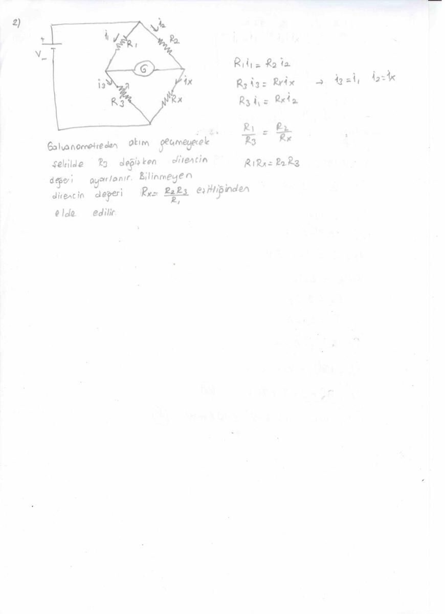
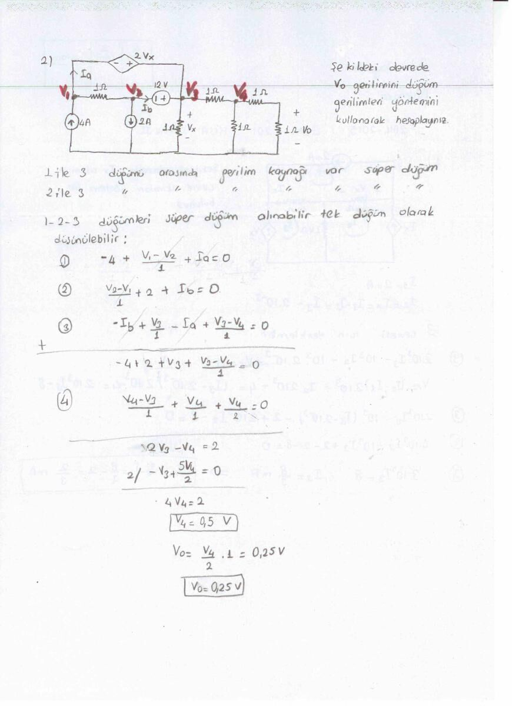
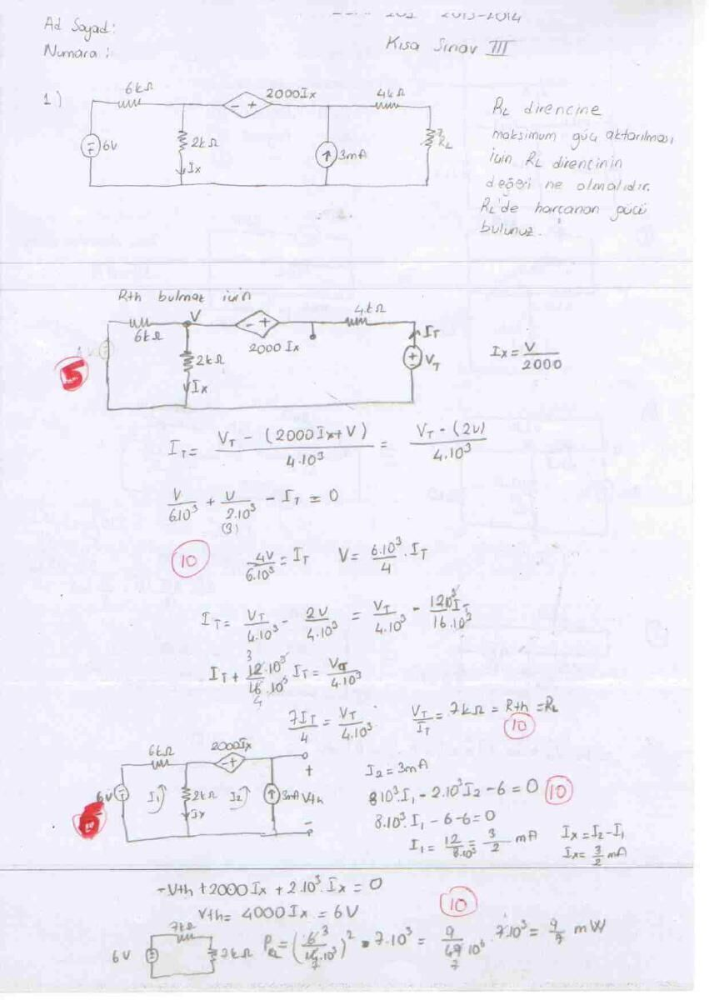
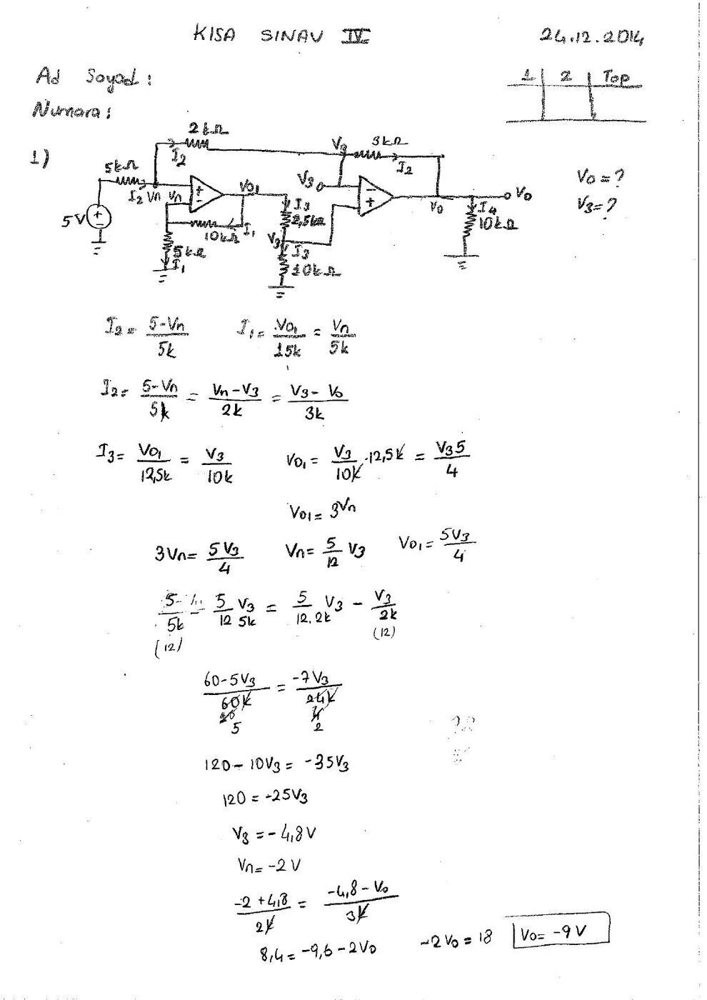
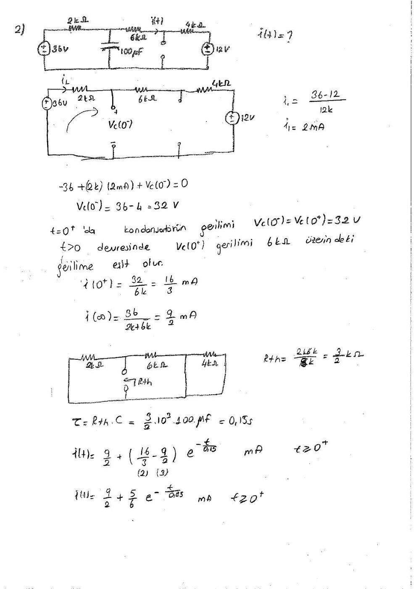

EEM202 klasöründe saklanan bu **EEM201 Devre Teorisi I** çözüm grubu, 2013–2014 ve 2014–2015 güz dönemlerinin kısa sınavları ile dört sayfalık ara sınav çözümünü içeriyor. Kısa Sınav II başlığında EEM201 kodu açıkça yazılıdır; diğer sayfalar aynı DC devre çözüm grubundadır. Bir arkadaşın hazırladığı el yazısı çözümlerdeki kimlik alanları boş; adı belirtilmeyen çözücünün adı yazıya eklenmedi. Kısa Sınav IV 24 Aralık 2014 tarihlidir; diğer taramaların dosya tarihi 21 Ocak 2015'tir. Nötr adlarla hazırlanmış PDF'ler yazının sonunda ZIP olarak indirilebilir.

## Ara sınav: direnç dönüşümü ve bağımlı kaynaklar

### Direnç ağının çözümü

40 Ω, 10 Ω ve 50 Ω üçgeninin yıldız karşılıkları:

- R₁ = 40·10/100 = **4 Ω**
- R₂ = 10·50/100 = **5 Ω**
- R₃ = 40·50/100 = **20 Ω**

Kaynak tarafından görülen eşdeğer **R_eş = (15 + 5) ∥ (1 + 4) + 20 = 24 Ω**, 24 V kaynağın akımı **I = 1 A**. Akım bölmesinden I₁ = 0,2 A ve I₂ = 0,8 A. El yazısı sonuçlar **V₁ = 23,2 V**, **V₂ = 21 V**.

### Düğüm gerilimleri

Bağımlı kaynaklı devrede V₂ = Vₐ, V₃ = VΔ, V₄ − V₃ = 0,4Vₐ ve V₂ − V₁ = 20 bağıntıları kullanılır. Süperdüğüm denklemleri:

- 14V₂ + 3V₃ = 400
- 2V₂ + 4V₃ = −200

Buradan **V₃ = VΔ = −72 V**, **V₂ = Vₐ = 44 V**, **V₁ = 24 V**. Akım hesabı 0,24 − I₀ − 0,216 = 0; **I₀ = 24 mA**.

### Çevre akımları

2 mA akım kaynağı için I₂ = 2 mA. Bağımlı kaynak nedeniyle I₃ = 2Iₓ ve Iₓ = I₂ − I₁. Çevre denklemi 6 + 3·10³I₁ − 2·10³I₂ − 10³I₃ = 0. Yerine koyunca **I₁ = 0,4 mA**; aranan kol akımı **I₀ = I₃ − I₁ = 2,8 mA**.

### Thevenin ve Norton

Yük açıkken düğüm çözümünden **V_Th = 20 V**. Norton akımı için kaynak dönüşümleri yapılıyor; **I_N = 12/19 A**, **R_Th = 95/3 Ω ≈ 31,66 Ω**.

## Dirençli devre ve Wheatstone köprüsü

Ayrı iki sayfalık çözümde 6 kΩ kolundaki 0,5 mA akımın oluşturduğu gerilim **3 V**. Devredeki akım bölüşümüyle **V₀ = 36 V**, kaynağın gücü **P = −108 mW** bulunmuş.

Wheatstone köprüsünde galvanometre akımı sıfırsa köprü dengededir. Çizimdeki adlandırmayla R₁i₁ = R₂i₂ ve R₃i₁ = Rₓi₂; dolayısıyla **R₁/R₃ = R₂/Rₓ**, **Rₓ = R₂R₃/R₁**.

## Kısa Sınav II: Çevre ve düğüm yöntemleri

Birinci soruda Iₓ çevre akımları yöntemiyle isteniyor. I₁ = 2 mA, I₂ = Iₓ ve I₃ − I₂ = 2 mA. Denklemler **3·10³ I₃ = 8** sonucuna indirgenmiş:

**Iₓ = I₃ − 2 mA = (8/3 − 2) mA = 2/3 mA.**

İkinci soruda gerilim kaynağıyla bağlı iki düğüm için süperdüğüm kuruluyor. El yazısı çözümde **V₂ = 0,5 V**, direnç bölücüsünden **V₀ = V₂/2 = 0,25 V**.

## Kısa Sınav III: Maksimum güç ve süperpozisyon

Bağımlı kaynak korunarak uygulanan test kaynağı hesabında **R_Th = 7 kΩ** bulunmuş. Maksimum güç için R_L = 7 kΩ seçilmiş; açık devre gerilimi **V_Th = 6 V**, yük gücü **9/7 mW** olarak verilmiştir.

İkinci soruda 6 mA, 3 mA ve 12 V kaynaklarının katkıları ayrı hesaplanıyor. El yazısındaki sonuçlar **I₀′ = 0**, **I₀″ = 4/5 mA**, **I₀‴ = −6/5 mA**. Toplam **I₀ = −2/5 mA**.

## Kısa Sınav IV: İki op-amp ve RC geçici rejimi

### Op-amp devresi

5 V kaynak, 5 kΩ giriş direnci, 2 kΩ ve 3 kΩ bağlantı dirençleri ile iki op-amp bulunuyor. İlk kademede V_o1 = 3V_n; ikinci kademenin bölücüsünden V_o1 = 5V₃/4. Bu nedenle V_n = 5V₃/12.

(5 − V_n)/5k = (V_n − V₃)/2k eşitliği **V₃ = −4,8 V**, **V_n = −2 V** verir. Son bağlantıda (V_n − V₃)/2k = (V₃ − V_o)/3k; buradan **V_o = −9 V**.

### RC devresi

36 V ve 12 V kaynakları, seri 2 kΩ, 6 kΩ, 4 kΩ dirençler ve 100 µF kondansatör var. Anahtar değişiminden önceki kalıcı durumda:

- i₁ = (36 − 12)/12k = 2 mA
- V_C(0⁻) = 36 − 2k·2 mA = **32 V**
- V_C(0⁺) = V_C(0⁻)
- i(0⁺) = 32/6k = **16/3 mA**
- i(∞) = 36/(2k + 6k) = **9/2 mA**
- R_Th = 2k ∥ 6k = **1,5 kΩ**; τ = R_Th C = **0,15 s**.

**i(t) = 9/2 + (5/6)e^(−t/0,15) mA**, t ≥ 0.

*Not: Bu son ifade başlangıçta 16/3 mA, sonsuz zamanda 9/2 mA verir. El yazısı çözümün başlangıç ve son değerleriyle tutarlıdır.*
