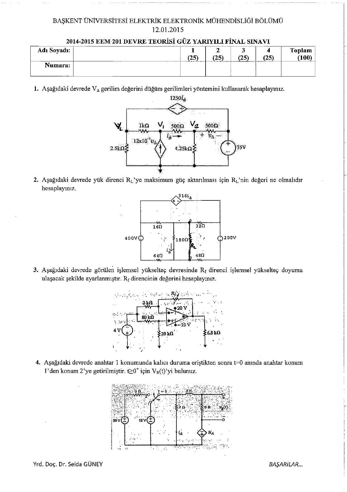
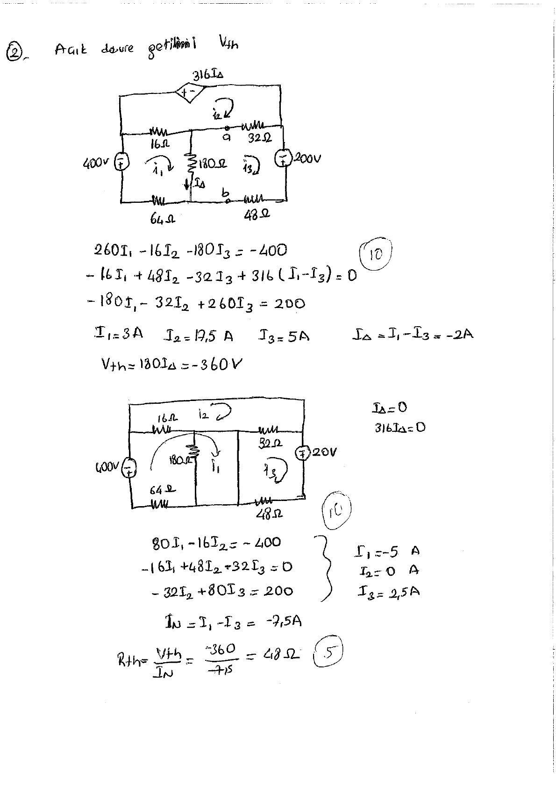
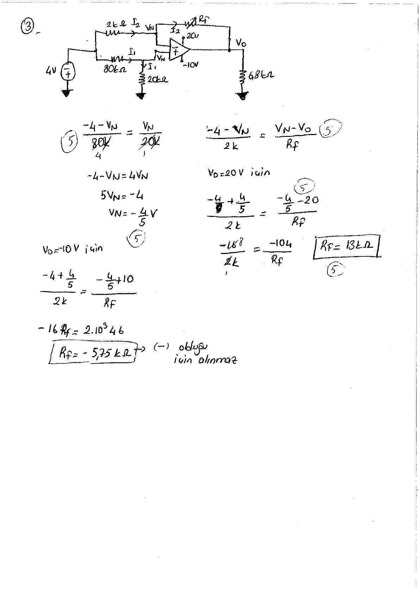
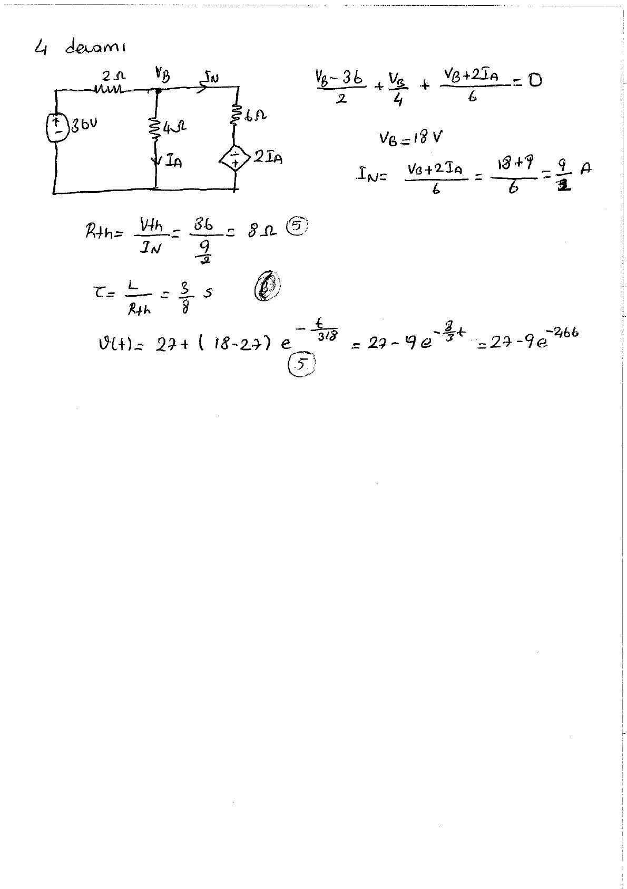

This is the 2014–2015 fall final exam of the Başkent University course **EEM201 Circuit Theory I**, dated **January 12, 2015**. The exam paper carries the name of Asst. Prof. Dr. Selda Güney. The six-page scanned PDF, found in the EEM202 folder, contains four questions along with handwritten solutions. The question texts and the main calculations are given below; the PDF can be downloaded at the end of the post.

## Exam questions

Each question is worth 25 points.

1. In the given circuit, calculate the voltage VΔ using the node-voltage method.
1. Calculate the value of R_L for maximum power transfer to the load resistor.
1. For what value of the resistor R_f does the op-amp reach saturation in the operational amplifier circuit? Find the output voltage at that moment.
1. After the switch reaches steady state in position 1, it is moved to position 2 at t = 0. Find v(t) for t ≥ 0.

## Question 1: Node voltages

In the solution, the control voltage of the dependent source is taken as VΔ = V₂ − 75. After rearranging, the node equations are:

- 16.5V₂ − 5.5V₁ = 825
- 180V₂ − 85V₁ = 6375

From this system, **V₁ = 105 V** and **V₂ = 85 V** are obtained, and therefore **VΔ = 10 V**.

## Question 2: Maximum power

With the load removed, the mesh currents are calculated:

- 260I₁ − 16I₂ − 180I₃ = −400
- −16I₁ + 48I₂ − 32I₃ + 316(I₁ − I₃) = 0
- −180I₁ − 32I₂ + 260I₃ = 200

Solution: I₁ = 3 A, I₂ = 17.5 A, and I₃ = 5 A. Since IΔ = I₁ − I₃ = −2 A, **V_Th = 180IΔ = −360 V**.

In the short-circuit calculation, I_N = −7.5 A. Thus **R_Th = V_Th/I_N = 48 Ω**, and for maximum power **R_L = 48 Ω**.

*Note: Substituting I₁ = 3, I₂ = 17.5, I₃ = 5 into the equations satisfies all three equalities; −360/(−7.5) = 48 Ω.*

## Question 3: Op-amp saturation

For the node at the positive input, (−4 − V_N)/80k = V_N/20k; hence **V_N = −4/5 V**.

The KCL at the inverting input relates R_f to the output voltage. The resistance found for the output to reach the positive supply limit of +20 V is negative; this situation cannot occur with a physical positive resistance. For the negative supply limit **V_o = −10 V**, **R_f = 13 kΩ** is obtained.

## Question 4: RL transient

With the switch in position 1 at steady state, the inductor acts as a short circuit:

- I_A = 12/4 = 3 A
- 12 = 6i_L(0⁻) − 2I_A ⇒ **i_L(0⁻) = 3 A**
- **i_L(0⁺) = 3 A**, v(0⁺) = 3·6 = **18 V**.

With the switch in position 2 at steady state, the node voltage is **V_B = 18 V** and the control current is 4.5 A. The final voltage across the resistor is **v(∞) = 27 V**.

For the equivalent seen by the inductor, V_Th = 36 V, I_N = 9/2 A, and **R_Th = 8 Ω** are found. Since L = 3 H, **τ = 3/8 s**.

**v(t) = 27 + (18 − 27)e^(−t/(3/8)) = 27 − 9e^(−8t/3) V**, t ≥ 0.

*Note: The approximate exponent in the last line of the source is of the form −2.66t. When written with the exact fraction −8t/3, the initial and final values are verified as 18 V and 27 V, respectively.*

