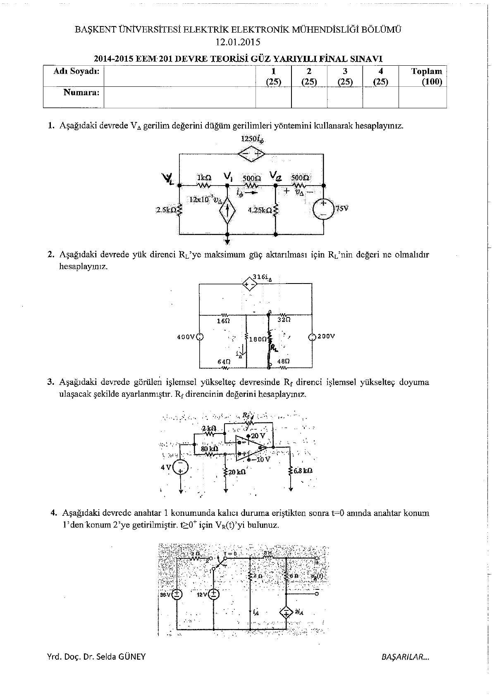
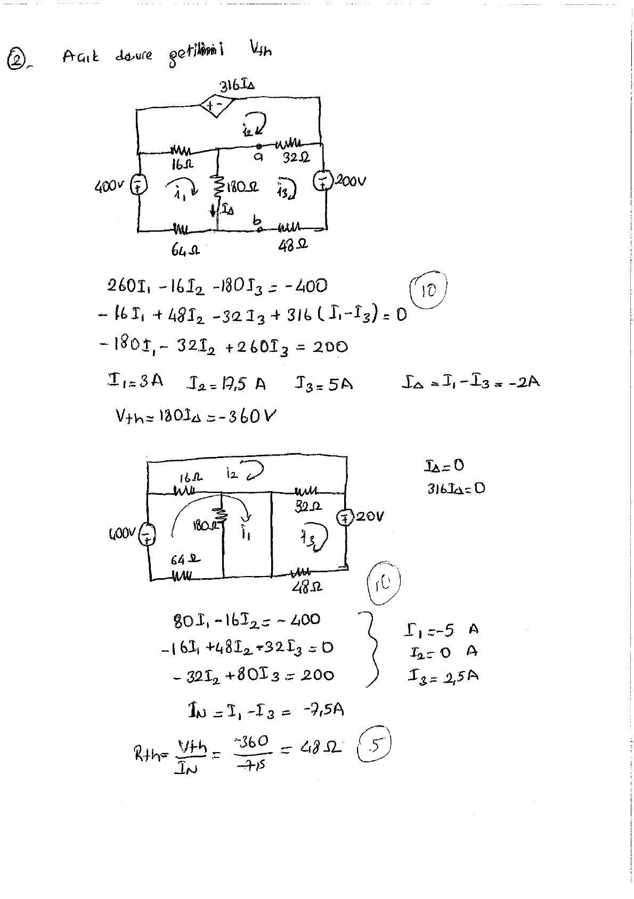
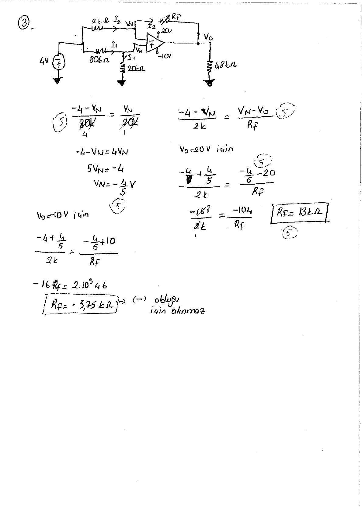
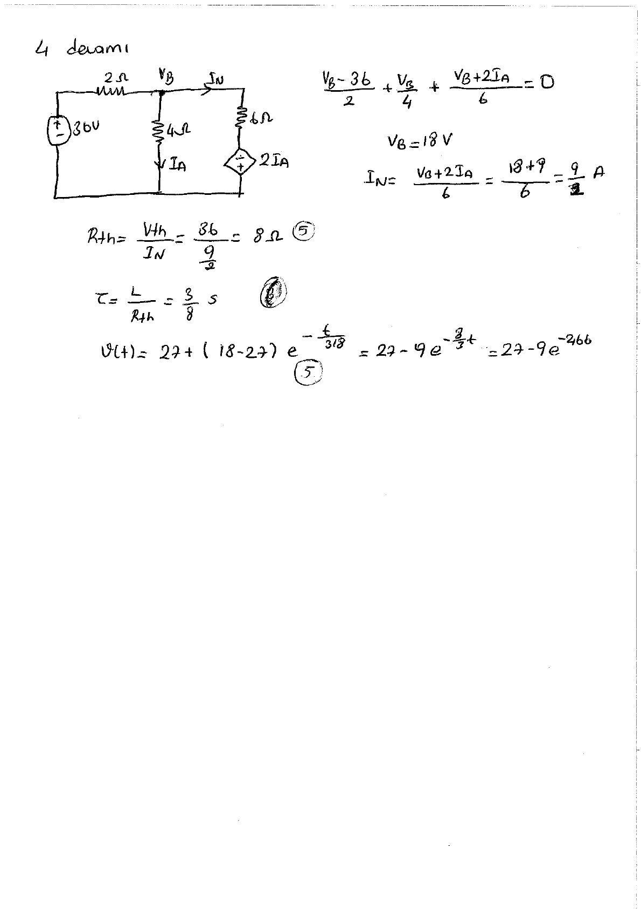

Başkent Üniversitesi **EEM201 Devre Teorisi I** dersinin **12 Ocak 2015** tarihli, 2014–2015 güz final sınavıdır. Soru kâğıdında Yrd. Doç. Dr. Selda Güney adı yer alıyor. EEM202 klasöründe bulunan altı sayfalık taranmış PDF, dört soru ile el yazısı çözümlerini içeriyor. Soru metinleri ve ana hesaplar aşağıdadır; PDF yazının sonunda indirilebilir.

## Sınav soruları

Her soru 25 puandır.

1. Verilen devrede VΔ gerilimini düğüm gerilimleri yöntemiyle hesaplayınız.
1. Yük direncine maksimum güç aktarılması için R_L değerini hesaplayınız.
1. İşlemsel yükselteç devresinde R_f direnci hangi değerdeyken op-amp doyuma ulaşır? O andaki çıkış gerilimini bulunuz.
1. Anahtar 1 konumunda kalıcı duruma ulaştıktan sonra t = 0'da 2'ye geçiriliyor. t ≥ 0 için v(t)'yi bulunuz.

## Soru 1: Düğüm gerilimleri

Çözümde bağımlı kaynağın kontrol gerilimi VΔ = V₂ − 75 alınır. Düğüm denklemleri düzenlenince:

- 16,5V₂ − 5,5V₁ = 825
- 180V₂ − 85V₁ = 6375

Bu sistemden **V₁ = 105 V**, **V₂ = 85 V**, dolayısıyla **VΔ = 10 V** bulunur.

## Soru 2: Maksimum güç

Yük kaldırılarak çevre akımları hesaplanır:

- 260I₁ − 16I₂ − 180I₃ = −400
- −16I₁ + 48I₂ − 32I₃ + 316(I₁ − I₃) = 0
- −180I₁ − 32I₂ + 260I₃ = 200

Çözüm: I₁ = 3 A, I₂ = 17,5 A ve I₃ = 5 A. IΔ = I₁ − I₃ = −2 A olduğundan **V_Th = 180IΔ = −360 V**.

Kısa devre hesabında I_N = −7,5 A. Böylece **R_Th = V_Th/I_N = 48 Ω**, maksimum güç için **R_L = 48 Ω**.

*Not: Denklemlere I₁ = 3, I₂ = 17,5, I₃ = 5 yazıldığında üç eşitlik de sağlanır; −360/(−7,5) = 48 Ω.*

## Soru 3: Op-amp doyumu

Pozitif girişteki düğüm için (−4 − V_N)/80k = V_N/20k; buradan **V_N = −4/5 V**.

Eviren girişteki KCL, R_f değerini çıkış gerilimine bağlar. Çıkışın pozitif besleme sınırı olan +20 V'a ulaşması için bulunan direnç negatiftir; fiziksel pozitif dirençle bu durum oluşmaz. Negatif besleme sınırı **V_o = −10 V** için **R_f = 13 kΩ** elde edilir.

## Soru 4: RL geçici rejimi

Anahtar 1 konumunda kalıcı durumda bobin kısa devredir:

- I_A = 12/4 = 3 A
- 12 = 6i_L(0⁻) − 2I_A ⇒ **i_L(0⁻) = 3 A**
- **i_L(0⁺) = 3 A**, v(0⁺) = 3·6 = **18 V**.

Anahtar 2 konumunda kalıcı durumda düğüm gerilimi **V_B = 18 V**, kontrol akımı 4,5 A olur. Direnç uçlarındaki son gerilim **v(∞) = 27 V**.

Bobinin gördüğü eşdeğer için V_Th = 36 V, I_N = 9/2 A ve **R_Th = 8 Ω** bulunur. L = 3 H olduğundan **τ = 3/8 s**.

**v(t) = 27 + (18 − 27)e^(−t/(3/8)) = 27 − 9e^(−8t/3) V**, t ≥ 0.

*Not: Kaynağın son satırındaki yaklaşık üs −2,66t biçimindedir. Tam kesirle −8t/3 yazıldığında başlangıç ve son değerler sırasıyla 18 V ve 27 V olarak doğrulanır.*

