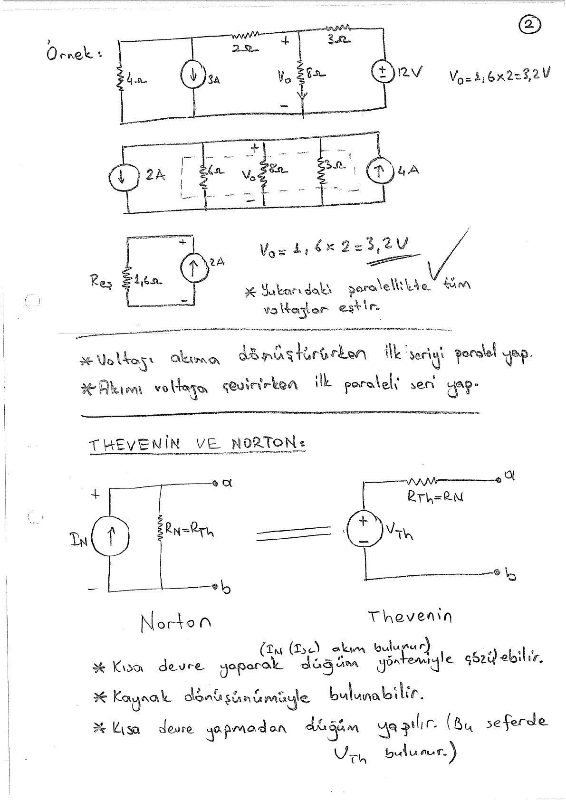
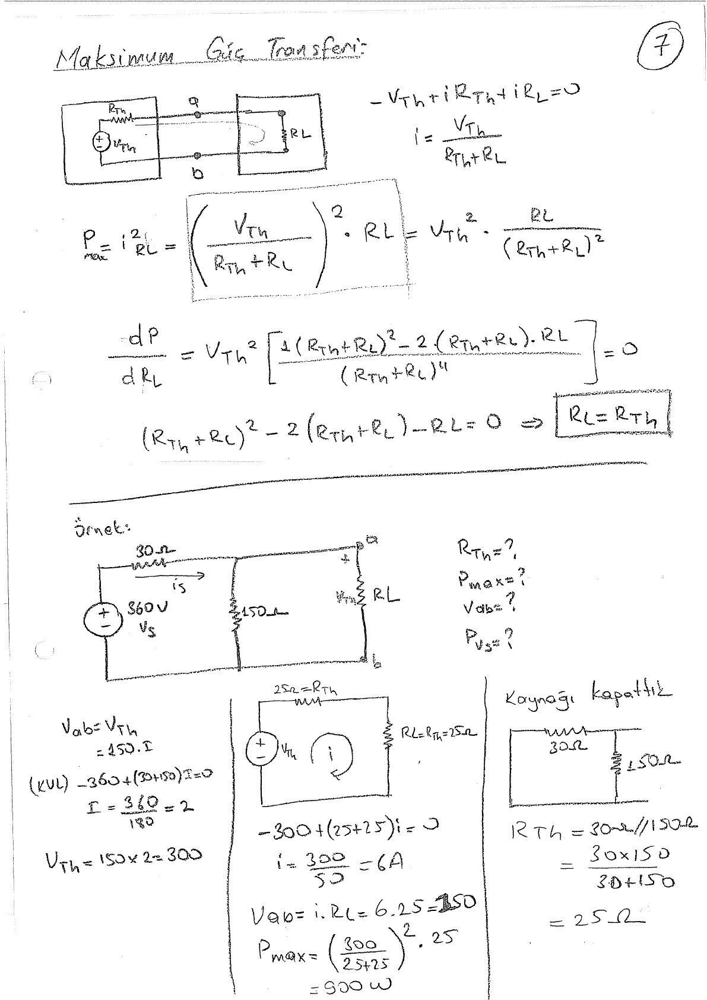
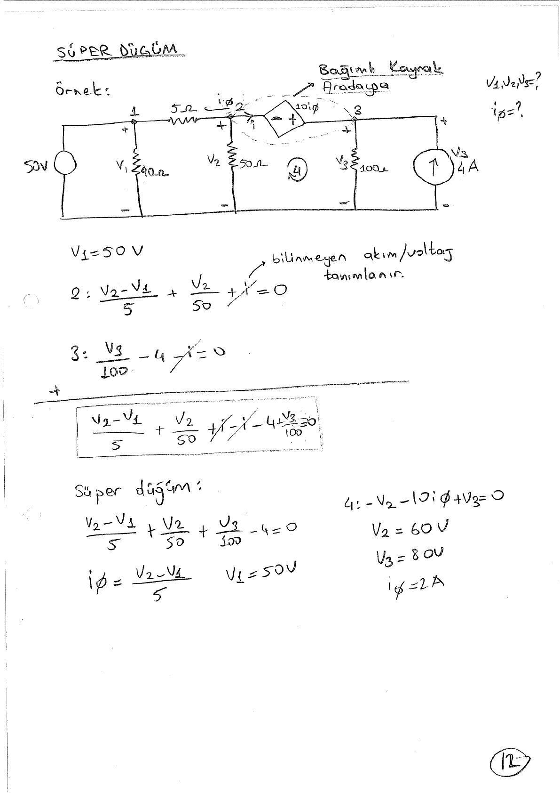
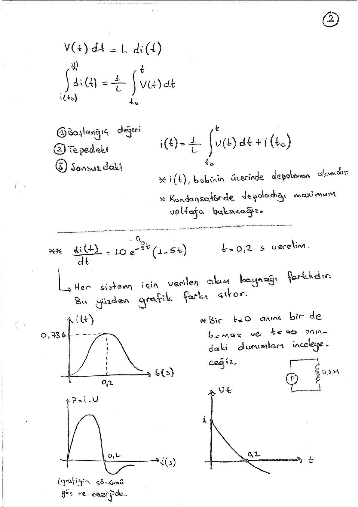
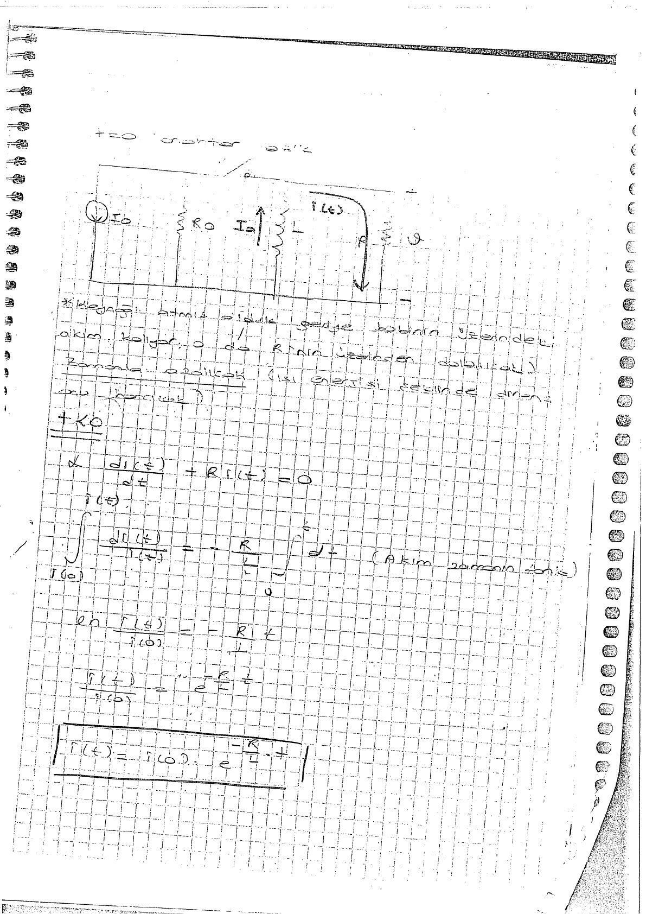
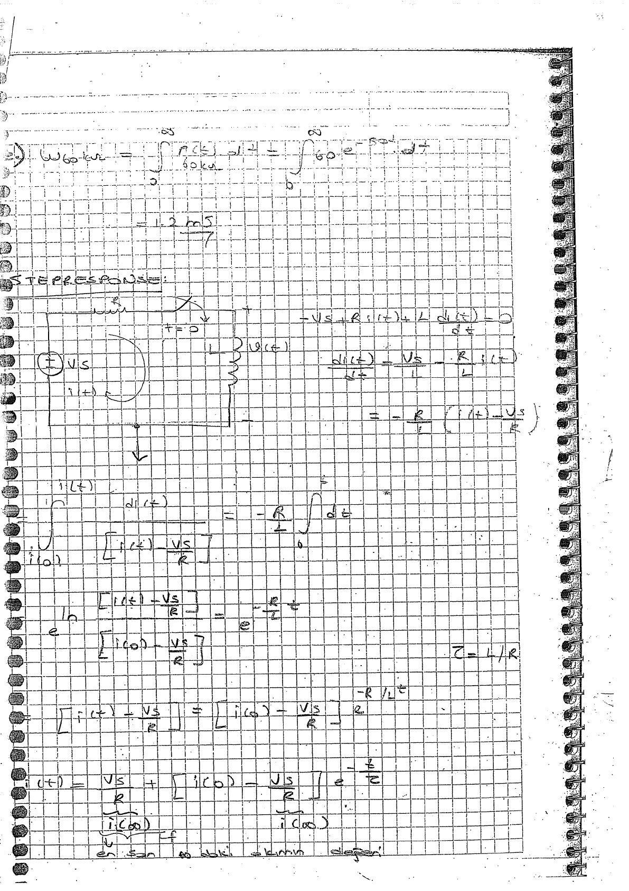

This post contains a **53-page handwritten circuit-analysis note** prepared by a friend, stored in the EEM202 folder under the name **Cilt1** ("Volume 1"). The pages carry the headings "Circuit-I" and section titles; the content was classified under **EEM201 Circuit Theory I**. The author's name and the date of the course are not given; the PDF was scanned on 22 January 2015. The headings, main formulas, and selected results have been transcribed into the text. The scanned PDF can be downloaded at the end of the post.

## Topic and page map

| PDF pages | Topic |
|---|---|
| 1–9 | Source transformations, Thevenin–Norton, maximum power transfer |
| 10–13 | Source transformation and superposition examples from a squared notebook |
| 14–15 | Input, output, and supply terminals of operational amplifiers |
| 16–23 | Current, voltage, power, sources, Kirchhoff, and divider circuits |
| 24–31 | Node voltage, supernode, mesh, and supermesh methods |
| 32–37 | Inductor and capacitor, derivative and integral, power and energy |
| 38–43 | RL natural response, equivalent resistance, time constant |
| 44–47 | RC natural response and switching examples |
| 48–53 | Step response, initial/final value, and op-amp example |

## Source transformation and equivalent circuit

The terminal behavior of a voltage source with a series resistor and a current source with a parallel resistor are matched by the relation **V_s = I_sR**. After the transformation, series and parallel resistors are combined.

- Thevenin equivalent: a V_Th voltage source with a series R_Th.
- Norton equivalent: an I_N current source with a parallel R_N.
- **R_Th = R_N**, **V_Th = I_NR_Th**.
- The open-circuit voltage is V_Th; the short-circuit current is I_N.
- Independent sources can be turned off; dependent sources are retained. With a test source, R_Th = V_T/I_T can be found.

In the example on page three, **V_Th = 32 V** and **I_sc = 4 A**, hence R_Th = 8 Ω. In the dependent-source example on page four, the notes give **V_Th = −5 V**, **I_sc = −50 mA**, and **R_Th = 100 Ω**.

## Maximum power transfer

For a resistive load:

**P_L = V_Th²R_L/(R_Th + R_L)²**.

Setting the derivative with respect to R_L equal to zero gives the condition **R_L = R_Th**. The power under this condition is **P_max = V_Th²/(4R_Th)**.

In the example with a 360 V source, **R_Th = 25 Ω**, **V_Th = 300 V**; the load current is 6 A and the load power is **900 W**. In the next example, **V_Th = 22 V**, **R_Th = 9 Ω**, and the power is approximately **13.44 W**.

*Note: The check calculations give 300²/(4·25) = 900 W and 22²/(4·9) ≈ 13.44 W.*

## Basic circuit quantities

- **i = dq/dt**: electric charge passing per unit time.
- **v = dE/dq**: energy per unit charge.
- **p = vi**; the sign depends on the direction of the current relative to the chosen voltage reference.
- **v = Ri**, **G = 1/R**.
- Resistor power **p = i²R = v²/R**.

Kirchhoff's current law sets the algebraic sum of the currents entering and leaving a node equal to zero; the voltage law sets the algebraic sum of the voltages around a closed loop equal to zero.

Series resistors carry the same current, and parallel resistors share the same voltage. For the voltage divider, **V₀ = V_sR₂/(R₁ + R₂)**. In a current divider with two parallel resistors, the current in one branch is proportional to the resistance of the opposite branch.

## Node and mesh methods

In the node method, KCL is written for each unknown node. A voltage source between two unknown nodes forms a supernode; the source voltage provides an additional equation.

In the mesh method, KVL is used. For a current source between two meshes, a supermesh is formed; the difference of the mesh currents is set equal to the source current. The controlling variable of a dependent source is also expressed in terms of the unknowns.

The first nodal calculation on page 25 gives **V₁ = 40 V** and a source power of **−100 W**. The negative sign indicates that, with the chosen reference, the source delivers power to the circuit. In the supernode example, the results V₁ = 50 V, V₂ = 60 V, V₃ = 80 V are marked.

## Op-amp notes

The notes show the inverting and non-inverting inputs, the output, and the positive and negative supply terminals. Supply limits and saturation are emphasized. On the last page, an amplifier powered by ±6 V is examined for its voltage gain, output current, and load resistance limits.

## Inductor and capacitor

For the inductor, **v_L(t) = L·di_L(t)/dt** and

**i_L(t) = i_L(t₀) + (1/L)∫[t₀,t]v_L(λ)dλ**.

For the capacitor, **i_C(t) = C·dv_C(t)/dt** and

**v_C(t) = v_C(t₀) + (1/C)∫[t₀,t]i_C(λ)dλ**.

The stored energies are **w_L = Li²/2** and **w_C = Cv²/2**. For series inductors the inductances add; for parallel inductors the reciprocals add (for examples without magnetic coupling). For capacitors, parallel capacitances add and in series the reciprocals add.

In the example with L = 0.1 H and i(t) = 10t e^(−5t), **v(t) = e^(−5t)(1 − 5t)**. The current reaches its maximum value at t = 0.2 s, where the voltage is zero.

## RL and RC natural responses

When the source is disconnected from the circuit, the stored energy is dissipated in the resistors:

- RL: **i_L(t) = I₀e^(−t/τ)**, **τ = L/R_eq**.
- RC: **v_C(t) = V₀e^(−t/τ)**, **τ = R_eqC**.

In the notes, the steady state before the switch, the continuity at t = 0⁺, and the equivalent resistance seen by the storage element are calculated separately. The initial values of the inductor current and capacitor voltage are carried over to the solution of the new circuit.

## Step response

The variable of a first-order circuit approaches its final value from its initial value exponentially:

**x(t) = x(∞) + [x(0⁺) − x(∞)]e^(−t/τ)**.

In the final section of the notes, RL and RC circuits are solved with this method. In the inductor examples, i_L(0⁺), i_L(∞), and τ are found first; in the capacitor examples, v_C(0⁺), v_C(∞), and τ. On the last pages, the resistor current, power, and the voltages of other branches are derived from these.

