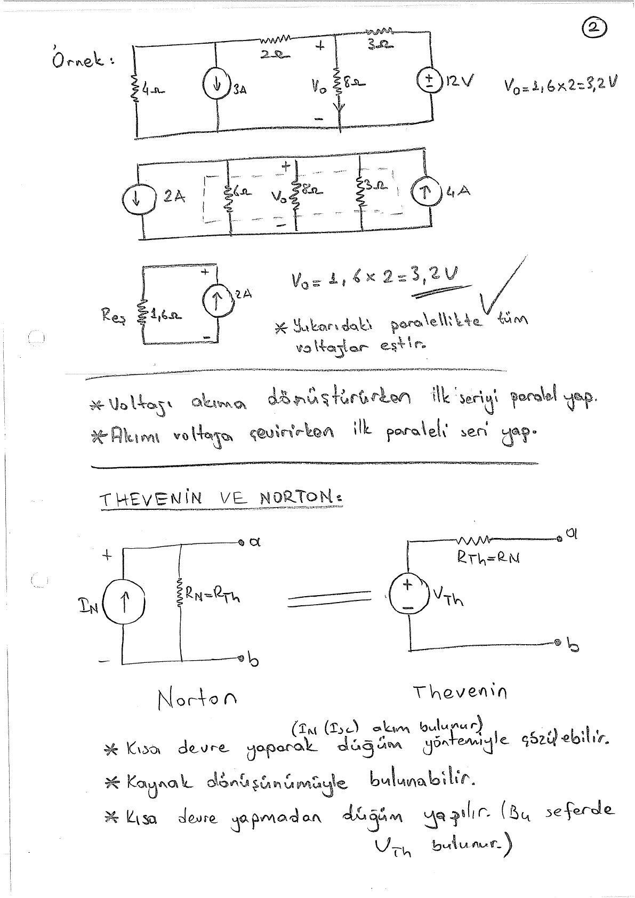
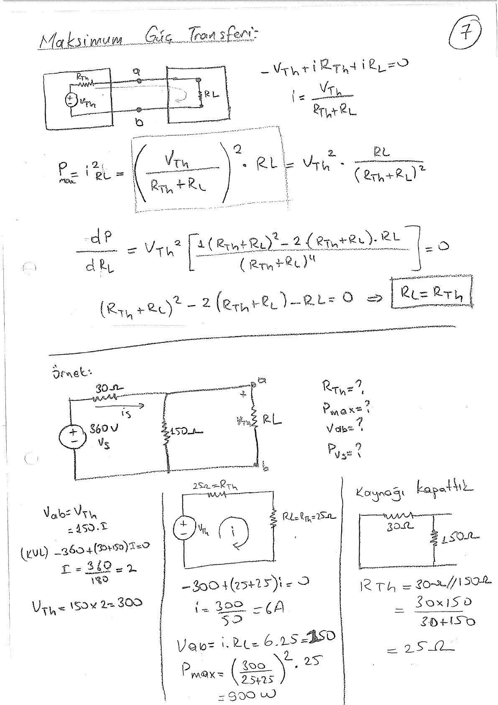
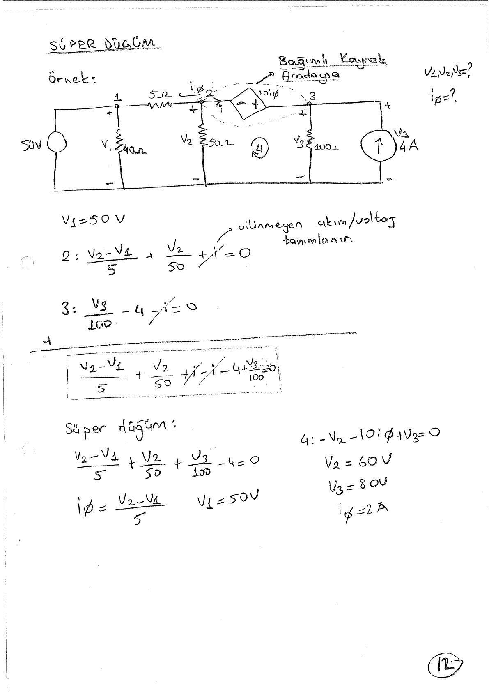
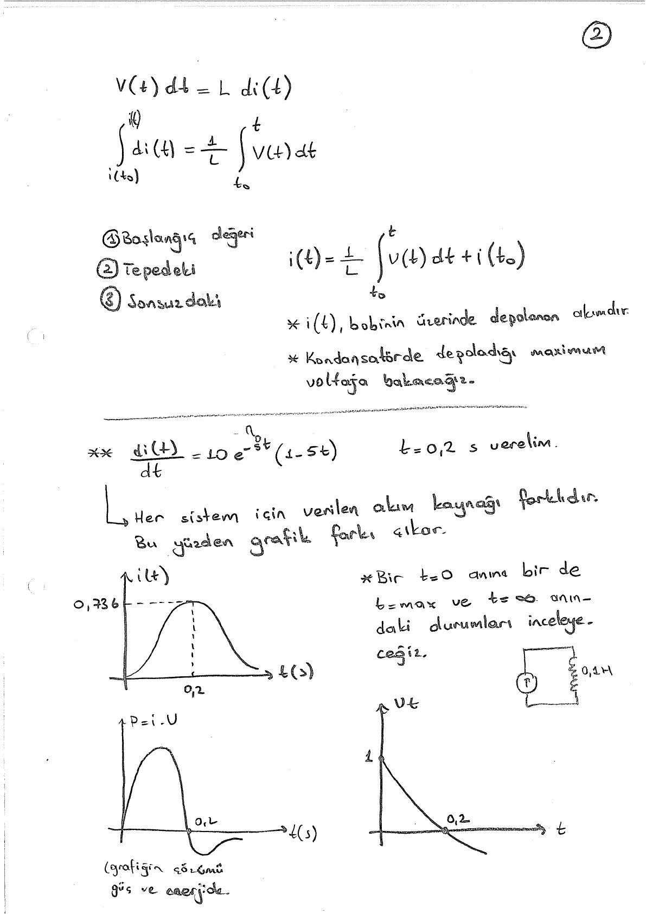
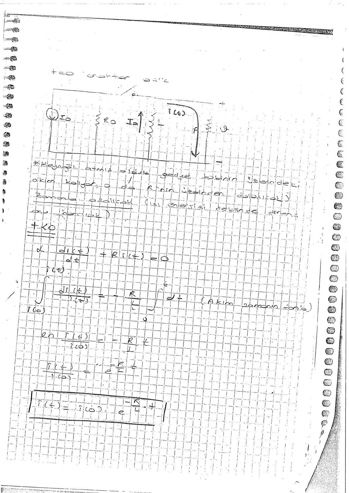
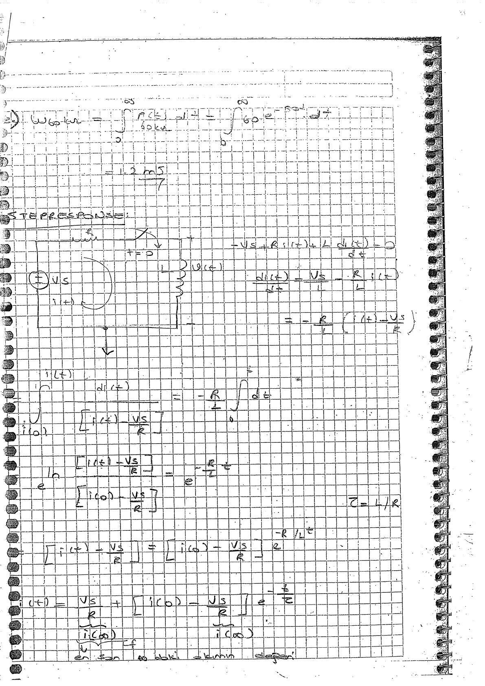

Bu yazı, EEM202 klasöründe **Cilt1** adıyla saklanan, bir arkadaşın hazırladığı **53 sayfalık el yazısı devre analizi notunu** içeriyor. Sayfalarda “Devre-I” ve bölüm başlıkları var; içerik **EEM201 Devre Teorisi I** altında sınıflandırıldı. Hazırlayanın adı ve ders tarihi belirtilmemiş; PDF 22 Ocak 2015'te taranmış. Başlıklar, ana formüller ve seçilmiş sonuçlar metne aktarıldı. Taranmış PDF yazının sonunda indirilebilir.

## Konu ve sayfa haritası

| PDF sayfaları | Konu |
|---|---|
| 1–9 | Kaynak dönüşümleri, Thevenin–Norton, maksimum güç aktarımı |
| 10–13 | Kareli defterden kaynak dönüşümü ve süperpozisyon örnekleri |
| 14–15 | İşlemsel yükselteçlerin giriş, çıkış ve besleme uçları |
| 16–23 | Akım, gerilim, güç, kaynaklar, Kirchhoff ve bölücü devreler |
| 24–31 | Düğüm gerilimi, süperdüğüm, çevre ve süperçevre yöntemleri |
| 32–37 | Bobin ve kondansatör, türev ve integral, güç ve enerji |
| 38–43 | RL doğal tepki, eşdeğer direnç, zaman sabiti |
| 44–47 | RC doğal tepki ve anahtarlama örnekleri |
| 48–53 | Basamak tepkisi, başlangıç/son değer ve op-amp örneği |

## Kaynak dönüşümü ve eşdeğer devre

Seri dirençli gerilim kaynağı ile paralel dirençli akım kaynağının uç davranışı **V_s = I_sR** bağıntısıyla eşlenir. Dönüşümden sonra seri ve paralel dirençler birleştirilir.

- Thevenin eşdeğeri: V_Th gerilim kaynağı ve seri R_Th.
- Norton eşdeğeri: I_N akım kaynağı ve paralel R_N.
- **R_Th = R_N**, **V_Th = I_NR_Th**.
- Açık devre gerilimi V_Th; kısa devre akımı I_N'dir.
- Bağımsız kaynaklar kapatılabilir; bağımlı kaynaklar korunur. Test kaynağıyla R_Th = V_T/I_T bulunabilir.

Üçüncü sayfadaki örnekte **V_Th = 32 V**, **I_sc = 4 A**, dolayısıyla R_Th = 8 Ω. Dördüncü sayfadaki bağımlı kaynak örneğinde **V_Th = −5 V**, **I_sc = −50 mA**, **R_Th = 100 Ω** yazıyor.

## Maksimum güç aktarımı

Dirençli yük için:

**P_L = V_Th²R_L/(R_Th + R_L)²**.

R_L'ye göre türev sıfıra eşitlenerek **R_L = R_Th** koşulu bulunuyor. Bu koşuldaki güç **P_max = V_Th²/(4R_Th)**.

360 V kaynaklı örnekte **R_Th = 25 Ω**, **V_Th = 300 V**; yük akımı 6 A ve yük gücü **900 W**. Bir sonraki örnekte **V_Th = 22 V**, **R_Th = 9 Ω** ve güç yaklaşık **13,44 W**.

*Not: Kontrol hesapları 300²/(4·25) = 900 W ve 22²/(4·9) ≈ 13,44 W verir.*

## Temel devre büyüklükleri

- **i = dq/dt**: birim zamanda geçen elektrik yükü.
- **v = dE/dq**: birim yük başına enerji.
- **p = vi**; işaret, akımın seçilen gerilim referansına göre yönüne bağlıdır.
- **v = Ri**, **G = 1/R**.
- Direnç gücü **p = i²R = v²/R**.

Kirchhoff akım yasası düğümde giren ve çıkan akımların cebirsel toplamını; gerilim yasası kapalı çevredeki gerilimlerin cebirsel toplamını sıfıra eşitler.

Seri dirençlerde aynı akım, paralel dirençlerde aynı gerilim vardır. Gerilim bölücüsünde **V₀ = V_sR₂/(R₁ + R₂)**. İki paralel dirençli akım bölücüsünde bir koldaki akım karşı kolun direnciyle orantılıdır.

## Düğüm ve çevre yöntemleri

Düğüm yönteminde her bilinmeyen düğüm için KCL yazılır. İki bilinmeyen düğüm arasındaki gerilim kaynağı süperdüğüm oluşturur; kaynak gerilimi ek denklem verir.

Çevre yönteminde KVL kullanılır. İki çevre arasındaki akım kaynağı için süperçevre kurulur; çevre akımlarının farkı kaynak akımına eşitlenir. Bağımlı kaynağın kontrol değişkeni de bilinmeyenlerle ifade edilir.

25. sayfadaki ilk düğüm hesabı **V₁ = 40 V**, kaynak gücü **−100 W** verir. Negatif işaret, seçilen referansla kaynağın devreye güç verdiğini gösterir. Süperdüğüm örneğinde V₁ = 50 V, V₂ = 60 V, V₃ = 80 V sonuçları işaretlenmiştir.

## Op-amp notları

Notlarda eviren ve evirmeyen giriş, çıkış, pozitif ve negatif besleme uçları gösteriliyor. Besleme sınırları ve doyum vurgulanıyor. Son sayfada ±6 V ile beslenen bir yükselteçte gerilim kazancı, çıkış akımı ve yük direnci sınırları inceleniyor.

## Bobin ve kondansatör

Bobin için **v_L(t) = L·di_L(t)/dt** ve

**i_L(t) = i_L(t₀) + (1/L)∫[t₀,t]v_L(λ)dλ**.

Kondansatör için **i_C(t) = C·dv_C(t)/dt** ve

**v_C(t) = v_C(t₀) + (1/C)∫[t₀,t]i_C(λ)dλ**.

Depolanan enerjiler **w_L = Li²/2**, **w_C = Cv²/2**. Seri bobinlerde endüktanslar toplanır; paralel bobinlerde tersleri toplanır (manyetik bağlaşım olmayan örnekler). Kondansatörlerde paralel sığalar toplanır, seride tersleri toplanır.

L = 0,1 H ve i(t) = 10t e^(−5t) örneğinde **v(t) = e^(−5t)(1 − 5t)**. Akım t = 0,2 s'de en büyük değerine ulaşırken gerilim sıfır olur.

## RL ve RC doğal tepkileri

Kaynak devreden ayrıldığında depolanmış enerji dirençlerde harcanır:

- RL: **i_L(t) = I₀e^(−t/τ)**, **τ = L/R_eş**.
- RC: **v_C(t) = V₀e^(−t/τ)**, **τ = R_eşC**.

Notlarda anahtarın öncesindeki kalıcı durum, t = 0⁺ anındaki süreklilik ve depolama elemanının gördüğü eşdeğer direnç ayrı ayrı hesaplanıyor. Bobin akımı ve kondansatör geriliminin başlangıç değerleri yeni devrenin çözümüne taşınıyor.

## Basamak tepkisi

Birinci mertebeden devrenin değişkeni başlangıç değerinden son değerine üstel yaklaşır:

**x(t) = x(∞) + [x(0⁺) − x(∞)]e^(−t/τ)**.

Notların son bölümünde RL ve RC devreleri bu yöntemle çözülüyor. Bobinli örneklerde önce i_L(0⁺), i_L(∞) ve τ; kondansatörlü örneklerde v_C(0⁺), v_C(∞) ve τ bulunuyor. Son sayfalarda bunlardan direnç akımı, güç ve diğer kol gerilimleri çıkarılıyor.

