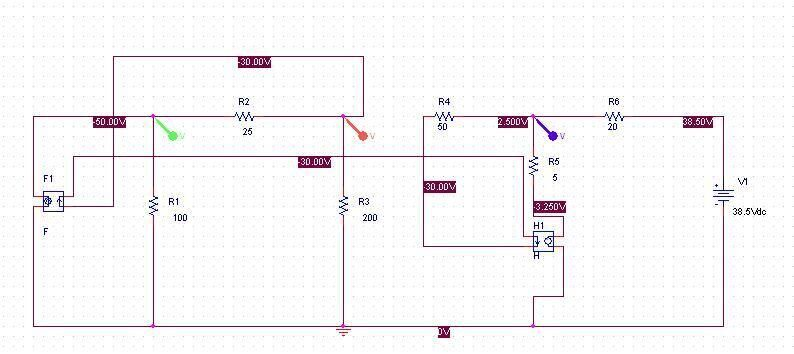
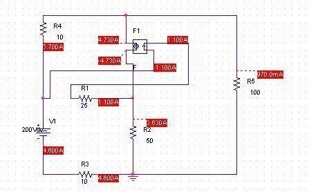

Başkent University EEM201 Laboratory PSpice Assignment-1, a question sheet signed by Asst. Prof. Dr. Aysel Şafak and Lecturer Baran Uslu, together with a friend's simulation files. The question sheet was transcribed from an image to text; the sheet itself was not published. Although the files were in the EEM211 folder, the title explicitly points to EEM201, so they were archived under Circuit Theory I. The document carries no date; the file date of 7 October 2015 was used. The circuits and screenshots, cleaned of personal information, are available for download at the end of the post.

## Assignment instructions

Build and run the two given circuits in PSpice. Compare your results with the theoretical results, that is, those found by hand calculation. Each question is worth 50 points.

## 1. Node-voltage method

The first circuit asks for the node voltages V1, V2 and V3. There is a 25 Ω resistor between V1 and V2, a 50 Ω resistor between V2 and V3, and a 20 Ω resistor between V3 and the 38.5 V source. The resistance from V1 to ground is 100 Ω, and that from V2 is 200 Ω. In the V3 branch, a 5 Ω resistor and a 5i₀ dependent voltage source are connected in series. The left dependent current source has the value 2i₀; i₀ is defined in the 50 Ω resistor, from V2 to V3.

The PSpice screen shows V1=−50 V, V2=−30 V and V3=2.5 V. Verification calculation:

- i₀=(V2−V3)/50=−0.65 A.
- Dependent voltage 5i₀=−3.25 V.
- At node V1: V1/100+(V1−V2)/25−2i₀=−0.5−0.8+1.3=0.
- At node V2: V2/200+(V2−V1)/25+i₀=−0.15+0.8−0.65=0.
- At node V3: (V3−V2)/50+(V3−38.5)/20+(V3−5i₀)/5=0.65−1.8+1.15=0.

*Note: These node equations were calculated during the archive transcription to verify the screen results.*

## 2. Mesh-current method

The second circuit asks for all branch currents to be found using the mesh-current method and compared with PSpice. The circuit contains a 200 V source, two 10 Ω resistors, 25 Ω, 50 Ω and 100 Ω resistors, and a 4.3iₐ dependent current source. iₐ is the current in the 25 Ω branch.

Current magnitudes in the screenshot:

| Branch | Current |
| --- | --- |
| 25 Ω | 1.100 A |
| Dependent source | 4.730 A |
| 50 Ω | 3.630 A |
| 100 Ω | 970.0 mA |
| Upper 10 Ω | 5.700 A |
| Lower 10 Ω and 200 V source | 4.600 A |

This is consistent with the dependent source value 4.3×1.100=4.730 A; with the middle branch current 4.730−1.100=3.630 A; and with the upper resistor current 4.730+0.970=5.700 A. The directions should be read together with the arrows and signs on the source screen.

## Download contents

There are two OrCAD/PSpice DSN circuits and three screenshots. The personal file names remaining inside the circuit files were replaced with neutral names of the same length. The sources were not run in this environment; the checks above are based on the saved results.
