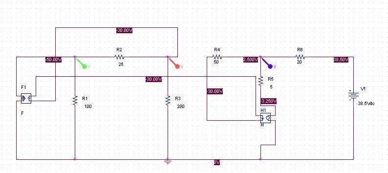
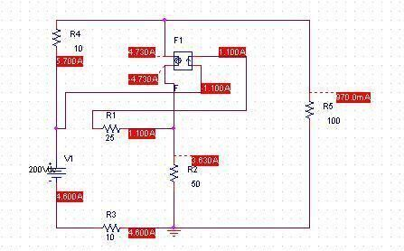

Başkent Üniversitesi EEM201 Laboratuvar PSpice Ödevi-1, Yrd. Doç. Dr. Aysel Şafak ve Öğr. Gör. Baran Uslu imzalı soru sayfası ile bir arkadaşın benzetim dosyaları. Soru sayfası görüntüden metne aktarıldı; kendisi yayımlanmadı. Dosyalar EEM211 klasöründe bulunsa da başlık açıkça EEM201'i gösterdiği için Devre Teorisi I altında arşivlendi. Belgenin üzerinde tarih yok; 7 Ekim 2015 dosya tarihi kullanıldı. Kişisel bilgilerden arındırılmış devreler ve ekran görüntüleri yazının sonunda indirilebilir.

## Ödevin yönergesi

Verilen iki devreyi PSpice ile kurup çalıştırın. Elde ettiğiniz sonuçları teorik, yani hesapla bulunan sonuçlarla karşılaştırın. Her soru 50 puandır.

## 1. Düğüm gerilim yöntemi

İlk devrede V1, V2 ve V3 düğüm gerilimleri istenir. V1–V2 arasında 25 Ω, V2–V3 arasında 50 Ω, V3 ile 38,5 V kaynak arasında 20 Ω vardır. V1'in toprağa direnci 100 Ω, V2'ninki 200 Ω'dur. V3 kolunda 5 Ω direnç ile 5i₀ bağımlı gerilim kaynağı seri bağlıdır. Sol bağımlı akım kaynağı 2i₀ değerindedir; i₀, 50 Ω direncinde V2'den V3'e doğru tanımlıdır.

PSpice ekranında V1=−50 V, V2=−30 V ve V3=2,5 V görülür. Kontrol hesabı:

- i₀=(V2−V3)/50=−0,65 A.
- Bağımlı gerilim 5i₀=−3,25 V.
- V1 düğümünde V1/100+(V1−V2)/25−2i₀=−0,5−0,8+1,3=0.
- V2 düğümünde V2/200+(V2−V1)/25+i₀=−0,15+0,8−0,65=0.
- V3 düğümünde (V3−V2)/50+(V3−38,5)/20+(V3−5i₀)/5=0,65−1,8+1,15=0.

*Not: Bu düğüm eşitlikleri ekran sonuçlarını doğrulamak için arşiv aktarımı sırasında hesaplandı.*

## 2. Ağ akım yöntemi

İkinci devrede bütün kol akımlarının ağ akım yöntemiyle bulunması ve PSpice ile karşılaştırılması istenir. Devrede 200 V kaynak, iki adet 10 Ω, 25 Ω, 50 Ω ve 100 Ω direnç ile 4,3iₐ bağımlı akım kaynağı vardır. iₐ, 25 Ω kolundaki akımdır.

Ekran görüntüsündeki akım büyüklükleri:

| Kol | Akım |
| --- | --- |
| 25 Ω | 1,100 A |
| Bağımlı kaynak | 4,730 A |
| 50 Ω | 3,630 A |
| 100 Ω | 970,0 mA |
| Üstteki 10 Ω | 5,700 A |
| Alttaki 10 Ω ve 200 V kaynak | 4,600 A |

4,3×1,100=4,730 A bağımlı kaynak değeriyle; 4,730−1,100=3,630 A orta kol akımıyla; 4,730+0,970=5,700 A üst direnç akımıyla uyumludur. Yönler kaynak ekranındaki ok ve işaretlerle birlikte okunmalıdır.

## İndirme içeriği

İki OrCAD/PSpice DSN devresi ve üç ekran görüntüsü vardır. Devre dosyalarının içinde kalan kişisel dosya adları aynı uzunlukta nötr adlarla değiştirildi. Kaynaklar bu ortamda çalıştırılmadı; yukarıdaki kontroller kaydedilmiş sonuçlara dayanır.
