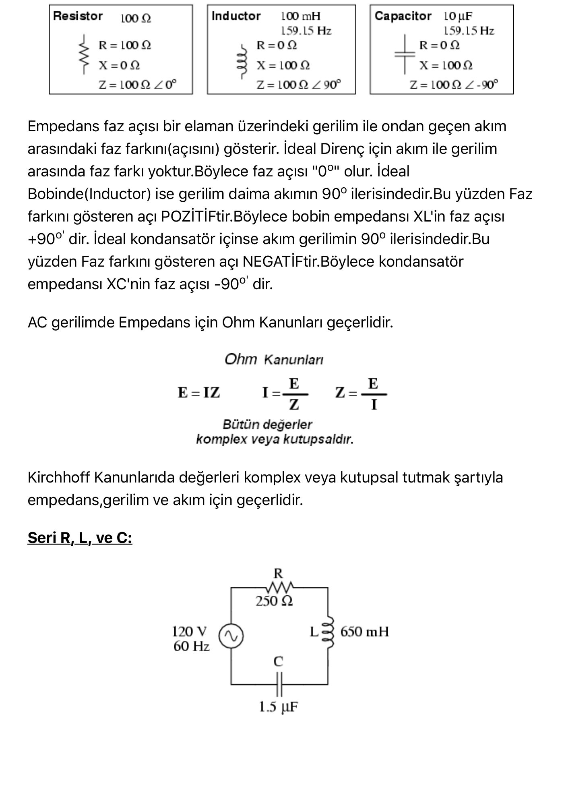
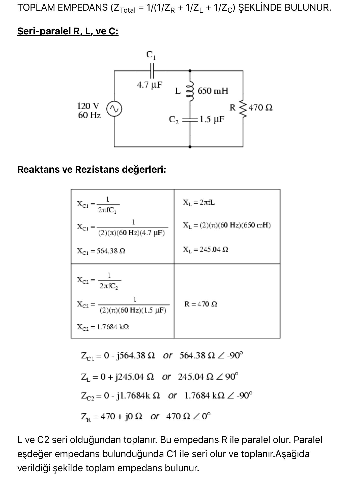

This post contains an 8-page Turkish note compiled from the internet and kept in the course folder under the name "R, C and L in AC voltage" (the PDF dates from April 2017). The document does not name its author; the figures and numerical examples are the same as those in the AC volume of Tony R. Kuphaldt's freely licensed *Lessons in Electric Circuits* (All About Circuits). The text and calculations are reproduced below; the original PDF can be downloaded at the end of the post.

*This content belongs to a third-party source; it is shared for archival and nostalgic purposes, with the source credited. It will be removed at the request of the rights holder.*

## Resistance, Reactance and Impedance in AC Circuits

**Resistance** is, fundamentally, the circuit element that tries to impede the motion of electrons. All conductors except superconductors contain some resistance. It is denoted by "R" and its unit is the ohm (Ω). When alternating current is applied, the current through a resistor and the voltage across it are in phase: if E = E_m sin(2πft) = E_m sin ωt, then I = (E_m/R) sin ωt. The power dissipated in a resistor, P = E·I = (E_m²/R) sin²(ωt), is always positive; this shows that a resistor continuously dissipates power.

**Reactance** is the inertia opposing the motion of electrons. Wherever there is an electric field proportional to the applied voltage (capacitor) or a magnetic field proportional to the current (inductor), there is reactance. When alternating current is applied to a pure reactance, there is a 90° phase shift between voltage and current. It is denoted by "X" and its unit is the ohm.

**Impedance** is the combined effect of resistance and reactance. The phase difference between the current and the voltage drop can be anywhere between 0° and 90°: if it is 0°, the impedance is purely resistive; if it is +90°, it is inductive; and if it is −90°, it is capacitive. It is denoted by "Z" and its unit is the ohm. An ideal resistor contains only resistance; an ideal inductor and an ideal capacitor contain only reactance.

The impedance phase angle is the angle between the voltage across the element and the current through it:

| Element (159.15 Hz) | R | X | Z |
| --- | --- | --- | --- |
| 100 Ω resistor | 100 Ω | 0 | 100 Ω∠0° |
| 100 mH inductor | 0 | 100 Ω | 100 Ω∠90° |
| 10 µF capacitor | 0 | 100 Ω | 100 Ω∠−90° |

In an ideal inductor the voltage always leads the current by 90° (the phase angle is positive, +90°); in an ideal capacitor the current leads the voltage by 90° (the phase angle is negative, −90°). Ohm's law (E = IZ, I = E/Z, Z = E/I) and Kirchhoff's laws also hold in AC, provided the values are kept as complex or polar quantities.

## Series RLC Circuit

A 120 V, 60 Hz source is connected in series with R = 250 Ω, L = 650 mH and C = 1.5 µF.

- X_L = 2πfL = 2π(60)(0.65) = 245.04 Ω, X_C = 1/(2πfC) = 1/(2π·60·1.5·10⁻⁶) = 1.7684 kΩ
- Z_R = 250∠0° Ω, Z_L = 245.04∠90° Ω, Z_C = 1.7684 kΩ∠−90°
- Z_total = 250 + j245.04 − j1768.4 = **250 − j1523.3 Ω = 1.5437 kΩ∠−80.68°**

In a series circuit the current is the same everywhere: I = E/Z = 120∠0°/1.5437 kΩ∠−80.68° = **12.589 + j76.708 mA = 77.734 mA∠80.68°**. The element voltages follow from E = IZ:

| Element | Voltage |
| --- | --- |
| R | 3.1472 + j19.177 V = 19.434 V∠80.68° |
| L | −18.797 + j3.0848 V = 19.048 V∠170.68° |
| C | 135.65 − j22.262 V = 137.46 V∠−9.32° |

*Note: In the document's calculation of the L voltage, Z_L is written as "254.04∠90°"; the correct value is 245.04∠90° Ω (the result, 19.048 V, was obtained with the correct value). The capacitor voltage is larger than the source voltage; this is possible because, in a series circuit, the reactive voltages partially cancel each other.*

## Parallel RLC Circuit

The same elements are connected in parallel to a 120 V, 60 Hz source. In a parallel circuit all voltages are the same: E_R = E_L = E_C = 120 V∠0°. The branch currents follow from Ohm's law:

- I_R = 120∠0°/250∠0° = **480 mA∠0°**
- I_L = 120∠0°/245.04∠90° = **489.71 mA∠−90°** (0 − j489.71 mA)
- I_C = 120∠0°/1.7684 kΩ∠−90° = **67.858 mA∠90°** (0 + j67.858 mA)

The total impedance is found as Z_total = 1/(1/Z_R + 1/Z_L + 1/Z_C).

## Series-Parallel RLC Circuit

A 120 V, 60 Hz source; C1 = 4.7 µF in series, followed by a series branch consisting of L = 650 mH and C2 = 1.5 µF, in parallel with R = 470 Ω.

- X_C1 = 1/(2π·60·4.7·10⁻⁶) = 564.38 Ω, X_L = 245.04 Ω, X_C2 = 1.7684 kΩ, R = 470 Ω
- L and C2 in series: Z_L–C2 = j245.04 − j1768.4 = **0 − j1.5233 kΩ**
- In parallel with R: Z_R∥(L–C2) = 1/(1/470 + 1/(−j1523.3)) = **429.15 − j132.41 Ω = 449.11 Ω∠−17.147°**
- In series with C1: Z_total = **429.15 − j696.79 Ω = 818.34 Ω∠−58.371°**
- Total current: I = 120∠0°/818.34∠−58.371° = **76.899 + j124.86 mA = 146.64 mA∠58.371°**

The currents and voltages of all elements follow from Ohm's law and Kirchhoff's current law:

| | C1 | L | C2 | R |
| --- | --- | --- | --- | --- |
| E (V) | 82.760∠−31.629° | 10.594∠221.22° | 76.451∠41.225° | 65.857∠41.225° |
| I (mA) | 146.64∠58.371° | 43.232∠131.22° | 43.232∠131.22° | 140.12∠41.225° |
| Z (Ω) | 564.38∠−90° | 245.04∠90° | 1768.4∠−90° | 470∠0° |

## Downloadable File

The original 8-page PDF can be downloaded below.
