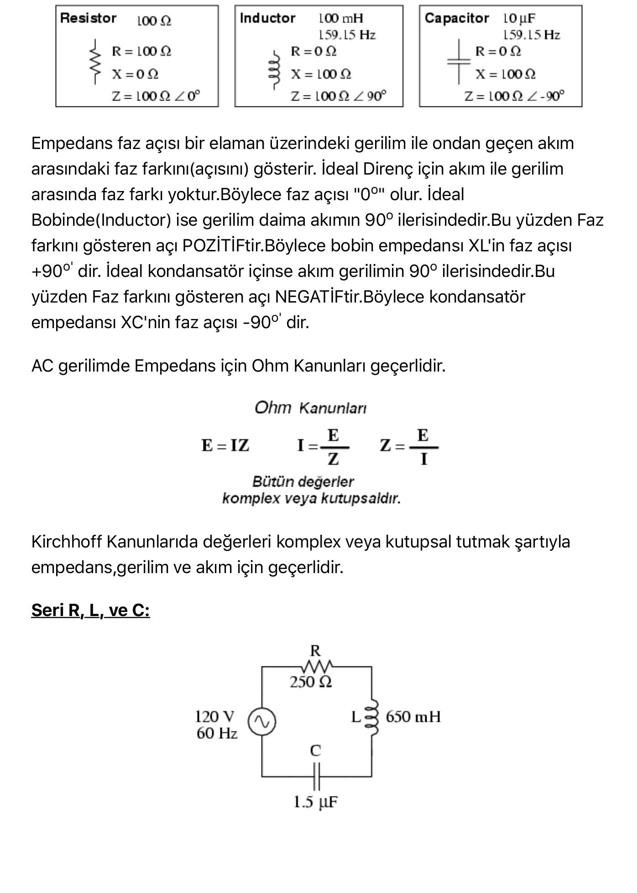
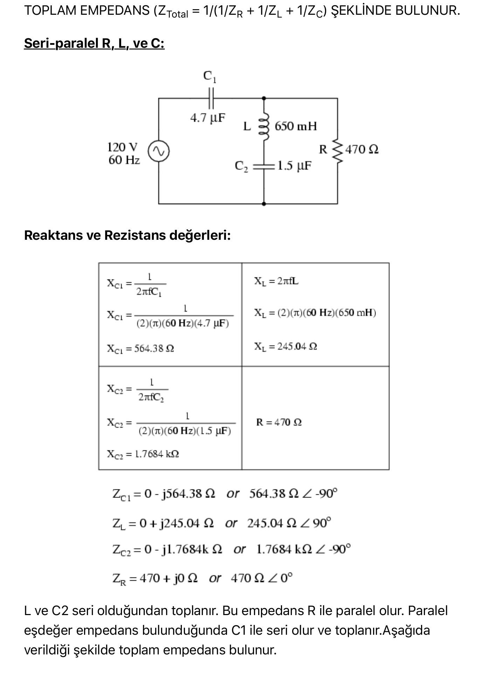

Bu yazı, ders klasöründe "AC gerilimde R,C ve L" adıyla saklanan, internetten derlenmiş 8 sayfalık Türkçe bir notu içeriyor (PDF Nisan 2017). Belgede yazar adı yok; şekiller ve sayısal örnekler Tony R. Kuphaldt'ın serbest lisanslı *Lessons in Electric Circuits* (All About Circuits) kitabının AC cildindeki örneklerle aynı. Metin ve hesaplar aşağıda aktarıldı; orijinal PDF yazının sonunda indirilebilir.

*Bu içerik üçüncü taraf bir kaynağa aittir; arşiv ve nostalji amacıyla kaynak belirtilerek paylaşılmıştır. Hak sahibinin talebi hâlinde kaldırılır.*

## AC devrede direnç, reaktans ve empedans

**Direnç**, temel olarak elektron hareketini engellemeye çalışan devre elemanıdır. Süper iletkenler hariç bütün iletkenler bir direnç içerir. "R" ile gösterilir, birimi ohm'dur (Ω). Alternatif akım uygulandığında dirençten geçen akım ve gerilim aynı fazdadır: E = E_m sin(2πft) = E_m sin ωt ise I = (E_m/R) sin ωt. Dirençte harcanan güç P = E·I = (E_m²/R) sin²(ωt) her zaman pozitiftir; bu, direncin sürekli güç harcadığını gösterir.

**Reaktans**, elektron hareketine karşı gösterilen atalettir. Uygulanan gerilimle orantılı elektrik alanın (kapasitör) veya akımla orantılı manyetik alanın (bobin) bulunduğu her yerde reaktans vardır. Alternatif akım saf reaktansa uygulandığında gerilimle akım arasında 90°'lik faz kayması olur. "X" ile gösterilir, birimi ohm'dur.

**Empedans**, direnç ve reaktansın bileşkesidir. Akım ile gerilim düşümü arasındaki faz farkı 0° ile 90° arasında olabilir: 0° ise empedans tamamen dirençsel, +90° ise endüktif, −90° ise kapasitiftir. "Z" ile gösterilir, birimi ohm'dur. İdeal direnç yalnız direnç, ideal bobin ve kondansatör yalnız reaktans içerir.

Empedans faz açısı, eleman üzerindeki gerilim ile akım arasındaki açıdır:

| Eleman (159,15 Hz) | R | X | Z |
| --- | --- | --- | --- |
| 100 Ω direnç | 100 Ω | 0 | 100 Ω∠0° |
| 100 mH bobin | 0 | 100 Ω | 100 Ω∠90° |
| 10 µF kondansatör | 0 | 100 Ω | 100 Ω∠−90° |

İdeal bobinde gerilim akımdan daima 90° ileridedir (faz açısı pozitif, +90°); ideal kondansatörde akım gerilimden 90° ileridedir (faz açısı negatif, −90°). Ohm kanunu (E = IZ, I = E/Z, Z = E/I) ve Kirchhoff kanunları, değerler karmaşık veya kutupsal tutulmak şartıyla AC'de de geçerlidir.

## Seri RLC devresi

120 V, 60 Hz kaynak; R = 250 Ω, L = 650 mH, C = 1,5 µF seri bağlı.

- X_L = 2πfL = 2π(60)(0,65) = 245,04 Ω, X_C = 1/(2πfC) = 1/(2π·60·1,5·10⁻⁶) = 1,7684 kΩ
- Z_R = 250∠0° Ω, Z_L = 245,04∠90° Ω, Z_C = 1,7684 kΩ∠−90°
- Z_toplam = 250 + j245,04 − j1768,4 = **250 − j1523,3 Ω = 1,5437 kΩ∠−80,68°**

Seri devrede akım her yerde aynıdır: I = E/Z = 120∠0°/1,5437 kΩ∠−80,68° = **12,589 + j76,708 mA = 77,734 mA∠80,68°**. Eleman gerilimleri E = IZ ile:

| Eleman | Gerilim |
| --- | --- |
| R | 3,1472 + j19,177 V = 19,434 V∠80,68° |
| L | −18,797 + j3,0848 V = 19,048 V∠170,68° |
| C | 135,65 − j22,262 V = 137,46 V∠−9,32° |

*Not: Belgedeki L gerilimi hesabında Z_L "254,04∠90°" yazılmış; doğrusu 245,04∠90° Ω'dur (sonuç 19,048 V doğru değerle bulunmuş). Kondansatör gerilimi kaynak geriliminden büyüktür; seri devrede reaktif gerilimler birbirini kısmen yok ettiği için bu mümkündür.*

## Paralel RLC devresi

Aynı elemanlar 120 V, 60 Hz kaynağa paralel bağlanıyor. Paralel devrede bütün gerilimler aynıdır: E_R = E_L = E_C = 120 V∠0°. Kol akımları Ohm kanunuyla:

- I_R = 120∠0°/250∠0° = **480 mA∠0°**
- I_L = 120∠0°/245,04∠90° = **489,71 mA∠−90°** (0 − j489,71 mA)
- I_C = 120∠0°/1,7684 kΩ∠−90° = **67,858 mA∠90°** (0 + j67,858 mA)

Toplam empedans Z_toplam = 1/(1/Z_R + 1/Z_L + 1/Z_C) şeklinde bulunur.

## Seri-paralel RLC devresi

120 V, 60 Hz kaynak; C1 = 4,7 µF seri, ardından L = 650 mH ile C2 = 1,5 µF'tan oluşan seri kol, R = 470 Ω ile paralel.

- X_C1 = 1/(2π·60·4,7·10⁻⁶) = 564,38 Ω, X_L = 245,04 Ω, X_C2 = 1,7684 kΩ, R = 470 Ω
- L ve C2 seri: Z_L–C2 = j245,04 − j1768,4 = **0 − j1,5233 kΩ**
- R ile paralel: Z_R∥(L–C2) = 1/(1/470 + 1/(−j1523,3)) = **429,15 − j132,41 Ω = 449,11 Ω∠−17,147°**
- C1 ile seri: Z_toplam = **429,15 − j696,79 Ω = 818,34 Ω∠−58,371°**
- Toplam akım: I = 120∠0°/818,34∠−58,371° = **76,899 + j124,86 mA = 146,64 mA∠58,371°**

Bütün elemanların akım ve gerilimleri Ohm ve Kirchhoff akım kanunlarıyla:

| | C1 | L | C2 | R |
| --- | --- | --- | --- | --- |
| E (V) | 82,760∠−31,629° | 10,594∠221,22° | 76,451∠41,225° | 65,857∠41,225° |
| I (mA) | 146,64∠58,371° | 43,232∠131,22° | 43,232∠131,22° | 140,12∠41,225° |
| Z (Ω) | 564,38∠−90° | 245,04∠90° | 1768,4∠−90° | 470∠0° |

## İndirilebilir dosya

8 sayfalık orijinal PDF aşağıdan indirilebilir.
