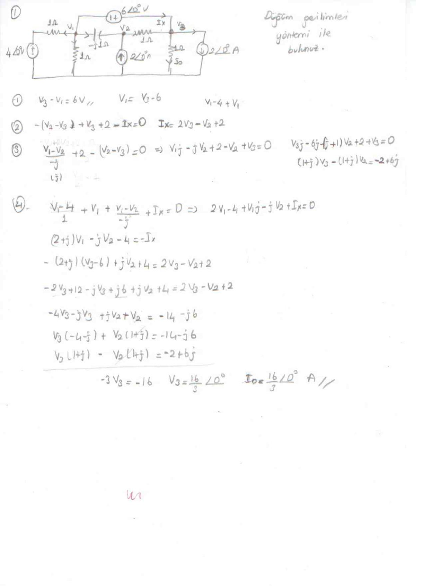
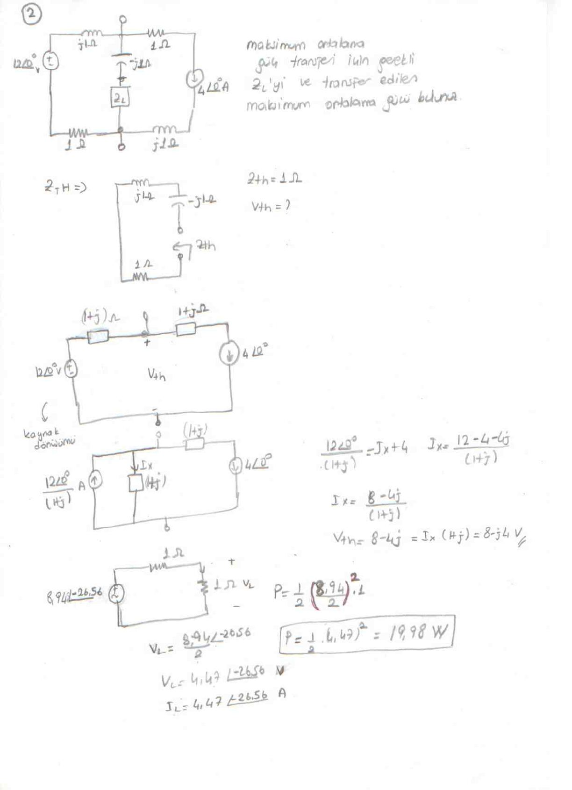
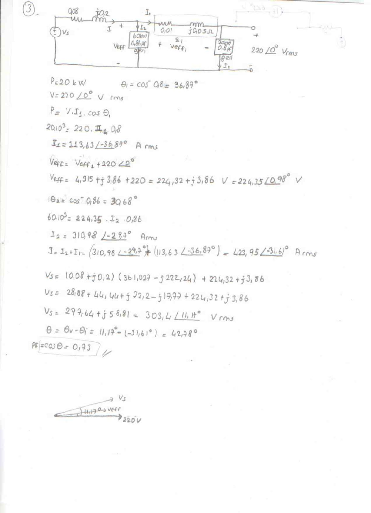
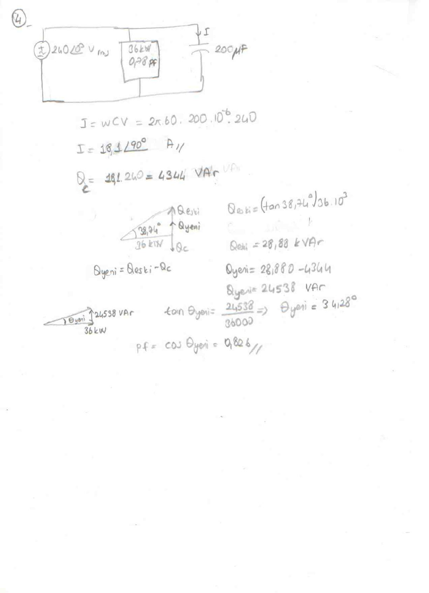

This post contains handwritten solutions to four problems from a midterm exam of the **EEM202 Circuit Theory II** course in the Electrical-Electronics Engineering program at Başkent University (the file in the archive is "arasınavcozumleri", 4 scanned pages). The topics are sinusoidal steady-state analysis and AC power: node voltages, the Thevenin equivalent and maximum power transfer, complex power, and power factor correction. The scanned page for each problem is shown, followed below it by a text transcription of the problem and the main results. The original PDF can be downloaded at the end of the post.

## Problem 1: Node-voltage method

In the phasor circuit shown, find the current I_o **using the node-voltage method.** The circuit contains a 4∠0° V source, a 6∠0° V voltage source between nodes V₁ and V₃ (a supernode), two 2∠0° A current sources, 1 Ω resistors, and a −j1 Ω capacitor.

The equations set up in the solution:

1. Supernode constraint: V₃ − V₁ = 6 V → V₁ = V₃ − 6
1. Node V₃: −(V₂ − V₃) + V₃ + 2 − I_x = 0 → I_x = 2V₃ − V₂ + 2
1. Node V₂: (V₁ − V₂)/(−j) + 2 − (V₂ − V₃) = 0 → (1+j)V₃ − (1+j)V₂ = −2 + 6j
1. Node V₁: (V₁ − 4)/1 + V₁ + (V₁ − V₂)/(−j) + I_x = 0 → (2+j)V₁ − jV₂ − 4 = −I_x

Substituting gives V₃(−4 − j) + V₂(1 + j) = −14 − j6; adding this to the third equation yields:

- −3V₃ = −16 → **V₃ = 16/3∠0° V**
- **I_o = 16/3∠0° A**

## Problem 2: Maximum average power transfer

Find the Z_L required for maximum average power transfer and the maximum average power transferred. The circuit contains a 12∠0° V voltage source, a 4∠0° A current source, two j1 Ω inductors, two 1 Ω resistors, and a −j1 Ω capacitor.

- Thevenin impedance: **Z_Th = 1 Ω** (for the load, Z_L = Z_Th* = 1 Ω)
- A source transformation gives a current source of 12∠0°/(1+j) A; 12∠0°/(1+j) = I_x + 4 → I_x = (8 − 4j)/(1+j)
- **V_Th = I_x(1+j) = 8 − j4 V = 8.94∠−26.56° V**
- V_L = 8.94∠−26.56°/2 = 4.47∠−26.56° V, I_L = 4.47∠−26.56° A
- Power found in the solution: P = ½(8.94/2)²·1 = ½·(4.47)² = 19.98 W

*Note: ½·(4.47)² = ½·19.98 = 9.99 W; the factor ½ was dropped in the last step of the solution. The correct value is P_max ≈ 10 W (|V_Th|²/8R = 80/8).*

## Problem 3: Source voltage and power factor in a line feeding two loads

The source V_s feeds a 60 kW, 0.86 power factor (lagging) load through a 0.08 + j0.2 Ω line, and a 20 kW, 0.8 power factor (lagging) load through a second 0.01 + j0.05 Ω line. The voltage across the second load is 220∠0° V rms. Find the source voltage and the power factor at the source.

- 20 kW load: θ₁ = cos⁻¹ 0.8 = 36.87°; 20·10³ = 220·I₁·0.8 → **I₁ = 113.63∠−36.87° A rms**
- Voltage across the first load: V_eff = V_eff1 + 220∠0° = 4.315 + j3.86 + 220 = 224.32 + j3.86 V = **224.35∠0.98° V**
- 60 kW load: θ₂ = cos⁻¹ 0.86 = 30.68°; 60·10³ = 224.35·I₂·0.86 → **I₂ = 310.98∠−29.7° A rms**
- Total current: I = I₁ + I₂ = **423.95∠−31.61° A rms**
- V_s = (0.08 + j0.2)(361.027 − j222.24) + 224.32 + j3.86 = 297.64 + j58.81 = **303.4∠11.17° V rms**
- θ = θ_v − θ_i = 11.17° − (−31.61°) = 42.78° → **pf = cos θ = 0.73**

*Note: In the intermediate step, the sum of the imaginary parts should be 72.2 − 17.77 + 3.86 = 58.29 (58.81 is written in the solution); this gives V_s ≈ 303.3∠11.08° V rms and θ ≈ 42.7°. The power factor is still 0.73.*

## Problem 4: Power factor correction with a capacitor

A 200 µF capacitor is connected in parallel with a 36 kW, 0.78 power factor (lagging) load supplied by a 240∠0° V rms, 60 Hz source. Find the capacitor current and the new power factor.

- I = ωCV = 2π·60·200·10⁻⁶·240 → **I = 18.1∠90° A**
- Q_C = 18.1·240 = **4344 VAr**
- Q_old = (tan 38.74°)·36·10³ = **28.88 kVAr**
- Q_new = Q_old − Q_C = 28 880 − 4344 = **24 538 VAr**
- tan θ_new = 24 538 / 36 000 → θ_new = 34.28°
- **pf = cos θ_new = 0.826**
