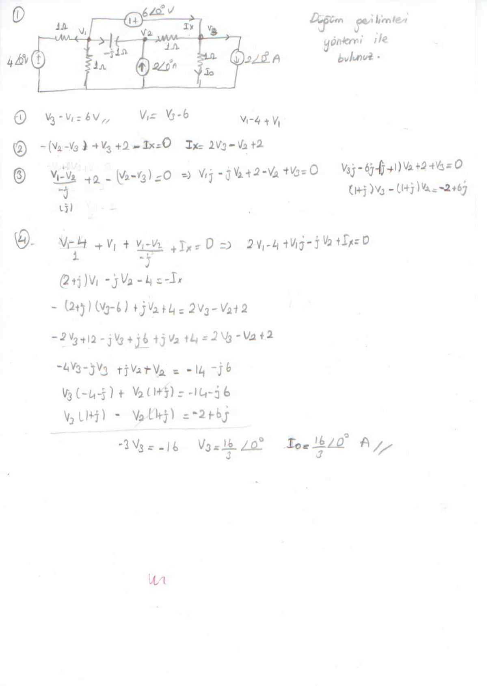
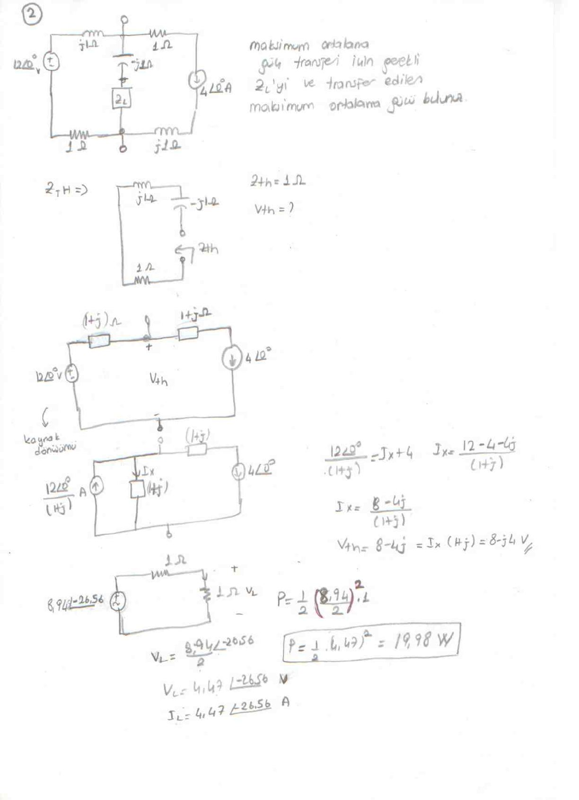
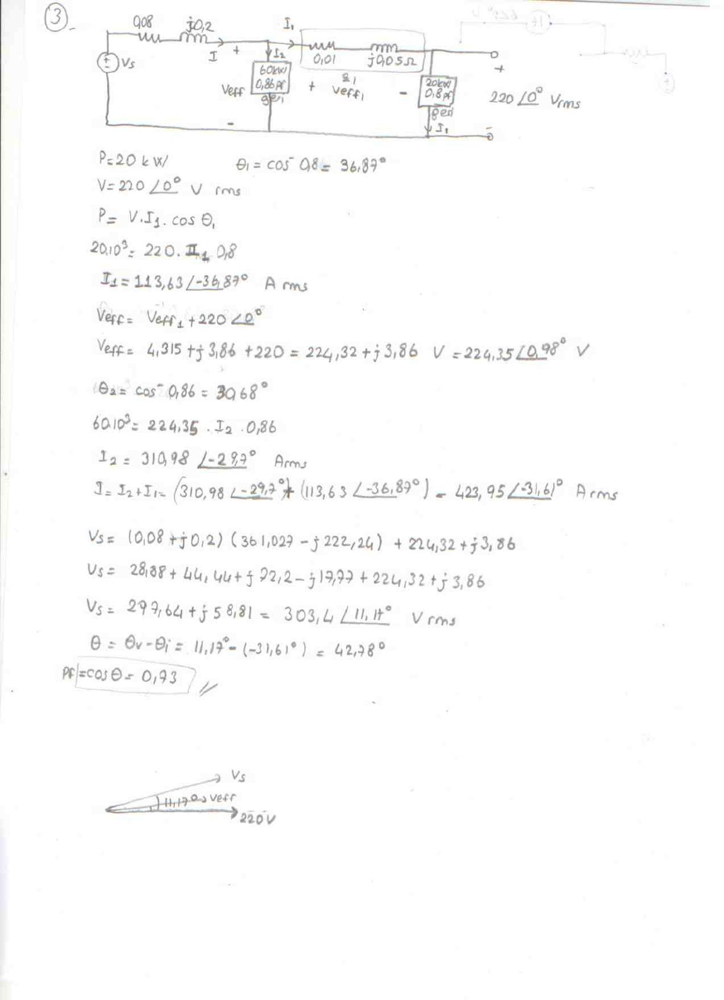
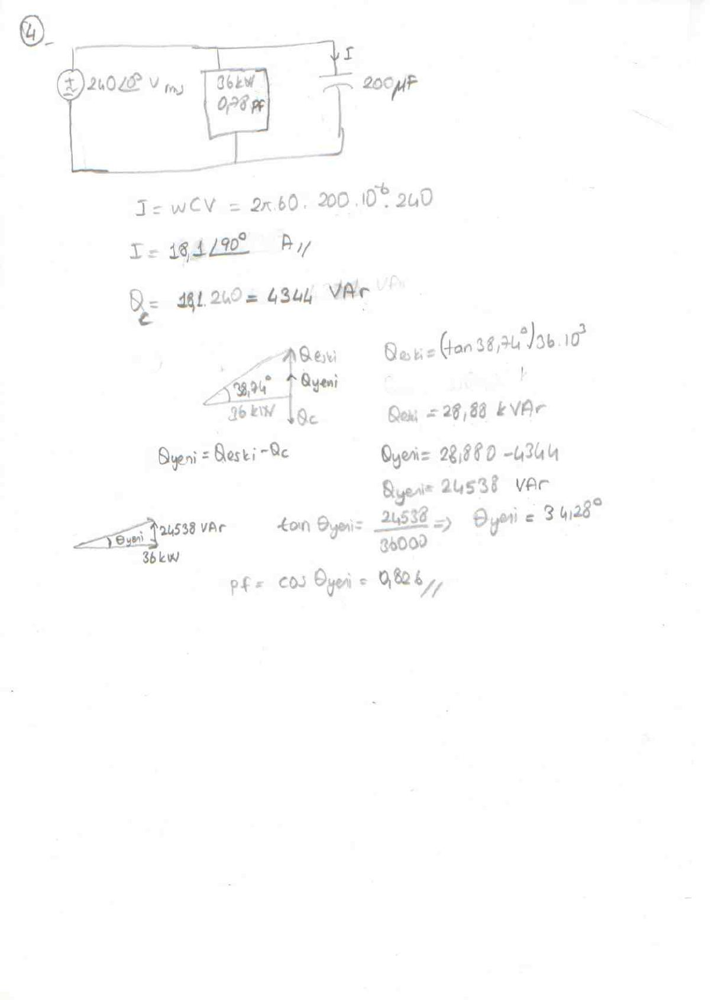

Bu yazı, Başkent Üniversitesi Elektrik-Elektronik Mühendisliği **EEM202 Devre Teorisi II** dersinin bir ara sınavına ait dört sorunun el yazısı çözümlerini içeriyor (arşivdeki dosya "arasınavcozumleri", taranmış 4 sayfa). Konular sinüsoidal kararlı durum analizi ve AC güç: düğüm gerilimleri, Thevenin eşdeğeri ve maksimum güç transferi, karmaşık güç ve güç çarpanı düzeltme. Her sorunun taranmış sayfası, altında soru ve ana sonuçların metin dökümüyle verildi. Orijinal PDF yazının sonunda indirilebilir.

## Soru 1: Düğüm gerilimleri yöntemi

Şekildeki fazör devresinde I_o akımını **düğüm gerilimleri yöntemi ile bulunuz.** Devrede 4∠0° V kaynak, V₁ ve V₃ düğümleri arasında 6∠0° V'luk bir gerilim kaynağı (süper düğüm), 2∠0° A'lik iki akım kaynağı, 1 Ω dirençler ve −j1 Ω'luk bir kapasitör var.

Çözümde kurulan denklemler:

1. Süper düğüm kısıtı: V₃ − V₁ = 6 V → V₁ = V₃ − 6
1. V₃ düğümü: −(V₂ − V₃) + V₃ + 2 − I_x = 0 → I_x = 2V₃ − V₂ + 2
1. V₂ düğümü: (V₁ − V₂)/(−j) + 2 − (V₂ − V₃) = 0 → (1+j)V₃ − (1+j)V₂ = −2 + 6j
1. V₁ düğümü: (V₁ − 4)/1 + V₁ + (V₁ − V₂)/(−j) + I_x = 0 → (2+j)V₁ − jV₂ − 4 = −I_x

Yerine koyunca V₃(−4 − j) + V₂(1 + j) = −14 − j6 bulunur; bunu üçüncü denklemle toplayınca:

- −3V₃ = −16 → **V₃ = 16/3∠0° V**
- **I_o = 16/3∠0° A**

## Soru 2: Maksimum ortalama güç transferi

Maksimum ortalama güç transferi için gerekli Z_L'yi ve transfer edilen maksimum ortalama gücü bulunuz. Devrede 12∠0° V gerilim kaynağı, 4∠0° A akım kaynağı, j1 Ω'luk iki bobin, 1 Ω'luk iki direnç ve −j1 Ω'luk kapasitör var.

- Thevenin empedansı: **Z_Th = 1 Ω** (yük için Z_L = Z_Th* = 1 Ω)
- Kaynak dönüşümüyle 12∠0°/(1+j) A'lik akım kaynağı elde edilir; 12∠0°/(1+j) = I_x + 4 → I_x = (8 − 4j)/(1+j)
- **V_Th = I_x(1+j) = 8 − j4 V = 8,94∠−26,56° V**
- V_L = 8,94∠−26,56°/2 = 4,47∠−26,56° V, I_L = 4,47∠−26,56° A
- Çözümde bulunan güç: P = ½(8,94/2)²·1 = ½·(4,47)² = 19,98 W

*Not: ½·(4,47)² = ½·19,98 = 9,99 W eder; çözümde ½ çarpanı son adımda unutulmuş. Doğrusu P_max ≈ 10 W (|V_Th|²/8R = 80/8).*

## Soru 3: İki yüklü hatta kaynak gerilimi ve güç çarpanı

Kaynak V_s, 0,08 + j0,2 Ω'luk hat üzerinden 60 kW, 0,86 güç çarpanı (geri) yükü ve 0,01 + j0,05 Ω'luk ikinci bir hat üzerinden 20 kW, 0,8 güç çarpanı (geri) yükü besler. İkinci yükün gerilimi 220∠0° V rms'dir. Kaynak gerilimi ve kaynaktaki güç çarpanı bulunur.

- 20 kW yük: θ₁ = cos⁻¹ 0,8 = 36,87°; 20·10³ = 220·I₁·0,8 → **I₁ = 113,63∠−36,87° A rms**
- Birinci yükün gerilimi: V_eff = V_eff1 + 220∠0° = 4,315 + j3,86 + 220 = 224,32 + j3,86 V = **224,35∠0,98° V**
- 60 kW yük: θ₂ = cos⁻¹ 0,86 = 30,68°; 60·10³ = 224,35·I₂·0,86 → **I₂ = 310,98∠−29,7° A rms**
- Toplam akım: I = I₁ + I₂ = **423,95∠−31,61° A rms**
- V_s = (0,08 + j0,2)(361,027 − j222,24) + 224,32 + j3,86 = 297,64 + j58,81 = **303,4∠11,17° V rms**
- θ = θ_v − θ_i = 11,17° − (−31,61°) = 42,78° → **pf = cos θ = 0,73**

*Not: Ara adımda sanal kısımların toplamı 72,2 − 17,77 + 3,86 = 58,29 olmalı (çözümde 58,81 yazılmış); buna göre V_s ≈ 303,3∠11,08° V rms ve θ ≈ 42,7° çıkar. Güç çarpanı yine 0,73'tür.*

## Soru 4: Kondansatörle güç çarpanı düzeltme

240∠0° V rms, 60 Hz kaynağa bağlı 36 kW, 0,78 güç çarpanlı (geri) yüke 200 µF'lık kondansatör paralel bağlanıyor. Kondansatör akımı ve yeni güç çarpanı bulunur.

- I = ωCV = 2π·60·200·10⁻⁶·240 → **I = 18,1∠90° A**
- Q_C = 18,1·240 = **4344 VAr**
- Q_eski = (tan 38,74°)·36·10³ = **28,88 kVAr**
- Q_yeni = Q_eski − Q_C = 28 880 − 4344 = **24 538 VAr**
- tan θ_yeni = 24 538 / 36 000 → θ_yeni = 34,28°
- **pf = cos θ_yeni = 0,826**
