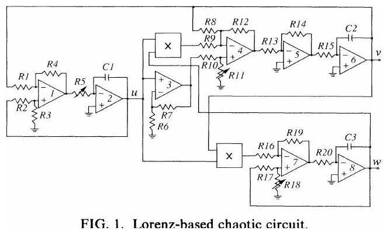
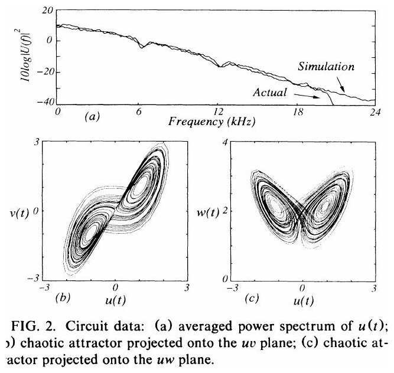

This post presents two scientific papers on the **synchronization of chaotic circuits**, kept under "devre_karisik_notlari" in the course folder. Both are the work of **Kevin M. Cuomo** and **Alan V. Oppenheim** (and, in the second, also **Steven H. Strogatz**) of the MIT Research Laboratory of Electronics; they describe an analog circuit that solves the Lorenz equations and the private-communications experiments carried out with this circuit. For a circuit theory student, it is an interesting example of "solving a differential equation with a circuit". The papers are not reproduced verbatim; the bibliographic details, abstracts, and main points are given, and two figures are included. The original (scanned) PDFs of both papers can be downloaded as a ZIP at the end of the post.

*Note: This content belongs to a third-party source; it is shared for archival and nostalgic purposes with the source credited. It will be removed at the request of the rights holder.*

## 1. Circuit Implementation of Synchronized Chaos with Applications to Communications

- **Authors:** Kevin M. Cuomo, Alan V. Oppenheim (Research Laboratory of Electronics, Massachusetts Institute of Technology)
- **Publication:** *Physical Review Letters*, Vol. 71, No. 1, pp. 65–68, 5 July 1993 (submitted 21 January 1993); © 1993 The American Physical Society
- **Abstract (from the paper):** "An analog circuit implementation of the chaotic Lorenz system is described and used to demonstrate two possible approaches to private communications based on synchronized chaotic systems."

### Main points

In 1990, Pecora and Carroll showed that some chaotic systems have the property of **self-synchronization**: if a system can be decomposed into a drive subsystem and a stable response subsystem, the two synchronize when coupled by a common drive signal. The Lorenz system is:

- ẋ = σ(y − x), ẏ = rx − y − xz, ż = xy − bz

To fit the wide dynamic range of the variables within the supply voltage limits, the transformation u = x/10, v = y/10, w = z/20 is applied, and the transmitter circuit implements the following equations:

- u̇ = σ(v − u), v̇ = ru − v − 20uw, ẇ = 5uv − bw

The circuit uses 8 op-amps (LF353) for summation, subtraction, and integration, and two analog multipliers (AD632AD) for the nonlinear terms. The coefficients σ, r, and b can be adjusted independently via the resistors R5, R11, and R18, and the time scale can be changed with the capacitors C1, C2, C3 (500 pF). The chosen values give σ = 16, r = 45.6, b = 4.

The circuit outputs were sampled at 48 kHz and 16 bits: the power spectrum of u(t) is broadband (characteristic of chaotic signals) and agrees with the digital simulation; the projections onto the uv and uw planes show the well-known "butterfly"-shaped Lorenz attractor.

The receiver is an identical circuit in which the drive signal u(t) takes the place of u_r in the v̇_r and ẇ_r equations. Using the Lyapunov function E = ½[(1/σ)e₁² + e₂² + 4e₃²] for the error dynamics e = d − r, it is shown that for σ, b > 0 the error goes to zero, i.e., the **synchronization is stable**; it is not even necessary for the transmitter and receiver to operate chaotically. The paper uses this property to demonstrate two private-communications approaches: hiding the message with a chaotic masking signal and extracting it at the receiver by regenerating the mask, and varying a transmitter coefficient with the message and decoding the binary data from the synchronization error at the receiver.

## 2. Synchronization of Lorenz-Based Chaotic Circuits with Applications to Communications

- **Authors:** Kevin M. Cuomo, Alan V. Oppenheim, Steven H. Strogatz
- **Publication:** *IEEE Transactions on Circuits and Systems—II: Analog and Digital Signal Processing*, Vol. 40, No. 10, pp. 626–633, October 1993 (8 pages); © 1993 IEEE
- **Abstract (from the paper, abridged):** "A circuit implementation of the chaotic Lorenz system is described. The chaotic behavior of the circuit closely matches the results predicted by numerical experiments. Using the concept of synchronized chaotic systems (SCS's), two possible approaches to secure communications are demonstrated with the Lorenz circuit implemented in both the transmitter and receiver. In the first approach, a chaotic masking signal is added at the transmitter to the message, and at the receiver, the masking is regenerated and subtracted from the received signal. The second approach utilizes modulation of the coefficients of the chaotic system in the transmitter and corresponding detection of synchronization error in the receiver to transmit binary-valued bit streams. (…) we establish an analogy between synchronization in chaotic systems, nonlinear observers for deterministic systems, and state estimation in probabilistic systems. (…) we compare the performance of the Lorenz SCS to an extended Kalman filter for providing state estimates when the measurement consists of a single noisy transmitter component."

### Sections

- I. Introduction
- II. Background (the concept of synchronized chaotic systems, the Lorenz system)
- III. Circuit implementation (the electronic circuit realization of the Lorenz system)
- IV. Synchronizing receiver (a receiver circuit that reproduces the full state dynamics of the transmitter)
- V–VI. Communications applications (binary data transmission by chaotic masking and by coefficient modulation)
- VII. Synchronization and state estimation (the synchronized chaotic system acting as a nonlinear state observer; its performance compared with an extended Kalman filter (EKF) given a single noisy transmitter component)

This paper is an extended version of the work in PRL.

## Downloadable files

The ZIP contains the scanned original PDFs of the two papers: "CircuitImplementation_000.pdf" (Physical Review Letters, 4 pages) and "SynchroofLorenz.pdf" (IEEE, 8 pages).
