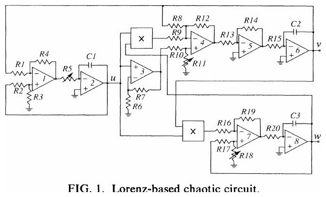
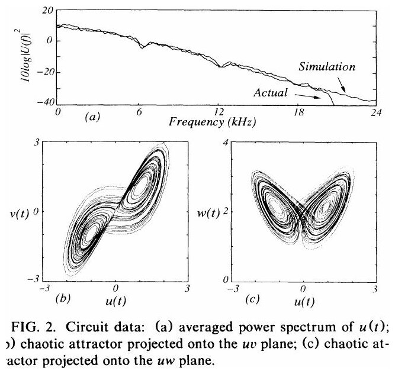

Bu yazı, ders klasöründeki "devre_karisik_notlari" altında saklanan, **kaotik devrelerin senkronizasyonu** üzerine iki bilimsel makaleyi tanıtıyor. İkisi de MIT Research Laboratory of Electronics'ten **Kevin M. Cuomo** ve **Alan V. Oppenheim**'ın (ikincisinde **Steven H. Strogatz** da) çalışması; Lorenz denklemlerini çözen bir analog devreyi ve bu devreyle yapılan gizli haberleşme deneylerini anlatıyor. Bir devre teorisi öğrencisi için ilgi çekici bir "devre ile diferansiyel denklem çözme" örneği. Makaleler birebir aktarılmadı; künye, özet ve ana noktalar verildi, iki şekil eklendi. İki makalenin orijinal (taranmış) PDF'leri yazının sonunda ZIP olarak indirilebilir.

*Bu içerik üçüncü taraf bir kaynağa aittir; arşiv ve nostalji amacıyla kaynak belirtilerek paylaşılmıştır. Hak sahibinin talebi hâlinde kaldırılır.*

## 1. Circuit Implementation of Synchronized Chaos with Applications to Communications

- **Yazarlar:** Kevin M. Cuomo, Alan V. Oppenheim (Research Laboratory of Electronics, Massachusetts Institute of Technology)
- **Yayın:** *Physical Review Letters*, Cilt 71, Sayı 1, s. 65–68, 5 Temmuz 1993 (gönderim 21 Ocak 1993); © 1993 The American Physical Society
- **Özet (makaleden):** "An analog circuit implementation of the chaotic Lorenz system is described and used to demonstrate two possible approaches to private communications based on synchronized chaotic systems."

### Ana noktalar

1990'da Pecora ve Carroll, bazı kaotik sistemlerin **kendi kendine senkronize olma** özelliği taşıdığını göstermişti: sistem bir sürücü (drive) ve kararlı bir yanıt (response) alt sistemine ayrılabiliyorsa, ortak bir sürücü işaretiyle bağlandıklarında senkronize olurlar. Lorenz sistemi:

- ẋ = σ(y − x), ẏ = rx − y − xz, ż = xy − bz

Değişkenlerin geniş dinamik aralığını besleme gerilimi sınırlarına sığdırmak için u = x/10, v = y/10, w = z/20 dönüşümü yapılır ve verici devre şu denklemleri gerçekler:

- u̇ = σ(v − u), v̇ = ru − v − 20uw, ẇ = 5uv − bw

Devre 8 op-amp (LF353) ile toplama, çıkarma ve integral alma; iki analog çarpıcı (AD632AD) ile doğrusal olmayan terimleri gerçekliyor. σ, r ve b katsayıları R5, R11 ve R18 dirençleriyle bağımsız ayarlanabiliyor, zaman ölçeği C1, C2, C3 kondansatörleriyle (500 pF) değiştirilebiliyor. Seçilen değerler σ = 16, r = 45,6, b = 4 veriyor.

Devre çıkışları 48 kHz ve 16 bit ile örneklenmiş: u(t)'nin güç spektrumu geniş bantlı (kaotik işaretlere özgü) ve sayısal benzetimle uyumlu; uv ve uw düzlemlerindeki izdüşümler bilinen "kelebek" biçimli Lorenz çekerini gösteriyor.

Alıcı, sürücü işareti u(t)'nin v̇_r ve ẇ_r denklemlerinde u_r'nin yerine geçtiği özdeş bir devredir. Hata dinamiği e = d − r için E = ½[(1/σ)e₁² + e₂² + 4e₃²] Lyapunov fonksiyonu kullanılarak σ, b > 0 iken hatanın sıfıra gittiği, yani **senkronizasyonun kararlı** olduğu gösteriliyor; verici ve alıcının kaotik çalışması bile gerekmiyor. Makale bu özellikle iki gizli haberleşme yaklaşımını gösteriyor: mesajı kaotik bir maskeleme işaretiyle gizleyip alıcıda maskeyi yeniden üreterek çıkarmak ve verici katsayısını mesajla değiştirip ikili veriyi alıcıdaki senkronizasyon hatasından çözmek.

## 2. Synchronization of Lorenz-Based Chaotic Circuits with Applications to Communications

- **Yazarlar:** Kevin M. Cuomo, Alan V. Oppenheim, Steven H. Strogatz
- **Yayın:** *IEEE Transactions on Circuits and Systems—II: Analog and Digital Signal Processing*, Cilt 40, Sayı 10, s. 626–633, Ekim 1993 (8 sayfa); © 1993 IEEE
- **Özet (makaleden, kısaltılarak):** "A circuit implementation of the chaotic Lorenz system is described. The chaotic behavior of the circuit closely matches the results predicted by numerical experiments. Using the concept of synchronized chaotic systems (SCS's), two possible approaches to secure communications are demonstrated with the Lorenz circuit implemented in both the transmitter and receiver. In the first approach, a chaotic masking signal is added at the transmitter to the message, and at the receiver, the masking is regenerated and subtracted from the received signal. The second approach utilizes modulation of the coefficients of the chaotic system in the transmitter and corresponding detection of synchronization error in the receiver to transmit binary-valued bit streams. (…) we establish an analogy between synchronization in chaotic systems, nonlinear observers for deterministic systems, and state estimation in probabilistic systems. (…) we compare the performance of the Lorenz SCS to an extended Kalman filter for providing state estimates when the measurement consists of a single noisy transmitter component."

### Bölümler

- I. Introduction
- II. Background (senkronize kaotik sistemler kavramı, Lorenz sistemi)
- III. Circuit implementation (Lorenz sisteminin elektronik devre gerçeklemesi)
- IV. Synchronizing receiver (vericinin tüm durum dinamiklerini yeniden üreten alıcı devre)
- V–VI. Haberleşme uygulamaları (kaotik maskeleme ve katsayı modülasyonuyla ikili veri iletimi)
- VII. Senkronizasyon ve durum kestirimi (senkronize kaotik sistemin doğrusal olmayan bir durum gözlemcisi gibi çalışması; gürültülü tek bir verici bileşeniyle genişletilmiş Kalman filtresine (EKF) göre başarımı)

Bu makale, PRL'deki çalışmanın genişletilmiş sürümüdür.

## İndirilebilir dosyalar

ZIP'te iki makalenin taranmış orijinal PDF'leri var: "CircuitImplementation_000.pdf" (Physical Review Letters, 4 sayfa) ve "SynchroofLorenz.pdf" (IEEE, 8 sayfa).
