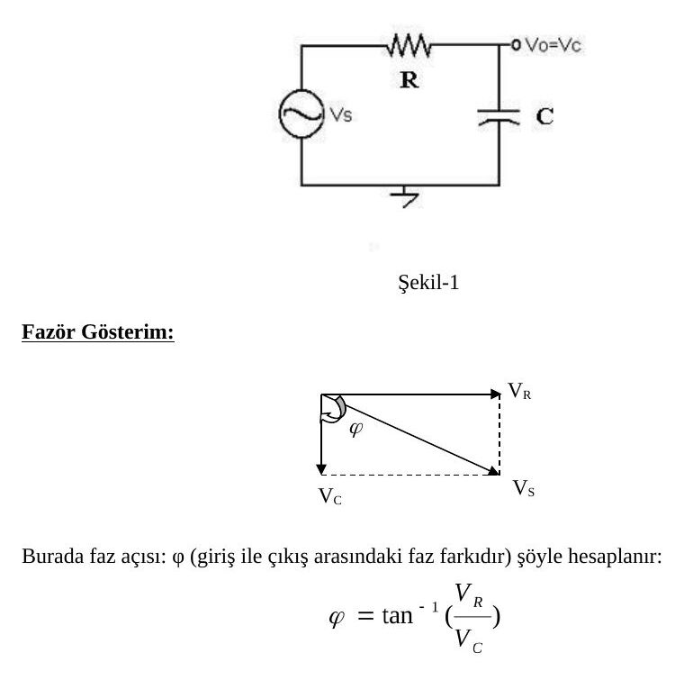
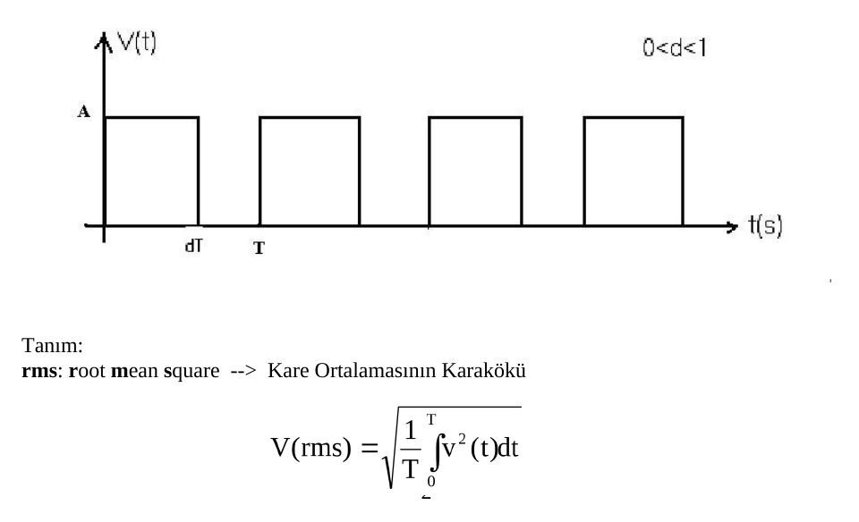
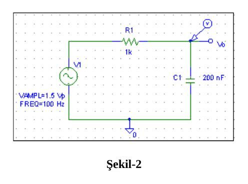
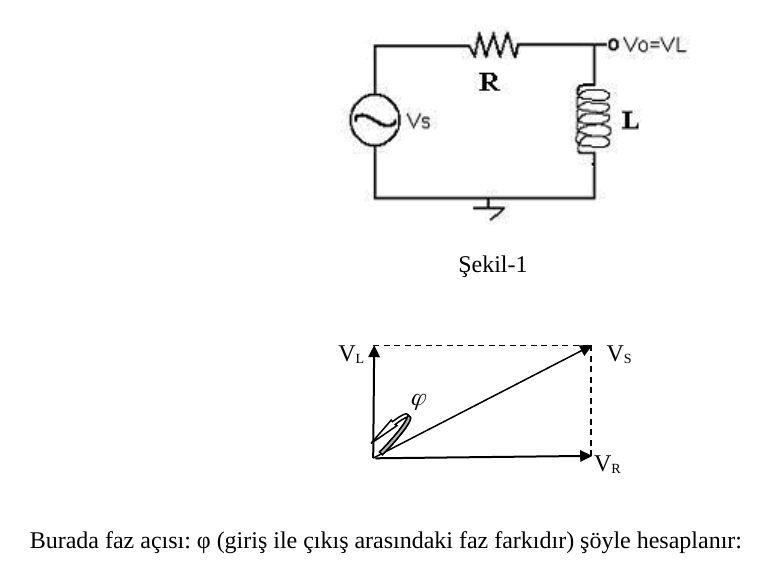
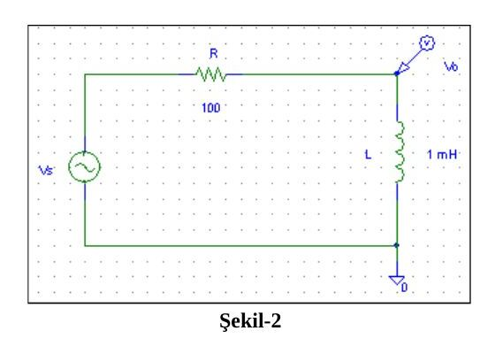

This post contains the first two experiment sheets of the Başkent University Electrical-Electronics Engineering **EEM-202 Circuit Theory-2 Laboratory**: **Experiment-1: Investigation of Sinusoidal RC Circuits** and **Experiment-2: Investigation of Sinusoidal RL Circuits** (2013 edition of the sheets). The text of the sheets has been transcribed, the circuit schematics and figures have been added as images, and the measurement tables are given empty. The original Word files of both sheets can be downloaded as a ZIP at the end of the post.

## Experiment-1: Investigation of sinusoidal RC circuits

**Objective:** To learn basic AC concepts and how to work with sinusoidal circuits, and to observe the variation of capacitor impedance with frequency.

### Theoretical background

A capacitor is a circuit element whose impedance varies with frequency. In sinusoidal circuits, capacitors create a 90° phase difference between the input and output terminals. For this reason, *phasor representation* is used in circuit analysis. The phasor representation of the RC circuit is given in Figure-1.

Here the phase angle φ (the phase difference between input and output) is calculated as follows:

φ = tan⁻¹(V_R / V_C)

Here the sign of φ is negative. Why? (Does the input or the output lead?)

**How is the phase angle measured with an oscilloscope?**

1. The time difference (Δt) between input and output is measured.
1. The following proportion is set up: T (period) → 360 degrees; Δt → ? degrees

### Pre-lab

1. Define the following concepts: period, impedance, rms value.
1. Explain how the impedance of a capacitor varies with frequency. Explain how the capacitor behaves at zero frequency (DC) and at very high frequencies (UHF: Ultra High Frequency).
1. Calculate the rms value of the signal below (a) in terms of A, d and T, (b) for d = 0.6 and A = 5.

Definition: rms (root mean square) is the square root of the mean of the square: V(rms) = √[(1/T)∫₀ᵀ v²(t) dt]

### Experiment: RC circuit

Build the circuit in Figure-2 with C = 200 nF.

1. For V_s = 3 V_p (p: peak) and f = 100 Hz, measure the output signal (V_o = V_C).
1. Draw the phasor representation of the circuit. Calculate the phase angle φ from the phasor representation.
1. For the other frequencies given in Table-1, measure the output V_C (p) and the phase difference Φ between input and output with the oscilloscope, and the current I_C with an AC ammeter, and record them in the table.

*Note: The text of the sheet states V_s = 3 V_p, whereas the PSpice source in Figure-2 is drawn with VAMPL = 1.5 V (i.e., 3 V peak-to-peak). The sheet has been left as is.*

**Table-1**

| f (Hz) | V_C (p) | I (rms) | Φ (degrees) |
|---|---|---|---|
| 100 | | | |
| 200 | | | |
| 400 | | | |
| 800 | | | |
| 1600 | | | |

### Results and discussion

1. How does the current vary with frequency in the RC circuit? How does the phase angle between input and output vary with frequency? Interpret by plotting a graph.
1. Fill in the values in Table-2 by calculation.

**Table-2**

| f (Hz) | X_C (Ω) | V_R (p) |
|---|---|---|
| 100 | | |
| 200 | | |
| 400 | | |
| 800 | | |
| 1600 | | |

## Experiment-2: Investigation of sinusoidal RL circuits

**Objective:** To observe the variation of inductor impedance with frequency by working on an RL circuit.

### Theoretical background

An inductor is a circuit element whose impedance varies with frequency. In sinusoidal circuits, inductors create a 90° phase difference between the input and output terminals. For this reason, *phasor representation* is used in circuit analysis. The phasor representation of the RL circuit is given in Figure-1.

Here the phase angle φ (the phase difference between input and output) is calculated as follows:

φ = tan⁻¹(V_R / V_L)

What is the sign of φ here?

### Pre-lab

1. Explain how the impedance of an inductor varies with frequency. State how the inductor behaves at zero frequency (DC) and at very high frequencies (UHF: Ultra High Frequency).
1. Define the following concepts: frequency, reactance, admittance.

### Experiment: RL circuit

Build the circuit in Figure-2 with L = 1 mH.

1. For V_s = 3 V_pp and f = 40 kHz, measure the output signal (V_o = V_L).
1. Draw the phasor representation of the circuit. Calculate the phase angle φ from the phasor representation.
1. For the other frequencies given in Table-1, measure the output V_L (p) and the phase difference Φ between input and output with the oscilloscope, and the current with an AC ammeter, and record them in the table.

**Table-1 (measured) and Table-2 (calculated)** have the same columns:

| f (kHz) | V_L (p) | I (rms) | Φ (degrees) |
|---|---|---|---|
| 20 | | | |
| 40 | | | |
| 60 | | | |
| 100 | | | |
| 140 | | | |

### Results and discussion

1. How do the current and the phase angle vary with frequency in the RL circuit? Plot a graph and interpret it.
1. Fill in the corresponding blanks by calculating the values in Table-2. Compare them with the values you measured in Table-1 and interpret.
