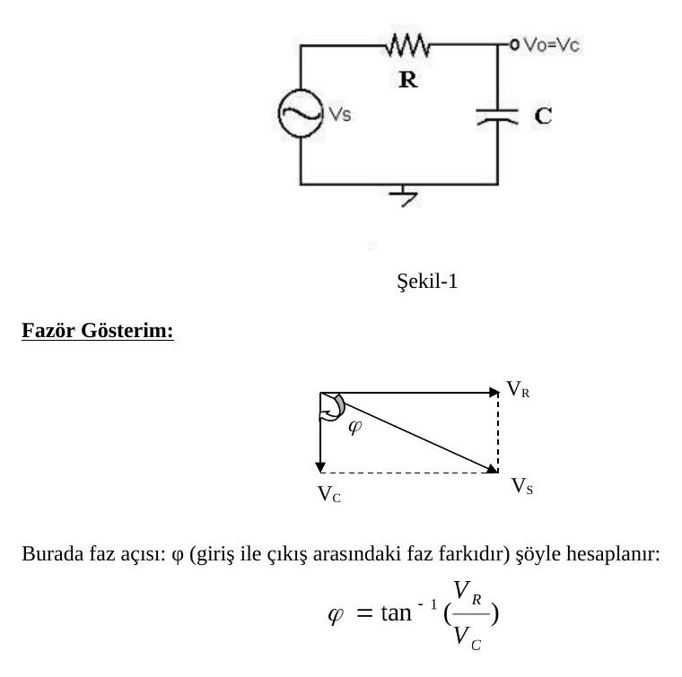
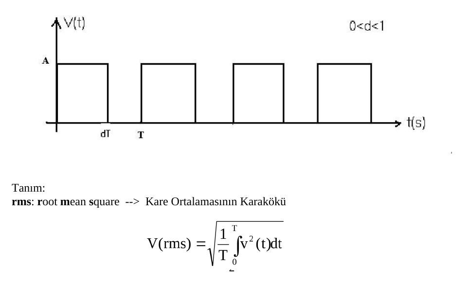
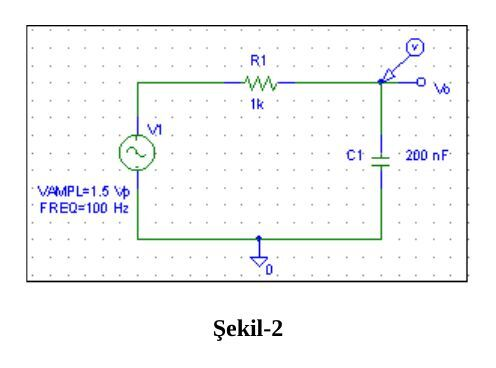
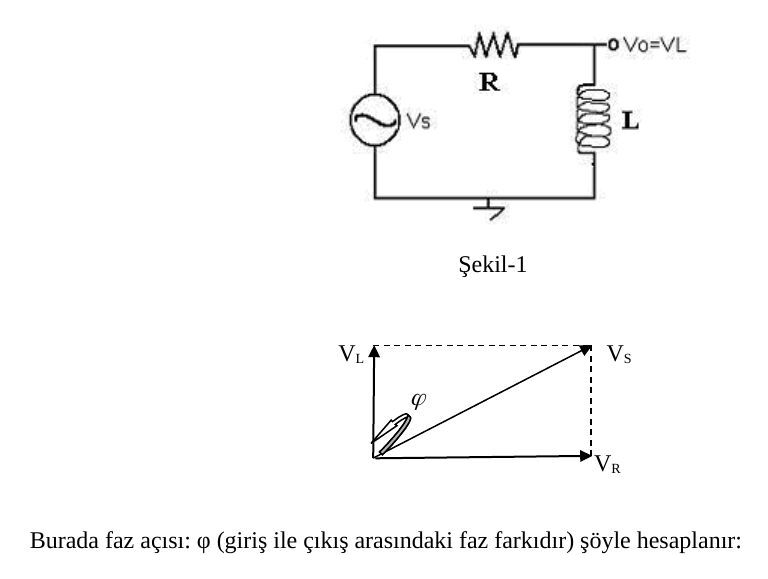
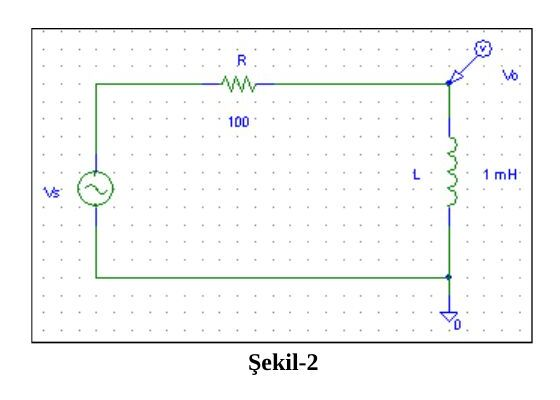

Bu yazı, Başkent Üniversitesi Elektrik-Elektronik Mühendisliği **EEM-202 Devre Teorisi-2 Laboratuvarı**'nın ilk iki deney föyünü içeriyor: **Deney-1: Sinüsoidal RC Devrelerinin İncelenmesi** ve **Deney-2: Sinüsoidal RL Devrelerinin İncelenmesi** (föylerin 2013 baskısı). Föy metinleri aktarıldı, devre şemaları ve şekiller görsel olarak eklendi; ölçüm tabloları boş hâlleriyle verildi. İki föyün orijinal Word dosyaları yazının sonunda ZIP olarak indirilebilir.

## Deney-1: Sinüsoidal RC devrelerinin incelenmesi

**Amaç:** Temel AC kavramların ve sinüsoidal devrelerle çalışmanın öğrenilmesi, kapasitör empedansının frekansla değişiminin gözlenmesidir.

### Kuramsal bilgi

Kapasitör, empedansı frekansla değişen bir devre elemanıdır. Kapasitörler sinüsoidal devrelerde giriş ve çıkış uçları arasında 90°'lik faz farkı oluşturur. Bundan dolayı devre analizinde *fazör gösterim* kullanılır. Şekil-1'de RC devresi için fazör gösterim verilmiştir.

Burada faz açısı φ (giriş ile çıkış arasındaki faz farkı) şöyle hesaplanır:

φ = tan⁻¹(V_R / V_C)

Burada φ'nin işareti negatiftir, neden? (Giriş mi, yoksa çıkış mı daha önde?)

**Faz açısı osiloskop ile nasıl ölçülür?**

1. Giriş ve çıkış arasındaki zaman farkı (Δt) ölçülür.
1. Şu orantı kurulur: T (periyot) → 360 derece; Δt → ? derece

### Ön çalışma

1. Şu kavramları tanımlayın: periyot, empedans, rms değer.
1. Kapasitör için empedansın frekansla nasıl değiştiğini açıklayın. Frekans sıfır olursa (DC) ve çok büyük frekanslarda (UHF: Ultra High Frequency) kapasitörün nasıl davranacağını açıklayın.
1. Aşağıdaki işaretin rms değerini (a) A, d ve T cinsinden, (b) d = 0.6 ve A = 5 için hesaplayınız.

Tanım: rms (root mean square), kare ortalamasının kareköküdür: V(rms) = √[(1/T)∫₀ᵀ v²(t) dt]

### Deney: RC devresi

Şekil-2'deki devreyi C = 200 nF ile kurun.

1. V_s = 3 V_p (p: peak / tepe değeri) ve f = 100 Hz için çıkış sinyalini (V_o = V_C) ölçün.
1. Devrenin fazör gösterimini çizin. Faz açısı φ'yi fazör gösterimden hesaplayın.
1. Tablo-1 ile verilen diğer frekanslar için çıkışı V_C (p) ve giriş-çıkış arasındaki faz farkını Φ osiloskop ile, I_C akımını AC ampermetre ile ölçün ve tabloya kaydedin.

*Not: Föyün metninde V_s = 3 V_p yazıyor; Şekil-2'deki PSpice kaynağı ise VAMPL = 1.5 V (yani 3 V tepeden tepeye) olarak çizilmiş. Föy hâliyle bırakıldı.*

**Tablo-1**

| f (Hz) | V_C (p) | I (rms) | Φ (derece) |
|---|---|---|---|
| 100 | | | |
| 200 | | | |
| 400 | | | |
| 800 | | | |
| 1600 | | | |

### Sonuçlar ve yorum

1. RC devresinde akım frekansla nasıl değişmektedir? Giriş-çıkış arasındaki faz açısı frekansla nasıl değişmektedir? Grafik çizerek yorumlayınız.
1. Tablo-2'deki değerleri hesaplayarak doldurunuz.

**Tablo-2**

| f (Hz) | X_C (Ω) | V_R (p) |
|---|---|---|
| 100 | | |
| 200 | | |
| 400 | | |
| 800 | | |
| 1600 | | |

## Deney-2: Sinüsoidal RL devrelerinin incelenmesi

**Amaç:** RL devresi üzerinde çalışarak bobin empedansının frekansla değişiminin gözlenmesidir.

### Kuramsal bilgi

Bobin, empedansı frekansla değişen bir devre elemanıdır. Bobinler sinüsoidal devrelerde giriş ve çıkış uçları arasında 90°'lik faz farkı oluşturur. Bundan dolayı devre analizinde *fazör gösterim* kullanılır. Şekil-1'de RL devresi için fazör gösterim verilmiştir.

Burada faz açısı φ (giriş ile çıkış arasındaki faz farkı) şöyle hesaplanır:

φ = tan⁻¹(V_R / V_L)

Burada φ'nin işareti nedir?

### Ön çalışma

1. Bobin için empedansın frekansla nasıl değiştiğini açıklayın. Frekans sıfır olursa (DC) ve çok büyük frekanslarda (UHF: Ultra High Frequency) bobinin nasıl davranacağını belirtin.
1. Şu kavramları tanımlayın: frekans, reaktans, admitans.

### Deney: RL devresi

Şekil-2'deki devreyi L = 1 mH bobin ile kurun.

1. V_s = 3 V_pp ve f = 40 kHz için çıkış sinyalini (V_o = V_L) ölçün.
1. Devrenin fazör gösterimini çizin. Faz açısı φ'yi fazör gösterimden hesaplayın.
1. Tablo-1 ile verilen diğer frekanslar için çıkışı V_L (p) ve giriş-çıkış arasındaki faz farkını Φ osiloskop ile, akımı AC ampermetre ile ölçün ve tabloya kaydedin.

**Tablo-1 (ölçülen) ve Tablo-2 (hesaplanan)** aynı sütunlara sahiptir:

| f (kHz) | V_L (p) | I (rms) | Φ (derece) |
|---|---|---|---|
| 20 | | | |
| 40 | | | |
| 60 | | | |
| 100 | | | |
| 140 | | | |

### Sonuçlar ve yorum

1. RL devresinde akım ve faz açısı frekansa bağlı olarak nasıl değişmektedir? Grafik çizip yorum yapınız.
1. Tablo-2'deki değerleri hesaplayarak ilgili boşlukları doldurunuz. Tablo-1'de ölçtüğünüz değerlerle karşılaştırıp yorumlayınız.
