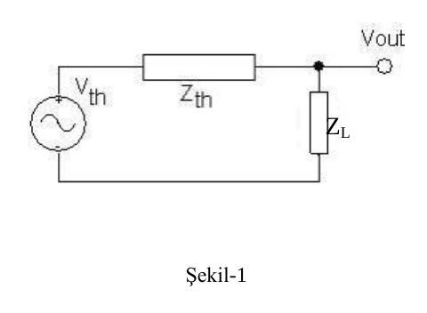
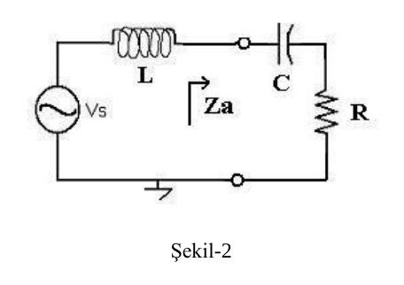
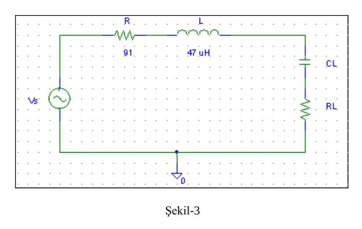
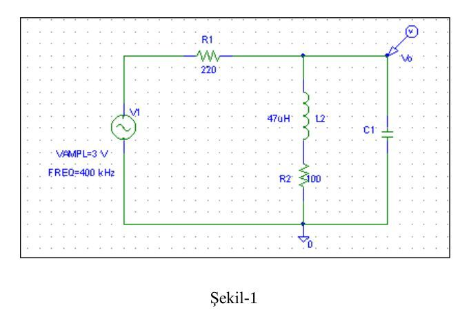
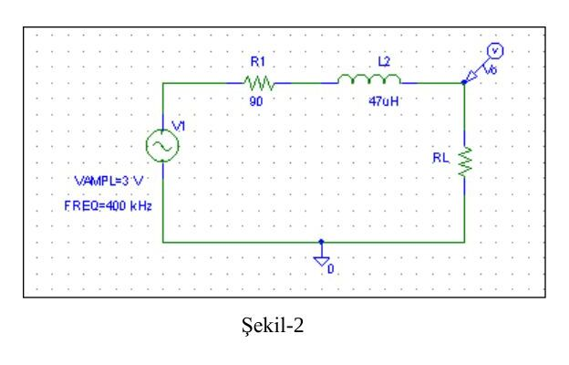

This post contains two experiment handouts from the Başkent University Electrical-Electronics Engineering **EEM-202 Circuit Theory II Laboratory**: **Experiment 3: Power Analysis in Sinusoidal Circuits and Maximum Power Transfer** (March 2013) and **Experiment 4: Power Compensation and Power Factor Correction** (April 2013). The handout texts have been transcribed, the circuit diagrams have been added as images, and the measurement tables are provided in their blank form. The original PDFs of both handouts can be downloaded as a ZIP at the end of the post.

## Experiment 3: Power analysis in sinusoidal circuits and maximum power transfer

**Objective:** The objective of this experiment is to calculate the power values of elements in sinusoidal circuits and to examine the condition required for transferring maximum power to a load.

### Theoretical background

Power is the product of voltage and current. In sinusoidal circuits, power is the product of a sinusoidal current and a sinusoidal voltage (which will probably have a phase difference between them). Here two different power expressions arise: (1) active (average, real) power P and (2) reactive power Q.

You know that the impedances of an inductor and a capacitor vary with the frequency of the source. As an example, suppose that in the circuit in Figure 1 the impedance Z_L increases with frequency. In this case, the voltage across Z_L increases while the current flowing through the circuit decreases. As in DC circuits, at one particular value of the impedance the power of the element is at its maximum, and maximum average power transfer from the source to the load takes place.

Power can be expressed in terms of both the maximum (peak) and the rms (effective) values of the current and voltage:

- P = ½·V_m·I_m·cos(θ_v − θ_i) = V_eff·I_eff·cos(θ_v − θ_i)
- Q = ½·V_m·I_m·sin(θ_v − θ_i) = V_eff·I_eff·sin(θ_v − θ_i)

### Pre-lab

1. What is active power? Why is it called by this name?
1. Write the equations that give the power values P and Q *in terms of impedance*. For an ideal, lossless capacitor and inductor, what is the value of the average power P?
1. In the circuit in Figure 3, what values must R_L and C_L take for maximum power to be transferred to Z_L? Calculate them.
1. Find the power consumption of the appliances in your home (such as a refrigerator, washing machine, television, and computer) and the energy they will consume in one hour.

### Experiment 1: Power measurement

Build the circuit given in Figure 2. Calculate the average power of Z_a, which consists of R and C, by measuring the values in Table 1. **L = 4.7 µH, C = 1 µF, R = 1 kΩ, V_s = 3 V_p.**

**Table 1**

| Frequency | V_Za | I_Za | θ_V − θ_I (degrees) | P |
|---|---|---|---|---|
| 150 Hz | | | | |
| 400 Hz | | | | |
| 1 kHz | | | | |

### Experiment 2: Maximum power transfer

**Table 2**

| R_L | C_L | V_L (p) | I_L (mA) | Θ_V − Θ_I | P (mW) |
|---|---|---|---|---|---|
| 91 | 1 nF | | | | |
| 91 | 3.2 nF | | | | |
| 91 | 4.7 nF | | | | |
| 150 | 3.2 nF | | | | |

### Results and discussion

1. In Part 2, for which resistor and capacitor values was the average power at its maximum? Why? Discuss.

## Experiment 4: Power compensation and power factor correction

**Objective:** The objective is to try to correct the power factor in sinusoidal circuits.

### Theoretical background

As an example, in Figure 1 the power factor angle of an inductive load is brought close to zero. To do this, a capacitor is connected in parallel with the load; the aim is to make the equivalent impedance real. This process is called *power factor correction*.

### Pre-lab

1. Calculate the value of C that must be connected across the load so that the source and load (output) voltages in the circuit in Figure 1 are in phase.
1. In the circuit in Figure 2, what value must R_L take for maximum power to be transferred to R_L?

### Experiment

**Part 1:** Build the circuit in Figure 1 first without the capacitor, then with the C values given in Table 1, and record the measurements.

**Table 1**

| C | V_out (amplitude) | Δt (input-output) |
|---|---|---|
| 10 nF | | |
| 2.2 nF | | |
| 470 pF | | |

**Part 2:** In the circuit in Figure 2, connect the resistors given in Table 2 and calculate the average power of R_L.

**Table 2**

| R_L | V_p | P_RL = 0.5·V_out²/R_L |
|---|---|---|
| 47 | | |
| 90 | | |
| 150 | | |
| 430 | | |
| 1k | | |
| 2.2k | | |

### Results and discussion

1. Why do we want to bring the power factor close to 1? How is this achieved? What effect did adding a parallel capacitor have on the circuit?
1. In the second circuit, for which R_L value was the average power at its maximum? Why? Discuss.
