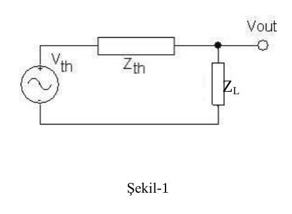
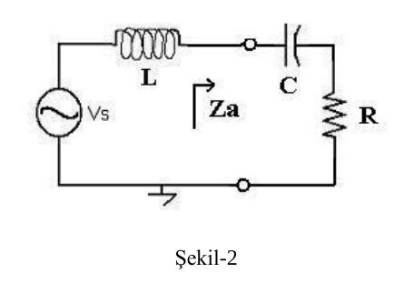
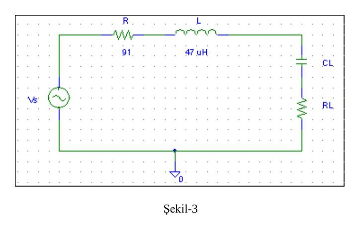
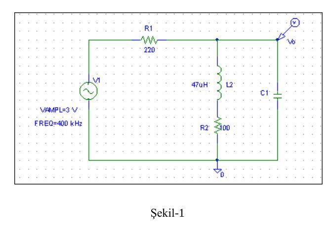
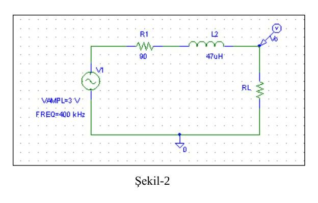

Bu yazı, Başkent Üniversitesi Elektrik-Elektronik Mühendisliği **EEM-202 Devre Teorisi-2 Laboratuvarı**'nın iki deney föyünü içeriyor: **Deney-3: Sinüsoidal Devrelerde Güç Analizi ve Maksimum Güç Transferi** (Mart 2013) ve **Deney-4: Güç Kompanzasyonu ve Güç Çarpanı Düzeltimi** (Nisan 2013). Föy metinleri aktarıldı, devre şemaları görsel olarak eklendi, ölçüm tabloları boş hâlleriyle verildi. İki föyün orijinal PDF'leri yazının sonunda ZIP olarak indirilebilir.

## Deney-3: Sinüsoidal devrelerde güç analizi ve maksimum güç transferi

**Amaç:** Bu deneyde amaç, sinüsoidal devrelerde elemanların güç değerlerini hesaplamak ve bir yüke maksimum gücün transfer edilebilmesi için gerekli koşulu incelemektir.

### Kuramsal bilgi

Güç, voltaj ve akımın çarpımıdır. Sinüsoidal devrelerde güç, sinüsoidal bir akımla sinüsoidal bir gerilimin (muhtemelen aralarında faz farkı olacaktır) çarpımıdır. Burada karşımıza iki farklı güç ifadesi çıkar: (1) aktif (ortalama, gerçel) güç P ve (2) reaktif güç Q.

Bobin ve kapasitörün empedanslarının kaynağın frekansıyla değiştiğini biliyorsunuz. Örnek olarak Şekil-1'deki devrede frekansla Z_L'nin empedansının arttığını varsayalım. Bu durumda Z_L üzerindeki voltaj artarken devreden geçen akım azalacaktır. Aynı DC devrelerde olduğu gibi, empedansın bir değerinde elemanın gücü maksimum olur ve kaynaktan yüke maksimum ortalama güç aktarımı gerçekleşir.

Güç, akım ve gerilimin hem maksimum (tepe) hem de rms (etkin) değerleri cinsinden ifade edilebilir:

- P = ½·V_m·I_m·cos(θ_v − θ_i) = V_eff·I_eff·cos(θ_v − θ_i)
- Q = ½·V_m·I_m·sin(θ_v − θ_i) = V_eff·I_eff·sin(θ_v − θ_i)

### Ön çalışma

1. Aktif güç nedir? Neden bu ismi almıştır?
1. P ve Q güç değerlerini *empedans cinsinden* veren eşitlikleri yazınız. İdeal, kayıpsız kapasitör ve bobin için P ortalama gücün değeri nedir?
1. Şekil-3'teki devrede, Z_L'ye maksimum güç aktarılması için R_L ve C_L'nin alması gereken değerler ne olmalıdır? Hesaplayınız.
1. Evinizdeki cihazların (buzdolabı, çamaşır makinesi, televizyon, bilgisayar gibi) güç tüketim değerini ve bir saatte harcayacakları enerjiyi bulun.

### Deney 1: Güç ölçümü

Şekil-2 ile verilen devreyi kurun. R ve C'den oluşan Z_a'nın ortalama gücünü Tablo-1'deki değerleri ölçerek hesaplayın. **L = 4.7 µH, C = 1 µF, R = 1 kΩ, V_s = 3 V_p.**

**Tablo-1**

| Frekans | V_Za | I_Za | θ_V − θ_I (derece) | P |
|---|---|---|---|---|
| 150 Hz | | | | |
| 400 Hz | | | | |
| 1 kHz | | | | |

### Deney 2: Maksimum güç transferi

**Tablo-2**

| R_L | C_L | V_L (p) | I_L (mA) | Θ_V − Θ_I | P (mW) |
|---|---|---|---|---|---|
| 91 | 1 nF | | | | |
| 91 | 3.2 nF | | | | |
| 91 | 4.7 nF | | | | |
| 150 | 3.2 nF | | | | |

### Sonuçlar ve yorum

1. 2. bölümde hangi direnç ve kapasitör değeri için ortalama güç maksimum çıktı? Neden? Yorumlayın.

## Deney-4: Güç kompanzasyonu ve güç çarpanı düzeltimi

**Amaç:** Sinüsoidal devrelerde güç çarpanını (power factor) düzeltmeye çalışmaktır.

### Kuramsal bilgi

Örnek olarak Şekil-1'de indüktif bir yükün güç çarpanı açısı sıfıra yaklaştırılmaktadır. Bunun için yüke paralel olarak bir kapasitör bağlanır; eşdeğer empedansın gerçel yapılmasına çalışılır. Bu işleme *güç çarpanı düzeltimi* (power factor correction) adı verilir.

### Ön çalışma

1. Şekil-1'deki devrede kaynak ve yük (çıkış) voltajlarının aynı fazda olması için yüke bağlanması gereken C'nin değerini hesaplayınız.
1. Şekil-2'deki devrede R_L'ye maksimum gücün transfer edilmesi için R_L'nin alması gereken değer ne olmalıdır?

### Deney

**Bölüm 1:** Şekil-1'deki devreyi önce kapasitörsüz, sonra Tablo-1'de verilen C değerleri ile kurun ve ölçümleri kaydedin.

**Tablo-1**

| C | V_out (genlik) | Δt (giriş-çıkış) |
|---|---|---|
| 10 nF | | |
| 2.2 nF | | |
| 470 pF | | |

**Bölüm 2:** Şekil-2'deki devrede Tablo-2 ile verilen dirençleri koyarak R_L'nin ortalama gücünü hesaplayınız.

**Tablo-2**

| R_L | V_p | P_RL = 0.5·V_out²/R_L |
|---|---|---|
| 47 | | |
| 90 | | |
| 150 | | |
| 430 | | |
| 1k | | |
| 2.2k | | |

### Sonuçlar ve yorum

1. Güç çarpanını 1'e yaklaştırmak istememizin sebebi nedir? Bu nasıl sağlanıyor? Devreye paralel bir kapasitör eklemenin devreye etkisi ne olmuştur?
1. İkinci devrede hangi R_L değeri için ortalama güç maksimum çıktı? Neden? Yorumlayın.
