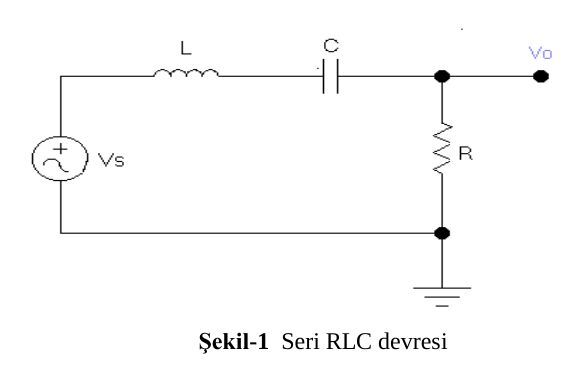
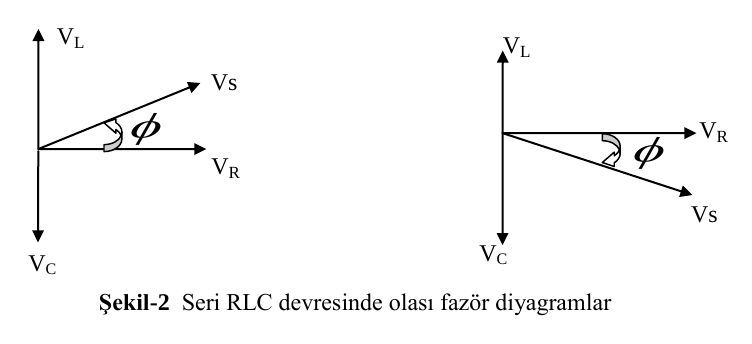
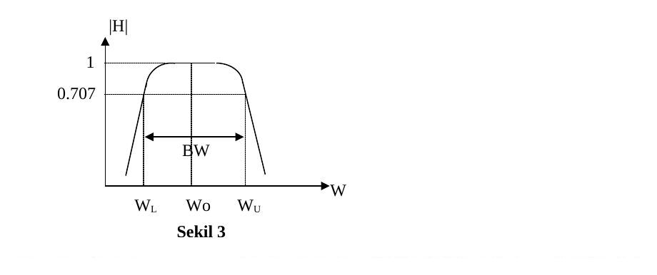

This post covers two lab sheets on series RLC circuits from the Başkent University Electrical and Electronics Engineering **EEM-202 Circuit Theory-2 Laboratory**: **Experiment-5: Series RLC Circuits** (April 2013) and **Experiment-6: Series RLC Circuits**, a longer version of the same topic that also includes a **series resonance circuit** section. Since the theory and first experiment sections of the two sheets are nearly identical, they are presented together; the differences are noted. The original files (Experiment-5 PDF, Experiment-6 Word) can be downloaded as a ZIP at the end of the post.

## Series RLC circuits

**Objective:** To examine the voltage, current, and phase characteristics of series-connected RLC circuits.

### Theory

The circuit in Figure-1 consists of series-connected R, L, and C elements and an AC voltage source. The resistor voltage (V_R) is in phase with the current (I). The inductor voltage leads the current by 90°, while the capacitor voltage lags it by 90°. The relationships between I and V_R, V_L, V_C are:

- V_R = R·I (in phase with I)
- V_L = jωL·I (voltage leads the current by 90°)
- V_C = I/(jωC) (voltage lags the current by 90°)
- V_S = V_R + V_L + V_C

The two possible phasor diagrams:

As can be seen from Figure-2, if |V_L| > |V_C|, the phase angle is positive and the current in the circuit lags V_S. If |V_L| < |V_C|, the current leads the input voltage. When |V_L| = |V_C| (|Z_L| = |Z_C|), V_S and the current are in phase. This special case is called **resonance**, and the frequency at which it occurs is called the **resonant frequency**. At the resonant frequency, the magnitude of the current takes its maximum value. The formulas for current, impedance, and phase angle are:

- I = V_s / (R + Z_L + Z_C), Z_L = jωL = jX_L, Z_C = 1/(jωC) = jX_C
- Z = R + Z_L + Z_C, |Z| = √(R² + (|Z_L| − |Z_C|)²) (total impedance)
- ϕ = arctan((|Z_L| − |Z_C|)/R) (phase angle)

As the equations above show, the case where |Z_L| = |Z_C|, Z = R, and ϕ = 0 is the resonance condition.

### Experiment (Experimental Work 1)

**A) Finding the phase angle in series RLC circuits and drawing the phasor diagram**

1. Build the circuit given in Figure-1 (**R = 43 Ω, L = 100 µH, C = 10 µF**).
1. Set the signal generator voltage to 6 V_pp and the frequency to f = 1.4 kHz.
1. Measure V_R and V_R + V_C. Calculate V_L and I.
1. Draw the phasor diagram of the circuit and calculate the phase angle (ϕ).
1. Measure the phase angle using an oscilloscope and record it.

**B) Examining current (I) and phase angle (ϕ) as a function of frequency**

1. Keeping the signal generator voltage constant, change the frequency according to the table.
1. Measure V_R, V_R + V_C, I, and ϕ. Calculate V_L and fill in the table.

**Table-1: Measurements in the series RLC circuit** (In Experiment-6, the 1.4 kHz row is absent and there is a V_C column instead of V_L)

| f (kHz) | V_R (pp) | V_R + V_C (pp) | V_L | I | ϕ |
|---|---|---|---|---|---|
| 0.5 | | | | | |
| 1.4 | | | | | |
| 3 | | | | | |
| 20 | | | | | |
| 100 | | | | | |
| 250 | | | | | |

### Results and discussion

1. How is the phase angle (ϕ) affected by the change in frequency? Plot the "ϕ–frequency" graph.
1. Find the frequency values at which the circuit behaves inductively and capacitively.

The last page of the Experiment-5 sheet is a **results sheet** on which to record the results of Parts A and B (R, L, C values; V_R, V_R + V_C, V_L, I for V_s = 6 V_pp and f = 1.4 kHz; the phasor diagram; ϕ from the phasor diagram and as measured with the oscilloscope; Table-2).

## Series resonance circuit (Experiment-6, Experimental Work 2)

**Objective:** To examine the series resonance circuit characteristics of a series-connected RLC circuit.

### Theory

The transfer functions of some circuits behave differently at different frequencies. At some frequencies they undergo more distortion than at others. The frequency band in which they undergo little distortion is called the **passband**, and the frequency band in which they undergo more distortion is called the **stopband**.

For the circuit shown in Figure-1, the transfer function H can be expressed as follows (all values are phasors):

V_o/V_s = H = R/(R + Z_L + Z_C), V_o = H·V_s

Since Z_L and Z_C depend on frequency, H is a function of frequency; it takes very large values at some frequencies and very small values at others (H is generally complex). At resonance (|Z_L| = |Z_C|), however, H takes the value 1 (H becomes a real number). The frequency at which this condition is satisfied is called the **resonant frequency**:

**f_res = 1/(2π√(LC))**

At this frequency the total impedance equals R, and the current in the circuit equals I = V_s/R. This current is called the **resonant current**. The magnitude of the current takes its maximum value at the resonant frequency.

The frequencies at which the transfer function drops from its maximum value to 0.707 (3 dB) are called the **lower cutoff** and **upper cutoff frequencies** (these are also called the **half-power frequencies**). The bandwidth of the transfer function is:

**BW = ω_U − ω_L = R/L**

The sharpness of the curve is defined as the **quality factor Q**:

**Q = ω_o/BW = ω_o·L/R = (1/R)·√(L/C)**

By this criterion, a Q value obtained with a large ω_o and a large BW is equal to a Q value obtained with a small ω_o and a small BW.

### Experiment

**A) Measuring the resonant frequency in the series resonance circuit**

1. Build the circuit given in Figure-1 (R = 43 Ω, L = 100 µH, C = 10 µF).
1. Set the signal generator voltage to 6 V_pp.
1. Adjust the frequency so that the phase shift between the input and output signals is 0, and record it (the frequency at which V_R takes its maximum value). This frequency is the resonant frequency.
1. Find the resonant, upper cutoff, and lower cutoff frequencies for R = 23 Ω, R = 43 Ω, and R = 100 Ω.
1. Find the bandwidth for each R value (BW = ω_U − ω_L).
1. Find the quality factor (Q) for each R value (Q = ω_o/BW).

### Results and discussion

1. Does the value of R affect the resonant frequency? If not, why not?
1. How did the resistance value affect the bandwidth? Explain using the equations given above.
1. Compare BW and Q.
1. Obtain the transfer function of the circuit given in Figure-1. Using the transfer function, prove the given formulas for BW and the resonant frequency.

> Hint: Find the frequency at which the magnitude of the transfer function is 1; this is the resonant frequency. Find the two frequencies at which the magnitude of the transfer function is 0.707; the difference between these two frequencies is the bandwidth of the circuit. When finding the results, assume that (R/L)² >> 4/(LC).

The last two pages of the Experiment-6 sheet are a results sheet on which to record the results of both experimental works (V_R, V_R + V_C, V_L, I, Φ; f_res, f_L, f_U, BW, and Q for each R).
