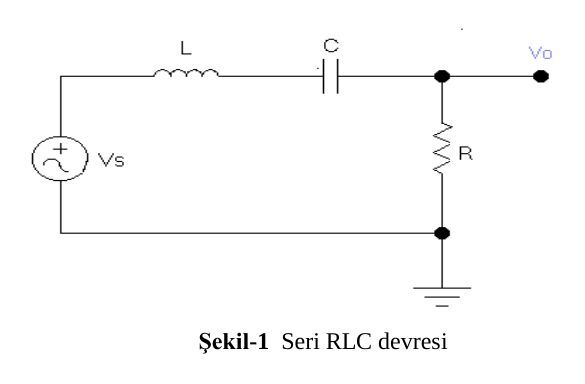
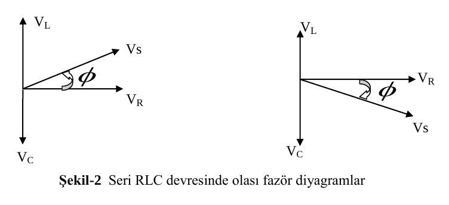
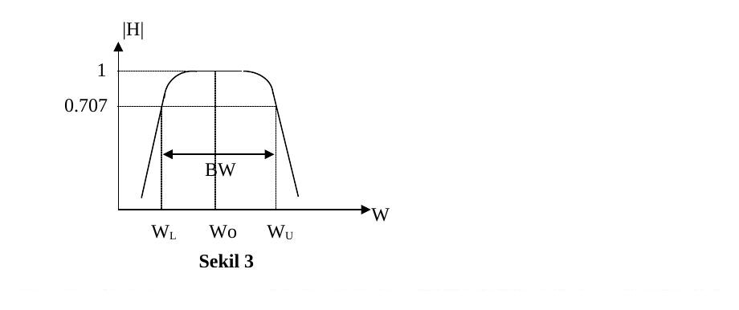

Bu yazı, Başkent Üniversitesi Elektrik-Elektronik Mühendisliği **EEM-202 Devre Teorisi-2 Laboratuvarı**'nın seri RLC devreleri üzerine iki föyünü içeriyor: **Deney-5: Seri RLC Devreleri** (Nisan 2013) ve aynı konunun **seri rezonans devresi** bölümünü de içeren daha uzun sürümü **Deney-6: Seri RLC Devreleri**. İki föyün teori ve ilk deney bölümleri neredeyse aynı olduğu için tek seferde aktarıldı; farklar belirtildi. Orijinal dosyalar (Deney-5 PDF, Deney-6 Word) yazının sonunda ZIP olarak indirilebilir.

## Seri RLC devreleri

**Amaç:** Seri bağlanmış RLC devrelerinde gerilim, akım ve faz özelliklerinin incelenmesi.

### Teori

Şekil-1'deki devre seri bağlanmış R, L, C elemanlarından ve bir adet AC gerilim kaynağından oluşmaktadır. Direnç gerilimi (V_R) ile akım (I) aynı faza sahiptir. Bobin gerilimi akımdan 90° önde, kapasitör gerilimi ise 90° geridedir. I ile V_R, V_L, V_C arasındaki bağlantılar:

- V_R = R·I (I ile aynı fazda)
- V_L = jωL·I (voltaj akımdan 90° önde)
- V_C = I/(jωC) (voltaj akımdan 90° geride)
- V_S = V_R + V_L + V_C

Oluşabilecek iki fazör diyagramı:

Şekil-2'den de görülebileceği gibi, |V_L| > |V_C| ise faz açısı pozitiftir; devredeki akım V_S'den geridedir. |V_L| < |V_C| ise akım giriş voltajından öndedir. |V_L| = |V_C| (|Z_L| = |Z_C|) durumunda ise V_S ile akımın fazları aynıdır. Bu özel duruma **rezonans**, bu durumun oluştuğu frekansa ise **rezonans frekansı** denir. Rezonans frekansında akımın büyüklüğü (magnitude) en büyük değerini alır. Akım, empedans ve faz açısı ile ilgili formüller:

- I = V_s / (R + Z_L + Z_C), Z_L = jωL = jX_L, Z_C = 1/(jωC) = jX_C
- Z = R + Z_L + Z_C, |Z| = √(R² + (|Z_L| − |Z_C|)²) (toplam empedans)
- ϕ = arctan((|Z_L| − |Z_C|)/R) (faz açısı)

Yukarıdaki eşitliklerden de görüldüğü gibi |Z_L| = |Z_C|, Z = R ve ϕ = 0 olduğu durum rezonans durumudur.

### Deney (Deneysel Çalışma 1)

**A) Seri bağlanmış RLC devrelerinde faz açısının bulunması ve vektör diyagramının çizilmesi**

1. Şekil-1'de verilen devreyi kurun (**R = 43 Ω, L = 100 µH, C = 10 µF**).
1. Sinyal üretecinin gerilimini 6 V_pp ve frekansını f = 1.4 kHz'e ayarlayın.
1. V_R, V_R + V_C değerlerini ölçün. V_L ve I değerlerini hesaplayın.
1. Devrenin fazör diyagramını çizin ve faz açısını (ϕ) hesaplayın.
1. Faz açısını osiloskop kullanarak ölçün ve kaydedin.

**B) Akım (I) ve faz açısının (ϕ) frekansa göre incelenmesi**

1. Sinyal üretecinin gerilimini sabit tutarak frekansı tabloya göre değiştirin.
1. V_R, V_R + V_C, I ve ϕ değerlerini ölçün. V_L değerini hesaplayıp tabloyu doldurun.

**Tablo-1: Seri RLC devresinde ölçümler** (Deney-6'da 1.4 kHz satırı yok ve V_L yerine V_C sütunu var)

| f (kHz) | V_R (pp) | V_R + V_C (pp) | V_L | I | ϕ |
|---|---|---|---|---|---|
| 0.5 | | | | | |
| 1.4 | | | | | |
| 3 | | | | | |
| 20 | | | | | |
| 100 | | | | | |
| 250 | | | | | |

### Sonuçlar ve yorum

1. Faz açısı (ϕ) frekans değişiminden nasıl etkilenmiştir? "ϕ-frekans" grafiğini çiziniz.
1. Devrenin indüktif ve kapasitif olarak çalıştığı frekans değerlerini bulunuz.

Deney-5 föyünün son sayfası, A ve B bölümlerinin sonuçlarının yazılacağı bir **sonuç kâğıdıdır** (R, L, C değerleri; V_s = 6 V_pp, f = 1.4 kHz için V_R, V_R + V_C, V_L, I; fazör diyagram; fazör diyagramdan ve osiloskopla ölçülen ϕ; Tablo-2).

## Seri rezonans devresi (Deney-6, Deneysel Çalışma 2)

**Amaç:** Seri bağlanmış RLC devresi için seri rezonans devre karakteristiklerinin incelenmesi.

### Teori

Bazı devrelerin transfer fonksiyonları değişik frekanslarda farklı özellik gösterirler. Bazı frekanslarda diğer frekanslara göre daha çok bozulmaya uğrarlar. Az bozulmaya uğradıkları frekans bandına **passband**, daha çok bozulmaya uğradıkları frekans bandına ise **stopband** denir.

Şekil-1'de gösterilen devrede H transfer fonksiyonu şöyle ifade edilebilir (bütün değerler fazördür):

V_o/V_s = H = R/(R + Z_L + Z_C), V_o = H·V_s

Z_L ve Z_C frekansa bağlı olduklarından H frekansın bir fonksiyonudur; bazı frekanslar için çok büyük, bazı frekanslar için ise çok küçük değerler almaktadır (H genellikle komplekstir). Fakat rezonans durumunda (|Z_L| = |Z_C|) H, 1 değerini alır (H gerçek sayı olur). Bu durumun sağlandığı frekansa **rezonans frekansı** denir:

**f_res = 1/(2π√(LC))**

Bu frekansta toplam empedans R'ye eşit olur ve devredeki akım I = V_s/R'ye eşit olur. Bu akıma **rezonans akımı** denir. Akımın büyüklüğü rezonans frekansında en yüksek değerini alır.

Transfer fonksiyonunun en büyük değerden 0.707 (3 dB) değerine düştüğü frekans değerlerine **alçak kesim** ve **yüksek kesim frekansları** denir (bu frekanslara aynı zamanda **yarı güç frekansları** da denir). Transfer fonksiyonunun bant genişliği:

**BW = ω_U − ω_L = R/L**

Eğrinin keskinliği **kalite faktörü (quality factor) Q** olarak tanımlanır:

**Q = ω_o/BW = ω_o·L/R = (1/R)·√(L/C)**

Bu kritere göre büyük ω_o ve büyük BW ile oluşan Q değeri ile küçük ω_o ve küçük BW ile oluşan Q değeri birbirine eşittir.

### Deney

**A) Seri rezonans devresinde rezonans frekansının ölçülmesi**

1. Şekil-1'de verilen devreyi kurun (R = 43 Ω, L = 100 µH, C = 10 µF).
1. Sinyal üreteci gerilimini 6 V_pp değerine ayarlayın.
1. Frekansı giriş ve çıkış sinyallerinin faz kayması 0 olacak şekilde ayarlayın ve kaydedin (V_R'nin en büyük değerini aldığı frekans). Bu frekans rezonans frekansıdır.
1. R = 23 Ω, R = 43 Ω ve R = 100 Ω değerleri için rezonans, yüksek kesim ve alçak kesim frekanslarını bulun.
1. Her R değeri için bant genişliğini bulun (BW = ω_U − ω_L).
1. Her R değeri için kalite faktörünü (Q) bulun (Q = ω_o/BW).

### Sonuçlar ve yorum

1. R'nin değeri rezonans frekansını etkiliyor mu? Etkilemiyorsa neden?
1. Direnç değeri bant genişliğini nasıl etkilemiştir? Yukarıda verilen denklemleri kullanarak açıklayın.
1. BW ve Q'yu karşılaştırın.
1. Şekil-1'de verilen devrenin transfer fonksiyonunu elde ediniz. Transfer fonksiyonunu kullanarak BW ve rezonans frekansı ile ilgili verilen formülleri kanıtlayın.

> İpucu: Transfer fonksiyonunun büyüklüğünün 1 olduğu frekansı bulun; bu rezonans frekansıdır. Transfer fonksiyonunun büyüklüğünün 0.707 olduğu iki frekansı bulun; bu iki frekans arasındaki fark devrenin bant genişliğidir. Sonuçları bulurken (R/L)² >> 4/(LC) olduğunu kabul edin.

Deney-6 föyünün son iki sayfası, her iki deneysel çalışmanın sonuçlarının (V_R, V_R + V_C, V_L, I, Φ; her R için f_res, f_L, f_U, BW ve Q) yazılacağı sonuç kâğıdıdır.
