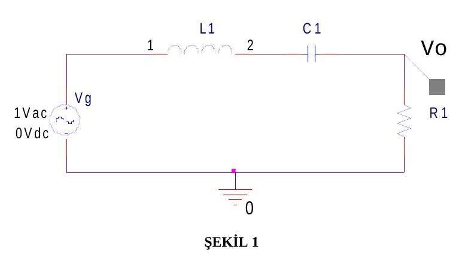
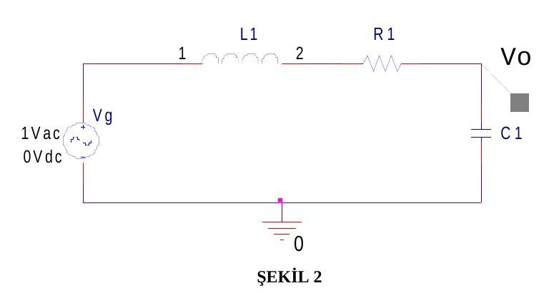
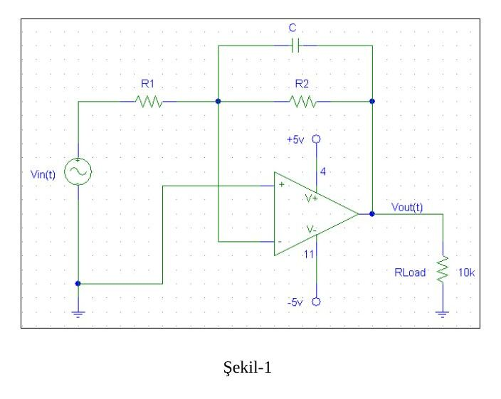

This post contains the three experiment sheets of the Başkent University Electrical-Electronics Engineering **EEM-202 Circuit Theory-2 Laboratory**: **Experiment-7: Bode Plots**, **Experiment-8: Active Filter Design (PSpice Study)**, and **Experiment-9: Active Filter Design (Laboratory Study)**. The text of the sheets has been transcribed, the circuit schematics have been added as images, and the tables are given in their blank form. The original Word files of the three sheets can be downloaded as a ZIP at the end of the post.

## Experiment-7: Bode plots

**Objective:** To learn the frequency response and Bode plots of series-connected RLC circuits.

### Experiment 1

**A) Circuit analysis**

1. Write the transfer function of the circuit shown in Figure 1.
1. For L = 10 mH, C = 0.01 µF, and R = 1 kΩ, calculate the resonant frequency f_RES, the bandwidth BW, the quality factor Q, and the lower and upper cutoff frequencies.

**B) PSpice simulation**

Simulate the circuit in PSpice and obtain the Bode plot of the frequency response. From the Bode plot, determine the circuit's resonant frequency f_RES, bandwidth BW, quality factor Q, and lower and upper cutoff frequencies. Compare the values you obtain with those you calculated in Part A.

### Experiment 2

**A) Circuit analysis**

1. Write the transfer function of the circuit shown in Figure 2.
1. For L1 = 10 mH, C1 = 0.01 µF, and R1 = 5 Ω, 50 Ω, 500 Ω, calculate the circuit's resonant frequency f_RES, bandwidth BW, quality factor Q, and lower and upper cutoff frequencies. Record the calculated values in Table 1.

**B) PSpice simulation**

For L1 = 10 mH, C1 = 0.01 µF, and R1 = 5 Ω, 50 Ω, 500 Ω, simulate the circuit in PSpice and obtain the Bode plot of the frequency response. From the Bode plot, determine f_RES, BW, Q, and the lower and upper cutoff frequencies. Record the values you obtain in Table 2 and compare them with those you calculated in Part A.

**Table 1 (calculated) and Table 2 (PSpice)** have the same columns:

| R1 | f_RES | BW | Q | f_L | f_U |
|---|---|---|---|---|---|
| 5 Ω | | | | | |
| 50 Ω | | | | | |
| 500 Ω | | | | | |

## Experiment-8: Active filter design (PSpice study)

**Objective:** To design an active low-pass filter (LPF) and examine it in the frequency domain.

Figure-1 shows the active low-pass filter circuit: the source V_in(t) is connected through R1 to the inverting (−) input of the op-amp; in the feedback path, R2 and C are connected in parallel; the non-inverting (+) input is grounded. The op-amp is supplied with ±5 V, and there is a 10 kΩ R_Load at the output.

### Preliminary work

1. Obtain the transfer function of the circuit by taking its Laplace transform. Show your derivation clearly. Simplify the transfer function as much as possible. State the order of the filter and explain why.
1. For C = 0.02 µF, R1 = 500 Ω, and R2 = 5 kΩ, find the transfer function of the circuit, sketch its Bode plot by hand, and calculate the DC gain and the cutoff frequency.

### Simulation study

Build the circuit you designed in the PSpice program and simulate it. Obtain the Bode plot of the circuit's transfer function. Set the frequency range in the simulation to 1 Hz–10 kHz.

### Results and discussion

Write up the work you carried out in the preliminary work and simulation sections above as a report, including your comments. Compare the Bode plot you drew by hand with the Bode plot you obtained in PSpice.

## Experiment-9: Active filter design (laboratory study)

**Objective:** To design an active low-pass filter (LPF) and examine it in the frequency domain. The circuit is the same as Figure-1 in Experiment-8.

### Preliminary work

1. Obtain the transfer function of the circuit by taking its Laplace transform. Show your derivation clearly. Simplify the transfer function as much as possible. State the order of the filter and explain why.
1. Design the circuit for a cutoff frequency (f₀) of **5 kHz** and a **DC gain of 2**. To do so, find the required values of C, R1, and R2. Use one of the following values for the capacitor (C) and calculate R1 and R2 for that value of C: 1 nF, 2.2 nF, 10 nF, 47 nF, 100 nF, 200 nF. State your calculations clearly.
1. Using the values you calculated, sketch the Bode plot of the transfer function by hand. Explain how the circuit responds to frequency and why.

### Laboratory study

Build the circuit you designed in the preliminary work on the laboratory test set. The table below lists the amplitudes of the input and output signals and the phase difference between them for different input signal frequencies. Fill in this table after building your circuit.

| Frequency (Hz) | V_in (V) | V_out (V) | Phase difference Δt (s) | Phase difference φ (deg.) |
|---|---|---|---|---|
| 1 | | | | |
| 500 | | | | |
| 1000 | | | | |
| 2000 | | | | |
| 3000 | | | | |
| 4000 | | | | |
| 5000 | | | | |
| 6000 | | | | |
| 7000 | | | | |

### Results and discussion

Using the values obtained in the laboratory study section above, sketch the Bode plot of your designed circuit by hand. How does your circuit respond to frequency? As the frequency increases, how do the amplitude and phase of your output signal change? In light of this information, prepare a detailed report.
