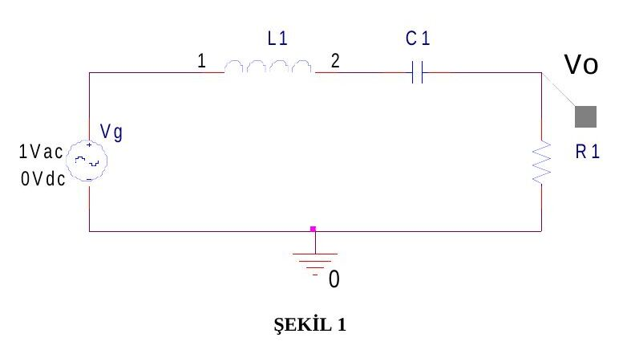
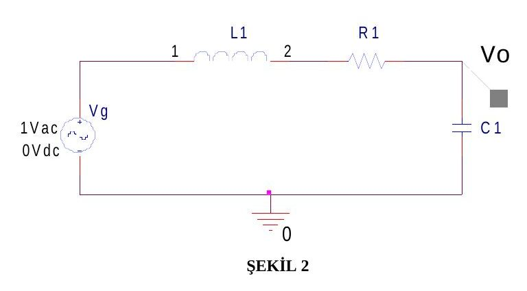
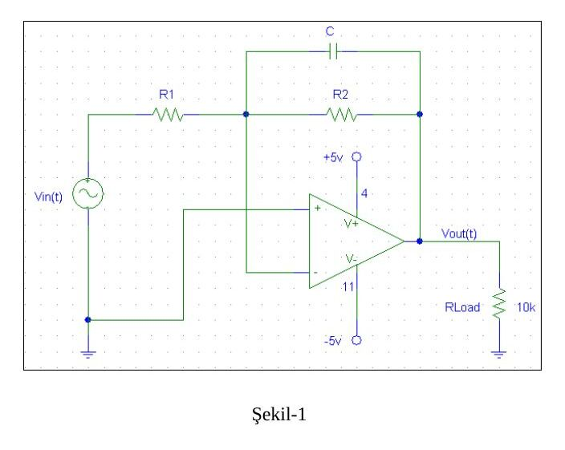

Bu yazı, Başkent Üniversitesi Elektrik-Elektronik Mühendisliği **EEM-202 Devre Teorisi-2 Laboratuvarı**'nın üç deney föyünü içeriyor: **Deney-7: Bode Çizimi**, **Deney-8: Aktif Süzgeç Tasarımı (PSpice çalışması)** ve **Deney-9: Aktif Süzgeç Tasarımı (deney çalışması)**. Föy metinleri aktarıldı, devre şemaları görsel olarak eklendi, tablolar boş hâlleriyle verildi. Üç föyün orijinal Word dosyaları yazının sonunda ZIP olarak indirilebilir.

## Deney-7: Bode çizimi

**Amaç:** Seri bağlanmış RLC devrelerinde frekans tepkisi ve Bode çizimlerinin öğrenilmesi.

### Deney 1

**A) Devre analizi**

1. Şekil 1'de gösterilen devrenin transfer fonksiyonunu yazın.
1. L = 10 mH, C = 0.01 µF ve R = 1 kΩ için rezonans frekansı f_RES, bant genişliği BW, kalite faktörü (quality factor) Q, alt ve üst kesim frekanslarını hesaplayın.

**B) PSpice simülasyonu**

Devrenin PSpice simülasyonunu yaparak frekans tepkisinin Bode çizimini elde ediniz. Bode çiziminden yola çıkarak devrenin rezonans frekansı f_RES, bant genişliği BW, kalite faktörü Q, alt ve üst kesim frekanslarını hesaplayın. Elde ettiğiniz değerleri A bölümünde hesapladığınız değerlerle karşılaştırın.

### Deney 2

**A) Devre analizi**

1. Şekil 2'de gösterilen devrenin transfer fonksiyonunu yazın.
1. L1 = 10 mH, C1 = 0.01 µF, R1 = 5 Ω, 50 Ω, 500 Ω değerleri için devrenin rezonans frekansı f_RES, bant genişliği BW, kalite faktörü Q, alt ve üst kesim frekanslarını hesaplayın. Hesapladığınız değerleri Tablo 1'e kaydedin.

**B) PSpice simülasyonu**

L1 = 10 mH, C1 = 0.01 µF, R1 = 5 Ω, 50 Ω, 500 Ω değerleri için devrenin PSpice simülasyonunu yaparak frekans tepkisinin Bode çizimini elde ediniz. Bode çiziminden yola çıkarak f_RES, BW, Q, alt ve üst kesim frekanslarını hesaplayın. Elde ettiğiniz değerleri Tablo 2'ye kaydedin ve A bölümünde hesapladığınız değerlerle karşılaştırın.

**Tablo 1 (hesaplanan) ve Tablo 2 (PSpice)** aynı sütunlara sahiptir:

| R1 | f_RES | BW | Q | f_L | f_U |
|---|---|---|---|---|---|
| 5 Ω | | | | | |
| 50 Ω | | | | | |
| 500 Ω | | | | | |

## Deney-8: Aktif süzgeç tasarımı (PSpice çalışması)

**Amaç:** Aktif alçak geçiren süzgeç (LPF) tasarımı ve frekans bölgesinde incelenmesi.

Şekil-1'de aktif alçak geçiren süzgeç devresi verilmiştir: V_in(t) kaynağı R1 üzerinden op-amp'ın eviren (−) girişine bağlıdır; geri besleme kolunda R2 ile C paralel bağlıdır; evirmeyen (+) giriş topraktadır. Op-amp ±5 V ile beslenir, çıkışta 10 kΩ'luk R_Load vardır.

### Ön çalışma

1. Devrenin Laplace dönüşümünü yaparak transfer fonksiyonunu elde edin. Çıkarımlarınızı açık bir şekilde gösterin. Transfer fonksiyonunu en sade hâle getirin. Süzgecin kaçıncı dereceden olduğunu nedeniyle açıklayın.
1. C = 0.02 µF, R1 = 500 Ω ve R2 = 5 kΩ değerleri için devrenin transfer fonksiyonunu bulun, Bode çizimini elinizle gerçekleştirin, DC kazancını ve kesim frekansını hesaplayın.

### Simülasyon (benzetim) çalışması

Tasarladığınız devreyi PSpice programında kurarak simülasyonunu (benzetimini) gerçekleştirin. Devrenin transfer fonksiyonunun Bode çizimini elde edin. Simülasyonda frekans aralığını 1 Hz–10 kHz olarak ayarlayın.

### Sonuçlar ve yorum

Yukarıdaki ön çalışma ve simülasyon kısımlarında yapmış olduğunuz çalışmaları yorumlarınızı da katarak rapor hâline getirin. Elle çıkardığınız Bode çizimi ile PSpice'ta elde ettiğiniz Bode çizimini karşılaştırın.

## Deney-9: Aktif süzgeç tasarımı (deney çalışması)

**Amaç:** Aktif alçak geçiren süzgeç (LPF) tasarımı ve frekans bölgesinde incelenmesi. Devre, Deney-8'deki Şekil-1 ile aynıdır.

### Ön çalışma

1. Devrenin Laplace dönüşümünü yaparak transfer fonksiyonunu elde edin. Çıkarımlarınızı açık bir şekilde gösterin. Transfer fonksiyonunu en sade hâle getirin. Süzgecin kaçıncı dereceden olduğunu nedeniyle açıklayın.
1. Devreyi kesim frekansı (f₀) **5 kHz** ve **DC kazancı 2** olacak şekilde tasarlayın. Bunun için gerekli olan C, R1 ve R2 değerlerini bulun. Kapasitör (C) değeri için şu değerlerden birini kullanın ve bu C değerine göre R1 ve R2 değerlerini hesaplayın: 1 nF, 2.2 nF, 10 nF, 47 nF, 100 nF, 200 nF. Hesaplamalarınızı açık bir şekilde ifade edin.
1. Hesapladığınız değerlere göre transfer fonksiyonunun Bode çizimini elle yapınız. Devrenin frekansa karşı nasıl bir tepki verdiğini nedeniyle açıklayınız.

### Deney çalışması

Ön çalışma kısmında tasarladığınız devrenizi deney setine kurunuz. Aşağıdaki tablo, giriş sinyalinin farklı frekans değerleri için giriş ve çıkış sinyallerinin genliklerini ve giriş-çıkış sinyalleri arasındaki faz farkını göstermektedir. Devrenizi kurduktan sonra bu tabloyu doldurunuz.

| Frekans (Hz) | V_in (V) | V_out (V) | Faz farkı Δt (s) | Faz farkı φ (der.) |
|---|---|---|---|---|
| 1 | | | | |
| 500 | | | | |
| 1000 | | | | |
| 2000 | | | | |
| 3000 | | | | |
| 4000 | | | | |
| 5000 | | | | |
| 6000 | | | | |
| 7000 | | | | |

### Sonuçlar ve yorum

Yukarıdaki deney çalışması kısmında elde ettiğiniz değerleri kullanarak tasarladığınız devrenizin Bode çizimini elinizle gerçekleştiriniz. Devreniz frekansa karşı nasıl bir tepki veriyor? Frekans arttıkça çıkış sinyalinizin genlik ve faz bilgisi nasıl değişiyor? Bu bilgiler ışığında detaylı bir rapor hazırlayınız.
