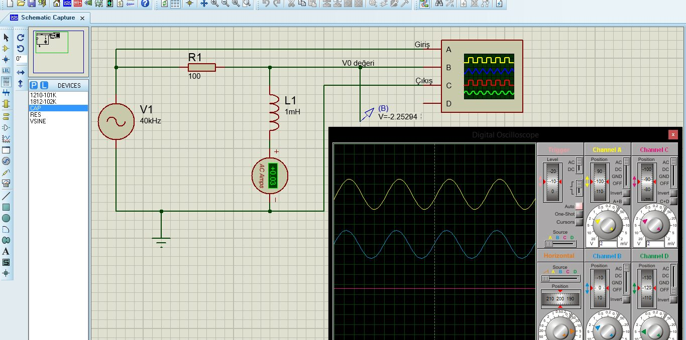
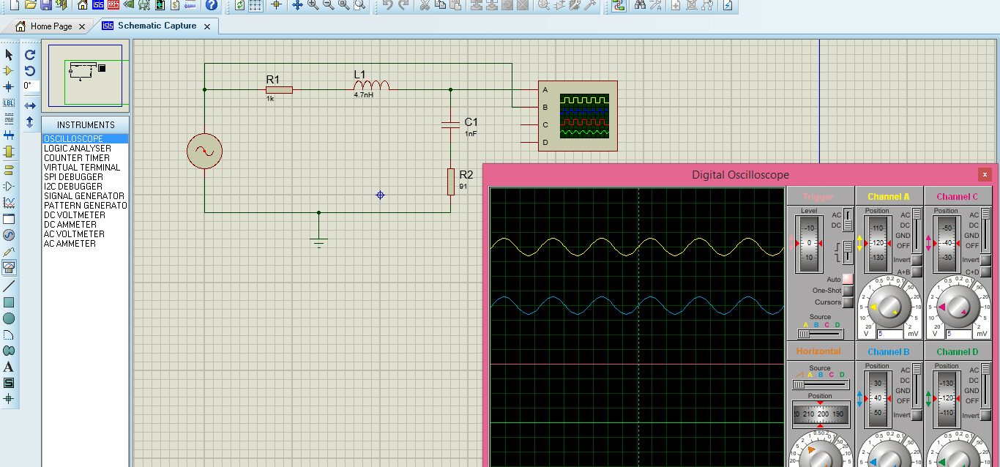
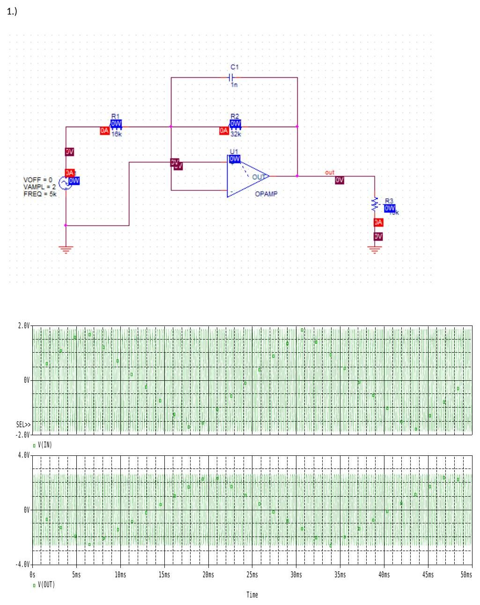

This post brings together student work prepared for the experiments of the Başkent University Electrical-Electronics Engineering **EEM-202 Circuit Theory-2 Laboratory** (2013-2014 spring semester, March–April 2014). The lab handouts themselves are in the archive as separate posts ([Experiments 1–2](/arsiv/eem202-deney-1-2-rc-rl/), [3–4](/arsiv/eem202-deney-3-4-guc/), [5–6](/arsiv/eem202-deney-5-6-seri-rlc/), [7–9](/arsiv/eem202-deney-7-9-bode-aktif-suzgec/)); here the **answers to the handouts and the simulation results** are presented. Sources: Proteus screenshots, a friend's handwritten preliminary work and report pages (transcribed to text from photographed pages; the photographs are not published), and Proteus and PSpice work prepared as Word files by two friends. Personal information has been removed. The screenshots and PDFs of the work can be downloaded as a ZIP at the end of the post.

## Experiment 1: Sinusoidal RC Circuit

### Preliminary Work (handwritten)

1. **Period:** The time between one complete oscillation, or the time elapsed for one vibration; we can also say "the time elapsed during one cycle." Its unit is the second, and it is inversely proportional to frequency: T = 1/f. **Impedance:** The resistance that a line presents in systems operating with alternating current is called impedance. **RMS value:** A statistical measure used in measuring varying quantities; it is especially useful for waveforms that alternate in the positive and negative directions. The name "root mean square" comes from taking the square root of the mean of the squares.
1. A capacitor has purely reactive impedance, and its impedance is inversely proportional to the signal frequency. If the frequency is 0, the capacitor is an open circuit. At high frequencies the capacitor is in a constant-voltage state.

*Note: At high frequencies the capacitor behaves like a **short circuit**, since its impedance 1/(ωC) approaches zero.*

### Measurements

The Figure-2 circuit from the handout was built: R = 1 kΩ, C = 200 nF, input 1.5 V peak (3 V peak-to-peak), output taken across the capacitor. The values entered in Table-1 (phase difference with Φ = tan⁻¹(V_R/V_C)):

| f (Hz) | V_C (peak) | I (rms) | Φ (degrees) |
| --- | --- | --- | --- |
| 100 | 1.5 V | 102.1 µA | 3.8 |
| 200 | 1.44 V | 190.1 µA | 7.9 |
| 400 | 1.36 V | 310.45 µA | 15.2 |
| 800 | 1.12 V | 416.69 µA | 28.1 |
| 1600 | 0.8 V | 470.25 µA | 45 |

In Table-2 the capacitor reactance was calculated with X_C = 1/(jωC): 8333 Ω at 100 Hz, 4166 Ω at 200 Hz, 2083 Ω at 400 Hz, 1041 Ω at 800 Hz, 520 Ω at 1600 Hz (all at an angle of −90°); the resistor voltage V_R (peak) rises from 0.1 V to 0.8 V. Comment: as the frequency increases, the angle between V_R and V_C grows and the impedance of the capacitor decreases.

*Note: In the X_C calculation, π ≈ 3 was used. The correct values with X_C = 1/(2πfC) are: **7958 Ω** at 100 Hz, 3979 Ω at 200 Hz, 1989 Ω at 400 Hz, 995 Ω at 800 Hz, 497 Ω at 1600 Hz. The theoretical phase difference Φ = tan⁻¹(ωRC) is approximately 7.2°, 14.1°, 26.7°, 45.1° and 63.5°, respectively; the measured angles in the table are about half of this.*

The same circuit was examined in Proteus with an oscilloscope at 100, 200, 400, 800 and 1600 Hz (five screenshots are in the ZIP):

")

## Experiment 2: Sinusoidal RL Circuit

### Preliminary Work (handwritten)

1. For an inductor, the variation of impedance with frequency is directly proportional: the inductor impedance increases as frequency increases and decreases as it decreases (Z = jωL, ω = 2πf). From this: if the frequency is zero, the impedance is also 0 and the inductor acts like an open circuit; if the frequency becomes very large, the impedance also becomes very large.
1. **Frequency:** The measure of how many times a wave repeats in one second (f = 1/T). **Reactance:** The resistance that circuit elements present to AC voltage (Z = R + jX). **Admittance:** In AC circuits, the ease of conduction that a parallel circuit presents to current (Y = 1/R = G).

*Note: An inductor whose impedance is zero at zero frequency behaves like a **short circuit** (not an open circuit). Admittance is in general the inverse of impedance: Y = 1/Z = G + jB; Y = 1/R = G holds only for a pure resistor.*

In Proteus, an RL circuit with R = 100 Ω and L = 1 mH was examined at 40 kHz; the input and V₀ (inductor) voltages are seen on the oscilloscope, and the current on the AC ammeter (about 0.03 A). At 40 kHz, X_L = 2π·40000·0.001 ≈ 251 Ω.

## Experiment 3: Power Analysis (Preliminary Work)

There are two sets of preliminary work for this experiment. In the handwritten one:

1. **Active power:** In cases where power takes a different value at every instant, the mean value of the power that does work and is useful is called active power in alternating current. Its unit is the watt: P = U·I·cos φ.
1. For an ideal impedance Z = R + jX: V = Z·I, S = V·I* = Z·I·I* = |I_rms|²(R + jX) = |I_rms|²R + j|I_rms|²X; hence **P = |I_rms|²·R** and **Q = |I_rms|²·X**.

In the preliminary work prepared as a Word file (the cover page is the handout form left blank):

- Apparent power S is the product of current and voltage. Active power P = S·cos φ = V·I·cos φ (watt, "P"). The power of the current flowing through an inductor or a capacitance is called reactive power: Q, with the unit VAr. The reactive power produced by the inductor effect is called **inductive power (+Q)**, and that produced by the capacitance effect is called **capacitive power (−Q)**.
- In an inductor, since the angle between current and voltage is +90°, P = (V_m I_m/2) cos 90° = 0, Q = V_m I_m/2: the inductor consumes reactive power. In a capacitor the angle is −90°: P = 0, Q = −V_m I_m/2: the capacitor produces reactive power.

In the same week, a circuit with R1 = 1 kΩ, L1, C1 = 1 nF and R2 = 91 Ω was also examined in Proteus with an oscilloscope:

## Experiment 4: Power Factor Correction (Proteus Work)

A friend's Proteus work contains two circuits; the measurements were read from the Proteus AC voltmeter:

- **1) Compensation:** A capacitor C1 in parallel with a series branch of L1 = 47 µH and R2 = 100 Ω, fed through R1 = 220 Ω. The voltages read: 0.90 V at C = 10 nF, 0.75 V at C = 2.2 nF, 0.77 V at C = 470 pF.
- **2) Variation of the load resistance:** A load R_L fed through R1 = 90 Ω and L1 = 47 µH. The values read:

| R_L | 47 Ω | 90 Ω | 150 Ω | 430 Ω | 1 kΩ | 2.2 kΩ |
| --- | --- | --- | --- | --- | --- | --- |
| V (AC) | 1.51 V | 1.69 V | 1.43 V | 1.68 V | 1.50 V | 1.78 V |

")

*Note: The amplitude and frequency of the source are not stated in the work; the voltmeter readings do not show a regular variation with R_L (they may be readings taken at the animation instant of the simulation), so the values are given only as a record.*

## Experiment 5: Series RLC Circuit (Proteus Work)

The series RLC circuit from the handout (R = 43 Ω, L = 100 µH, C = 10 µF) was built in Proteus and measured with an AC voltmeter/ammeter:

| f | V_R | V_C | V_L | I |
| --- | --- | --- | --- | --- |
| 0.5 kHz | 3.43 V | 2.51 V | 0.02 V | 0.07 A |
| 1.4 kHz | 4.12 V | 1.08 V | 0.08 V | 0.09 A |
| 3 kHz | 4.22 V | 0.52 V | 0.19 V | 0.09 A |
| 20 kHz | 4.07 V | 0.07 V | 1.21 V | 0.09 A |
| 100 kHz | 2.27 V | 0.00 V | 3.36 V | 0.05 A |
| 250 kHz | 0.78 V | 0.00 V | 2.86 V | 0.02 A |

The values agree with theory: at 1.4 kHz, X_C ≈ 11.4 Ω and X_L ≈ 0.88 Ω, so V_C/V_R ≈ 11.4/43 ≈ 0.26 and V_L/V_R ≈ 0.02 (in the table, 1.08/4.12 ≈ 0.26 and 0.08/4.12 ≈ 0.02). Around the resonant frequency f₀ = 1/(2π√LC) ≈ 5 kHz, V_R and the current are at their maximum; at high frequencies the voltage accumulates across the inductor.

## Experiment 8: Active Low-Pass Filter (PSpice Work)

Although the file name says "6th experiment report," the content is the PSpice work for the **active low-pass filter with a 5 kHz cutoff frequency and a DC gain of 2** from the Experiment-8 handout. The op-amp has R2 ∥ C1 in the feedback path and R1 at the input; the cutoff frequency is f_c = 1/(2πR2C1) and the DC gain is −R2/R1. The source is a 2 V amplitude, 5 kHz sine. Three designs:

| Design | R1 | R2 | C1 | f_c = 1/(2πR2C1) | |R2/R1| |
| --- | --- | --- | --- | --- | --- |
| 1 | 16 kΩ | 32 kΩ | 1 nF | ≈ 4.97 kHz | 2 |
| 2 | 1590 Ω | 3180 Ω | 10 nF | ≈ 5.00 kHz | 2 |
| 3 | 159 Ω | 318 Ω | 100 nF | ≈ 5.00 kHz | 2 |

In all three designs the input (2 V) and output (about ±2.8 V) waveforms come out the same: since the gain at the cutoff frequency is 2/√2 ≈ 1.41, the output amplitude is about 2.83 V.

## Downloadable Files

In the ZIP, organized by experiment folder:

- **Experiment-1:** Oscilloscope screenshots of the RC circuit in Proteus at 100–1600 Hz (5 images).
- **Experiment-2:** Two screenshots of the RL circuit.
- **Experiment-3:** Proteus screenshot and a friend's preliminary work (PDF).
- **Experiment-4 and Experiment-5:** A friend's Proteus work (name and student number removed).
- **Experiment-8:** PSpice work of the active filter (3 pages).

Photographs of the handwritten preliminary work and report pages for Experiments 1, 2 and 3 are not published.
