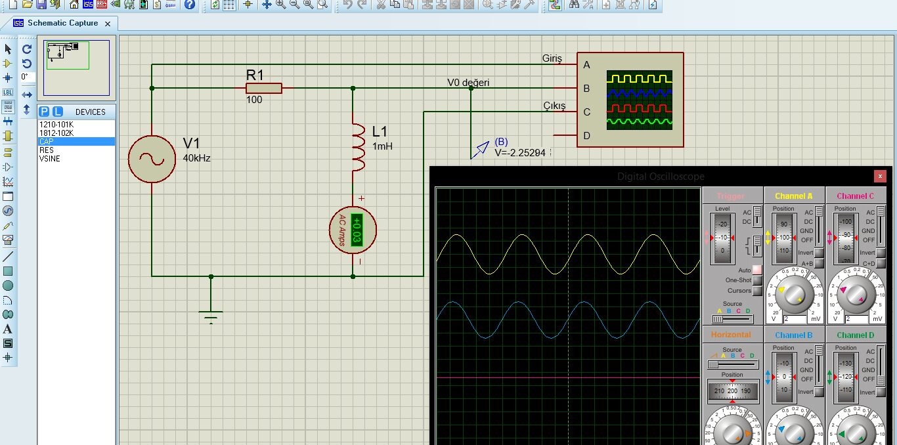
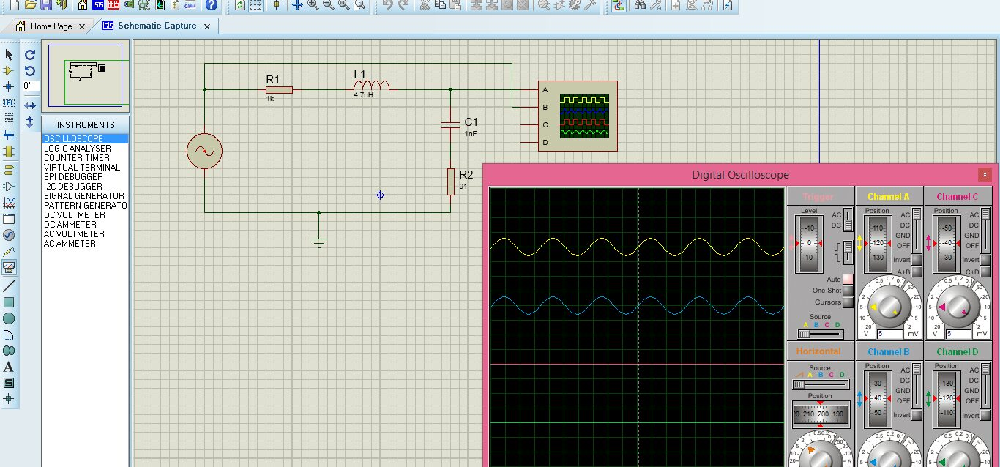
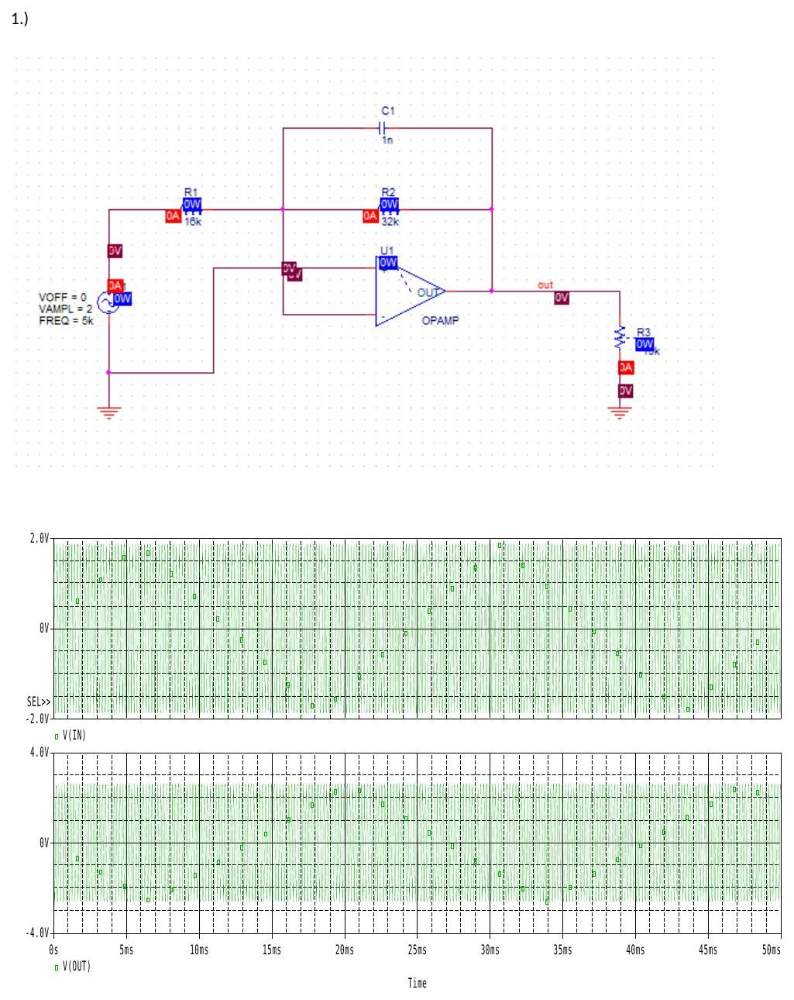

Bu yazı, Başkent Üniversitesi Elektrik-Elektronik Mühendisliği **EEM-202 Devre Teorisi-2 Laboratuvarı**'nın deneyleri için hazırlanmış öğrenci çalışmalarını bir araya getiriyor (2013-2014 bahar dönemi, Mart–Nisan 2014). Deney föylerinin kendisi arşivde ayrı yazılarda ([Deney 1–2](/arsiv/eem202-deney-1-2-rc-rl/), [3–4](/arsiv/eem202-deney-3-4-guc/), [5–6](/arsiv/eem202-deney-5-6-seri-rlc/), [7–9](/arsiv/eem202-deney-7-9-bode-aktif-suzgec/)) var; burada föylere verilen **cevaplar ve benzetim sonuçları** anlatılıyor. Kaynaklar: Proteus ekran görüntüleri, bir arkadaşın el yazısı ön çalışma ve rapor sayfaları (fotoğraflanmış sayfalardan metne aktarıldı, fotoğraflar yayınlanmıyor), iki arkadaşın Word dosyası olarak hazırladığı Proteus ve PSpice çalışmaları. Kişisel bilgiler çıkarıldı. Ekran görüntüleri ve çalışmaların PDF'leri yazının sonunda ZIP olarak indirilebilir.

## Deney 1: Sinüsoidal RC devresi

### Ön çalışma (el yazısı)

1. **Periyot:** Bir tam salınım arasındaki zaman süresine ya da bir titreşim için geçen süreye denir; "bir devir süresince geçen zaman" da diyebiliriz. Birimi saniyedir, frekansla ters orantılıdır: T = 1/f. **Empedans:** alternatif akımla çalışan sistemlerde hattın gösterdiği dirence empedans denir. **RMS değer:** değişen büyüklüklerin ölçülmesinde kullanılan istatistiksel bir ölçüttür; değişimin artı ve eksi yönde olduğu dalgalarda özellikle faydalıdır. "Karekök ortalama" ismi, karelerin ortalamasının karekökünün alınmasından gelir.
1. Kapasitör tam reaktif empedansa sahiptir ve empedansı sinyal frekansıyla ters orantılıdır. Frekans 0 olursa kapasitör açık devredir. Yüksek frekanslarda kapasitör sabit voltaj durumundadır.

*Not: Yüksek frekanslarda kapasitörün empedansı 1/(ωC) sıfıra yaklaştığı için kapasitör **kısa devre** gibi davranır.*

### Ölçümler

Föydeki Şekil-2 devresi kurulmuş: R = 1 kΩ, C = 200 nF, giriş 1,5 V tepe (3 V tepeden tepeye), çıkış kondansatör üzerinden alınıyor. Tablo-1'e yazılan değerler (faz farkı Φ = tan⁻¹(V_R/V_C) ile):

| f (Hz) | V_C (tepe) | I (rms) | Φ (derece) |
| --- | --- | --- | --- |
| 100 | 1,5 V | 102,1 µA | 3,8 |
| 200 | 1,44 V | 190,1 µA | 7,9 |
| 400 | 1,36 V | 310,45 µA | 15,2 |
| 800 | 1,12 V | 416,69 µA | 28,1 |
| 1600 | 0,8 V | 470,25 µA | 45 |

Tablo-2'de kapasitör reaktansı X_C = 1/(jωC) ile hesaplanmış: 100 Hz'de 8333 Ω, 200 Hz'de 4166 Ω, 400 Hz'de 2083 Ω, 800 Hz'de 1041 Ω, 1600 Hz'de 520 Ω (hepsi −90° açılı); direnç gerilimi V_R (tepe) 0,1 V'tan 0,8 V'a çıkıyor. Yorum: frekans arttıkça V_R ile V_C arasındaki açı büyüyor, kondansatörün empedansı azalıyor.

*Not: X_C hesabında π ≈ 3 alınmış. Doğru değerler X_C = 1/(2πfC): 100 Hz'de **7958 Ω**, 200 Hz'de 3979 Ω, 400 Hz'de 1989 Ω, 800 Hz'de 995 Ω, 1600 Hz'de 497 Ω. Kuramsal faz farkı Φ = tan⁻¹(ωRC) ise sırasıyla yaklaşık 7,2°, 14,1°, 26,7°, 45,1° ve 63,5°'dir; tablodaki ölçülen açılar bunun yaklaşık yarısı kadar kalmış.*

Proteus'ta aynı devre 100, 200, 400, 800 ve 1600 Hz'de osiloskopla incelenmiş (beş ekran görüntüsü ZIP'te):

")

## Deney 2: Sinüsoidal RL devresi

### Ön çalışma (el yazısı)

1. Bobin için empedansın frekansla değişimi doğru orantılıdır: bobin empedansı frekans arttıkça artar, azaldıkça azalır (Z = jωL, ω = 2πf). Buradan yola çıkarak: frekans sıfır olursa empedans da 0 olur ve devrede bobin açık devre gibi çalışır; frekans çok büyürse empedans da çok büyür.
1. **Frekans:** bir dalganın bir saniyede kaç defa tekrarlandığının ölçümüdür (f = 1/T). **Reaktans:** devre elemanlarının AC gerilime karşı gösterdikleri dirençtir (Z = R + jX). **Admitans:** AC devrelerde, paralel devrenin akımına gösterdiği iletim kolaylığıdır (Y = 1/R = G).

*Not: Frekans sıfırken empedansı sıfır olan bobin **kısa devre** gibi davranır (açık devre değil). Admitans genel olarak empedansın tersidir: Y = 1/Z = G + jB; Y = 1/R = G yalnız saf direnç için geçerlidir.*

Proteus'ta R = 100 Ω ve L = 1 mH'lik RL devresi 40 kHz'de incelenmiş; giriş ve V₀ (bobin) gerilimi osiloskopta, akım AC ampermetrede (yaklaşık 0,03 A) görülüyor. 40 kHz'de X_L = 2π·40000·0,001 ≈ 251 Ω.

## Deney 3: Güç analizi (ön çalışma)

Bu deney için iki ön çalışma var. El yazısı olanında:

1. **Aktif güç:** gücün her an değişik değer aldığı durumlarda iş gören, faydalı olan gücün ortalama değerine alternatif akımda aktif güç denir. Birimi watt'tır: P = U·I·cos φ.
1. İdeal bir Z = R + jX empedansı için: V = Z·I, S = V·I* = Z·I·I* = |I_rms|²(R + jX) = |I_rms|²R + j|I_rms|²X; buradan **P = |I_rms|²·R** ve **Q = |I_rms|²·X**.

Word dosyası olarak hazırlanan ön çalışmada (kapak sayfası boş bırakılmış föy formu):

- Görünen güç S, akım ile gerilimin çarpımıdır. Aktif güç P = S·cos φ = V·I·cos φ (watt, "P"). Bobin ya da kapasitans üzerinden geçen akımın gücüne reaktif güç denir: Q, birimi VAr. Bobin etkisiyle oluşan reaktif güce **indüktif güç (+Q)**, kapasitans etkisiyle oluşana **kapasitif güç (−Q)** denir.
- Bobinde akım ile gerilim arasındaki açı +90° olduğundan P = (V_m I_m/2) cos 90° = 0, Q = V_m I_m/2: bobin reaktif güç harcar. Kapasitörde açı −90°: P = 0, Q = −V_m I_m/2: kapasitör reaktif güç üretir.

Aynı hafta Proteus'ta R1 = 1 kΩ, L1, C1 = 1 nF ve R2 = 91 Ω'luk bir devre de osiloskopla incelenmiş:

## Deney 4: Güç kompanzasyonu (Proteus çalışması)

Bir arkadaşın Proteus çalışmasında iki devre var; ölçümler Proteus AC voltmetresinden okunmuş:

- **1) Kompanzasyon:** R1 = 220 Ω üzerinden beslenen, L1 = 47 µH ve R2 = 100 Ω'luk seri kola paralel bir C1 kondansatörü. Okunan gerilimler: C = 10 nF'ta 0,90 V, C = 2,2 nF'ta 0,75 V, C = 470 pF'ta 0,77 V.
- **2) Yük direncinin değişimi:** R1 = 90 Ω ve L1 = 47 µH üzerinden beslenen R_L yükü. Okunan değerler:

| R_L | 47 Ω | 90 Ω | 150 Ω | 430 Ω | 1 kΩ | 2,2 kΩ |
| --- | --- | --- | --- | --- | --- | --- |
| V (AC) | 1,51 V | 1,69 V | 1,43 V | 1,68 V | 1,50 V | 1,78 V |

")

*Not: Kaynağın genliği ve frekansı çalışmada belirtilmemiş; voltmetre okumaları R_L ile düzenli bir değişim göstermiyor (benzetimin animasyon anındaki okumaları olabilir), bu yüzden değerler yalnız kayıt olarak verildi.*

## Deney 5: Seri RLC devresi (Proteus çalışması)

Föydeki seri RLC devresi (R = 43 Ω, L = 100 µH, C = 10 µF) Proteus'ta kurulmuş ve AC voltmetre/ampermetreyle ölçülmüş:

| f | V_R | V_C | V_L | I |
| --- | --- | --- | --- | --- |
| 0,5 kHz | 3,43 V | 2,51 V | 0,02 V | 0,07 A |
| 1,4 kHz | 4,12 V | 1,08 V | 0,08 V | 0,09 A |
| 3 kHz | 4,22 V | 0,52 V | 0,19 V | 0,09 A |
| 20 kHz | 4,07 V | 0,07 V | 1,21 V | 0,09 A |
| 100 kHz | 2,27 V | 0,00 V | 3,36 V | 0,05 A |
| 250 kHz | 0,78 V | 0,00 V | 2,86 V | 0,02 A |

Değerler kuramla uyumlu: 1,4 kHz'de X_C ≈ 11,4 Ω ve X_L ≈ 0,88 Ω olduğundan V_C/V_R ≈ 11,4/43 ≈ 0,26 ve V_L/V_R ≈ 0,02 (tabloda 1,08/4,12 ≈ 0,26 ve 0,08/4,12 ≈ 0,02). Rezonans frekansı f₀ = 1/(2π√LC) ≈ 5 kHz civarında V_R ve akım en büyük; yüksek frekanslarda gerilim bobin üzerinde toplanıyor.

## Deney 8: Aktif alçak geçiren süzgeç (PSpice çalışması)

Dosya adı "6. deney raporu" olsa da içerik, Deney-8 föyündeki **5 kHz kesim frekanslı, DC kazancı 2 olan aktif alçak geçiren süzgecin** PSpice çalışması. Op-amp'ın geri besleme yolunda R2 ∥ C1, girişte R1 var; kesim frekansı f_c = 1/(2πR2C1), DC kazancı −R2/R1. Kaynak 2 V genlikli, 5 kHz sinüs. Üç tasarım:

| Tasarım | R1 | R2 | C1 | f_c = 1/(2πR2C1) | |R2/R1| |
| --- | --- | --- | --- | --- | --- |
| 1 | 16 kΩ | 32 kΩ | 1 nF | ≈ 4,97 kHz | 2 |
| 2 | 1590 Ω | 3180 Ω | 10 nF | ≈ 5,00 kHz | 2 |
| 3 | 159 Ω | 318 Ω | 100 nF | ≈ 5,00 kHz | 2 |

Üç tasarımda da giriş (2 V) ve çıkış (yaklaşık ±2,8 V) dalga biçimleri aynı çıkıyor: kesim frekansında kazanç 2/√2 ≈ 1,41 olduğundan çıkış genliği yaklaşık 2,83 V.

## İndirilebilir dosyalar

ZIP'te deney klasörlerine göre:

- **Deney-1:** Proteus'ta RC devresinin 100–1600 Hz osiloskop ekran görüntüleri (5 adet).
- **Deney-2:** RL devresinin iki ekran görüntüsü.
- **Deney-3:** Proteus ekran görüntüsü ve bir arkadaşın ön çalışması (PDF).
- **Deney-4 ve Deney-5:** bir arkadaşın Proteus çalışmaları (ad ve numara çıkarıldı).
- **Deney-8:** aktif süzgecin PSpice çalışması (3 sayfa).

Deney 1, 2 ve 3'ün el yazısı ön çalışma ve rapor sayfalarının fotoğrafları yayınlanmıyor.
