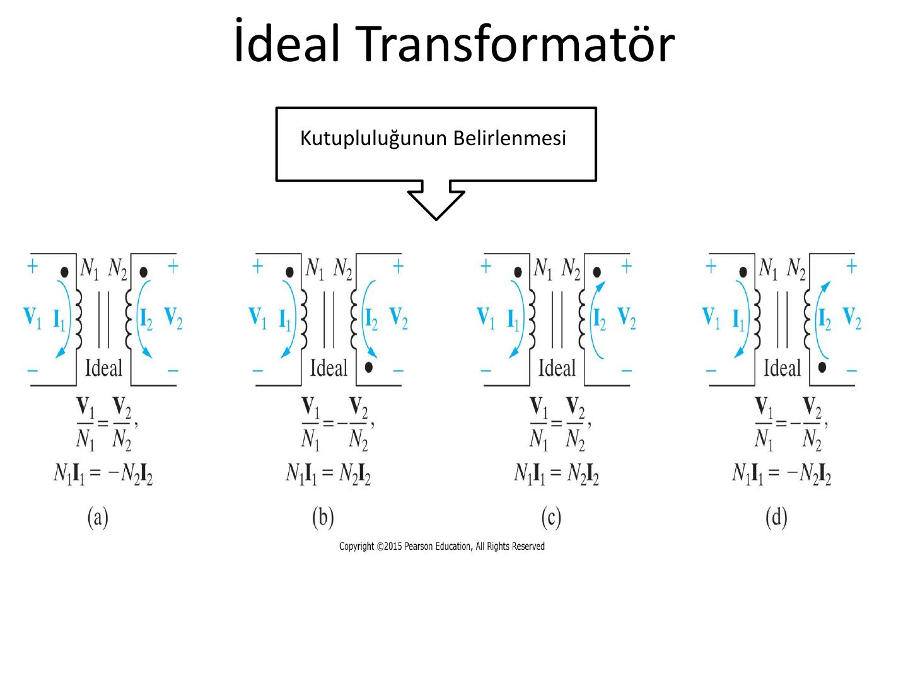
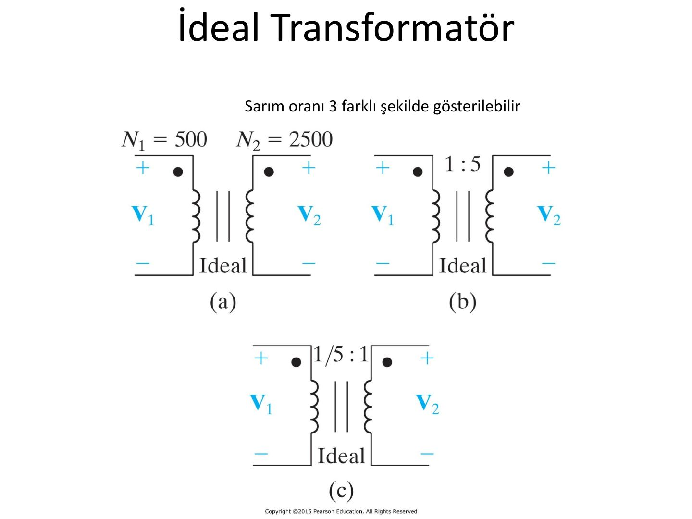
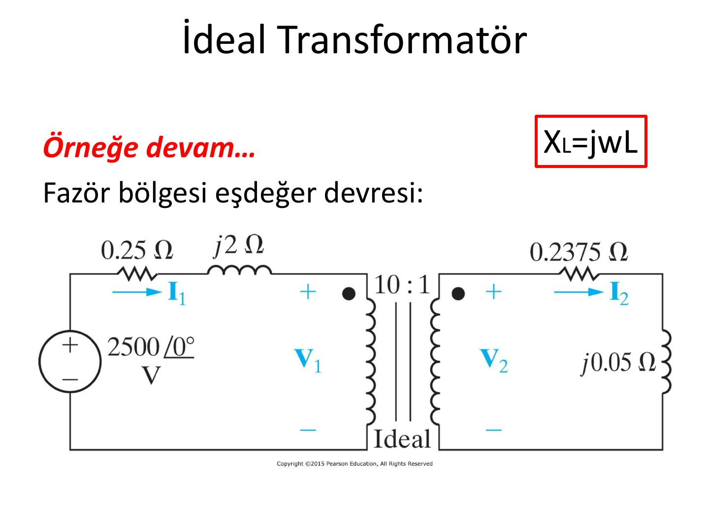
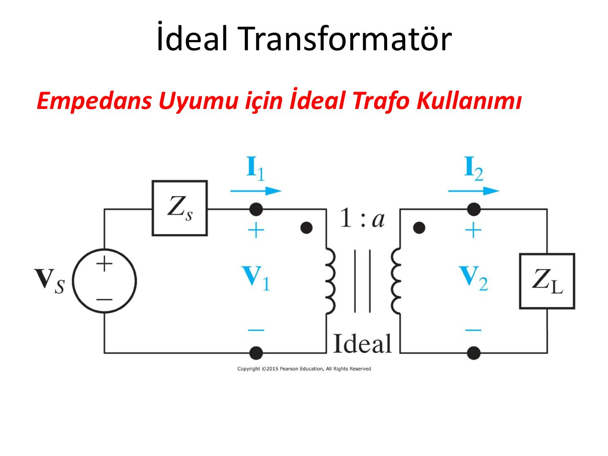

This post is the content of the **Ideal Transformer** presentation prepared by Asst. Prof. Dr. Selda Güney for the Başkent University Electrical and Electronics Engineering course **EEM202 Circuit Theory II** (April 2014). It is a short six-slide presentation: the circuit diagrams are included as images, while the formulas and values are transcribed as text. The original PDF can be downloaded at the end of the post.

## Determining the polarity

In an ideal transformer, the signs of the voltage and current relationships depend on the positions of the dots on the windings (the dot convention) and on the reference directions. The four cases in the presentation:

| Case | Voltage relationship | Current relationship |
|---|---|---|
| (a) | V₁/N₁ = V₂/N₂ | N₁I₁ = −N₂I₂ |
| (b) | V₁/N₁ = −V₂/N₂ | N₁I₁ = N₂I₂ |
| (c) | V₁/N₁ = V₂/N₂ | N₁I₁ = N₂I₂ |
| (d) | V₁/N₁ = −V₂/N₂ | N₁I₁ = −N₂I₂ |

## Notation of the turns ratio

The turns ratio can be shown in three different ways. For example, for an ideal transformer with N₁ = 500 and N₂ = 2500 turns:

- (a) The numbers of turns are written directly: N₁ = 500, N₂ = 2500
- (b) As a ratio: **1 : 5**
- (c) As a ratio normalized to the primary side: **1/5 : 1**

## Example: vg = 2500 cos 400t V

The source is vg = 2500 cos 400t V; the primary side has a 0.25 Ω resistance and a 5 mH inductance, followed by a 10 : 1 ideal transformer, and the load on the secondary side consists of a 237.5 mΩ resistance and a 125 µH inductance.

")

### Phasor-domain equivalent circuit

The reactances of the inductances are found with X_L = jωL (ω = 400 rad/s):

- 5 mH → j·400·0.005 = **j2 Ω**
- 125 µH → j·400·125·10⁻⁶ = **j0.05 Ω**
- Source phasor: **2500∠0° V**

## Using the ideal transformer for impedance matching

The last slide shows a circuit in which a source V_s with internal impedance Z_s supplies a load Z_L through a 1 : a ideal transformer.

