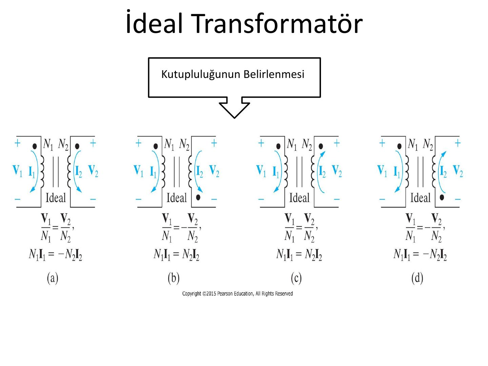
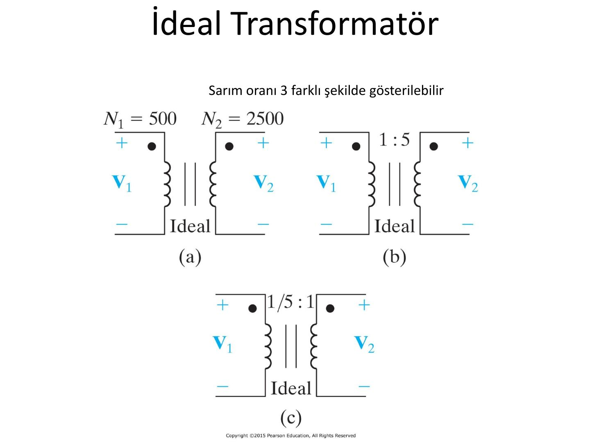
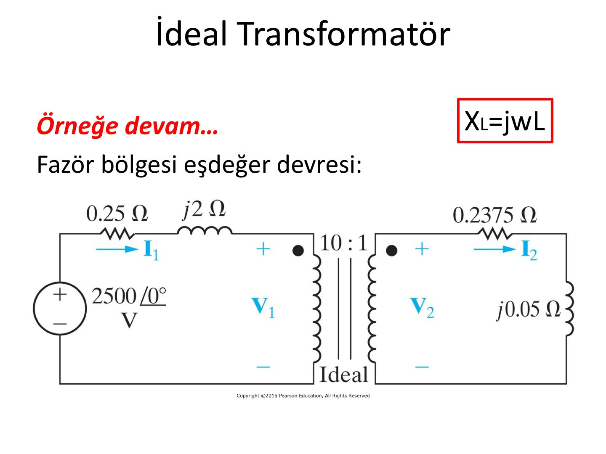
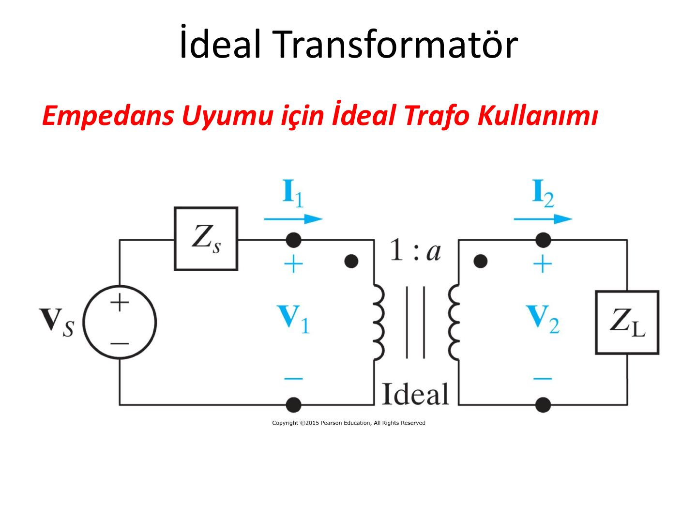

Bu yazı, Başkent Üniversitesi Elektrik-Elektronik Mühendisliği **EEM202 Devre Teorisi II** dersinde Yrd. Doç. Dr. Selda Güney'in hazırladığı **İdeal Transformatör** sunumunun içeriğidir (Nisan 2014). Altı slaytlık kısa bir sunum: devre şemaları görsel olarak, formüller ve değerler metin olarak aktarıldı. Orijinal PDF yazının sonunda indirilebilir.

## Kutupluluğun belirlenmesi

İdeal transformatörde gerilim ve akım ilişkilerinin işareti, sargılardaki noktaların (nokta kuralı) ve referans yönlerin konumuna bağlıdır. Sunumdaki dört durum:

| Durum | Gerilim ilişkisi | Akım ilişkisi |
|---|---|---|
| (a) | V₁/N₁ = V₂/N₂ | N₁I₁ = −N₂I₂ |
| (b) | V₁/N₁ = −V₂/N₂ | N₁I₁ = N₂I₂ |
| (c) | V₁/N₁ = V₂/N₂ | N₁I₁ = N₂I₂ |
| (d) | V₁/N₁ = −V₂/N₂ | N₁I₁ = −N₂I₂ |

## Sarım oranının gösterimi

Sarım oranı üç farklı şekilde gösterilebilir. Örneğin N₁ = 500, N₂ = 2500 sarımlı bir ideal trafo için:

- (a) Sarım sayıları doğrudan yazılır: N₁ = 500, N₂ = 2500
- (b) Oran olarak: **1 : 5**
- (c) Birinci tarafa göre normalize edilmiş oran: **1/5 : 1**

## Örnek: vg = 2500 cos 400t V

Kaynak vg = 2500 cos 400t V; birinci tarafta 0,25 Ω direnç ve 5 mH endüktans, 10 : 1 oranlı ideal trafo, ikinci tarafta 237,5 mΩ direnç ve 125 µH endüktanstan oluşan yük.

")

### Fazör bölgesi eşdeğer devresi

Endüktansların reaktansı X_L = jωL ile bulunur (ω = 400 rad/s):

- 5 mH → j·400·0,005 = **j2 Ω**
- 125 µH → j·400·125·10⁻⁶ = **j0,05 Ω**
- Kaynak fazörü: **2500∠0° V**

## Empedans uyumu için ideal trafo kullanımı

Son slaytta, iç empedansı Z_s olan V_s kaynağının 1 : a oranlı ideal trafo üzerinden Z_L yükünü beslediği devre gösterilir.

