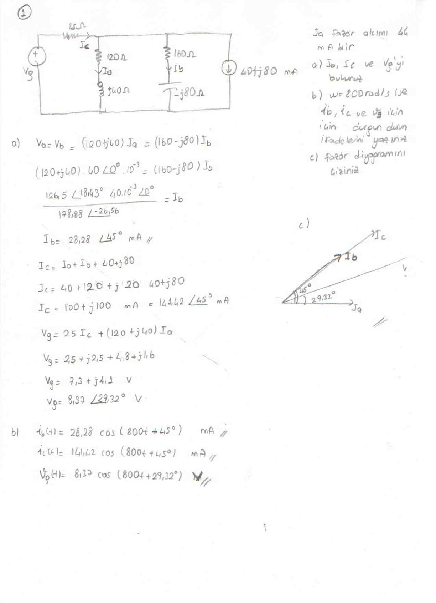
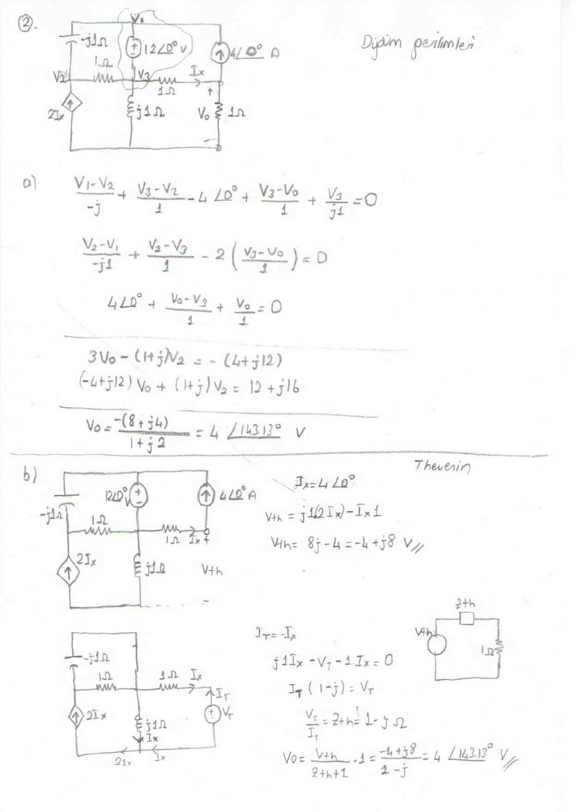

This post collects the handwritten solutions to two quizzes from the **EEM202 Circuit Theory II** course in the Electrical and Electronics Engineering Department at Başkent University: "kısasınav1cozumleri" (quiz 1 solutions) from the archive, and "kısasınav3cozumleri", whose title reads "EEM 202 Quiz III – Answer Key". Each consists of two questions. The scanned pages are given question by question, with the question text and the main results transcribed below them. The two original PDFs can be downloaded as a ZIP at the end of the post.

## Quiz 1

### Question 1: Phasor currents and steady-state expressions

The source V_g feeds three parallel branches through 25 Ω: 120 Ω + j40 Ω (I_a), 160 Ω − j80 Ω (I_b), and a 40 + j80 mA current source. The phasor current I_a is 40 mA.

1. Find I_b, I_c, and V_g.
1. If ω = 800 rad/s, write the steady-state expressions for i_b, i_c, and v_g.
1. Draw the phasor diagram.

- (120 + j40)·40∠0°·10⁻³ = (160 − j80)·I_b → **I_b = 28.28∠45° mA**
- I_c = I_a + I_b + 40 + j80 = **100 + j100 mA = 141.42∠45° mA**
- V_g = 25·I_c + (120 + j40)·I_a = 2.5 + j2.5 + 4.8 + j1.6 = 7.3 + j4.1 V = **8.37∠29.32° V**
- i_b(t) = 28.28 cos(800t + 45°) mA
- i_c(t) = 141.42 cos(800t + 45°) mA
- v_g(t) = 8.37 cos(800t + 29.32°) V

### Question 2: Node voltages and Thevenin equivalent

In a circuit consisting of a 12∠0° V voltage source, a 4∠0° A current source, a 2I_x dependent current source, a −j1 Ω capacitor, a j1 Ω inductor, and 1 Ω resistors, V_o is found (a) by the node-voltage method and (b) by the Thevenin equivalent.

a) From the node equations:

- 3V_o − (1 + j)V₂ = −(4 + j12)
- (−4 + j12)V_o + (1 + j)V₂ = 12 + j16
- **V_o = −(8 + j4)/(1 + j2) = 4∠143.13° V**

b) Thevenin:

- I_x = 4∠0° A, V_Th = j1(2I_x) − I_x·1 = **−4 + j8 V**
- With a test source: I_T = −I_x, I_T(1 − j) = V_T → **Z_Th = 1 − j Ω**
- V_o = V_Th/(Z_Th + 1)·1 = (−4 + j8)/(2 − j) = **4∠143.13° V** (both methods give the same result)

## Quiz III (answer key)

### Question 1: Maximum power in a circuit with mutual inductance

In a circuit consisting of a 30∠0° V (rms) source, 15 Ω, two inductors of j30 Ω and j15 Ω (with a mutual inductance impedance of j18 Ω between them), and a load Z_o, find Z_o for maximum power.

")

The open-circuit voltage is found:

- I₁ = 30∠0°/(15 + j30) = 0.4 − j0.8 A
- V_Th = j30·I₁ − j18·I₁ = j12·I₁ = 9.6 + j4.8 = **10.73∠26.57° V** (j18·I₁: the voltage that current I₁ produces in the 2nd inductor, i.e. the mutual inductance impedance)

The short-circuit current is found:

- 30∠0° = (15 + j30)I₁ − j12·I_N and j9·I_N = j12·I₁ → I₁ = (3/4)I_N
- 30∠0° = (11.25 + j22.5 − j12)I_N → **I_N = 30∠0°/15.38∠43.02° = 1.95∠−43.02° A**

Result:

- Z_Th = V_Th/I_N = 10.73∠26.57°/1.95∠−43.05° = **1.92 + j5.16 Ω**
- **Z_o = Z_Th* = 1.92 − j5.16 Ω**

### Question 2: Y-Δ three-phase system

Positive-sequence, Y-connected sources 1365∠0° V, 1365∠−120° V, 1365∠120° V (internal impedance j2 Ω), a 1.5 Ω line, and a Δ-connected load of 85.5 + j114 Ω per phase.

")

a) For the single-phase equivalent circuit, the Δ load is converted to a Y load:

- Z_Y = Z_Δ/3 = (85.5 + j114)/3 = **28.5 + j38 Ω**
- I_aA = 1365∠0°/(30 + j40) = **27.3∠−53.13° A**
- Because of the positive sequence: I_bB = 27.3∠−173.13° A, I_cC = 27.3∠66.87° A
- I_AB = I_aA/(√3∠−30°) = **15.76∠−23.13° A**
- I_BC = 15.76∠−143.13° A, I_CA = 15.76∠96.87° A

b) Power:

- S_source = −1365·(I_aA)* = −22,358.75 − j29,811.56 VA
- P_generated = 22,358.75 kW
- P_dissipated,load = |I_aA|²·(28.5) = 21.241 kW

c) Efficiency: P_dissipated/P_generated = 21,241/22,359 · 100 = **95%**

*Note: The answer key gives P_generated = 22,358.75 kW; the unit should be W (22,358.75 W = 22.36 kW). These values are per phase; the three-phase total is 3 times as much. The efficiency ratio is unaffected, and 95% is correct.*
