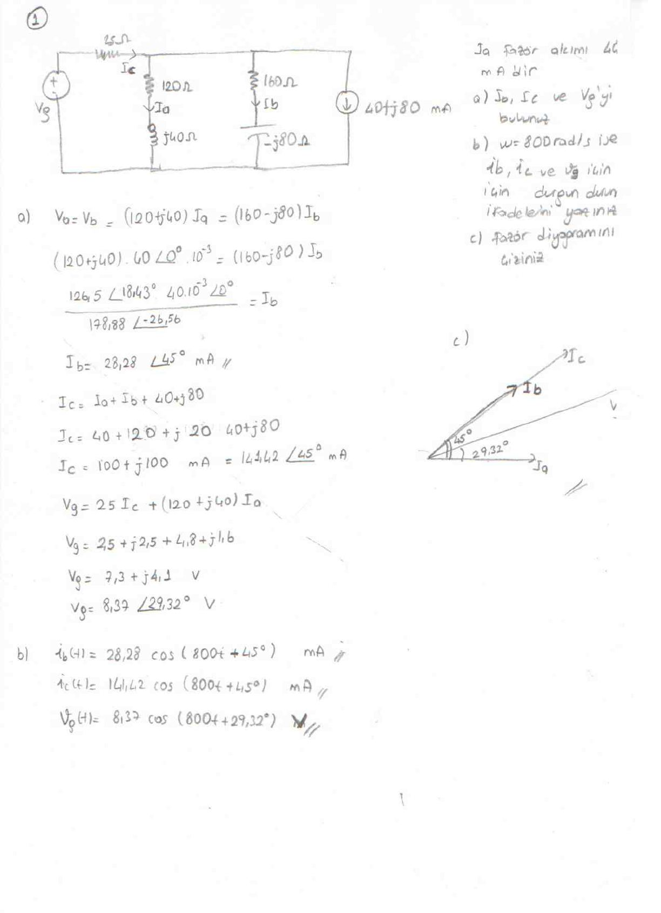
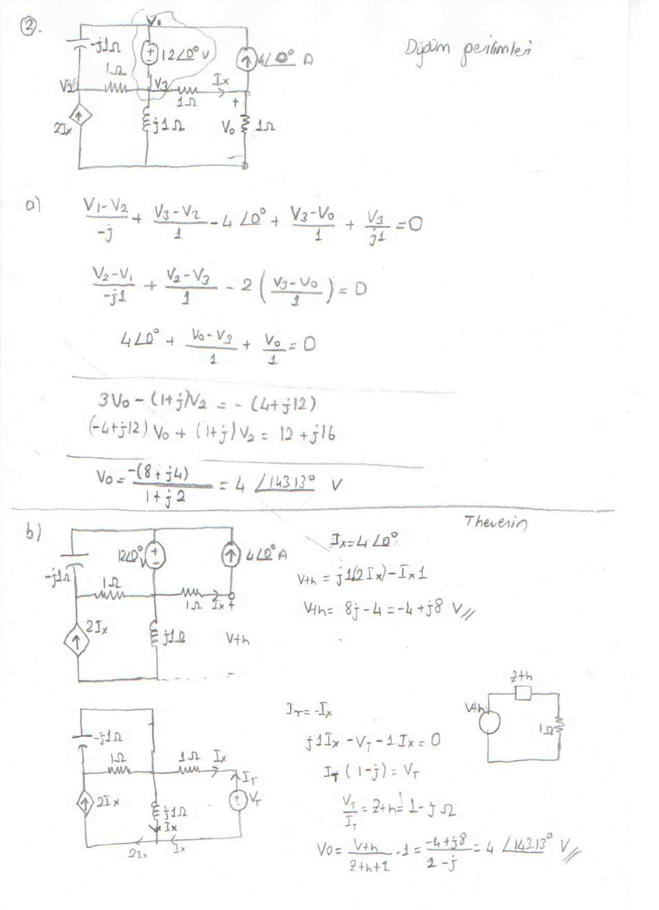

Bu yazı, Başkent Üniversitesi Elektrik-Elektronik Mühendisliği **EEM202 Devre Teorisi II** dersinin iki kısa sınavına ait el yazısı çözümleri bir araya getiriyor: arşivdeki "kısasınav1cozumleri" ve başlığında "EEM 202 Kısa Sınav III – Cevap anahtarı" yazan "kısasınav3cozumleri". Her biri iki sorudan oluşuyor. Taranmış sayfalar soru soru verildi; altlarında soru metni ve ana sonuçlar yazıya döküldü. İki orijinal PDF yazının sonunda ZIP olarak indirilebilir.

## Kısa Sınav 1

### Soru 1: Fazör akımlar ve kararlı durum ifadeleri

V_g kaynağı 25 Ω üzerinden üç paralel kolu besler: 120 Ω + j40 Ω (I_a), 160 Ω − j80 Ω (I_b) ve 40 + j80 mA'lik akım kaynağı. I_a fazör akımı 40 mA'dir.

1. I_b, I_c ve V_g'yi bulunuz.
1. ω = 800 rad/s ise i_b, i_c ve v_g için durgun durum (kararlı durum) ifadelerini yazınız.
1. Fazör diyagramını çiziniz.

- (120 + j40)·40∠0°·10⁻³ = (160 − j80)·I_b → **I_b = 28,28∠45° mA**
- I_c = I_a + I_b + 40 + j80 = **100 + j100 mA = 141,42∠45° mA**
- V_g = 25·I_c + (120 + j40)·I_a = 2,5 + j2,5 + 4,8 + j1,6 = 7,3 + j4,1 V = **8,37∠29,32° V**
- i_b(t) = 28,28 cos(800t + 45°) mA
- i_c(t) = 141,42 cos(800t + 45°) mA
- v_g(t) = 8,37 cos(800t + 29,32°) V

### Soru 2: Düğüm gerilimleri ve Thevenin eşdeğeri

12∠0° V gerilim kaynağı, 4∠0° A akım kaynağı, 2I_x bağımlı akım kaynağı, −j1 Ω kapasitör, j1 Ω bobin ve 1 Ω dirençlerden oluşan devrede V_o, (a) düğüm gerilimleri yöntemiyle ve (b) Thevenin eşdeğeriyle bulunur.

a) Düğüm denklemlerinden:

- 3V_o − (1 + j)V₂ = −(4 + j12)
- (−4 + j12)V_o + (1 + j)V₂ = 12 + j16
- **V_o = −(8 + j4)/(1 + j2) = 4∠143,13° V**

b) Thevenin:

- I_x = 4∠0° A, V_Th = j1(2I_x) − I_x·1 = **−4 + j8 V**
- Test kaynağıyla: I_T = −I_x, I_T(1 − j) = V_T → **Z_Th = 1 − j Ω**
- V_o = V_Th/(Z_Th + 1)·1 = (−4 + j8)/(2 − j) = **4∠143,13° V** (iki yöntem aynı sonucu veriyor)

## Kısa Sınav III (cevap anahtarı)

### Soru 1: Karşılıklı endüktanslı devrede maksimum güç

30∠0° V (rms) kaynak, 15 Ω, j30 Ω ve j15 Ω'luk iki bobin (aralarındaki karşılıklı endüktans empedansı j18 Ω) ve Z_o yükünden oluşan devrede, maksimum güç için Z_o bulunur.

")

Açık devre gerilimi bulunur:

- I₁ = 30∠0°/(15 + j30) = 0,4 − j0,8 A
- V_Th = j30·I₁ − j18·I₁ = j12·I₁ = 9,6 + j4,8 = **10,73∠26,57° V** (j18·I₁: I₁ akımının 2. endüktansta yarattığı gerilim, ortak endüktans empedansı)

Kısa devre akımı bulunur:

- 30∠0° = (15 + j30)I₁ − j12·I_N ve j9·I_N = j12·I₁ → I₁ = (3/4)I_N
- 30∠0° = (11,25 + j22,5 − j12)I_N → **I_N = 30∠0°/15,38∠43,02° = 1,95∠−43,02° A**

Sonuç:

- Z_Th = V_Th/I_N = 10,73∠26,57°/1,95∠−43,05° = **1,92 + j5,16 Ω**
- **Z_o = Z_Th* = 1,92 − j5,16 Ω**

### Soru 2: Y-Δ üç fazlı sistem

Pozitif sıralı, Y bağlı 1365∠0° V, 1365∠−120° V, 1365∠120° V kaynaklar (iç empedans j2 Ω), 1,5 Ω'luk hat ve faz başına 85,5 + j114 Ω'luk Δ bağlı yük.

")

a) Tek faz eşdeğer devresi için Δ yük Y yüke dönüştürülür:

- Z_Y = Z_Δ/3 = (85,5 + j114)/3 = **28,5 + j38 Ω**
- I_aA = 1365∠0°/(30 + j40) = **27,3∠−53,13° A**
- Pozitif sıradan dolayı: I_bB = 27,3∠−173,13° A, I_cC = 27,3∠66,87° A
- I_AB = I_aA/(√3∠−30°) = **15,76∠−23,13° A**
- I_BC = 15,76∠−143,13° A, I_CA = 15,76∠96,87° A

b) Güç:

- S_kaynak = −1365·(I_aA)* = −22 358,75 − j29 811,56 VA
- P_üretilen = 22 358,75 kW
- P_harcanan,yük = |I_aA|²·(28,5) = 21,241 kW

c) Verim: P_harcanan/P_üretilen = 21 241/22 359 · 100 = **%95**

*Not: Cevap anahtarında P_üretilen = 22 358,75 kW yazılmış; birim W olmalı (22 358,75 W = 22,36 kW). Bu değerler faz başınadır; üç faz toplamı 3 katıdır. Verim oranı etkilenmez, %95 doğrudur.*
