This post is the content of the presentation on the **use of the Laplace transform in circuit analysis**, prepared by Asst. Prof. Dr. Selda Güney for the **EEM202 Circuit Theory II** course in the Electrical-Electronics Engineering department at Başkent University (May 2014). The presentation is based on figures from the course textbook, Nilsson & Riedel *Electric Circuits* (10th edition); the slides contain only headings and figures. For this reason, the headings and the element values in the figures are given here as text, and the diagrams are included as images. The original PDF can be downloaded at the end of the post.

## Contents

- Circuit elements in the s domain
- Circuit analysis in the s domain and applications
- Transfer function
- Partial fraction expansion and the transfer function

## Circuit elements in the s domain

| Element | Time domain | s domain, series equivalent | s domain, parallel equivalent |
|---|---|---|---|
| Resistor | v = Ri | V = RI | – |
| Inductor | v = L di/dt, i = (1/L)∫₀ᵗ v dx + I₀ | V = sLI − LI₀ | I = V/(sL) + I₀/s |
| Capacitor | i = C dv/dt, v = (1/C)∫₀ᵗ i dx + V₀ | V = I/(sC) + V₀/s | I = sCV − CV₀ |

- **Inductor:** In the series equivalent, a voltage source LI₀ is in series with the impedance sL; in the parallel equivalent, a current source I₀/s is in parallel with sL. If the initial stored energy is zero, only sL remains.
- **Capacitor:** In the series equivalent, a voltage source V₀/s is in series with the impedance 1/sC; in the parallel equivalent, a current source CV₀ is in parallel with 1/sC. If the initial stored energy is zero, only 1/sC remains.

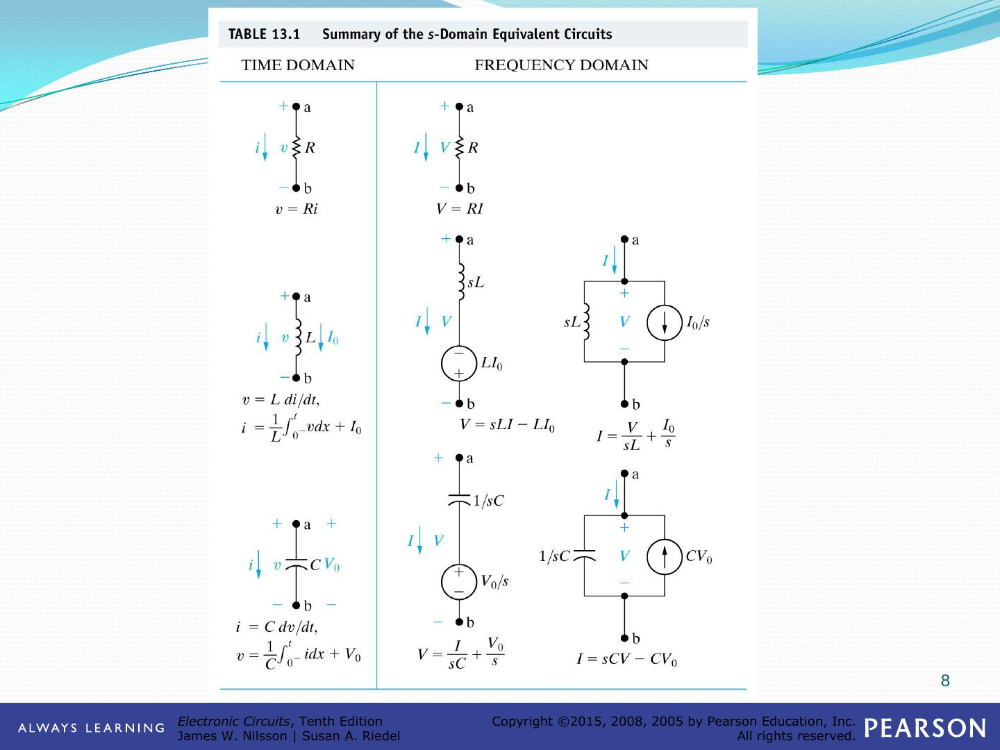

## Circuit analysis in the s domain and applications

### Natural response of an RC circuit

A capacitor C initially charged to a voltage V₀ discharges through a resistor R when the switch closes at t = 0. In the presentation, the circuit is drawn in the s domain in two ways:

- **Series equivalent representation:** a source V₀/s in series with 1/sC, with current I through R
- **Parallel equivalent representation:** a current source CV₀, with 1/sC and R in parallel; output V

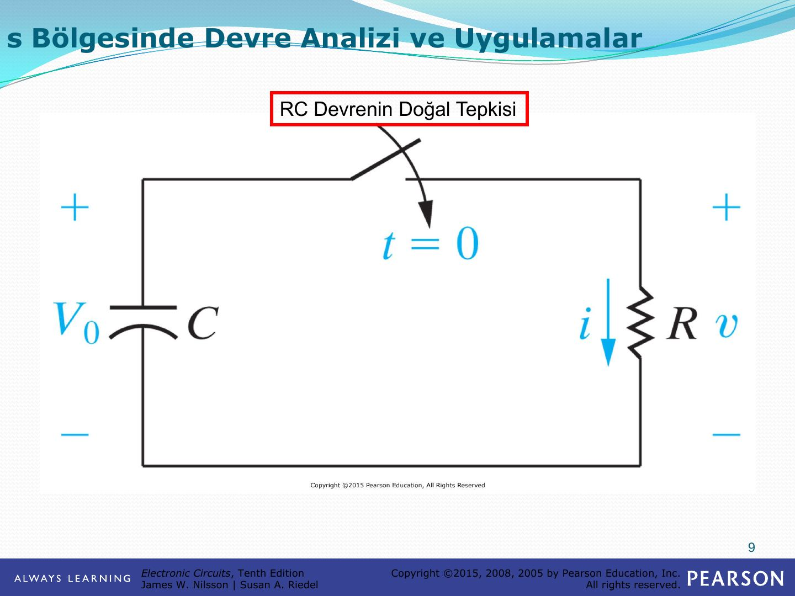

### Natural response of a parallel circuit

A current source I_dc = 24 mA feeds a parallel circuit with C = 25 nF, R = 625 Ω, L = 25 mH through a switch that opens at t = 0; the current i_L is sought. In the s-domain equivalent, the source is I_dc/s and the elements are 1/sC, R and sL.

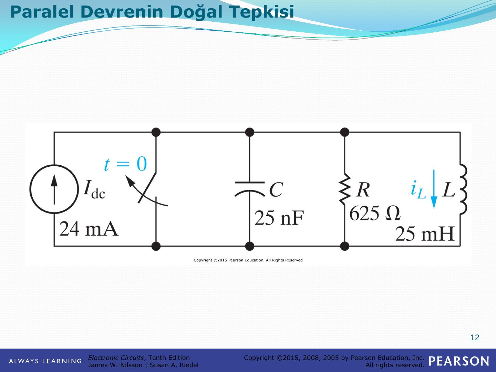

### Step response of a multi-mesh circuit

A 336 V source is connected at t = 0; in a two-mesh circuit consisting of inductances of 8.4 H and 10 H and resistors of 42 Ω and 48 Ω, i₁ and i₂ are sought. In the s domain, the source is 336/s and the inductances are 8.4s and 10s; the circuit is solved using the mesh currents I₁ and I₂.

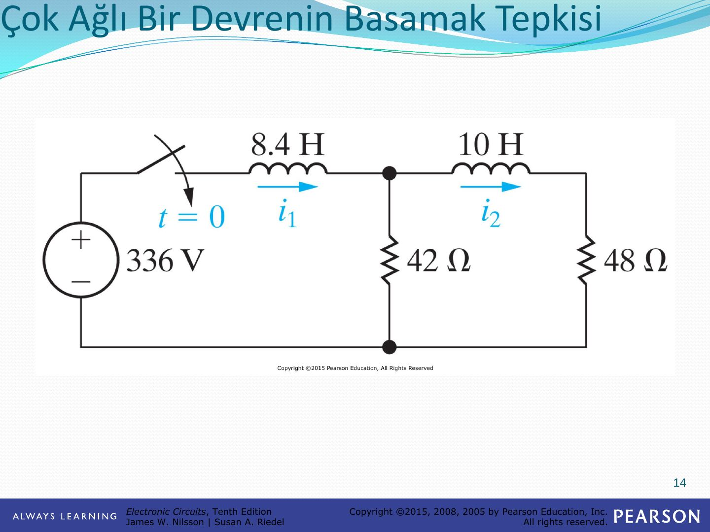

### Using the Thevenin equivalent

A 480 V source feeds a 5 µF capacitor through 20 Ω, a switch that closes at t = 0, a 2 mH inductance and 60 Ω; i_C and v_C are sought. In the s domain, the source is 480/s, the inductance is 0.002s and the capacitor is 2×10⁵/s. The Thevenin equivalent with respect to terminals a-b is:

- V_Th = 480/(s + 10⁴)
- Z_Th = 80(s + 7500)/(s + 10⁴)

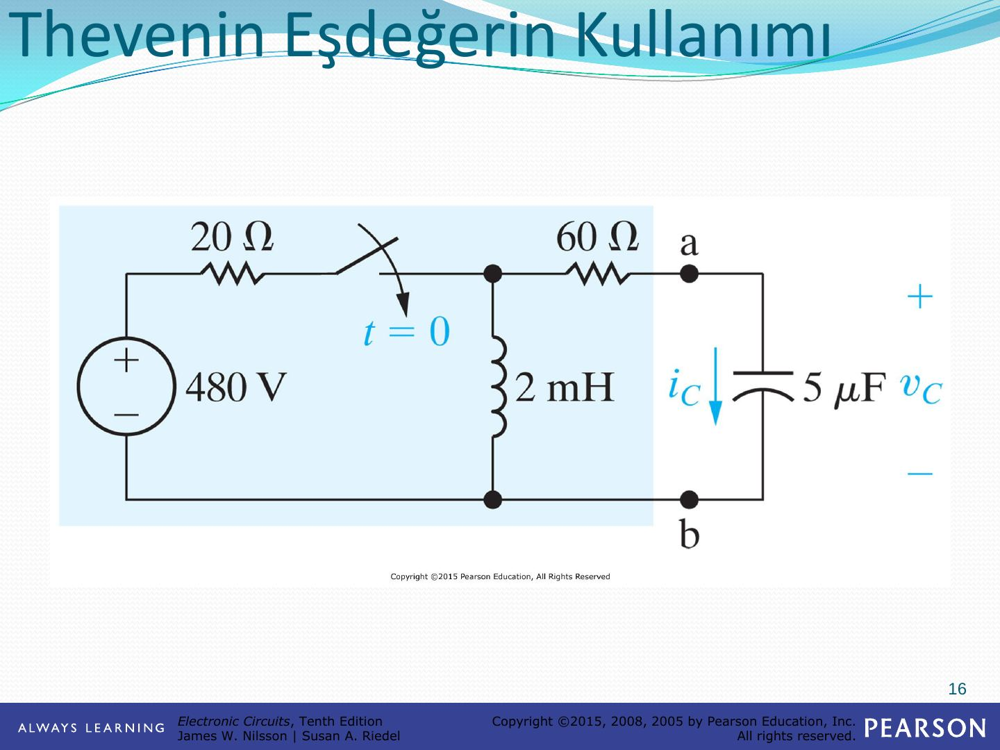

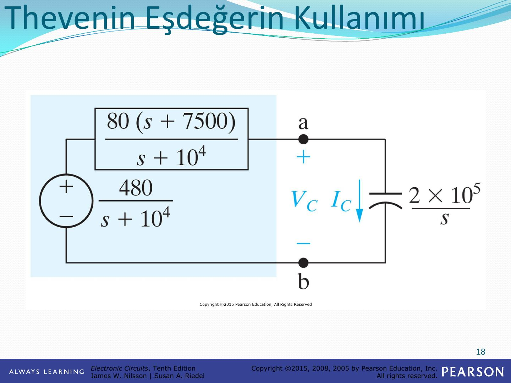

### A circuit with mutual inductance

A 60 V source, 9 Ω and 3 Ω resistors, a switch that moves from position a to position b at t = 0; windings of 2 H and 8 H with mutual inductance M = 2 H between them, and 2 Ω and 10 Ω on the secondary side. The mutual inductance is replaced by a T equivalent: (L₁ − M) = 0 H, M = 2 H, (L₂ − M) = 6 H. In the s domain, the common branch is represented by the impedance 2s and a 10 V source arising from the initial current.

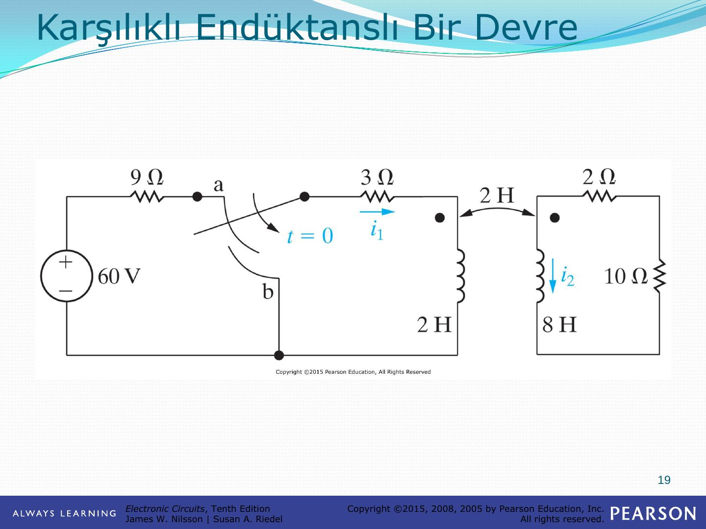

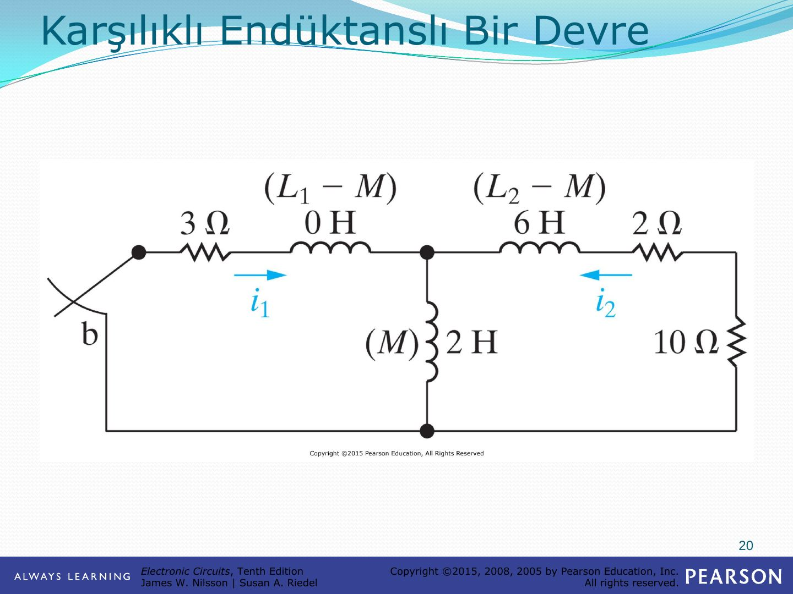

As a result, the current i₂ starts from zero, reaches its maximum value of 481.13 mA at t = 549.31 ms, and then decays.

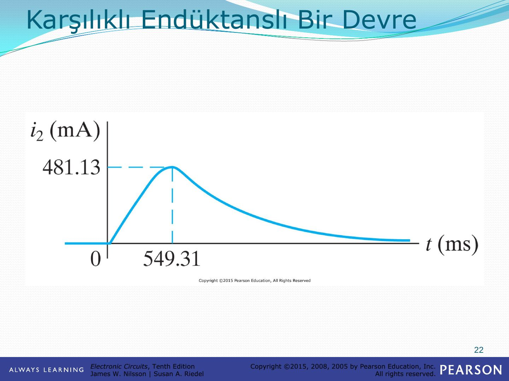

### Using superposition

In a circuit consisting of a voltage source v_g, R₁, L (initial current ρ), C (initial voltage γ), R₂ and a current source i_g, v₂ is sought. In the s-domain equivalent circuit, the initial condition of the inductance is shown as a current source ρ/s, and that of the capacitor as a current source γC.

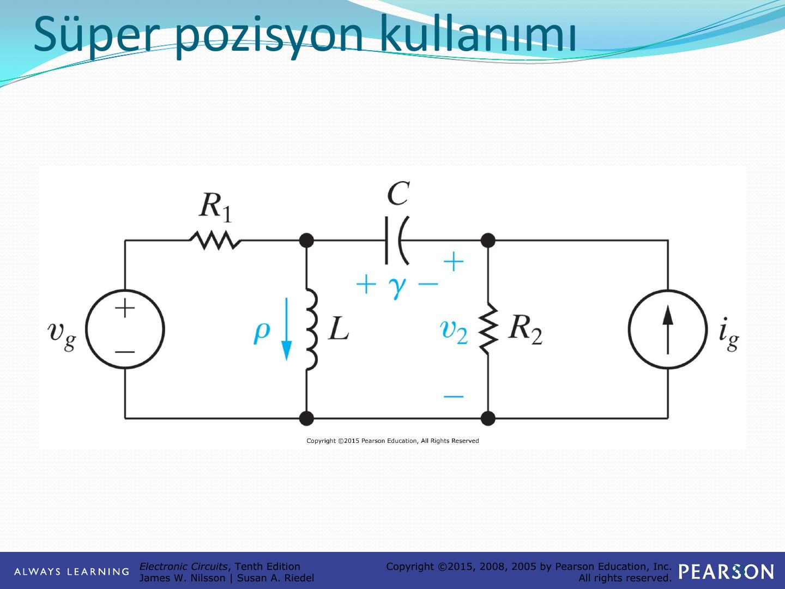

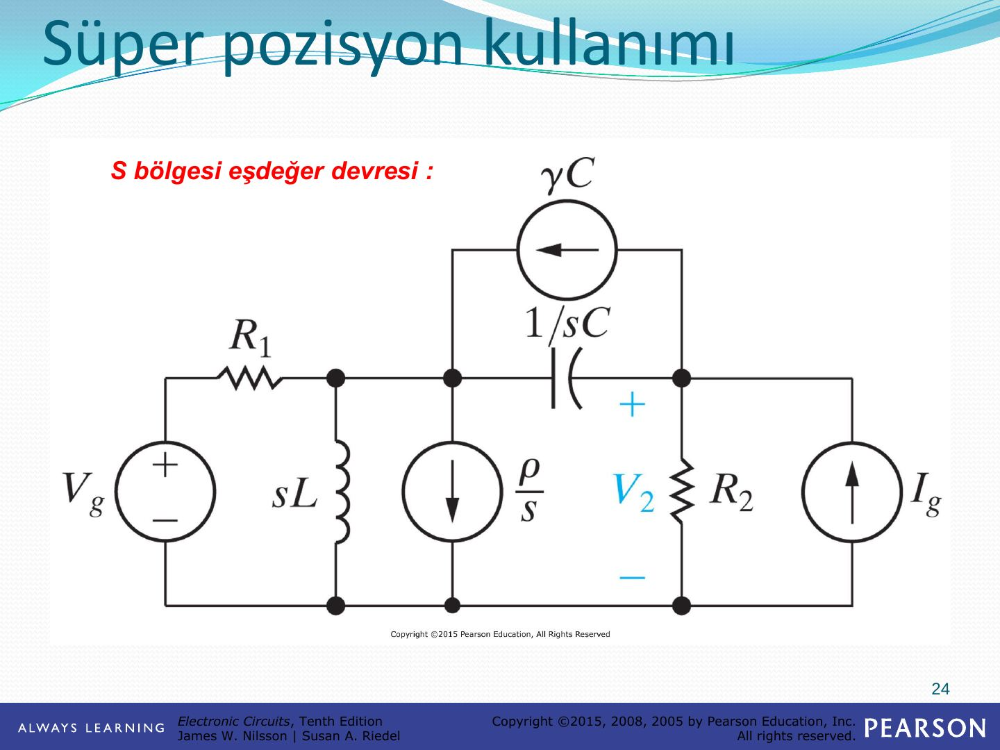

V₂ is found as the sum of the effects of the four sources:

1. With only the voltage source V_g left in the circuit → V₂′
1. With only the current source I_g left in the circuit → V₂″
1. With only the initial-current source of the inductance (ρ/s) left in the circuit → V₂‴
1. With only the initial-current source of the capacitor (γC) left in the circuit → V₂⁗

## Transfer function

In the presentation, the transfer function is shown on a series circuit consisting of the source V_g, R, sL and 1/sC; either the current I or the capacitor voltage V can be taken as the output.

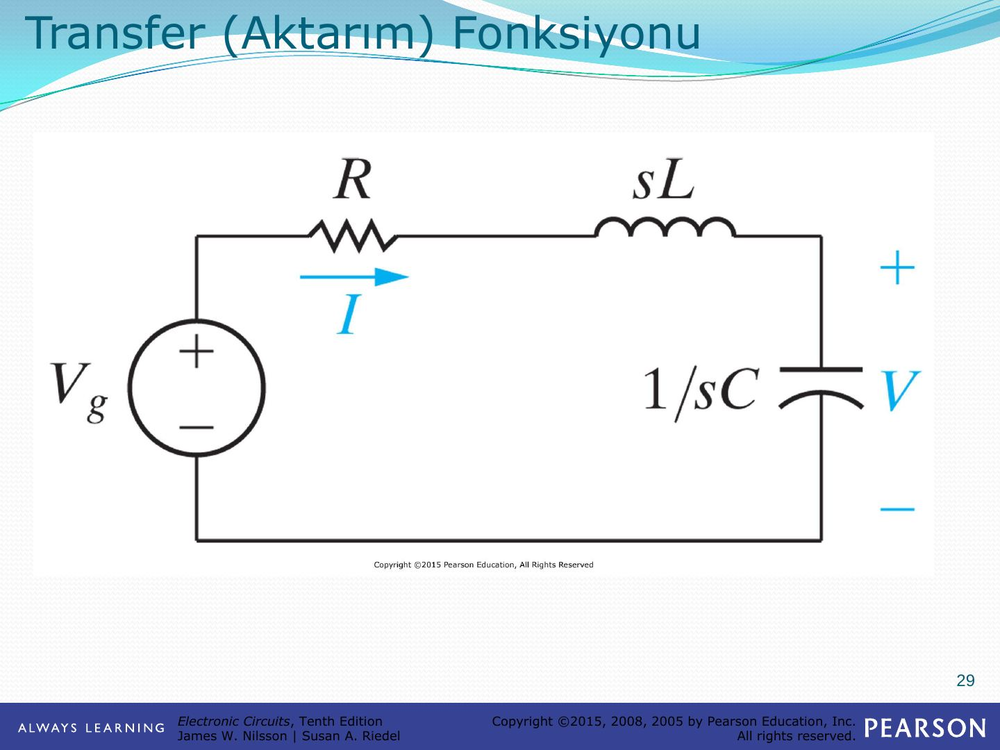

**Example:** The source v_g feeds, through 1000 Ω, a node where a series branch of 250 Ω + 50 mH is connected in parallel with a 1 µF capacitor; the output is v_o. In the s domain, 50 mH → 0.05s and 1 µF → 10⁶/s.

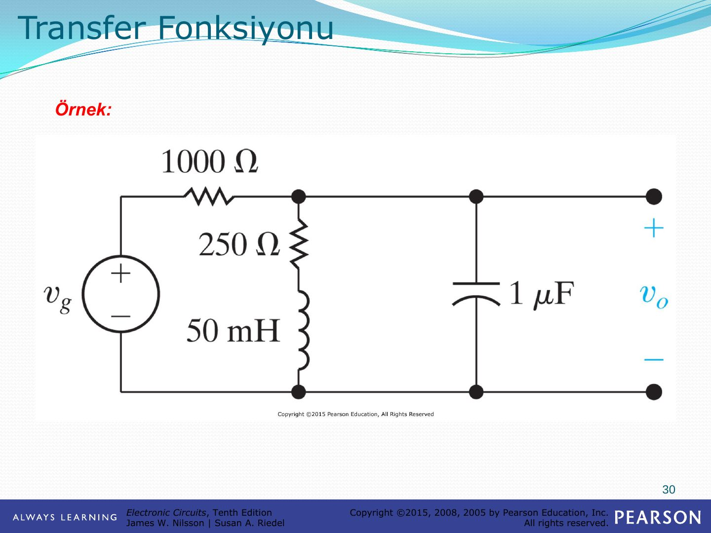

## Partial fraction expansion and the transfer function

The graph on the last slide shows the output v_o of the example circuit: after the initial transient, v_o settles onto the line (10 000t − 0.4) mV.

")
