Bu yazı, Başkent Üniversitesi Elektrik-Elektronik Mühendisliği **EEM202 Devre Teorisi II** dersinde Yrd. Doç. Dr. Selda Güney'in hazırladığı **Laplace dönüşümünün devre analizinde kullanımı** sunumunun içeriğidir (Mayıs 2014). Sunum, dersin kaynak kitabı Nilsson & Riedel *Electric Circuits* (10. baskı) şekilleri üzerine kurulu; slaytlarda yalnızca başlıklar ve şekiller var. Bu yüzden yazıda başlıklar ve şekillerdeki eleman değerleri metin olarak verildi, şemalar görsel olarak eklendi. Orijinal PDF yazının sonunda indirilebilir.

## İçerik

- s bölgesinde devre elemanları
- s bölgesinde devre analizi ve uygulamalar
- Aktarım (transfer) fonksiyonu
- Kısmi kesirlere açılım ve aktarım fonksiyonu

## s bölgesinde devre elemanları

| Eleman | Zaman bölgesi | s bölgesi, seri eşdeğer | s bölgesi, paralel eşdeğer |
|---|---|---|---|
| Direnç | v = Ri | V = RI | – |
| İndüktör | v = L di/dt, i = (1/L)∫₀ᵗ v dx + I₀ | V = sLI − LI₀ | I = V/(sL) + I₀/s |
| Kapasitör | i = C dv/dt, v = (1/C)∫₀ᵗ i dx + V₀ | V = I/(sC) + V₀/s | I = sCV − CV₀ |

- **İndüktör:** Seri eşdeğerde sL empedansına seri LI₀ gerilim kaynağı; paralel eşdeğerde sL'ye paralel I₀/s akım kaynağı bulunur. Depolanmış başlangıç enerjisi sıfırsa yalnızca sL kalır.
- **Kapasitör:** Seri eşdeğerde 1/sC empedansına seri V₀/s gerilim kaynağı; paralel eşdeğerde 1/sC'ye paralel CV₀ akım kaynağı bulunur. Depolanmış başlangıç enerjisi sıfırsa yalnızca 1/sC kalır.

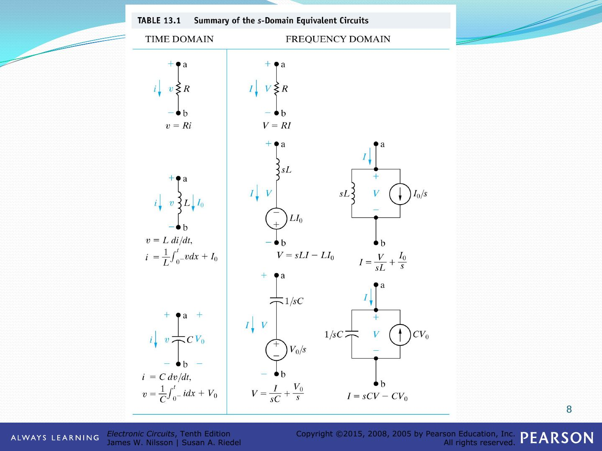

## s bölgesinde devre analizi ve uygulamalar

### RC devrenin doğal tepkisi

Başlangıçta V₀ gerilimiyle yüklü C kapasitörü, t = 0'da kapanan anahtarla R direnci üzerinden boşalır. Sunumda devre s bölgesinde iki şekilde çizilir:

- **Seri eşdeğer gösterim:** 1/sC ile seri V₀/s kaynağı, R üzerinden I akımı
- **Paralel eşdeğer gösterim:** CV₀ akım kaynağı, 1/sC ve R paralel; çıkış V

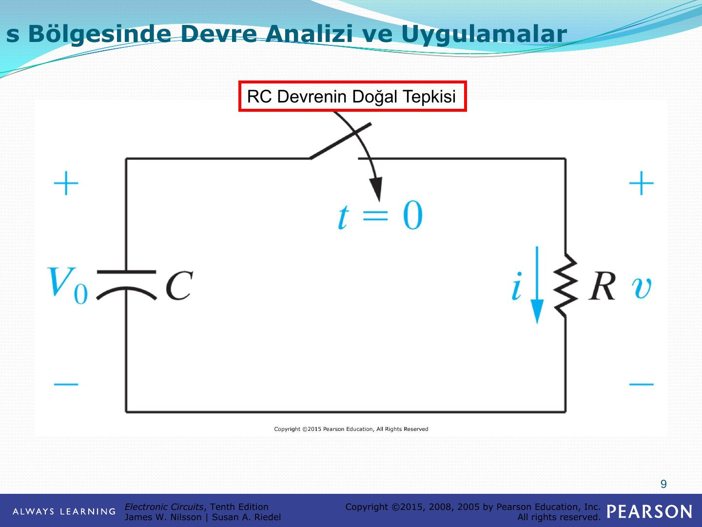

### Paralel devrenin doğal tepkisi

I_dc = 24 mA akım kaynağı t = 0'da açılan anahtarla paralel C = 25 nF, R = 625 Ω, L = 25 mH devresini besler; i_L akımı aranır. s bölgesi eşdeğerinde kaynak I_dc/s, elemanlar 1/sC, R ve sL olur.

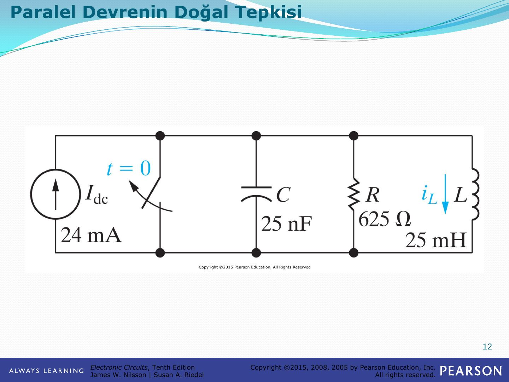

### Çok ağlı bir devrenin basamak tepkisi

336 V kaynak t = 0'da devreye girer; 8,4 H ve 10 H endüktanslar ile 42 Ω ve 48 Ω dirençlerden oluşan iki gözlü devrede i₁ ve i₂ aranır. s bölgesinde kaynak 336/s, endüktanslar 8,4s ve 10s olur; I₁ ve I₂ göz akımlarıyla çözülür.

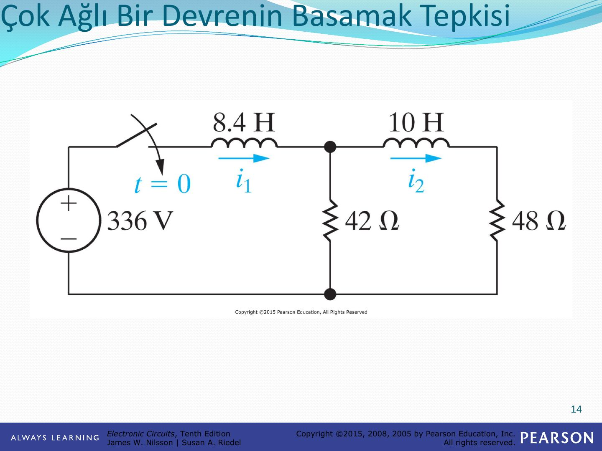

### Thevenin eşdeğerinin kullanımı

480 V kaynak, 20 Ω, t = 0'da kapanan anahtar, 2 mH endüktans ve 60 Ω üzerinden 5 µF kapasitörü besler; i_C ve v_C aranır. s bölgesinde kaynak 480/s, endüktans 0,002s, kapasitör 2×10⁵/s olur. a-b uçlarına göre Thevenin eşdeğeri:

- V_Th = 480/(s + 10⁴)
- Z_Th = 80(s + 7500)/(s + 10⁴)

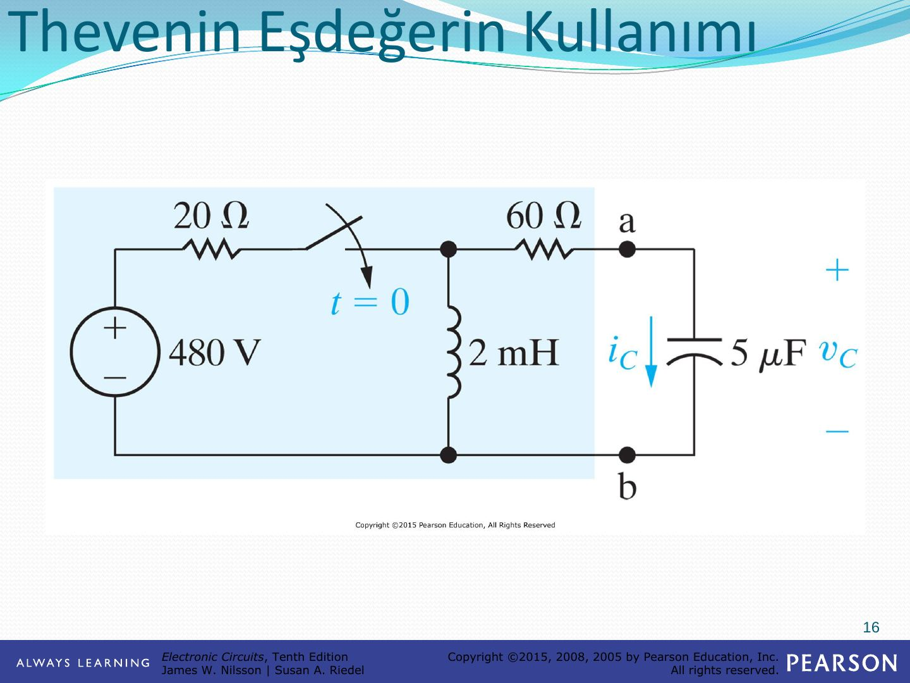

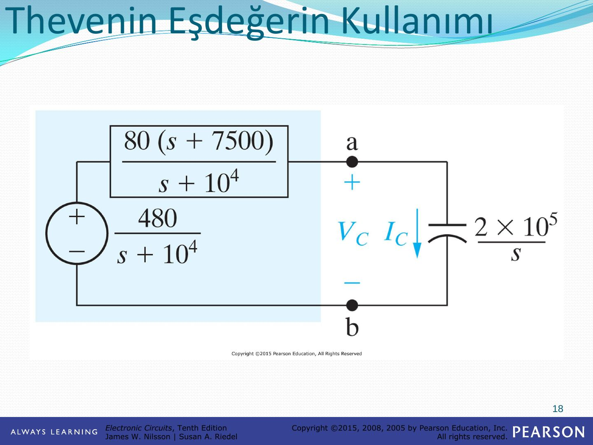

### Karşılıklı endüktanslı bir devre

60 V kaynak, 9 Ω ve 3 Ω dirençler, t = 0'da a konumundan b konumuna geçen anahtar; 2 H ve 8 H sargılar arasında M = 2 H karşılıklı endüktans, ikinci tarafta 2 Ω ve 10 Ω. Karşılıklı endüktans T eşdeğeriyle değiştirilir: (L₁ − M) = 0 H, M = 2 H, (L₂ − M) = 6 H. s bölgesinde ortak kol 2s empedansı ve başlangıç akımından gelen 10 V'luk kaynakla gösterilir.

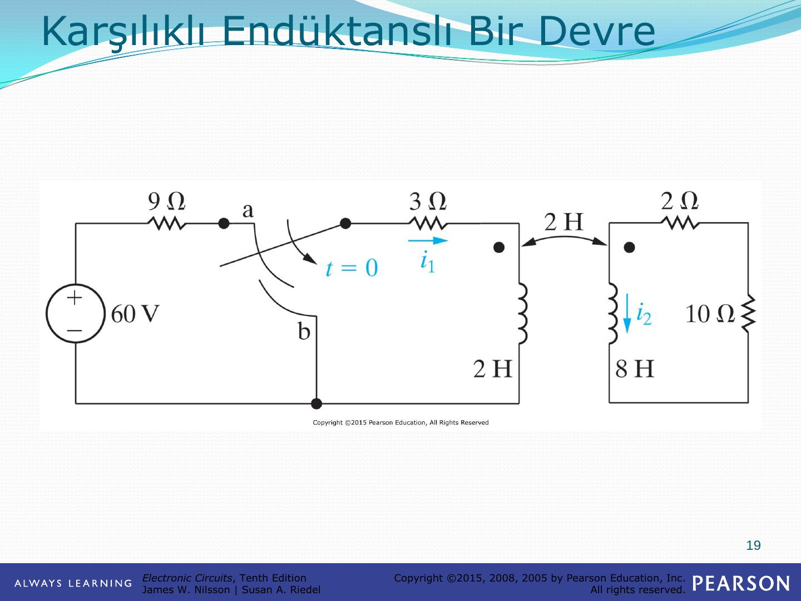

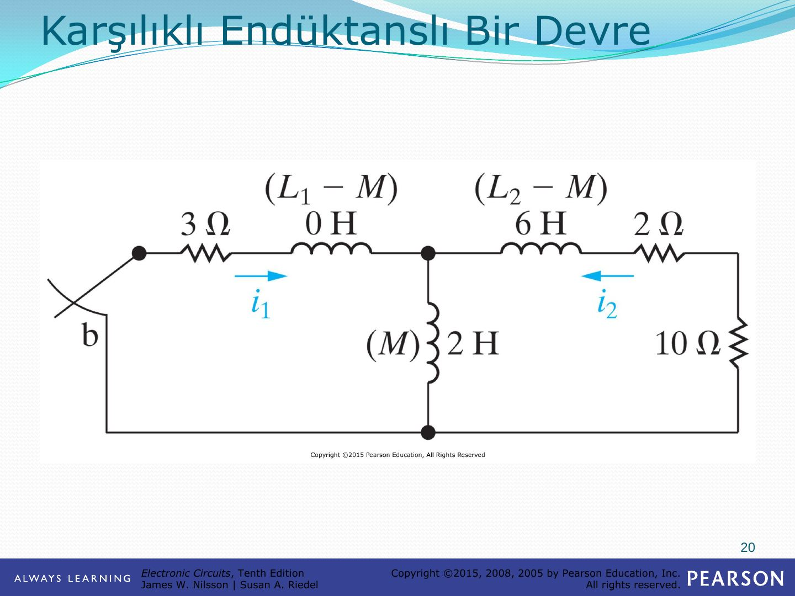

Sonuçta i₂ akımı sıfırdan başlayıp t = 549,31 ms'de en büyük değeri olan 481,13 mA'e ulaşır ve sonra sönümlenir.

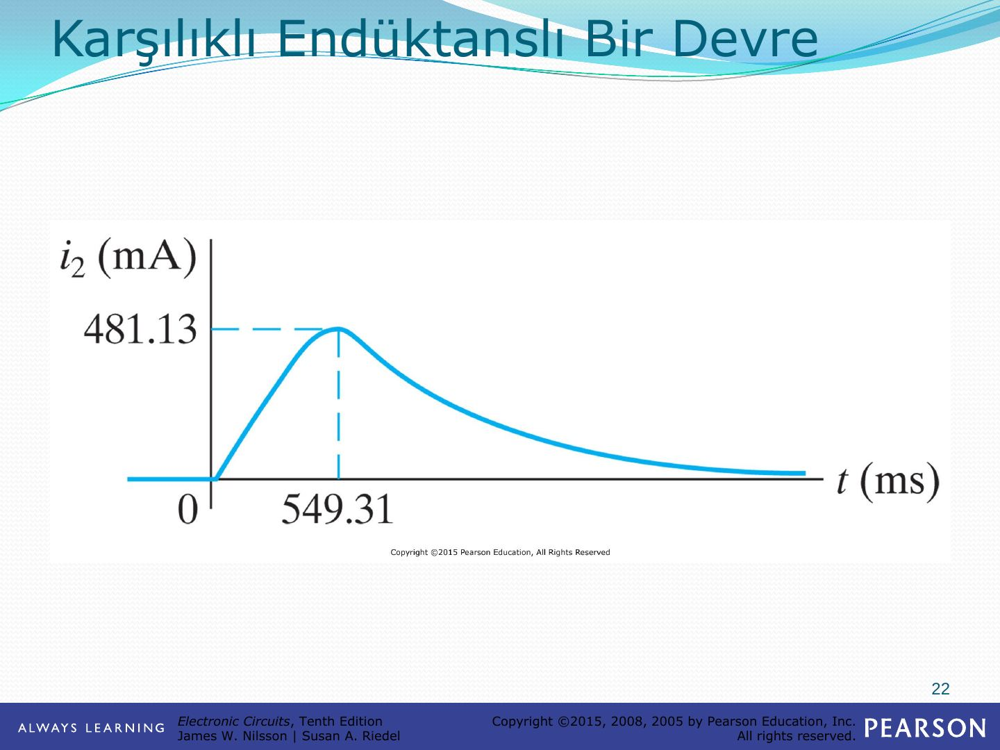

### Süperpozisyon kullanımı

v_g gerilim kaynağı, R₁, L (başlangıç akımı ρ), C (başlangıç gerilimi γ), R₂ ve i_g akım kaynağından oluşan devrede v₂ aranır. s bölgesi eşdeğer devresinde endüktansın başlangıç koşulu ρ/s akım kaynağı, kapasitörünki γC akım kaynağı olarak gösterilir.

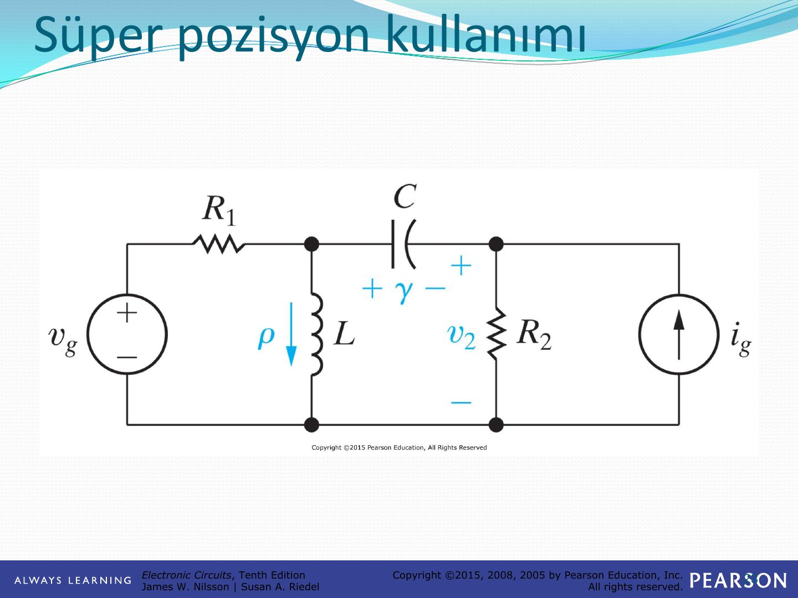

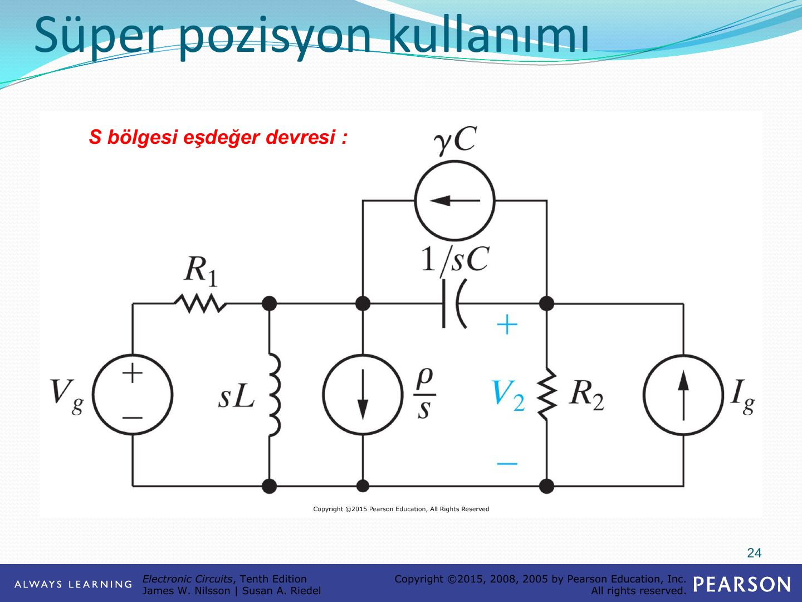

V₂, dört kaynağın etkisinin toplamı olarak bulunur:

1. Sadece devrede V_g gerilim kaynağı bırakılırsa → V₂′
1. Sadece devrede I_g akım kaynağı bırakılırsa → V₂″
1. Sadece devrede endüktansın başlangıç akım kaynağı (ρ/s) bırakılırsa → V₂‴
1. Sadece devrede kondansatörün başlangıç akım kaynağı (γC) bırakılırsa → V₂⁗

## Transfer (aktarım) fonksiyonu

Sunumda transfer fonksiyonu, V_g kaynağı, R, sL ve 1/sC'den oluşan seri devre üzerinde gösterilir; I akımı ya da kapasitör gerilimi V çıkış olarak alınabilir.

 fonksiyonu")

**Örnek:** v_g kaynağı 1000 Ω üzerinden, 250 Ω + 50 mH seri kolu ile 1 µF kapasitörün paralel bağlı olduğu düğümü besler; çıkış v_o. s bölgesinde 50 mH → 0,05s, 1 µF → 10⁶/s olur.

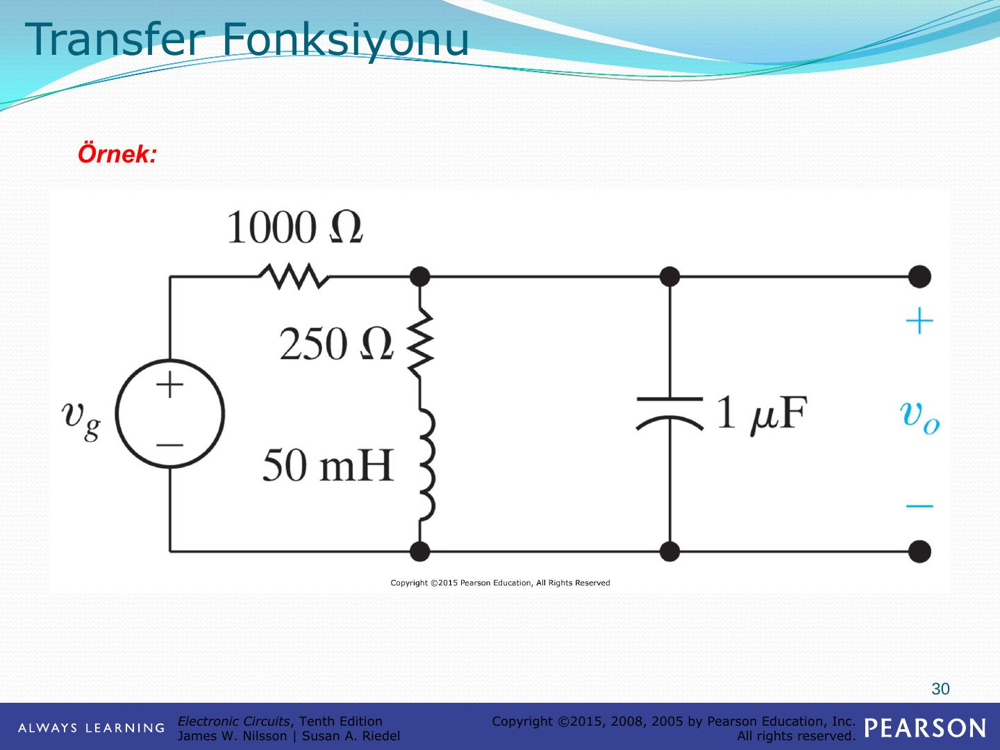

## Kısmi kesir açılımı ve transfer fonksiyonu

Son slayttaki grafik, örnek devrenin v_o çıkışını gösterir: v_o, başlangıçtaki geçici bölümden sonra (10 000t − 0,4) mV doğrusuna oturur.

")
