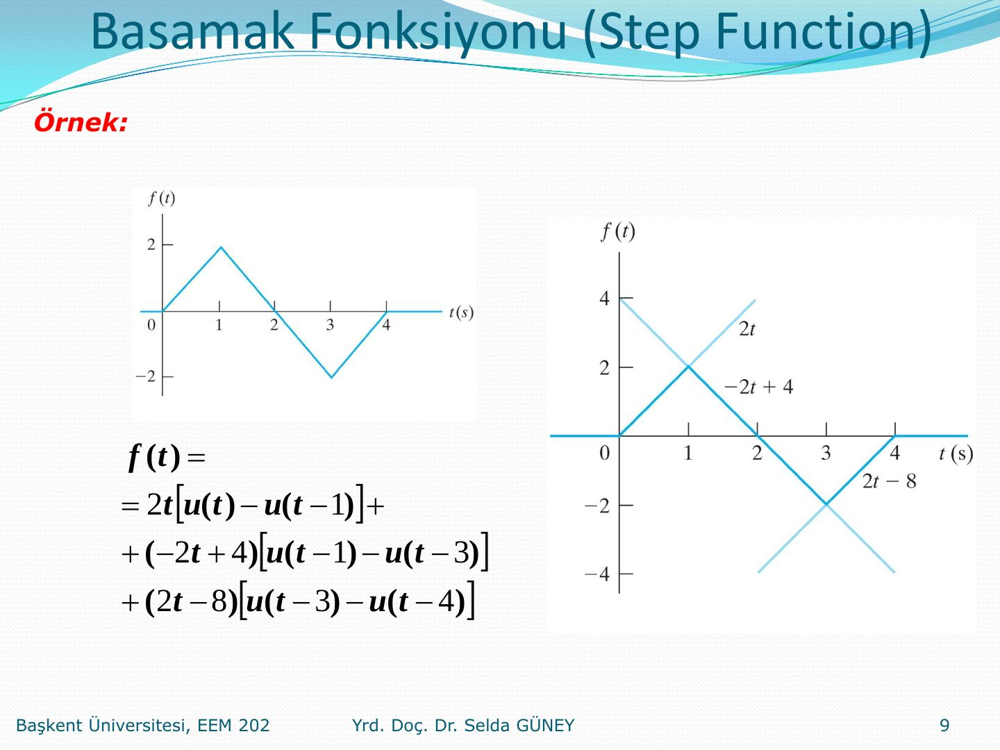
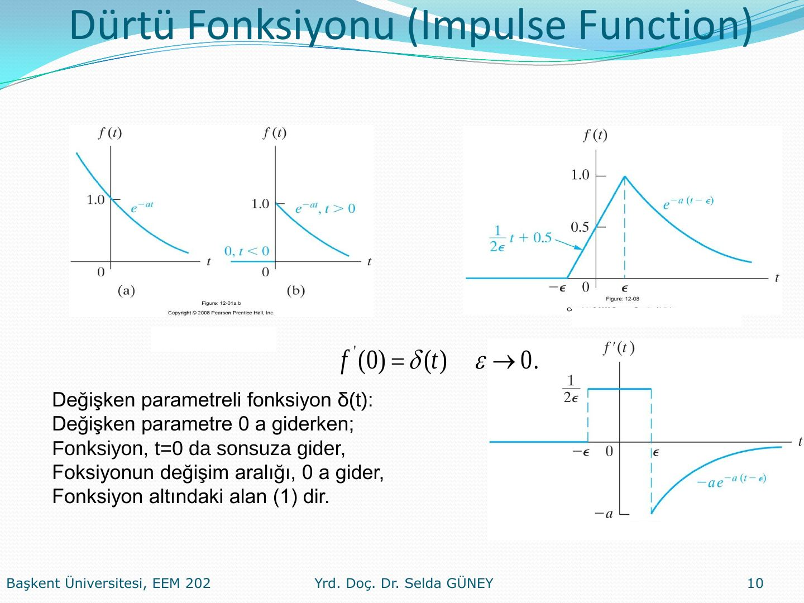
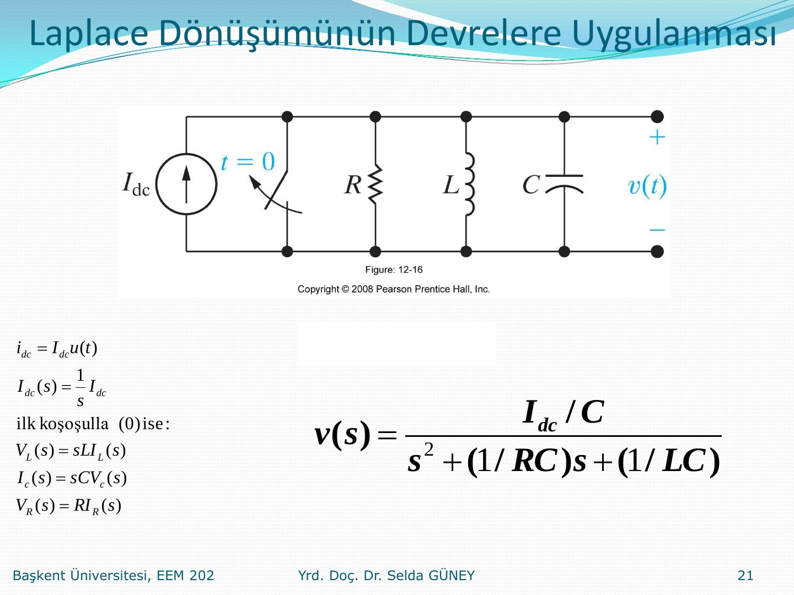
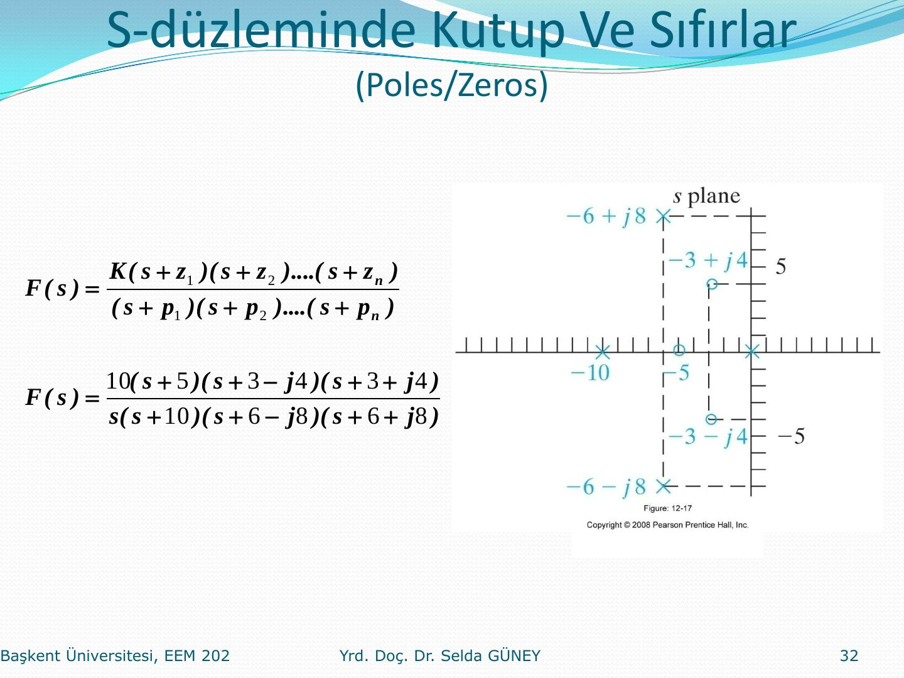

This post is the content of the **Laplace Transform** presentation prepared by Asst. Prof. Dr. Selda Güney for the **EEM202 Circuit Theory II** course in the Electrical-Electronics Engineering department at Başkent University (May 2014). Formulas and transform tables are written as text; graphs and the circuit diagram are included as images. The original 33-slide PDF can be downloaded at the end of the post.

## Topics

- Definition of the Laplace transform
- Step function
- Impulse function
- Functional transforms
- Operational transforms
- Application of the Laplace transform to circuits
- Inverse Laplace transform
- Poles and zeros of F(s)
- Initial and final value theorems

## Definition of the Laplace transform

The presentation begins with the signals encountered in circuits:

- Electrical signals: analog, digital (sound, image, light, radiation, ultrasound; transducers; Fourier transform; sinusoidal signals)
- Sources: DC source + switch (unit step), point of discontinuity; derivative at the point of discontinuity (Dirac delta function, impulse); integral at the point of discontinuity (an area with one dimension equal to zero); AC
- Signals seen in linear circuits: DC voltage/current, AC voltage/current (damped), exponential voltage/current

Let there be a transform that gives the complete solution of the differential equation; by definition, the mesh and node equations become algebraic:

- L{f(t)} = ∫₀^∞ f(t)·e^(−st) dt
- F(s) = L{f(t)}
- f(t) = L⁻¹{F(s)}

The lower limit is chosen according to whether f is continuous or discontinuous at t = 0:

- t = 0⁻ is taken as the lower limit
- t < 0⁻: formation of the initial conditions
- Integral between t = 0⁻ and t = 0⁺: (0)
- Exception: impulse function (Dirac delta)

 and discontinuous (b) at the origin")

## Step function

- Ku(t) = 0, t < 0
- Ku(t) = K, t > 0
- For K = 1, the **unit step function**

The step function is a mathematical model; its counterpart in circuits is switching: applying a DC voltage source to the circuit through a switch. For consistency between theory and practice, Ku(0) = 0.5K is taken.

 = 0.5K")

Shifted step:

- Ku(t − a) = 0, t < a; Ku(t − a) = K, t > a
- Ku(a − t) = K, t < a; Ku(a − t) = 0, t > a

**Example:** The triangular wave in the figure is written in terms of step functions as follows:

f(t) = 2t[u(t) − u(t−1)] + (−2t + 4)[u(t−1) − u(t−3)] + (2t − 8)[u(t−3) − u(t−4)]

## Impulse function

f′(0) = δ(t), ε → 0. Function δ(t) with a variable parameter: as the variable parameter tends to 0,

- the function tends to infinity at t = 0,
- the interval over which the function varies tends to 0,
- the area under the function is 1.

- ∫ Kδ(t) dt = K (from −∞ to ∞), δ(t) = 0, t ≠ 0; K: strength
- Shifting (sifting) property of the Dirac delta function: if f(t) is continuous at t = a, then ∫ f(t)·δ(t − a) dt = f(a)

## Functional transforms

- L{δ(t)} = ∫₀^∞ δ(t)·e^(−st) dt = ∫ δ(t)·1 dt = **1**
- L{δ′(t)} = s; in general L{δ⁽ⁿ⁾(t)} = sⁿ
- As ε → 0, f(t) → u(t) and f′(t) → δ(t); that is, δ(t) = du(t)/dt

 → u(t), f′(t) → δ(t)")

- L{u(t)} = ∫₀^∞ e^(−st) dt = [−(1/s)e^(−st)]₀^∞ = −(1/s)(0 − 1) = **1/s**
- L{e^(−at)} = **1/(s + a)**
- e^(jωt) = cos ωt + j sin ωt, e^(−jωt) = cos ωt − j sin ωt; cos ωt = ½(e^(jωt) + e^(−jωt)), sin ωt = (1/2j)(e^(jωt) − e^(−jωt))
- L{sin ωt} = **ω/(s² + ω²)**, L{cos ωt} = **s/(s² + ω²)**
- Ramp: ∫₀^∞ t·e^(−st) dt is evaluated by integration by parts (u = e^(−st), dv = dt) and gives **1/s²**.

| Function | f(t) | F(s) |
|---|---|---|
| Impulse | δ(t) | 1 |
| Step | u(t) | 1/s |
| Ramp | t | 1/s² |
| Exponential | e^(−at) | 1/(s+a) |
| Sine | sin ωt | ω/(s²+ω²) |
| Cosine | cos ωt | s/(s²+ω²) |
| Damped ramp | t·e^(−at) | 1/(s+a)² |
| Damped sine | e^(−at) sin ωt | ω/((s+a)²+ω²) |
| Damped cosine | e^(−at) cos ωt | (s+a)/((s+a)²+ω²) |

## Operational transforms

| Operation | f(t) | F(s) |
|---|---|---|
| Multiplication by a constant | K·f(t) | K·F(s) |
| Addition and subtraction | f₁(t) + f₂(t) − f₃(t) | F₁(s) + F₂(s) − F₃(s) |
| Differentiation | df(t)/dt | sF(s) − f(0⁻) |
| Second-order differentiation | d²f(t)/dt² | s²F(s) − s·f(0⁻) − df(0⁻)/dt |
| nth-order differentiation | dⁿf(t)/dtⁿ | sⁿF(s) − sⁿ⁻¹f(0⁻) − sⁿ⁻²·df(0⁻)/dt − … − dⁿ⁻¹f(0⁻)/dtⁿ⁻¹ |
| Integration | ∫₀ᵗ f(x) dx | F(s)/s |
| Translation in the time domain | f(t−a)u(t−a), a > 0 | e^(−as)F(s) |
| Translation in the s domain | e^(−at)f(t) | F(s+a) |
| Scale change | f(at), a > 0 | (1/a)F(s/a) |
| First derivative in the s domain | t·f(t) | −dF(s)/ds |
| nth derivative in the s domain | tⁿf(t) | (−1)ⁿ dⁿF(s)/dsⁿ |
| Integration in the s domain | f(t)/t | ∫ₛ^∞ F(u) du |

## Application of the Laplace transform to circuits

A DC current source I_dc, whose switch is opened at t = 0, feeds parallel R, L, C elements:

- i_dc = I_dc·u(t) → I_dc(s) = I_dc/s
- If the initial conditions are 0: V_L(s) = sL·I_L(s), I_C(s) = sC·V_C(s), V_R(s) = R·I_R(s)
- Result: **v(s) = (I_dc/C) / (s² + (1/RC)s + 1/LC)**

## Inverse Laplace transform

Circuit solutions are rational functions in the s-domain:

F(s) = N(s)/D(s) = (aₙsⁿ + aₙ₋₁sⁿ⁻¹ + … + a₁s + a₀) / (bₘsᵐ + bₘ₋₁sᵐ⁻¹ + … + b₁s + b₀)

- Proper rational: n < m
- Improper rational: m < n

Rational functions can be written as a sum of simple fractions (partial fraction expansion). From these simple fractions, one can go to the t domain by using the linearity of the Laplace transform.

| Type of root | Term | Inverse Laplace |
|---|---|---|
| Real root | K/(s+a) | K·e^(−at)u(t) |
| Repeated real root | K/(s+a)² | K·t·e^(−at)u(t) |
| Complex root | K/(s+α−jβ) + K*/(s+α+jβ) | 2∣K∣e^(−αt) cos(βt+θ)u(t) |
| Repeated complex root | K/(s+α−jβ)² + K*/(s+α+jβ)² | 2t∣K∣e^(−αt) cos(βt+θ)u(t) |

Here K = |K|∠θ. It must not be forgotten that K belongs to the root s = −α + jβ!

Poles of a rational function:

- if real, the inverse Laplace is exponential,
- if complex, it is an exponentially damped sinusoid,
- if purely imaginary, it is sinusoidal.

### Distinct real roots

F(s) = 96(s+5)(s+12) / [s(s+8)(s+6)] = K₁/s + K₂/(s+8) + K₃/(s+6)

L⁻¹{F(s)} = (120 − 72e^(−8t) + 48e^(−6t))u(t)

### Distinct and repeated real roots

s+6 / [s(s+3)(s+1)²] = K₁/s + K₂/(s+3) + K₃/(s+1)² + K₄/(s+1) → (K₁ + K₂e^(−3t) + K₃te^(−t) + K₄e^(−t))u(t)

Transforms used: L⁻¹{1/(s+a)} = e^(−at), L⁻¹{1/(s+a)²} = te^(−at), and in general L⁻¹{1/(s+a)ⁿ} = tⁿ⁻¹e^(−at)/(n−1)!

100(s+25) / [s(s+5)³] = K₁/s + K₂/(s+5)³ + K₃/(s+5)² + K₄/(s+5)

- K₁ = 20, K₂ = −400, K₃ = −100, K₄ = −20
- L⁻¹ = [20 − 200t²e^(−5t) − 100te^(−5t) − 20e^(−5t)]u(t)

### Complex conjugate roots

Distinct complex conjugate roots: L⁻¹{K/(s+α−jβ) + K*/(s+α+jβ)} = 2|K|e^(−αt) cos(βt + θ)u(t)

Repeated complex conjugate roots: L⁻¹{K/(s+α−jβ)ʳ + K*/(s+α+jβ)ʳ} = [2|K|tʳ⁻¹/(r−1)!]·e^(−αt) cos(βt + θ)u(t), K = |K|e^(jθ)

> Comment: Of the complex conjugate roots, it is enough to find the coefficient K belonging to −α+jβ; there is no need to find K*, since the inverse Laplace can be written directly from this data. What if the roots are purely imaginary?

**Example (complex conjugate poles):**

F(s) = 100(s+3) / [(s+6)(s² + 6s + 25)], s² + 6s + 25 = (s+3−j4)(s+3+j4)

F(s) = K₁/(s+6) + K₂/(s+3−j4) + K₃/(s+3+j4)

- K₁ = −12
- K₂ = 6 − j8 = 10e^(−j53°)
- K₃ = 6 + j8 = 10e^(j53°) = K₂*
- L⁻¹{F(s)} = [−12e^(−6t) + 20e^(−3t) cos(4t − 53°)]u(t)

**Example (repeated complex pole):**

F(s) = 768 / (s² + 6s + 25)² = 768 / [(s+3−j4)²(s+3+j4)²] = K₁/(s+3−j4)² + K₂/(s+3−j4) + K₁*/(s+3+j4)² + K₂*/(s+3+j4)

- K₁ = −12, K₂ = −j3 = 3e^(−j90°)
- K₁* = −12, K₂* = j3 = 3e^(j90°)
- f(t) = [−24te^(−3t) cos 4t + 6e^(−3t) cos(4t − 90°)]u(t)

### If the degree of the numerator is greater than that of the denominator

- If the degree of the numerator is greater than that of the denominator, division is performed to convert the function into a polynomial plus a proper rational function.
- The inverse transform of the polynomial yields derivatives of the Dirac delta function and/or the delta function itself.
- The inverse transform of the proper rational function is carried out as before.

**Example:**

F(s) = (s⁴ + 13s³ + 66s² + 200s + 300) / (s² + 9s + 20)

F(s) = s² + 4s + 10 + (30s + 10)/(s² + 9s + 20) = s² + 4s + 10 − 20/(s+4) + 50/(s+5)

f(t) = d²δ(t)/dt² + 4·dδ(t)/dt + 10δ(t) − (20e^(−4t) − 50e^(−5t))u(t)

*Note: The slide gives the numerator of the remainder term as 30s + 10; the remainder of the division is actually 30s + 100. The expansion −20/(s+4) + 50/(s+5) in the next line and the result f(t) are consistent with 30s + 100.*

## Poles and zeros in the s-plane

F(s) = K(s+z₁)(s+z₂)…(s+zₙ) / [(s+p₁)(s+p₂)…(s+pₙ)]

Example: F(s) = 10(s+5)(s+3−j4)(s+3+j4) / [s(s+10)(s+6−j8)(s+6+j8)]

Zeros: −5, −3 ± j4; poles: 0, −10, −6 ± j8.

## Initial and final value theorems

- We can use them to test the results we have found.
- They help us determine the behavior of F(s) and f(t) at 0 and ∞.
- Without taking the inverse transform of F(s), we can check the initial and final values of f(t) against the known circuit behavior and observe whether they agree.

Initial value theorem: lim(t→0⁺) f(t) = lim(s→∞) sF(s)

Final value theorem: lim(t→∞) f(t) = lim(s→0) sF(s)
