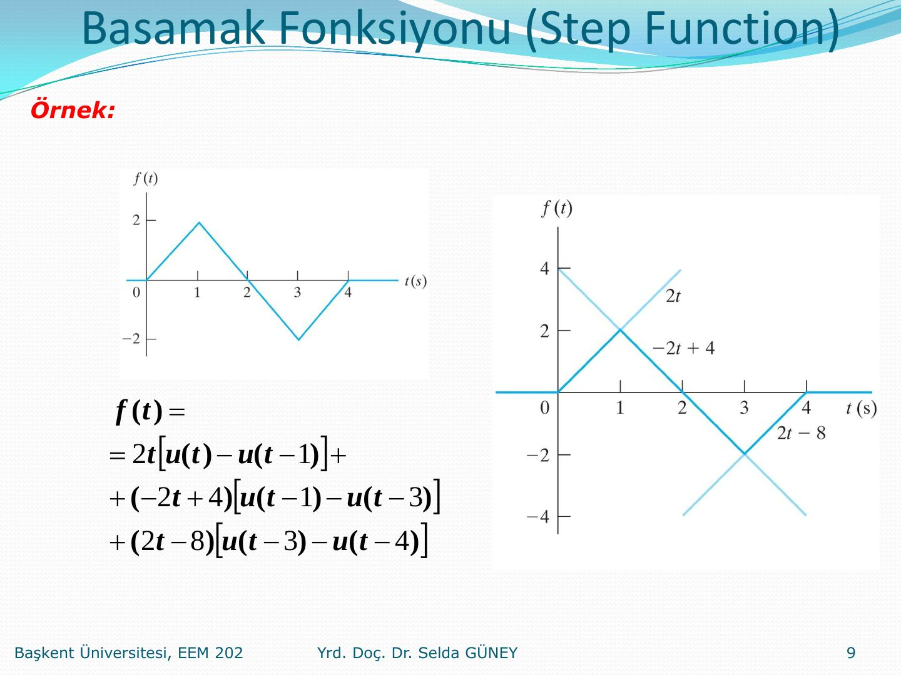
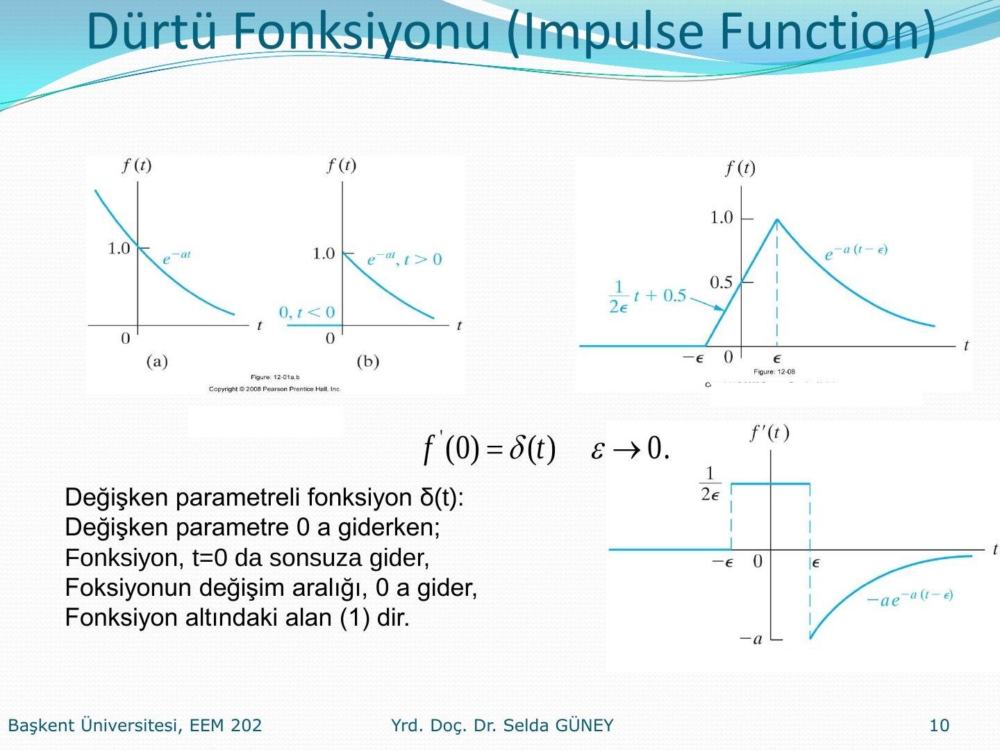
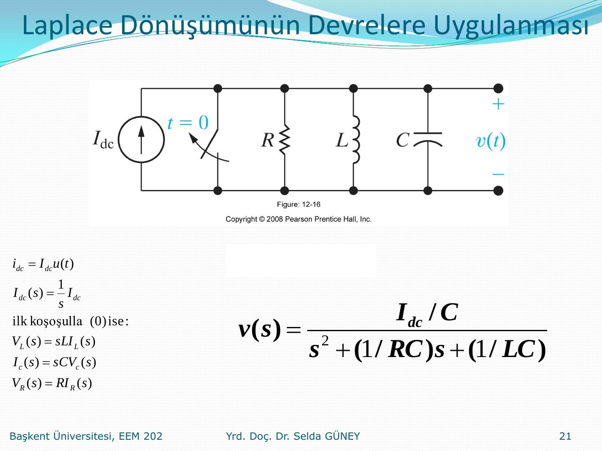
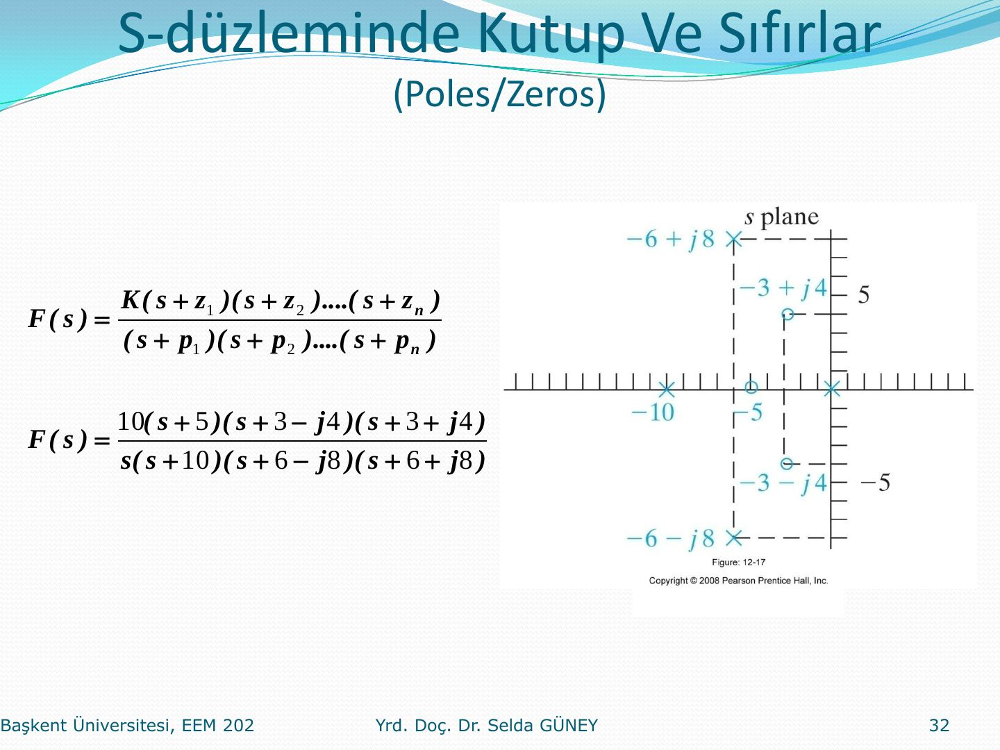

Bu yazı, Başkent Üniversitesi Elektrik-Elektronik Mühendisliği **EEM202 Devre Teorisi II** dersinde Yrd. Doç. Dr. Selda Güney'in hazırladığı **Laplace Dönüşümü** sunumunun içeriğidir (Mayıs 2014). Formüller ve dönüşüm tabloları metin olarak yazıldı; grafikler ve devre şeması görsel olarak eklendi. 33 slaytlık orijinal PDF yazının sonunda indirilebilir.

## Konular

- Laplace dönüşümü tanımı
- Basamak fonksiyonu
- Dürtü fonksiyonu
- Fonksiyonel dönüşümler
- İşlemsel dönüşümler
- Laplace dönüşümünün devrelere uygulanması
- Ters Laplace dönüşümü
- F(s)'nin kutup ve sıfırları
- Başlangıç ve son değer teoremleri

## Laplace dönüşümü tanımı

Sunum, devrelerde karşılaşılan işaretlerle başlar:

- Elektriksel işaretler: analog, sayısal (ses, görüntü, ışık, radyasyon, ultrason; dönüştürücüler; Fourier dönüşümü; sinüsoidal işaretler)
- Kaynaklar: DC kaynak + anahtar (birim basamak), süreksizlik noktası; süreksizlik noktasında türev (Dirac delta fonksiyonu, impulse); süreksizlik noktasında integral (bir boyutu sıfır olan alan); AC
- Lineer devrelerde görülen işaretler: doğru gerilim/akım, AC gerilim/akım (sönümlü), üstel gerilim/akım

Öyle bir dönüşüm olsun ki diferansiyel denklemin tam çözümünü versin; tanım, çevre ve düğüm denklemleri cebirsel olsun:

- L{f(t)} = ∫₀^∞ f(t)·e^(−st) dt
- F(s) = L{f(t)}
- f(t) = L⁻¹{F(s)}

Alt limit, t = 0'da süreklilik/süreksizlik durumuna göre seçilir:

- t = 0⁻ alt limit alınır
- t < 0⁻: ilk koşulların oluşumu
- t = 0⁻ ile t = 0⁺ aralığında integral: (0)
- İstisna: impulse function (Dirac delta)

 ve süreksiz (b) fonksiyon")

## Basamak fonksiyonu (step function)

- Ku(t) = 0, t < 0
- Ku(t) = K, t > 0
- K = 1 için **birim basamak fonksiyonu** (unit step function)

Basamak fonksiyonu bir matematik modeldir; devrelerdeki karşılığı anahtarlamadır: doğru gerilim kaynağının (DC) bir anahtarla devreye uygulanması. Teori ile uygulamanın uyumluluğu için Ku(0) = 0,5K alınır.

 = 0.5K")

Kaydırılmış basamak:

- Ku(t − a) = 0, t < a; Ku(t − a) = K, t > a
- Ku(a − t) = K, t < a; Ku(a − t) = 0, t > a

**Örnek:** Şekildeki üçgen dalga, basamak fonksiyonlarıyla şöyle yazılır:

f(t) = 2t[u(t) − u(t−1)] + (−2t + 4)[u(t−1) − u(t−3)] + (2t − 8)[u(t−3) − u(t−4)]

## Dürtü fonksiyonu (impulse function)

f′(0) = δ(t), ε → 0. Değişken parametreli fonksiyon δ(t): değişken parametre 0'a giderken

- fonksiyon t = 0'da sonsuza gider,
- fonksiyonun değişim aralığı 0'a gider,
- fonksiyon altındaki alan 1'dir.

- ∫ Kδ(t) dt = K (−∞'dan ∞'a), δ(t) = 0, t ≠ 0; K: şiddet (strength)
- Dirac delta fonksiyonunun zamanda kayma özelliği (shifting/sifting property): f(t), t = a'da sürekli ise ∫ f(t)·δ(t − a) dt = f(a)

## Fonksiyonel dönüşümler

- L{δ(t)} = ∫₀^∞ δ(t)·e^(−st) dt = ∫ δ(t)·1 dt = **1**
- L{δ′(t)} = s; genelleştirilmişi L{δ⁽ⁿ⁾(t)} = sⁿ
- ε → 0 iken f(t) → u(t) ve f′(t) → δ(t); yani δ(t) = du(t)/dt

 → u(t), f′(t) → δ(t)")

- L{u(t)} = ∫₀^∞ e^(−st) dt = [−(1/s)e^(−st)]₀^∞ = −(1/s)(0 − 1) = **1/s**
- L{e^(−at)} = **1/(s + a)**
- e^(jωt) = cos ωt + j sin ωt, e^(−jωt) = cos ωt − j sin ωt; cos ωt = ½(e^(jωt) + e^(−jωt)), sin ωt = (1/2j)(e^(jωt) − e^(−jωt))
- L{sin ωt} = **ω/(s² + ω²)**, L{cos ωt} = **s/(s² + ω²)**
- Rampa: ∫₀^∞ t·e^(−st) dt kısmi integrasyonla (u = e^(−st), dv = dt) hesaplanır ve **1/s²** bulunur.

| Fonksiyon | f(t) | F(s) |
|---|---|---|
| Impulse | δ(t) | 1 |
| Step | u(t) | 1/s |
| Ramp | t | 1/s² |
| Exponential | e^(−at) | 1/(s+a) |
| Sine | sin ωt | ω/(s²+ω²) |
| Cosine | cos ωt | s/(s²+ω²) |
| Damped ramp | t·e^(−at) | 1/(s+a)² |
| Damped sine | e^(−at) sin ωt | ω/((s+a)²+ω²) |
| Damped cosine | e^(−at) cos ωt | (s+a)/((s+a)²+ω²) |

## İşlemsel dönüşümler

| İşlem | f(t) | F(s) |
|---|---|---|
| Bir sabit ile çarpma | K·f(t) | K·F(s) |
| Toplama ve çıkarma | f₁(t) + f₂(t) − f₃(t) | F₁(s) + F₂(s) − F₃(s) |
| Türev alma | df(t)/dt | sF(s) − f(0⁻) |
| 2. dereceden türev alma | d²f(t)/dt² | s²F(s) − s·f(0⁻) − df(0⁻)/dt |
| n. dereceden türev alma | dⁿf(t)/dtⁿ | sⁿF(s) − sⁿ⁻¹f(0⁻) − sⁿ⁻²·df(0⁻)/dt − … − dⁿ⁻¹f(0⁻)/dtⁿ⁻¹ |
| İntegral alma | ∫₀ᵗ f(x) dx | F(s)/s |
| Zaman bölgesinde kaydırma | f(t−a)u(t−a), a > 0 | e^(−as)F(s) |
| s bölgesinde kaydırma | e^(−at)f(t) | F(s+a) |
| Ölçek değiştirme | f(at), a > 0 | (1/a)F(s/a) |
| s bölgesinde 1. türev alma | t·f(t) | −dF(s)/ds |
| s bölgesinde n. türev alma | tⁿf(t) | (−1)ⁿ dⁿF(s)/dsⁿ |
| s bölgesinde integral alma | f(t)/t | ∫ₛ^∞ F(u) du |

## Laplace dönüşümünün devrelere uygulanması

t = 0'da anahtarı açılan bir I_dc akım kaynağı, paralel R, L, C elemanlarını besler:

- i_dc = I_dc·u(t) → I_dc(s) = I_dc/s
- İlk koşullar 0 ise: V_L(s) = sL·I_L(s), I_C(s) = sC·V_C(s), V_R(s) = R·I_R(s)
- Sonuç: **v(s) = (I_dc/C) / (s² + (1/RC)s + 1/LC)**

## Ters Laplace dönüşümü

Devre çözümleri s-domeninde rasyonel fonksiyonlardır:

F(s) = N(s)/D(s) = (aₙsⁿ + aₙ₋₁sⁿ⁻¹ + … + a₁s + a₀) / (bₘsᵐ + bₘ₋₁sᵐ⁻¹ + … + b₁s + b₀)

- Proper rational: n < m
- Improper rational: m < n

Rasyonel fonksiyonlar basit kesirler (partial fraction expansion) toplamı biçiminde yazılabilir. Bu basit kesirlerden de Laplace dönüşümünün doğrusallığından yararlanarak t domenine geçilebilir.

| Kök türü | Terim | Ters Laplace |
|---|---|---|
| Reel kök | K/(s+a) | K·e^(−at)u(t) |
| Katlı reel kök | K/(s+a)² | K·t·e^(−at)u(t) |
| Kompleks kök | K/(s+α−jβ) + K*/(s+α+jβ) | 2∣K∣e^(−αt) cos(βt+θ)u(t) |
| Katlı kompleks kök | K/(s+α−jβ)² + K*/(s+α+jβ)² | 2t∣K∣e^(−αt) cos(βt+θ)u(t) |

Burada K = |K|∠θ. K'nın s = −α + jβ köküne ait olduğu unutulmamalıdır!

Rasyonel fonksiyonun kutupları:

- reel ise ters Laplace eksponansiyel,
- kompleks ise eksponansiyel sönümlü sinüsoidal,
- imajiner ise sinüsoidaldir.

### Katsız reel kökler

F(s) = 96(s+5)(s+12) / [s(s+8)(s+6)] = K₁/s + K₂/(s+8) + K₃/(s+6)

L⁻¹{F(s)} = (120 − 72e^(−8t) + 48e^(−6t))u(t)

### Katsız ve katlı reel kökler

s+6 / [s(s+3)(s+1)²] = K₁/s + K₂/(s+3) + K₃/(s+1)² + K₄/(s+1) → (K₁ + K₂e^(−3t) + K₃te^(−t) + K₄e^(−t))u(t)

Kullanılan dönüşümler: L⁻¹{1/(s+a)} = e^(−at), L⁻¹{1/(s+a)²} = te^(−at), genel olarak L⁻¹{1/(s+a)ⁿ} = tⁿ⁻¹e^(−at)/(n−1)!

100(s+25) / [s(s+5)³] = K₁/s + K₂/(s+5)³ + K₃/(s+5)² + K₄/(s+5)

- K₁ = 20, K₂ = −400, K₃ = −100, K₄ = −20
- L⁻¹ = [20 − 200t²e^(−5t) − 100te^(−5t) − 20e^(−5t)]u(t)

### Eşlenik kompleks kökler

Katsız eşlenik kompleks kök: L⁻¹{K/(s+α−jβ) + K*/(s+α+jβ)} = 2|K|e^(−αt) cos(βt + θ)u(t)

Katlı eşlenik kompleks kök: L⁻¹{K/(s+α−jβ)ʳ + K*/(s+α+jβ)ʳ} = [2|K|tʳ⁻¹/(r−1)!]·e^(−αt) cos(βt + θ)u(t), K = |K|e^(jθ)

> Yorum: Eşlenik kompleks köklerden −α+jβ'ya ait K katsayısını bulmak yeter, K*'ı bulmaya gerek yok; bu veri ile ters Laplace doğrudan yazılabilir. Kökler yalnız imajiner olursa sonuç?

**Örnek (eşlenik kompleks kutuplar):**

F(s) = 100(s+3) / [(s+6)(s² + 6s + 25)], s² + 6s + 25 = (s+3−j4)(s+3+j4)

F(s) = K₁/(s+6) + K₂/(s+3−j4) + K₃/(s+3+j4)

- K₁ = −12
- K₂ = 6 − j8 = 10e^(−j53°)
- K₃ = 6 + j8 = 10e^(j53°) = K₂*
- L⁻¹{F(s)} = [−12e^(−6t) + 20e^(−3t) cos(4t − 53°)]u(t)

**Örnek (katlı kompleks kutup):**

F(s) = 768 / (s² + 6s + 25)² = 768 / [(s+3−j4)²(s+3+j4)²] = K₁/(s+3−j4)² + K₂/(s+3−j4) + K₁*/(s+3+j4)² + K₂*/(s+3+j4)

- K₁ = −12, K₂ = −j3 = 3e^(−j90°)
- K₁* = −12, K₂* = j3 = 3e^(j90°)
- f(t) = [−24te^(−3t) cos 4t + 6e^(−3t) cos(4t − 90°)]u(t)

### Payın derecesi paydanınkinden büyükse

- Payın derecesi paydanınkinden büyük ise bölme işlemi yapılarak polinom uygun rasyonel fonksiyona dönüştürülür.
- Polinomun ters dönüşümünden Dirac delta fonksiyonunun türevleri ve/veya kendisi gelir.
- Uygun rasyonel fonksiyonun ters dönüşümü ise önce yapıldığı gibidir.

**Örnek:**

F(s) = (s⁴ + 13s³ + 66s² + 200s + 300) / (s² + 9s + 20)

F(s) = s² + 4s + 10 + (30s + 10)/(s² + 9s + 20) = s² + 4s + 10 − 20/(s+4) + 50/(s+5)

f(t) = d²δ(t)/dt² + 4·dδ(t)/dt + 10δ(t) − (20e^(−4t) − 50e^(−5t))u(t)

*Not: Slayttaki kalan terimde pay 30s + 10 yazılmış; bölme işleminin kalanı aslında 30s + 100'dür. Sonraki satırdaki −20/(s+4) + 50/(s+5) açılımı ve f(t) sonucu 30s + 100 ile tutarlıdır.*

## s-düzleminde kutup ve sıfırlar (poles/zeros)

F(s) = K(s+z₁)(s+z₂)…(s+zₙ) / [(s+p₁)(s+p₂)…(s+pₙ)]

Örnek: F(s) = 10(s+5)(s+3−j4)(s+3+j4) / [s(s+10)(s+6−j8)(s+6+j8)]

Sıfırlar: −5, −3 ± j4; kutuplar: 0, −10, −6 ± j8.

## Başlangıç ve son değer teoremleri

- Bulunan sonuçları test etmekte kullanabiliriz.
- F(s)'nin ve f(t)'nin 0 ve ∞'daki davranışını belirlememizde yardımcı olur.
- F(s)'nin ters dönüşümünü almadan f(t)'nin başlangıç ve son değerlerini, bilinen devre davranışından kontrol ederek uyumlu olup olmadıklarını gözlemleyebiliriz.

Başlangıç değer teoremi: lim(t→0⁺) f(t) = lim(s→∞) sF(s)

Son değer teoremi: lim(t→∞) f(t) = lim(s→0) sF(s)
