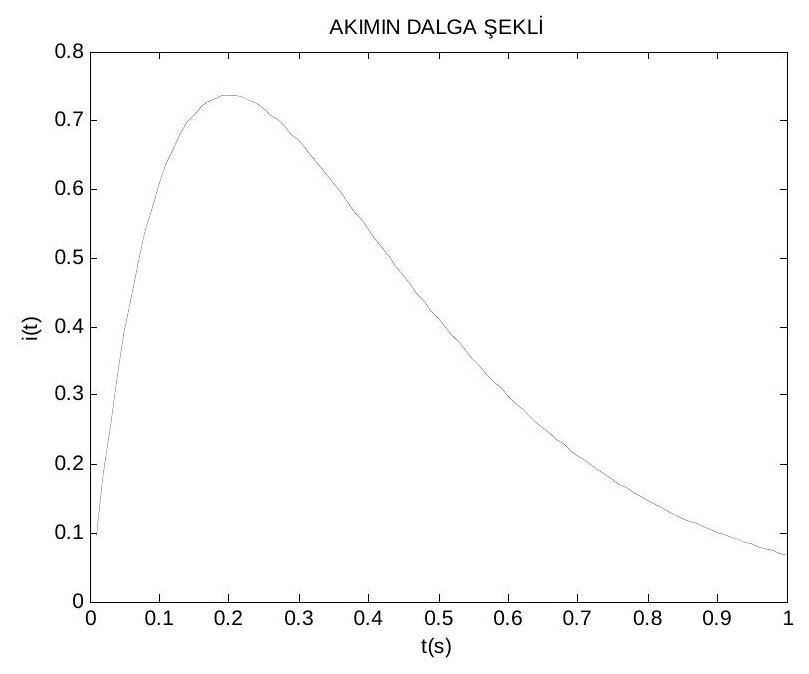
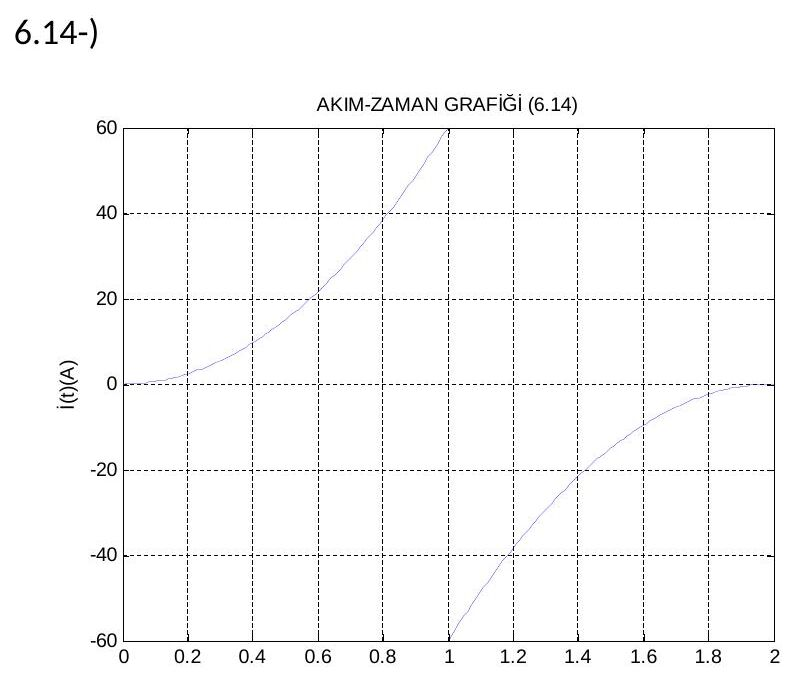

This post brings together solutions to two assignments from the Başkent University Electrical-Electronics Engineering course **EEM202 Circuit Theory II**, prepared by classmates. **Assignment 1** (March 2014) is a handwritten solution on phasor transformations; it was transcribed from photographed pages to text, and the photos are not published. The **MATLAB assignments** were Word files: plots of current and voltage expressions made with MATLAB commands. Personal information has been removed. The MATLAB work was converted from page images to PDF and can be downloaded as a ZIP at the end of the post.

## Assignment 1: Phasors

Questions on the assignment sheet:

1. Convert the voltages v₁(t) = 12 cos(377t − 425°) V and v₂(t) = 18 sin(2513t + 4.2°) V to phasors.
1. Convert the phasors V₁ = 10∠20° and V₂ = 12∠−60° to the time domain when the frequency is 400 Hz.
1. Write i = 5 cos(ωt + 36.87°) + 10 cos(ωt − 53.13°) A and V = (20 + j80 − 30∠15°) V as a single term.
1. A 50 µF capacitor is connected in parallel with a series branch of 20 Ω + 40 mH across the source v = 120 sin(377t + 60°) V; find the source current.

### Solutions

**1)** V₁ = 12∠−425° V. Converting the second voltage to a cosine: v₂(t) = 18 sin(2513t + 4.2°) = 18 cos(2513t + 94.2°) → V₂ = 18∠94.2° V.

*Note: The angle −425° is equivalent to −65° (V₁ = 12∠−65° V). Since sin x = cos(x − 90°), the correct form is v₂(t) = 18 cos(2513t − 85.8°), i.e. **V₂ = 18∠−85.8° V**; the solution added 90° instead.*

**2)** ω = 2πf = 2(3.14)(400) = 2512 rad/s:

- v₁(t) = 10 cos(2512t + 20°) V
- v₂(t) = 12 cos(2512t − 60°) V

**3)** Current phasor:

- I = 5∠36.87° + 10∠−53.13° = 5(0.80 + j0.60) + 10(0.60 − j0.80) = 4 + j3 + 6 − j8 = 10 − j5
- |I| = √(10² + 5²) = 11.18; θ = arctan(−5/10) = −26.57° → **i(t) = 11.18 cos(ωt − 26.57°) A**

Voltage phasor:

- V = 20 + j80 − 30(cos 15° + j sin 15°) = 20 + j80 − 29.1 − j7.8 = −9.1 + j72.2
- |V| = √(9.1² + 72.2²) = 72.77; the solution took θ = arctan(72.2/−9.1) = −82.81°.

*Note: Since the real part is negative and the imaginary part is positive, the phasor lies in the second quadrant: θ = 180° − 82.8° ≈ **97.2°**, so v(t) ≈ 72.8 cos(ωt + 97.2°) V is the correct result.*

**4)** v = 120 sin(377t + 60°) should be written as 120 cos(377t − 30°); the solution instead used 120 cos(377t + 150°). Impedances:

- Z_R = 20 Ω, Z_L = jωL = j(377)(0.04) = j15.08 Ω, Z_C = −j/(ωC) = −j/(377 · 50·10⁻⁶) = −j53.05 Ω
- Z_eq = (20 + j15.08) ∥ (−j53.05) = (800.45 − j1061.6)/(20 − j37.97) = 1329.55∠−53.0° / 43∠−62.24° = **30.92∠9.18° Ω**
- I = 120∠150° / 30.92∠9.18° = 3.88∠140.82° A → the solution's result: i(t) = 3.88 cos(377t + 140.82°) A

*Note: The calculation is correct (Z_eq ≈ 30.96∠9.2° Ω); however, in converting from sine to cosine, sin x = cos(x − 90°) must be used. With the correct phasor V = 120∠−30° V, one obtains **i(t) ≈ 3.88 cos(377t − 39.2°) A**. The solution's angle is shifted by 180°, i.e. the sign of the current came out reversed.*

## MATLAB Assignments

### Assignment 1: Current and voltage waveforms

The current i(t) = 10t·e^(−5t) A and the voltage v(t) = (1 − 5t)·e^(−5t) V were plotted over 0–1 s (v corresponds to v = L·di/dt for a 0.1 H inductor):

```matlab
t=0.01:0.01:1;
i=10*t.*exp(-5*t);
figure(1),plot(t,i);
title('AKIMIN DALGA ŞEKLİ')
xlabel('t(s)')
ylabel('i(t)')

V=(1-5*t).*exp(-5*t);
figure(1),plot(t,V);
title('VOLTAJIN DALGA ŞEKLİ')
```

The current reaches its maximum value at t = 0.2 s: i(0.2) = 10·0.2·e⁻¹ ≈ 0.736 A. At the same instant the voltage crosses zero and turns negative.



### Assignment 2: Problems 6.14, 7.7, and 7.51

**6.14:** Piecewise current expression: i = 60t² A for 0 ≤ t ≤ 1 s, and i = −60(2 − t)² A for 1 ≤ t ≤ 2 s.

```matlab
t=0:0.01:1;
i=60*t.^2;
t1=1:0.01:2;
i1=-60*(2-t1).^2;
figure(1);
plot(t,i);
hold on;
plot(t1,i1);
grid;
title('AKIM-ZAMAN GRAFİĞİ (6.14)');
xlabel('t(s)');
ylabel('İ(t)(A)');
```



**7.7:** The currents i = 2e^(−1000t) A and i = 4e^(−125t) A were plotted over 0–2 s.

**7.51:** The voltages v = 15 − 105e^(−4000t) V and v = 20 − 100e^(3333t) V were plotted over 0–1 s.

*Note: The time constants in the expressions for 7.7 and 7.51 are on the order of milliseconds (1/1000 s, 1/125 s, 1/4000 s); when plotted with a 0.01 s step over 0–2 s, the transient portion is squeezed into a single sample, and the plots look empty or like a flat line. A range such as t = 0:1e-5:5e-3 should be chosen instead. In addition, the exponent in the last expression was written as positive (e^(3333t)); because of this the plot diverges to the order of −10³⁰⁵. For a decaying response the exponent must be negative: v = 20 − 100e^(−3333t) V.*

## Downloadable Files

The ZIP contains PDFs generated from the page images of the two MATLAB assignments (Assignment 1: 2 pages, Assignment 2: 5 pages). The handwritten photos of Assignment 1 are not published.
