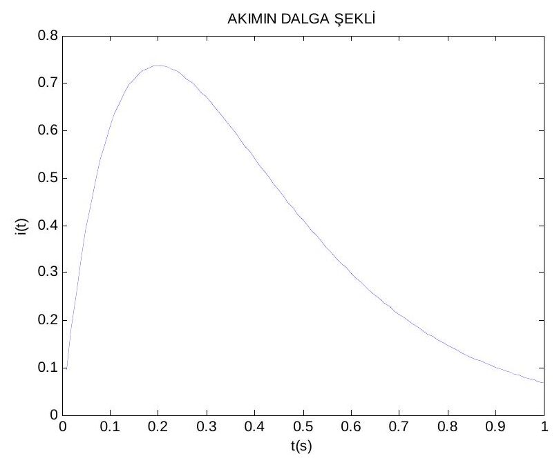
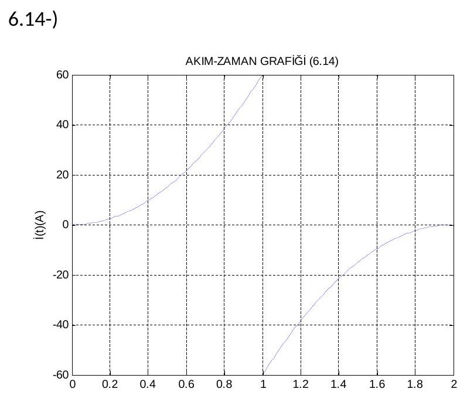

Bu yazı, Başkent Üniversitesi Elektrik-Elektronik Mühendisliği **EEM202 Devre Teorisi II** dersinin iki ödevinin arkadaşlar tarafından hazırlanmış çözümlerini bir araya getiriyor. **Ödev-1** (Mart 2014) fazör dönüşümleri üzerine el yazısı bir çözüm; fotoğraflanmış sayfalardan metne aktarıldı, fotoğraflar yayınlanmıyor. **MATLAB ödevleri** ise Word dosyalarıydı: akım ve gerilim ifadelerinin MATLAB komutlarıyla çizilmiş grafikleri. Kişisel bilgiler çıkarıldı. MATLAB çalışmaları sayfa görüntülerinden PDF'e çevrilerek yazının sonunda ZIP olarak indirilebilir.

## Ödev-1: Fazörler

Ödev kâğıdındaki sorular:

1. v₁(t) = 12 cos(377t − 425°) V ve v₂(t) = 18 sin(2513t + 4,2°) V gerilimlerini fazörlere çeviriniz.
1. Frekans 400 Hz olduğunda V₁ = 10∠20° ve V₂ = 12∠−60° fazörlerini zaman bölgesine çeviriniz.
1. i = 5 cos(ωt + 36,87°) + 10 cos(ωt − 53,13°) A ve V = (20 + j80 − 30∠15°) V ifadelerini tek terim hâlinde yazınız.
1. v = 120 sin(377t + 60°) V kaynağına 50 µF'lık kondansatör ile 20 Ω + 40 mH'lik seri kol paralel bağlanmıştır; kaynak akımını bulunuz.

### Çözümler

**1)** V₁ = 12∠−425° V. İkinci gerilim kosinüse çevrilerek: v₂(t) = 18 sin(2513t + 4,2°) = 18 cos(2513t + 94,2°) → V₂ = 18∠94,2° V.

*Not: −425° açısı −65° ile aynıdır (V₁ = 12∠−65° V). sin x = cos(x − 90°) olduğundan doğrusu v₂(t) = 18 cos(2513t − 85,8°), yani **V₂ = 18∠−85,8° V** olmalıdır; çözümde 90° eklenmiş.*

**2)** ω = 2πf = 2(3,14)(400) = 2512 rad/s:

- v₁(t) = 10 cos(2512t + 20°) V
- v₂(t) = 12 cos(2512t − 60°) V

**3)** Akım fazörü:

- I = 5∠36,87° + 10∠−53,13° = 5(0,80 + j0,60) + 10(0,60 − j0,80) = 4 + j3 + 6 − j8 = 10 − j5
- |I| = √(10² + 5²) = 11,18; θ = arctan(−5/10) = −26,57° → **i(t) = 11,18 cos(ωt − 26,57°) A**

Gerilim fazörü:

- V = 20 + j80 − 30(cos 15° + j sin 15°) = 20 + j80 − 29,1 − j7,8 = −9,1 + j72,2
- |V| = √(9,1² + 72,2²) = 72,77; çözümde θ = arctan(72,2/−9,1) = −82,81° alınmış.

*Not: Gerçel kısım negatif, sanal kısım pozitif olduğundan fazör ikinci bölgededir: θ = 180° − 82,8° ≈ **97,2°**, yani v(t) ≈ 72,8 cos(ωt + 97,2°) V olmalıdır.*

**4)** v = 120 sin(377t + 60°) = 120 cos(377t − 30°) olarak yazılmalıdır; çözümde ise 120 cos(377t + 150°) alınmış. Empedanslar:

- Z_R = 20 Ω, Z_L = jωL = j(377)(0,04) = j15,08 Ω, Z_C = −j/(ωC) = −j/(377 · 50·10⁻⁶) = −j53,05 Ω
- Z_eş = (20 + j15,08) ∥ (−j53,05) = (800,45 − j1061,6)/(20 − j37,97) = 1329,55∠−53,0° / 43∠−62,24° = **30,92∠9,18° Ω**
- I = 120∠150° / 30,92∠9,18° = 3,88∠140,82° A → çözümün sonucu: i(t) = 3,88 cos(377t + 140,82°) A

*Not: Hesap doğru (Z_eş ≈ 30,96∠9,2° Ω); ancak sinüsten kosinüse geçişte sin x = cos(x − 90°) kullanılmalı. Doğru fazör V = 120∠−30° V ile **i(t) ≈ 3,88 cos(377t − 39,2°) A** bulunur. Çözümün açısı 180° kaymış, yani akımın işareti ters çıkmış.*

## MATLAB ödevleri

### Ödev 1: Akım ve gerilim dalga şekilleri

i(t) = 10t·e^(−5t) A akımı ve v(t) = (1 − 5t)·e^(−5t) V gerilimi 0–1 s aralığında çizdirilmiş (v, 0,1 H'lik bir bobin için v = L·di/dt ifadesine karşılık geliyor):

```matlab
t=0.01:0.01:1;
i=10*t.*exp(-5*t);
figure(1),plot(t,i);
title('AKIMIN DALGA ŞEKLİ')
xlabel('t(s)')
ylabel('i(t)')

V=(1-5*t).*exp(-5*t);
figure(1),plot(t,V);
title('VOLTAJIN DALGA ŞEKLİ')
```

Akım t = 0,2 s'de en büyük değerine ulaşıyor: i(0,2) = 10·0,2·e⁻¹ ≈ 0,736 A. Gerilim aynı anda sıfırdan geçip negatife dönüyor.



### Ödev 2: 6.14, 7.7 ve 7.51 problemleri

**6.14:** Parçalı akım ifadesi: 0 ≤ t ≤ 1 s için i = 60t² A, 1 ≤ t ≤ 2 s için i = −60(2 − t)² A.

```matlab
t=0:0.01:1;
i=60*t.^2;
t1=1:0.01:2;
i1=-60*(2-t1).^2;
figure(1);
plot(t,i);
hold on;
plot(t1,i1);
grid;
title('AKIM-ZAMAN GRAFİĞİ (6.14)');
xlabel('t(s)');
ylabel('İ(t)(A)');
```



**7.7:** i = 2e^(−1000t) A ve i = 4e^(−125t) A akımları 0–2 s aralığında çizdirilmiş.

**7.51:** v = 15 − 105e^(−4000t) V ve v = 20 − 100e^(3333t) V gerilimleri 0–1 s aralığında çizdirilmiş.

*Not: 7.7 ve 7.51'deki ifadelerin zaman sabitleri milisaniye mertebesinde (1/1000 s, 1/125 s, 1/4000 s); 0,01 s adımla ve 0–2 s aralığında çizilince geçici kısım tek bir örneğe sıkışıyor, grafikler boş ya da düz çizgi gibi görünüyor. Örneğin t = 0:1e-5:5e-3 gibi bir aralık seçilmelidir. Ayrıca son ifadede üs pozitif yazılmış (e^(3333t)); bu yüzden grafik −10³⁰⁵ mertebesine ıraksıyor. Sönümlü bir tepki için üs negatif olmalıdır: v = 20 − 100e^(−3333t) V.*

## İndirilebilir dosyalar

ZIP'te iki MATLAB ödevinin (Ödev 1: 2 sayfa, Ödev 2: 5 sayfa) sayfa görüntülerinden oluşturulmuş PDF'leri var. Ödev-1'in el yazısı fotoğrafları yayınlanmıyor.
