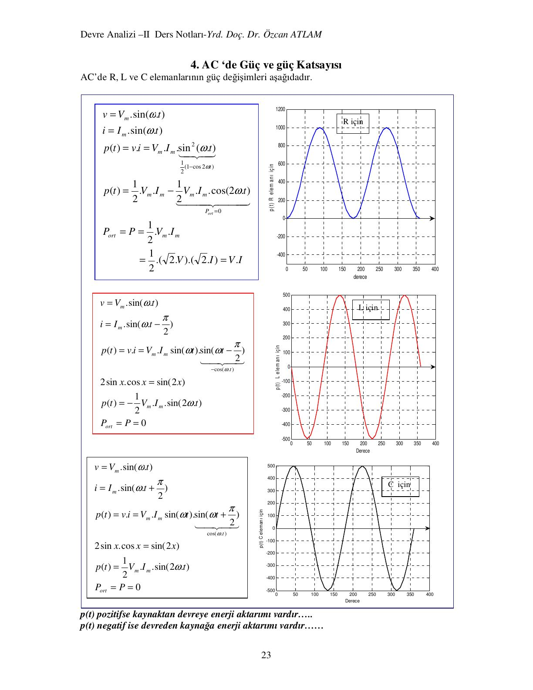
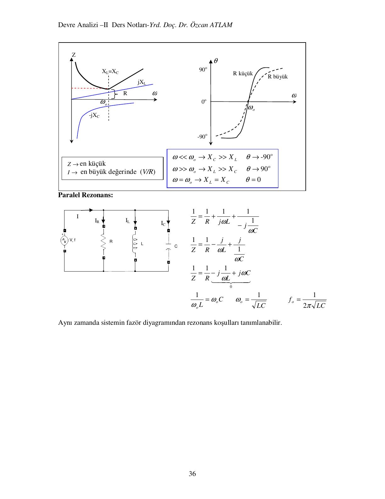
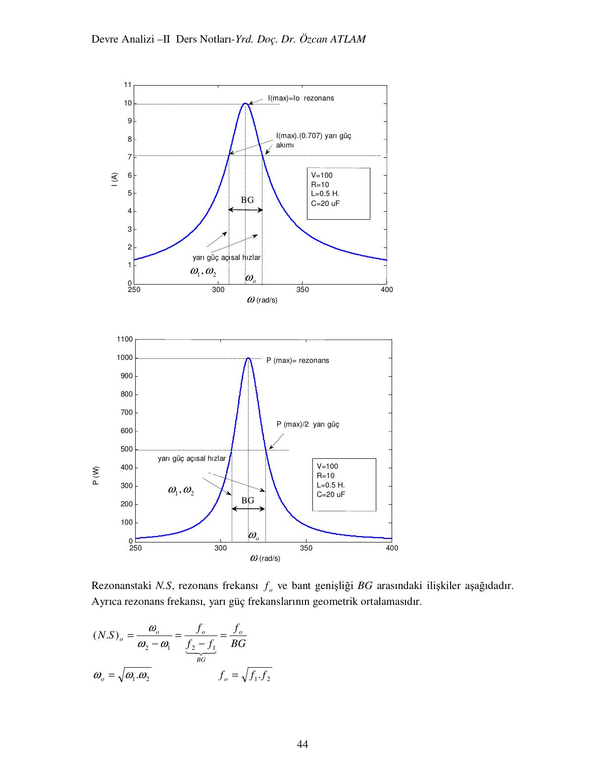

This post presents the document **"Circuit Analysis II Lecture Notes"** prepared by **Asst. Prof. Dr. Özcan Atlam** (77 pages, PDF, 2009). The notes do not belong to Başkent University; they were used as a reference while studying for the EEM202 Circuit Theory II course and kept in the course folder. In this post, the topics, main definitions and formulas, and some worked examples are summarized section by section as text; a few pages are included as images. The complete notes (the original PDF) can be downloaded at the end of the post.

*This content belongs to a third-party source; it is shared for archival and nostalgic purposes with the source credited. It will be removed at the request of the rights holder.*

## 1. Sinusoidal current and voltage

- v(t) = V_m sin(ωt + θ), ω = 2πf; V_m is the maximum value, ω is the angular velocity (rad/s), and θ is the phase angle relative to zero.
- When computing v(t), if θ is in degrees, ωt is converted to degrees (ωt·180/π) and added to θ.
- Example: the value of v(t) = 100 sin(4000t + 30°) at t = 0.1 s: v = 100 sin(4000·0.1·180/π + 30°) ≈ 100(−0.99) = −99 V.
- Impedance: Z = V_max/I_max = V_rms/I_rms.
- In a resistor, current and voltage are in phase; in an inductor, i_L = I_m sin(ωt − π/2) (current lags by 90°, V_max/I_max = ωL); in a capacitor, i_C = I_m sin(ωt + π/2) (current leads by 90°, V_max/I_max = 1/(ωC)).

This section also contains many examples on writing the total voltage as a single sinusoid in series RL, RC, and RLC circuits and in parallel circuits (for example, "In a series RL circuit, R = 20 Ω, L = 0.06 H, and the current lags the voltage by 80°; ω = ?").

## 2. Analysis with complex numbers

Cartesian and polar representation, the four operations with complex numbers, expressing impedances with complex numbers (Z_R = R, Z_L = jωL, Z_C = −j/(ωC)), and the representation of impedances in circuit diagrams. Example: "In a series RL circuit with an impedance of 40∠30° Ω, L = 0.02 H. R = ? and f = ?"

## 3. Analysis of AC series and parallel circuits

Equivalent impedance, current and voltage dividers, and phasor diagrams in series and parallel RLC circuits. In a parallel circuit, if I_L > I_C (1/(ωL) > ωC), the angle is negative and the current lags the voltage.

## 4. Power and power factor in AC

Instantaneous power for R, L, and C:

- R: p(t) = ½V_mI_m − ½V_mI_m cos 2ωt → P = ½V_mI_m = V·I
- L: p(t) = −½V_mI_m sin 2ωt → P = 0
- C: p(t) = ½V_mI_m sin 2ωt → P = 0

If p(t) is positive, energy is transferred from the source to the circuit; if negative, from the circuit to the source.

For a general circuit with v = V_m sin ωt and i = I_m sin(ωt + θ):

- **Active (average) power:** P = V·I·cos θ = I²R (W); cos θ is the power factor. If the current lags the voltage, the circuit has a lagging power factor; if it leads, a leading power factor.
- **Apparent power:** S = V·I (VA); **reactive power:** Q = V·I·sin θ (VAR).
- P, Q, and S form a power triangle. Complex power is computed as S = V·I*; the conjugate of the current is taken so that the angle comes out as the difference between the voltage and current angles (θ = θ₁ − θ₂). The real part is P and the imaginary part is Q. The power angle is also the angle of the equivalent impedance.
- In the circuit, the P powers are dissipated in the R's and the Q powers in the L's and C's; the system reactive power is Q = ΣQ_L − ΣQ_C.

Example: Z = 3 + j4 Ω, V = 100∠30° → I = 100∠30°/5∠53.1° = 20∠−23.1° A; P = 20²·3 = 1200 W, Q = 20²·4 = 1600 VAR (lagging), S = 2000 VA, cos θ = cos 53.1° = 0.6 lagging.

## 5. Power factor correction

Loads in homes and industry (motors, fluorescent lamps, and lamps with chokes) are generally inductive. The apparent power S is a measure of the loading of the system, while P is a measure of the power converted into useful work. Bringing θ close to zero, and thus S close to P, is called **power factor correction (compensation)**. A capacitor is usually connected in parallel with inductive loads: the load voltage and P do not change, and since cos θ increases, the current and S decrease; the distribution system is loaded less. In the examples, the power factor of a load Z_y = 2 + j8 Ω supplied by V = 100∠0° V is corrected to 0.8 lagging using a series and a parallel capacitor; and the parallel capacitor required to raise a motor's power factor to 0.95 lagging is calculated.

## 6. Resonance circuits

**Series resonance:** When X_L = X_C, Z = R is at its minimum and the current is at its maximum (V/R); for ω ≪ ω₀, X_C ≫ X_L and θ → −90°, and for ω ≫ ω₀, θ → +90°.

**Parallel resonance:** 1/Z = 1/R − j(1/(ωL) − ωC); when the imaginary term is zero, 1/(ω₀L) = ω₀C:

- ω₀ = 1/√(LC), f₀ = 1/(2π√(LC))

## 7. Quality factor, half-power frequencies, and bandwidth

Quality factor (Q factor): Q = 2π·(maximum stored energy)/(energy dissipated per cycle). In a series RLC circuit at resonance, Q = ω₀L/R = 1/(ω₀CR); in a parallel circuit, Q = ω₀CR.

In a series RLC circuit, the current is at its maximum at resonance (I₀ = V/R) and P_max = I₀²R. At the two frequencies where the current is 0.707·I₀, the power is P_max/2: these are the **half-power frequencies** (|Z| = √2·R, that is, |X_L − X_C| = R). The difference between them is the **bandwidth**:

- Q = ω₀/(ω₂ − ω₁) = f₀/(f₂ − f₁) = f₀/BW
- ω₀ = √(ω₁ω₂), f₀ = √(f₁f₂) (the resonant frequency is the geometric mean of the half-power frequencies)

In the example in the graph, ω₀ = 1/√(0.5·20·10⁻⁶) ≈ 316 rad/s, I_max = 100/10 = 10 A, P_max = 1000 W, the bandwidth is R/L = 20 rad/s, and Q = ω₀L/R ≈ 15.8.

## 8. Current at resonance

The current at resonance is determined by the real part R_e of the equivalent impedance under the resonance conditions. In a series RLC circuit, R_e = R is independent of frequency; at resonance the imaginary term vanishes, the impedance is at its minimum, and the current is at its maximum (V/R). In circuits with parallel branches (for example, an R + jX_L branch in parallel with a capacitor), R_e also depends on ω; the resonance condition changes R_e, and this new R_e determines whether the current at resonance will be at its maximum, minimum, or an intermediate value. The section demonstrates this with two examples.

## 9. Mesh currents, node voltages, Thevenin, and Norton

- **Mesh current method:** impedance, current, and voltage matrices are defined; the diagonal of the impedance matrix is the total impedance of the mesh, and the off-diagonal terms are the negatives of the shared impedances; sources opposing the mesh direction take a (−) sign.
- **Node voltage method:** currents are assumed to leave the nodes; each row of the admittance matrix is the equation of one node.
- **Thevenin and Norton theorems:** V_Th is the open-circuit voltage, I_N is the short-circuit current, Z_Th = V_Th/I_N.

Section 10 consists of example problems solved with the mesh, node, Thevenin, and Norton methods.

## 10–11. Wye-delta transformation and other theorems

- **Wye-delta (T-π) transformation**
- **Superposition theorem**
- **Reciprocity theorem**
- **Compensation theorem**
- **Maximum power transfer theorem**

Maximum power transfer is examined in three cases:

- Variable load with resistance only: P = V_g²R_y/[(R_g + R_y)² + X_g²]; setting the derivative equal to zero gives R_y = √(R_g² + X_g²) = |Z_g|. If X_g = 0, the DC condition R_y = R_g follows.
- Load with variable resistance and reactance: first X_y = −X_g, then R_y = R_g → **Z_y = R_g − jX_g**, that is, the conjugate of the internal impedance.
- Load with fixed reactance and variable resistance: the fixed reactance is included in the internal impedance → R_y = √(R_g² + (X_g + X_y)²).

## 11. Magnetically coupled circuits

- If the current in a coil changes, the flux it produces also changes and an emf is induced in the windings: e = N·dφ/dt = L·di/dt. For an air core, L = N²µA/l (µ₀ = 4π·10⁻⁷ H/m).
- **Mutual inductance** M: in one coil, the induction coefficient caused by the current in another coil that magnetically influences it. The ratio of the transferred flux to the total flux is the **coupling coefficient** k (k ≤ 1), and **M = k√(L₁L₂)**.
- Phasor equations: V₁ = (R₁ + jωL₁)I₁ − jωM·I₂, V₂ = (R₂ + jωL₂)I₂ − jωM·I₁ (the sign of M depends on the flux directions).
- **Dot convention:** if the currents in both coils enter (or leave) at the dotted terminal, M takes the same sign as L (+); if one enters and the other leaves, it takes the opposite sign (−). With more than two coils, a separate M is defined for each pair.
- The notes end with the current induced on the other side (natural current) in a magnetic system fed from only one side, and with examples.

## Downloadable file

The original 77-page PDF of the notes can be downloaded below.
