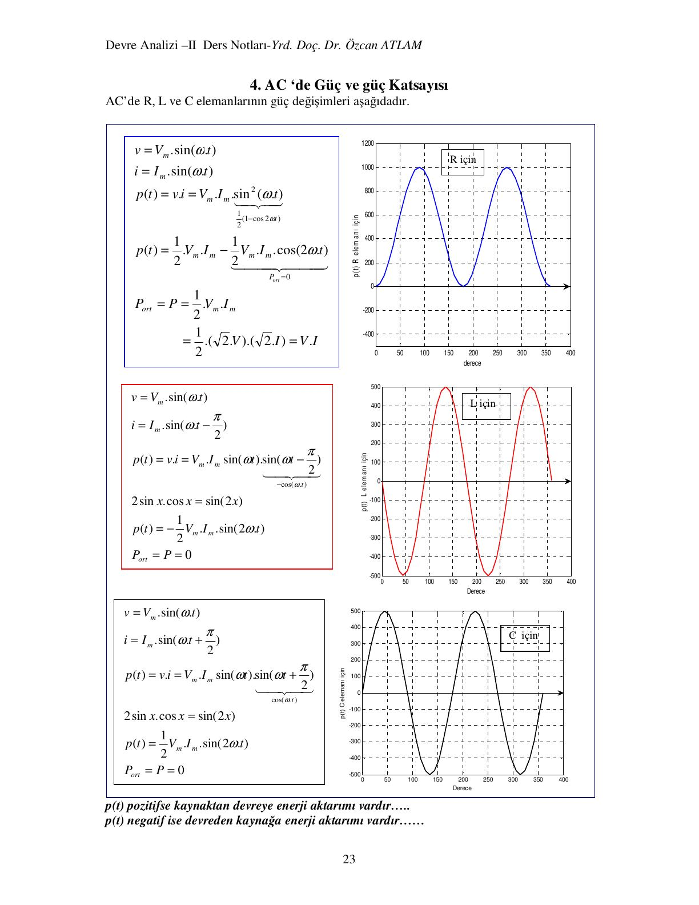
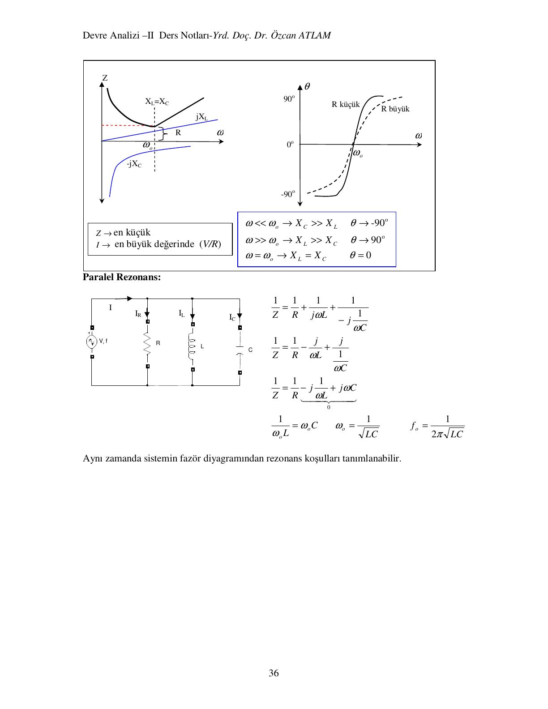
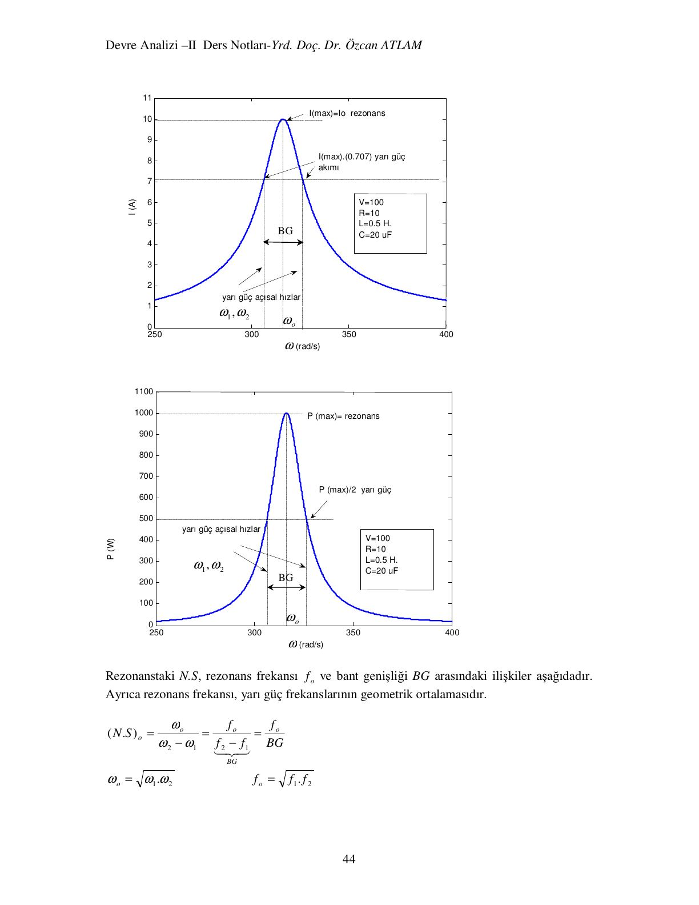

Bu yazı, **Yrd. Doç. Dr. Özcan Atlam**'ın hazırladığı **"Devre Analizi –II Ders Notları"** belgesini tanıtıyor (77 sayfa, PDF 2009). Notlar Başkent Üniversitesi'ne ait değil; EEM202 Devre Teorisi II dersine çalışırken kaynak olarak kullanılmış ve ders klasöründe saklanmış. Yazıda bölüm bölüm konular, ana tanım ve formüller ile bazı çözümlü örnekler metin olarak özetlendi; birkaç sayfa görsel olarak eklendi. Notların tamamı (orijinal PDF) yazının sonunda indirilebilir.

*Bu içerik üçüncü taraf bir kaynağa aittir; arşiv ve nostalji amacıyla kaynak belirtilerek paylaşılmıştır. Hak sahibinin talebi hâlinde kaldırılır.*

## 1. Sinüs akım ve gerilim

- v(t) = V_m sin(ωt + θ), ω = 2πf; V_m maksimum değer, ω açısal hız (rad/s), θ sıfıra göre faz açısı.
- v(t) hesaplanırken θ derece ise ωt dereceye çevrilir (ωt·180/π) ve θ ile toplanır.
- Örnek: v(t) = 100 sin(4000t + 30°)'un t = 0,1 s'deki değeri: v = 100 sin(4000·0,1·180/π + 30°) ≈ 100(−0,99) = −99 V.
- Empedans: Z = V_max/I_max = V_rms/I_rms.
- Dirençte akım ve gerilim aynı fazda; bobinde i_L = I_m sin(ωt − π/2) (akım 90° geride, V_max/I_max = ωL); kondansatörde i_C = I_m sin(ωt + π/2) (akım 90° ileride, V_max/I_max = 1/(ωC)).

Bu bölümde ayrıca seri RL, RC ve RLC ile paralel devrelerde toplam gerilimin tek bir sinüs olarak yazılması üzerine çok sayıda örnek var (örneğin "Seri bir RL devresinde R = 20 Ω, L = 0,06 H ve akım gerilimden 80° geridedir; ω = ?").

## 2. Karmaşık sayılarla analiz

Kartezyen ve kutupsal gösterim, karmaşık sayılarla dört işlem, empedansların karmaşık sayılarla ifadesi (Z_R = R, Z_L = jωL, Z_C = −j/(ωC)) ve devre çizimlerinde empedansların gösterimi. Örnek: "Empedansı 40∠30° Ω olan seri bir RL devresinde L = 0,02 H'dir. R = ? ve f = ?"

## 3. AC seri ve paralel devrelerde analiz

Seri ve paralel RLC devrelerinde eşdeğer empedans, akım ve gerilim bölücü, fazör diyagramları. Paralel devrede I_L > I_C ise (1/(ωL) > ωC) açı negatif olur ve akım gerilimden geri kalır.

## 4. AC'de güç ve güç katsayısı

R, L ve C için anlık güç:

- R: p(t) = ½V_mI_m − ½V_mI_m cos 2ωt → P = ½V_mI_m = V·I
- L: p(t) = −½V_mI_m sin 2ωt → P = 0
- C: p(t) = ½V_mI_m sin 2ωt → P = 0

p(t) pozitifse kaynaktan devreye, negatifse devreden kaynağa enerji aktarımı vardır.

Genel bir devrede v = V_m sin ωt, i = I_m sin(ωt + θ) için:

- **Aktif (ortalama) güç:** P = V·I·cos θ = I²R (W); cos θ güç katsayısıdır. Akım gerilimden geri ise geri, ileri ise ileri güç katsayılı devre.
- **Görünür güç:** S = V·I (VA); **reaktif güç:** Q = V·I·sin θ (VAR).
- P, Q ve S bir güç üçgeni oluşturur. Karmaşık güç S = V·I* hesaplanır; akımın eşleniği alınır ki açı, gerilim ile akım arasındaki fark açı (θ = θ₁ − θ₂) çıksın. Gerçel kısım P, sanal kısım Q'dur. Güç açısı aynı zamanda eşdeğer empedansın açısıdır.
- Devredeki P güçleri R'lerde, Q güçleri L ve C'lerde harcanır; sistem reaktif gücü Q = ΣQ_L − ΣQ_C.

Örnek: Z = 3 + j4 Ω, V = 100∠30° → I = 100∠30°/5∠53,1° = 20∠−23,1° A; P = 20²·3 = 1200 W, Q = 20²·4 = 1600 VAR (geri), S = 2000 VA, cos θ = cos 53,1° = 0,6 geri.

## 5. Güç katsayısının düzeltilmesi

Ev ve sanayideki yükler (motorlar, floresan ve şok bobinli lambalar) genelde endüktiftir. S görünür gücü sistemin yüklenmesinin, P ise faydalı işe dönüşen gücün ölçüsüdür. θ sıfıra yaklaştırılarak S'nin P'ye yaklaştırılmasına **güç katsayısının düzeltilmesi (kompanzasyon)** denir. Endüktif yüklere genellikle paralel kondansatör bağlanır: yük gerilimi ve P değişmez, cos θ arttığı için akım ve S azalır; dağıtım sistemi daha az yüklenir. Örneklerde V = 100∠0° V ile beslenen Z_y = 2 + j8 Ω'luk yükün güç katsayısı seri ve paralel kondansatörle 0,8 geriye düzeltiliyor; bir motorun güç katsayısını 0,95 geriye çıkarmak için gereken paralel kondansatör hesaplanıyor.

## 6. Rezonans devreleri

**Seri rezonans:** X_L = X_C olduğunda Z = R en küçük, akım en büyük (V/R) olur; ω ≪ ω₀ iken X_C ≫ X_L ve θ → −90°, ω ≫ ω₀ iken θ → +90°.

**Paralel rezonans:** 1/Z = 1/R − j(1/(ωL) − ωC); sanal terim sıfır olduğunda 1/(ω₀L) = ω₀C:

- ω₀ = 1/√(LC), f₀ = 1/(2π√(LC))

## 7. Nitelik sayısı, yarı güç frekansları ve bant genişliği

Nitelik sayısı (N.S, kalite faktörü): N.S = 2π·(depolanan en büyük enerji)/(devir başına harcanan enerji). Rezonanstaki seri RLC devresinde N.S = ω₀L/R = 1/(ω₀CR); paralel devrede N.S = ω₀CR.

Seri RLC devresinde rezonansta akım en büyük (I₀ = V/R) ve P_max = I₀²R'dir. Akımın 0,707·I₀ olduğu iki frekansta güç P_max/2 olur: bunlar **yarı güç frekanslarıdır** (|Z| = √2·R, yani |X_L − X_C| = R). Aradaki fark **bant genişliğidir**:

- N.S = ω₀/(ω₂ − ω₁) = f₀/(f₂ − f₁) = f₀/BG
- ω₀ = √(ω₁ω₂), f₀ = √(f₁f₂) (rezonans frekansı yarı güç frekanslarının geometrik ortalamasıdır)

Grafikteki örnekte ω₀ = 1/√(0,5·20·10⁻⁶) ≈ 316 rad/s, I_max = 100/10 = 10 A, P_max = 1000 W, bant genişliği R/L = 20 rad/s ve N.S = ω₀L/R ≈ 15,8.

## 8. Rezonanstaki akımın durumu

Rezonanstaki akımı, rezonans koşullarındaki eşdeğer empedansın gerçel kısmı R_e belirler. Seri RLC devresinde R_e = R frekanstan bağımsızdır; rezonansta sanal terim sıfırlanır, empedans en küçük ve akım en büyük (V/R) olur. Paralel kollu (örneğin R + jX_L kolu ile paralel kondansatör) devrelerde ise R_e de ω'ya bağlıdır; rezonans koşulu R_e'yi değiştirir ve rezonanstaki akımın en büyük, en küçük ya da ara bir değerde olacağını bu yeni R_e belirler. Bölüm iki örnekle bunu gösteriyor.

## 9. Çevre akımları, düğüm gerilimleri, Thevenin ve Norton

- **Çevre akımları yöntemi:** empedans, akım ve gerilim matrisleri tanımlanır; empedans matrisinin köşegeni çevrenin toplam empedansı, köşegen dışı terimler ortak empedansların negatifidir; çevre yönüne zıt kaynaklar (−) işaret alır.
- **Düğüm gerilimleri yöntemi:** akımlar düğümlerden çıkıyor kabul edilir; admitans matrisinin her satırı bir düğümün denklemidir.
- **Thevenin ve Norton teoremleri:** V_Th açık devre gerilimi, I_N kısa devre akımı, Z_Th = V_Th/I_N.

Bölüm 10, çevre, düğüm, Thevenin ve Norton yöntemleriyle çözülmüş örnek problemlerden oluşuyor.

## 10–11. Yıldız-üçgen dönüşümü ve diğer teoremler

- **Yıldız-üçgen (T-π) dönüşümü**
- **Süperpozisyon teoremi**
- **Karşıtlık (reciprocity) teoremi**
- **Kompanzasyon teoremi**
- **Maksimum güç transferi teoremi**

Maksimum güç transferi üç durumda inceleniyor:

- Yalnız direnç olan değişken yük: P = V_g²R_y/[(R_g + R_y)² + X_g²] türevi sıfıra eşitlenerek R_y = √(R_g² + X_g²) = |Z_g|. X_g = 0 ise DC'deki R_y = R_g koşulu çıkar.
- Direnci ve reaktansı değişken yük: önce X_y = −X_g, sonra R_y = R_g → **Z_y = R_g − jX_g**, yani iç empedansın eşleniği.
- Reaktansı sabit, direnci değişken yük: sabit reaktans iç empedansa katılır → R_y = √(R_g² + (X_g + X_y)²).

## 11. Manyetik kuplajlı devreler

- Bir bobinde akım değişirse ürettiği akı da değişir ve sargılarda emk endüklenir: e = N·dφ/dt = L·di/dt. Hava nüvede L = N²µA/l (µ₀ = 4π·10⁻⁷ H/m).
- **Karşılıklı endüktans** M: bir bobinde, onu manyetik olarak etkileyen diğer bobindeki akımın neden olduğu endükleme katsayısı. Aktarılan akının toplam akıya oranı **etkileşim (bağlaşım) katsayısı** k'dir (k ≤ 1) ve **M = k√(L₁L₂)**.
- Fazör denklemleri: V₁ = (R₁ + jωL₁)I₁ − jωM·I₂, V₂ = (R₂ + jωL₂)I₂ − jωM·I₁ (akı yönlerine göre M'nin işareti).
- **Nokta kuralı:** iki bobinde akımların ikisi de noktalı uçtan giriyor (veya çıkıyor) ise M, L ile aynı işaretli (+); biri giriyor diğeri çıkıyorsa ters işaretli (−) alınır. İkiden fazla bobinde her çift için ayrı M tanımlanır.
- Notlar, yalnız bir taraftan beslenen manyetik sistemde diğer tarafta endüklenen akım (doğal akım) ve örneklerle sona eriyor.

## İndirilebilir dosya

Notların orijinal 77 sayfalık PDF'i aşağıdan indirilebilir.
