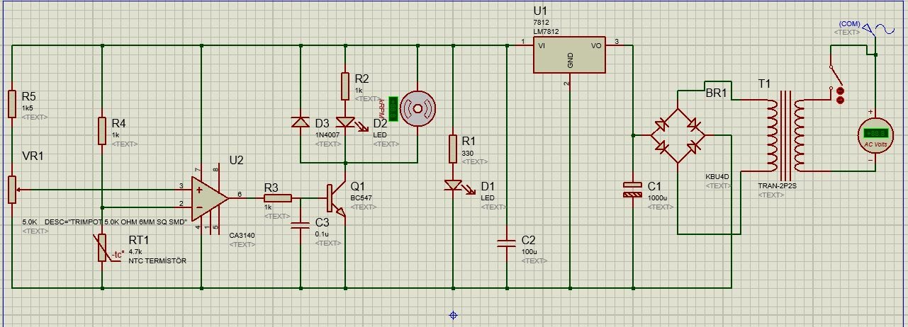

This post contains the documents of the term project that Hasan Can Öztürk prepared for the **EEM202 Circuit Theory II** course in the Electrical and Electronics Engineering Department at Başkent University: the **project proposal** dated February 2015, the **interim report** dated April 2015 (the cover page and a 4-page explanation titled "How does our laptop cooler circuit work?"), and Proteus screenshots of the circuit. The student number on the proposal and the cover page has been redacted. The documents can be downloaded as a ZIP at the end of the post.

## Project proposal

> I would like to build a cooler for laptops that is powered from the city mains. I plan for the cooler to include a controllable power supply that can be adjusted both according to data taken from the computer and manually, at least 5 fans, multiplied USB ports some of which are powered by the power supply, and an output to power the computer.

The proposal also sets the following goals:

- The components should take up as little space as possible and the cooler should be as light as possible.
- The electricity taken from the mains is split in two, going to the power supply and to the laptop's adapter.
- The output of the power supply rises and falls according to the computer's temperature, so that fan noise is reduced and the computer stays cool.
- To prevent insufficient current with USB devices that demand high current, USB ports powered by the power supply are provided in addition to the multiplied USB ports.

## Interim report: How does the circuit work?

In the interim report the proposal is simplified: a 12 V power supply fed from the mains and a fan control circuit that starts and stops by itself according to temperature.

The operating sequence described in the report:

1. There is a **220 V AC** input. After the input, a **switch** was added so that the power supply can be turned on and off when needed.
1. The **T1 transformer** steps the 220 V mains voltage down to the required level. For example, for a 12 V power supply, a 220 V/24 V transformer is used.
1. After the transformer, a **bridge-type full-wave rectifier circuit** made of 4 diodes converts the AC voltage to DC voltage.
1. After the bridge, a **1000 µF** capacitor suppresses the ripple and noise at the input.
1. The **LM7812** IC steps the DC voltage down to 12 V; the **100 µF** capacitor at its output suppresses the ripple and noise at the output. Thus, 220 V AC is converted to 12 V DC.
1. Fan control is performed with the 12 V DC obtained; the fan starts and stops automatically according to temperature.
1. An **NTC thermistor** is used to sense temperature: as the temperature rises, the resistance of the NTC falls. **IC1 (CA3140 op-amp)** is used to compare voltages.
1. The temperature at which the fan starts and stops is set with the **VR1 potentiometer**. When the set temperature is reached, a voltage appears at the output of IC1 and the fan runs; below this temperature there is no output and the fan stops. The LED stays lit as long as the fan is running.

The second page of the report contains the pinout of the CA3140 (PDIP/SOIC, 8 pins): 1 offset null, 2 inverting input, 3 non-inverting input, 4 V−, 5 offset null, 6 output, 7 V+, 8 strobe. The third and fourth pages are Proteus screenshots (the schematic and the simulation message window).

Other components in the schematic: the fan driver **BC547** transistor (Q1), a **1N4007** freewheeling diode across the fan terminals (D3), the power LED (D1) with R1 = 330 Ω, the fan LED (D2) with R2 = 1 kΩ, C3 = 0.1 µF, R3 and R4 = 1 kΩ, and VR1 = a 5 kΩ trimpot.

*Note: The report says "200V/24V transformer"; 220 V/24 V is what is meant. Also, the 24 V (RMS) transformer output yields a DC voltage of about 24√2 − 2·0.7 ≈ 32 V after the bridge and the 1000 µF capacitor (the report says 24 V DC); the LM7812 still steps this down to 12 V, but more power is dissipated in the regulator.*

## Photos in the project folder

The project folder also contains five photos dated May 2014 (not published): a power supply built on a printed circuit board with an **LM317T** adjustable regulator (a bridge diode, a large electrolytic capacitor, screw terminals, and a transformer connected by wire), and a board built on perforated phenolic board with a 40-pin IC and many red, green, yellow, and white LEDs.

## Downloadable files

The ZIP contains the project proposal and the interim report cover page (number redacted), the 4-page explanation of the interim report (the original PDF), and the Proteus screenshots (Devre2proje, BİR, İKİ, Başlıksız-1).
