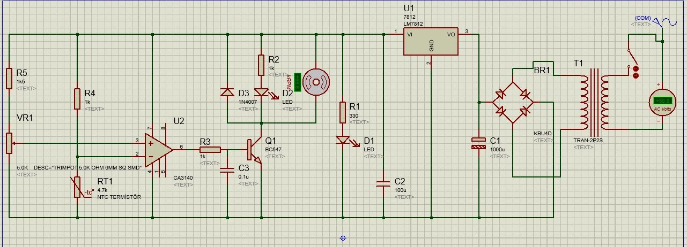

Bu yazı, Hasan Can Öztürk'ün Başkent Üniversitesi Elektrik-Elektronik Mühendisliği **EEM202 Devre Teorisi II** dersi için hazırladığı dönem projesinin belgelerini içeriyor: Şubat 2015 tarihli **proje önerisi**, Nisan 2015 tarihli **ara rapor** (kapak ve "Dizüstü bilgisayar soğutucu devremiz nasıl çalışıyor?" başlıklı 4 sayfalık açıklama) ve devrenin Proteus ekran görüntüleri. Öneri ve kapaktaki öğrenci numarası gizlendi. Belgeler yazının sonunda ZIP olarak indirilebilir.

## Proje önerisi

> Dizüstü bilgisayarlar için şehir şebekesinden beslenen soğutucu projesi yapmak istiyorum. Soğutucunun içine bilgisayardan alınan veriler çerçevesinde ve el yordamıyla ayarlanabilecek kontrol edilebilir bir güç kaynağı, en az 5 adet fan, bir kısmı güç kaynağı tarafından beslenen çoğaltılmış USB girişleri ve bilgisayarı beslemek için bir çıkış olmasını planlamaktayım.

Öneride ayrıca şunlar hedefleniyor:

- Yerleştirilen elemanların mümkün olduğunca az yer tutması ve soğutucunun olabildiğince hafif olması.
- Şebekeden alınan elektriğin güç kaynağına ve dizüstü bilgisayarın adaptörüne giderek ikiye ayrılması.
- Güç kaynağının çıkışının bilgisayarın sıcaklığına göre artıp azalması; böylece hem fan sesinin azalması hem de bilgisayarın serin kalması.
- Yüksek akım isteyen USB cihazlarında akım yetersizliğini önlemek için, çoğaltılmış USB girişlerine ek olarak güç kaynağından beslenen USB girişleri.

## Ara rapor: Devre nasıl çalışıyor?

Ara raporda öneri sadeleştirilmiş: şebekeden beslenen 12 V'luk bir güç kaynağı ve sıcaklığa göre kendiliğinden çalışıp duran bir fan kontrol devresi.

Raporun anlattığı çalışma sırası:

1. Girişte **220 V AC** var. Girişten sonra güç kaynağının gerektiğinde açılıp kapatılması için bir **anahtar** konuldu.
1. **T1 trafosu** 220 V'luk şebeke gerilimini ihtiyaç duyulan düzeye düşürüyor. Örneğin 12 V'luk güç kaynağı için 220 V/24 V'luk bir trafo kullanılıyor.
1. Trafodan sonra 4 diyottan oluşan **köprü tipi tam dalga doğrultma devresi** AC gerilimi DC gerilime çeviriyor.
1. Köprüden sonra **1000 µF**'lık kondansatör girişteki dalgalanma ve gürültüyü engelliyor.
1. **LM7812** entegresi DC gerilimi 12 V'a düşürüyor; çıkışındaki **100 µF**'lık kondansatör çıkıştaki dalgalanma ve gürültüyü engelliyor. Böylece 220 V AC, 12 V DC'ye çevrilmiş oluyor.
1. Elde edilen 12 V DC ile fan kontrolü yapılıyor; fan sıcaklığa göre otomatik çalışıp duruyor.
1. Sıcaklığı algılamak için **NTC termistör** kullanılıyor: sıcaklık artınca NTC'nin direnci düşer. **IC1 (CA3140 op-amp)** gerilimleri karşılaştırmak için kullanılıyor.
1. **VR1 potansiyometresi** ile fanın çalışıp duracağı sıcaklık ayarlanıyor. Ayarlanan sıcaklığa gelindiğinde IC1'in çıkışında gerilim oluşuyor ve fan çalışıyor; bu sıcaklığın altında çıkış yok ve fan duruyor. Fan çalıştığı sürece LED yanıyor.

Raporun ikinci sayfasında CA3140'ın (PDIP/SOIC, 8 bacak) bacak dizilimi var: 1 offset null, 2 eviren giriş, 3 evirmeyen giriş, 4 V−, 5 offset null, 6 çıkış, 7 V+, 8 strobe. Üçüncü ve dördüncü sayfalar Proteus ekran görüntüleri (şema ve benzetim mesaj penceresi).

Şemadaki diğer elemanlar: fan sürücüsü **BC547** transistör (Q1), fan uçlarında **1N4007** serbest geçiş diyotu (D3), R1 = 330 Ω ile güç LED'i (D1), R2 = 1 kΩ ile fan LED'i (D2), C3 = 0,1 µF, R3 ve R4 = 1 kΩ, VR1 = 5 kΩ'luk trimpot.

*Not: Raporda "200V/24V luk bir trafo" yazıyor; kastedilen 220 V/24 V'tur. Ayrıca 24 V (efektif) trafo çıkışı köprüden ve 1000 µF'lık kondansatörden sonra yaklaşık 24√2 − 2·0,7 ≈ 32 V'luk bir DC gerilim verir (raporda 24 V DC denmiş); LM7812 bu gerilimi yine 12 V'a düşürür, ancak regülatörde daha fazla güç harcanır.*

## Proje klasöründeki fotoğraflar

Proje klasöründe ayrıca Mayıs 2014 tarihli beş fotoğraf var (yayınlanmıyor): baskılı devre kartı üzerine kurulmuş, **LM317T** ayarlı regülatörlü bir güç kaynağı (köprü diyot, büyük bir elektrolitik kondansatör, vidalı klemensler ve kabloyla bağlı bir trafo) ve delikli pertinaks üzerine kurulmuş, 40 bacaklı bir entegre ile çok sayıda kırmızı, yeşil, sarı ve beyaz LED'den oluşan bir kart.

## İndirilebilir dosyalar

ZIP'te proje önerisi ve ara rapor kapağı (numara gizlendi), ara raporun 4 sayfalık açıklaması (orijinal PDF) ve Proteus ekran görüntüleri (Devre2proje, BİR, İKİ, Başlıksız-1) var.
