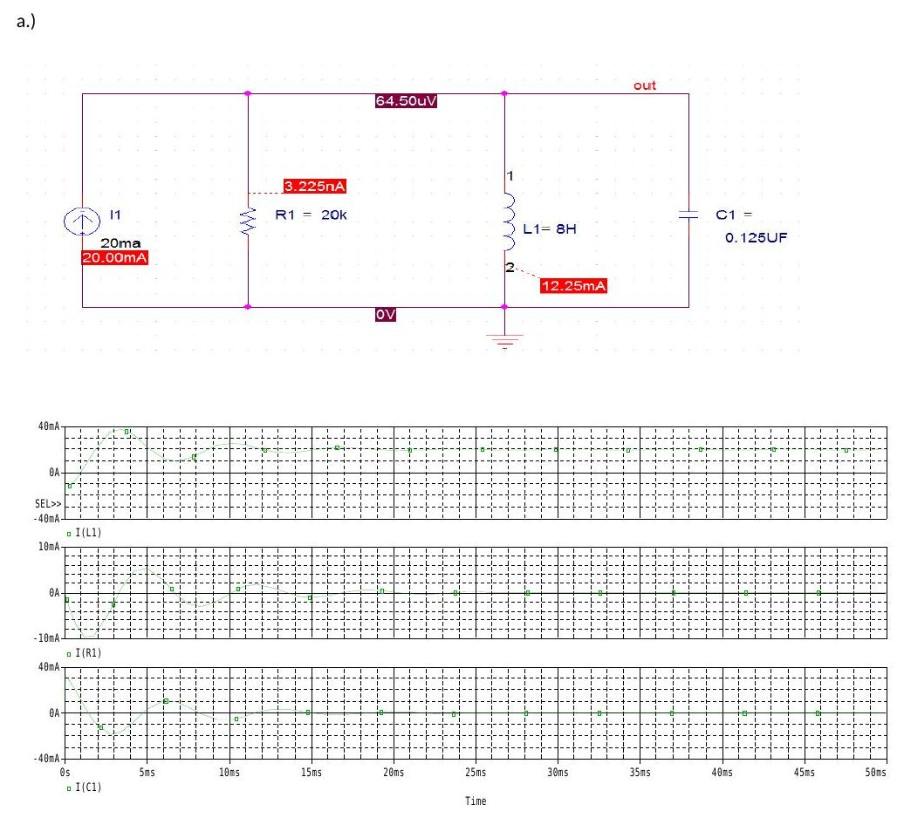
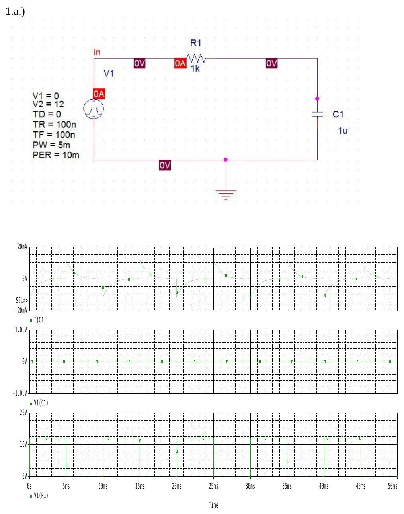
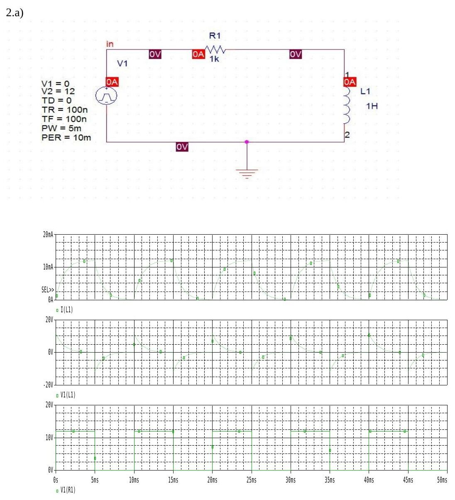

This post collects the **solution side** of the first two PSpice assignments given in the Başkent University Electrical-Electronics Engineering **EEM-202 Circuit Theory-2 Laboratory**: the PSpice simulation outputs Hasan Can Öztürk obtained in March 2015, together with the Assignment-1 and Assignment-2 reports and plot files prepared by classmates that are kept in the course archive. Names, surnames and student numbers have been removed from the classmates' reports, and these files were converted from page images to PDF. The text of the assignment sheets is in a separate post titled [PSpice Assignments 1–4](/arsiv/eem202-pspice-odevleri/); here only the solutions and results are described. All files can be downloaded as a ZIP at the end of the post.

## Assignment 1: RLC natural and step response

The circuit consists of a resistor, an L = 8 H inductor and a C = 0.125 µF capacitor connected in parallel. The initial conditions are V₀ = 0 and an inductor current of I₀ = −12.25 mA. For a parallel RLC circuit, the damping coefficient and the resonant frequency are:

- α = 1/(2RC)
- ω₀ = 1/√(LC) = 1/√(8 · 0.125·10⁻⁶) = **1000 rad/s**

### Part 1: Natural response

1. **R = 20 kΩ:** α = 1/(2 · 20000 · 0.125·10⁻⁶) = 200 s⁻¹ < ω₀ → **underdamped** response. The damped oscillation frequency is ω_d = √(ω₀² − α²) ≈ 980 rad/s. In the plots, v(t) is a decaying sinusoid starting with a peak of about 70 V; i_L(t) starts at −12.25 mA and oscillates around zero.
1. **Critical damping:** From the condition α = ω₀, R = 1/(2ω₀C) = 1/(2 · 1000 · 0.125·10⁻⁶) = **4000 Ω**. With this value, v(t) and i_L(t) decay to zero without oscillating.
1. **Overdamping:** α > ω₀ is required, i.e. R < 4000 Ω; the report chose **R = 2 kΩ** (α = 2000 s⁻¹).

")

### Part 2: Step response

A 20 mA current source is connected to the same circuit, and i_R(t), i_L(t) and i_C(t) are plotted for the R = 20 kΩ, R = 4 Ω and R = 1 Ω values requested in the assignment sheet.

| R | α = 1/(2RC) | Response |
| --- | --- | --- |
| 20 kΩ | 200 s⁻¹ | underdamped (oscillatory) |
| 4 Ω | 10⁶ s⁻¹ | overdamped |
| 1 Ω | 4·10⁶ s⁻¹ | overdamped |

At R = 20 kΩ, the inductor current settles to its final value of 20 mA with oscillations; at 4 Ω and 1 Ω, the capacitor and resistor currents die out within microseconds and all of the current is transferred to the inductor.

*Note: The 4 Ω and 1 Ω values given in the assignment sheet for the step response may have been intended as examples of critical (4 kΩ) and overdamped cases; both 4 Ω and 1 Ω give very strong overdamping. The reports use the values from the assignment sheet as they are.*

Hasan Can Öztürk's PSpice outputs (the "hasancan …" files in the ZIP) are the plots for the same questions: Question 1 (0–11 ms and 0–1 s ranges), Question 1b, Questions 2b and 2c (critical damping, R = 4 kΩ), Question 3 (overdamping), and the step response plots of Part 2.

## Assignment 2: RC and RL circuits

Both circuits are driven by a square wave with V1 = 0 V, V2 = 12 V, pulse width PW = 5 ms and period PER = 10 ms (rise and fall times of 100 ns); R = 1 kΩ.

### RC circuit

For C = 1 µF, the time constant is τ = RC = 1 ms. Since the half period of 5 ms = 5τ, the capacitor fully charges and discharges in each half period; the capacitor current jumps by ±12 mA at each edge and then decays exponentially to zero.

When the capacitor value is changed:

| C | τ = RC |
| --- | --- |
| 0.5 µF | 0.5 ms |
| 1 µF | 1 ms |
| 1.5 µF | 1.5 ms |

The report's interpretation: the general shape of the plots does not change; as the capacitor grows, τ grows and charging and discharging become slower.

### RL circuit

For L = 1 H, τ = L/R = 1 ms. The inductor voltage jumps by ±12 V at each edge and then decays exponentially, while the inductor current charges and discharges between 0 and 12 mA.

| L | τ = L/R |
| --- | --- |
| 0.5 H | 0.5 ms |
| 1 H | 1 ms |
| 1.5 H | 1.5 ms |

The report's interpretation: since the same resistance and the same numerical values are used, the τ values found for the RL circuit are the same as those for the RC circuit; the plots of the inductor voltage and the capacitor current are also similar to each other (both jump at the source edges and decay with τ).

## Downloadable files

The ZIP contains two folders:

- **Assignment-1:** Hasan Can Öztürk's PSpice plot outputs (8 PDFs), one classmate's Assignment-1 report, and plots merged from another classmate's individual plot files.
- **Assignment-2:** two classmates' Assignment-2 reports (the main report and its "continuation") and one classmate's plot files (with a cover page). Personal information has been removed.
