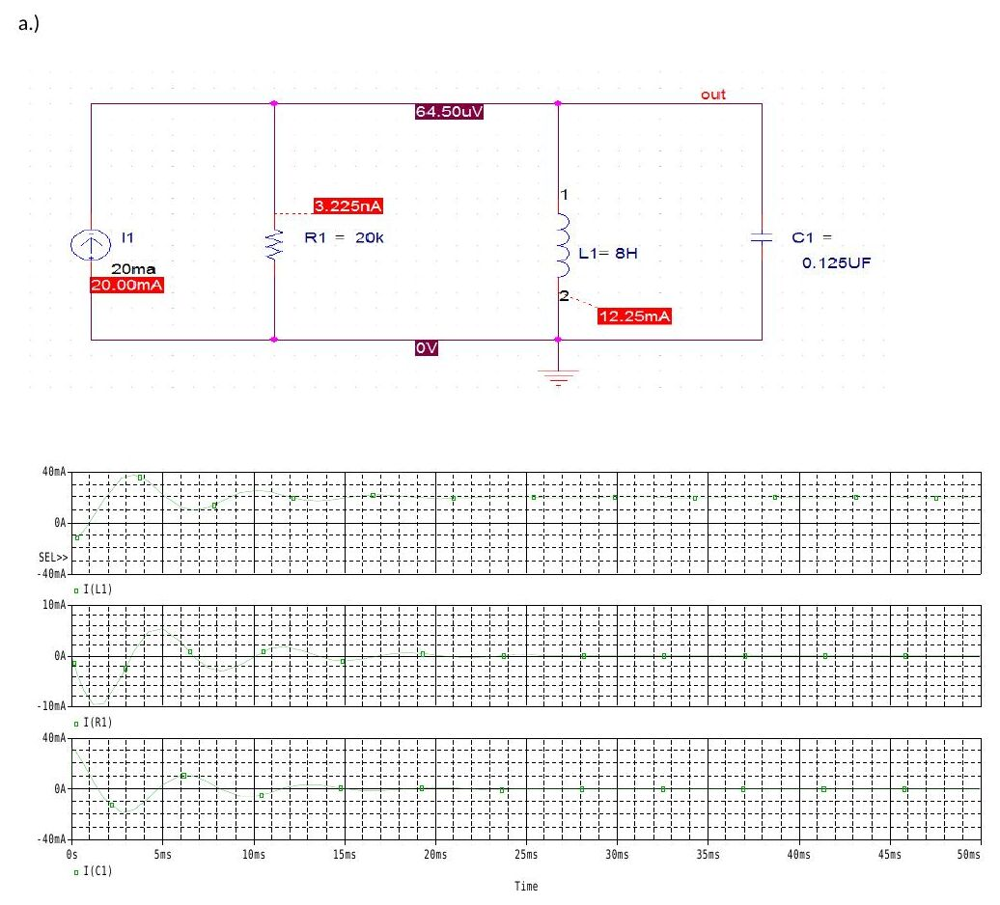
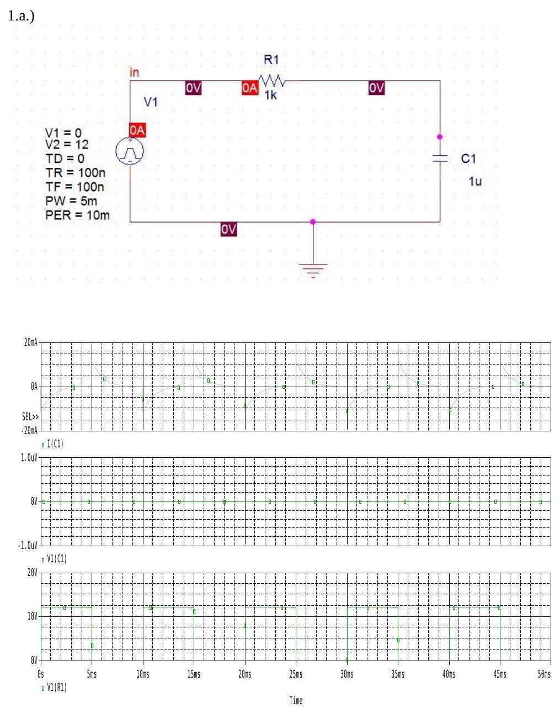
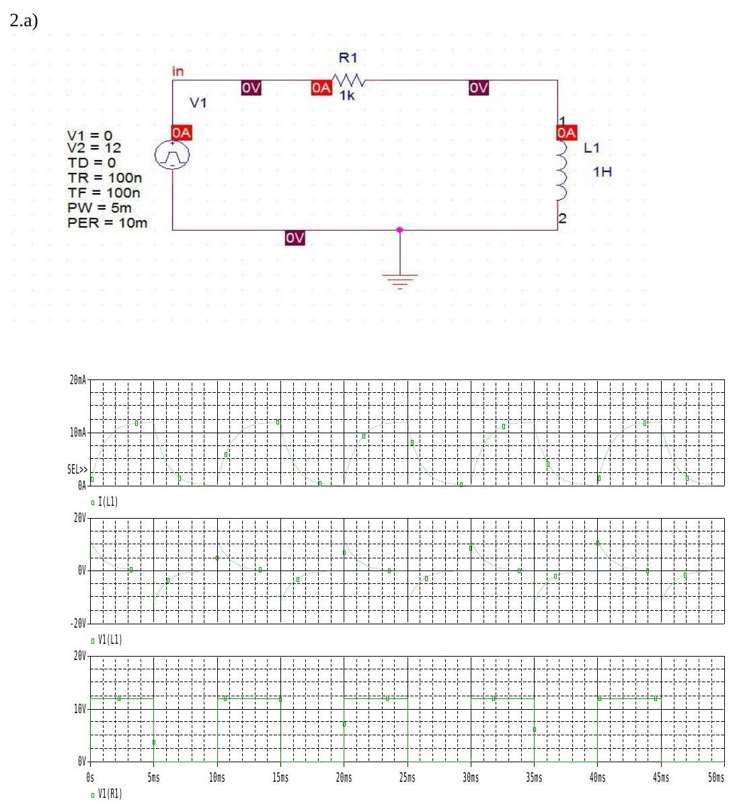

Bu yazı, Başkent Üniversitesi Elektrik-Elektronik Mühendisliği **EEM-202 Devre Teorisi-2 Laboratuvarı**'nda verilen ilk iki PSpice ödevinin **çözüm tarafını** topluyor: Hasan Can Öztürk'ün Mart 2015'te aldığı PSpice benzetim çıktıları ile ders arşivinde duran, arkadaşların hazırladığı Ödev-1 ve Ödev-2 raporları ve grafik dosyaları. Arkadaş raporlarındaki ad, soyad ve öğrenci numaraları çıkarıldı; bu dosyalar sayfa görüntülerinden PDF'e çevrildi. Ödev föylerinin metni arşivde [PSpice Ödevleri 1–4](/arsiv/eem202-pspice-odevleri/) başlıklı ayrı yazıda var; burada yalnız çözümler ve sonuçlar anlatılıyor. Tüm dosyalar yazının sonunda ZIP olarak indirilebilir.

## Ödev-1: RLC doğal ve basamak tepkisi

Devre paralel bağlı bir direnç, L = 8 H'lik bobin ve C = 0,125 µF'lık kondansatörden oluşuyor. Başlangıç koşulları V₀ = 0 ve bobin akımı I₀ = −12,25 mA. Paralel RLC devresinde sönüm katsayısı ve rezonans frekansı:

- α = 1/(2RC)
- ω₀ = 1/√(LC) = 1/√(8 · 0,125·10⁻⁶) = **1000 rad/s**

### Bölüm 1: Doğal tepki

1. **R = 20 kΩ:** α = 1/(2 · 20000 · 0,125·10⁻⁶) = 200 s⁻¹ < ω₀ → **eksik sönümlü (underdamped)** tepki. Sönümlü salınım frekansı ω_d = √(ω₀² − α²) ≈ 980 rad/s. Grafiklerde v(t) yaklaşık 70 V'luk tepeyle başlayan, giderek sönen bir sinüs; i_L(t) −12,25 mA'den başlayıp sıfır çevresinde salınıyor.
1. **Kritik sönüm:** α = ω₀ koşulundan R = 1/(2ω₀C) = 1/(2 · 1000 · 0,125·10⁻⁶) = **4000 Ω**. Bu değerle v(t) ve i_L(t) salınım yapmadan sıfıra iniyor.
1. **Aşırı sönüm:** α > ω₀ olmalı, yani R < 4000 Ω; raporda **R = 2 kΩ** seçilmiş (α = 2000 s⁻¹).

")

### Bölüm 2: Basamak tepkisi

Aynı devreye 20 mA'lik bir akım kaynağı bağlanıyor ve föyde istenen R = 20 kΩ, R = 4 Ω ve R = 1 Ω değerleri için i_R(t), i_L(t) ve i_C(t) çizdiriliyor.

| R | α = 1/(2RC) | Tepki |
| --- | --- | --- |
| 20 kΩ | 200 s⁻¹ | eksik sönümlü (salınımlı) |
| 4 Ω | 10⁶ s⁻¹ | aşırı sönümlü |
| 1 Ω | 4·10⁶ s⁻¹ | aşırı sönümlü |

R = 20 kΩ'da bobin akımı 20 mA son değerine salınarak oturuyor; 4 Ω ve 1 Ω'da kondansatör ve direnç akımları mikrosaniyeler içinde sönüyor ve akımın tamamı bobine geçiyor.

*Not: Föyde basamak tepkisi için verilen 4 Ω ve 1 Ω değerleri kritik (4 kΩ) ve aşırı sönüm örneği olarak düşünülmüş olabilir; 4 Ω ve 1 Ω'un ikisi de çok güçlü aşırı sönüm veriyor. Raporlar föydeki değerleri olduğu gibi kullanıyor.*

Hasan Can Öztürk'ün PSpice çıktıları (ZIP'teki "hasancan …" dosyaları) aynı soruların grafikleridir: Soru 1 (0–11 ms ve 0–1 s aralıkları), Soru 1b, Soru 2b ve 2c (kritik sönüm, R = 4 kΩ), Soru 3 (aşırı sönüm) ve Bölüm 2'nin basamak tepkisi grafikleri.

## Ödev-2: RC ve RL devreleri

Her iki devre de V1 = 0 V, V2 = 12 V, darbe genişliği PW = 5 ms ve periyodu PER = 10 ms olan bir kare dalgayla (yükselme ve düşme süreleri 100 ns) besleniyor; R = 1 kΩ.

### RC devresi

C = 1 µF için zaman sabiti τ = RC = 1 ms. Yarım periyot 5 ms = 5τ olduğundan kondansatör her yarım periyotta tam dolup boşalıyor; kapasitör akımı her kenarda ±12 mA'lik bir sıçrama yapıp üstel olarak sıfıra iniyor.

Kapasitör değeri değiştirildiğinde:

| C | τ = RC |
| --- | --- |
| 0,5 µF | 0,5 ms |
| 1 µF | 1 ms |
| 1,5 µF | 1,5 ms |

Raporun yorumu: grafiklerin genel biçimi değişmiyor, kapasitör büyüdükçe τ büyüyor ve dolma-boşalma yavaşlıyor.

### RL devresi

L = 1 H için τ = L/R = 1 ms. Bobin gerilimi her kenarda ±12 V sıçrayıp üstel olarak sönerken bobin akımı 0 ile 12 mA arasında dolup boşalıyor.

| L | τ = L/R |
| --- | --- |
| 0,5 H | 0,5 ms |
| 1 H | 1 ms |
| 1,5 H | 1,5 ms |

Raporun yorumu: aynı direnç ve aynı sayısal değerler kullanıldığı için RL devresinde bulunan τ değerleri RC devresindekilerle aynı çıkıyor; bobin gerilimi ile kapasitör akımının grafikleri de birbirine benziyor (ikisi de kaynak kenarlarında sıçrayıp τ ile sönüyor).

## İndirilebilir dosyalar

ZIP'te iki klasör var:

- **Ödev-1:** Hasan Can Öztürk'ün PSpice grafik çıktıları (8 PDF), bir arkadaşın Ödev-1 raporu ve başka bir arkadaşın tek tek grafik dosyalarından birleştirilen grafikler.
- **Ödev-2:** iki arkadaşın Ödev-2 raporları (ana rapor ve "devamı") ve bir arkadaşın grafik dosyaları (kapak sayfasıyla). Kişisel bilgiler çıkarıldı.
