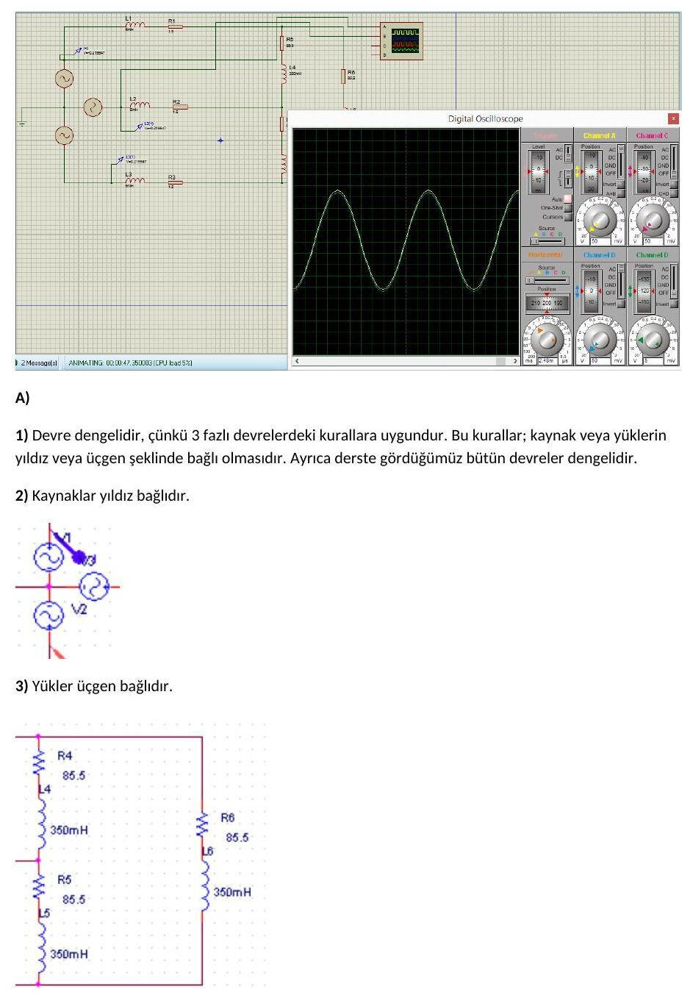
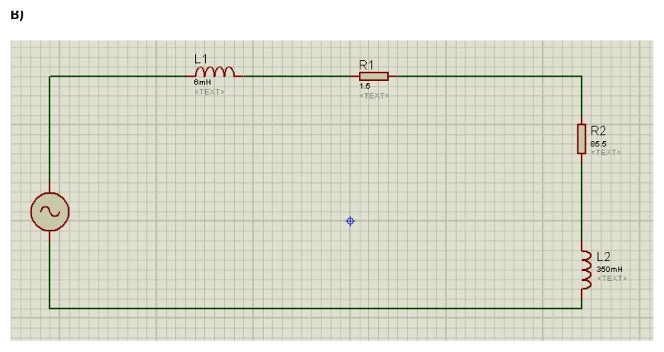
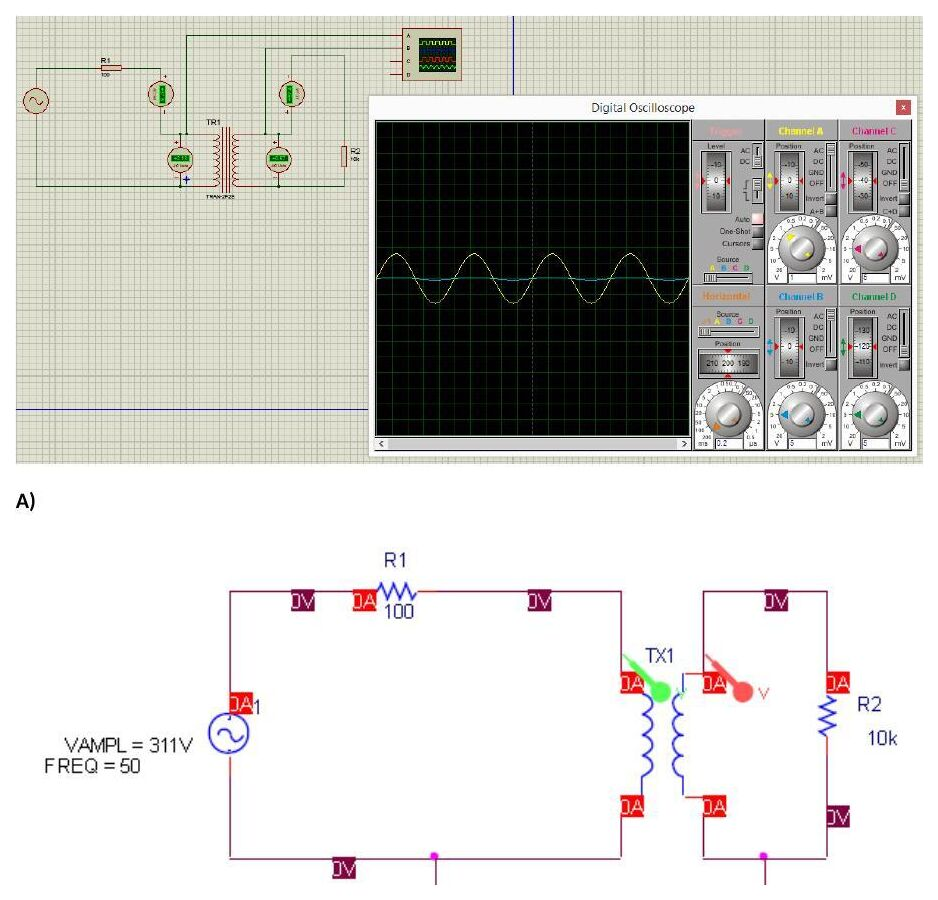

This post contains the reports for the last two PSpice assignments of the Başkent University Electrical-Electronics Engineering **EEM-202 Circuit Theory II Laboratory**: **Hasan Can Öztürk's PSpice Assignment 3 (Three-Phase Circuits) report** (April 2015, 4 pages; student number hidden), a one-page graphing exercise by a friend for the same assignment, and a friend's **Assignment 4 (Transformers)** report (name and number removed). The simulations were done in Proteus, and oscilloscope screenshots are included in the reports. The text of the assignment handouts is in a separate post titled [PSpice Assignments 1–4](/arsiv/eem202-pspice-odevleri/). Some calculations in the reports are wrong; the correct values are given in the notes. The files can be downloaded as a ZIP at the end of the post.

## Assignment 3: Three-phase circuit

The circuit has three positive-sequence sources of 311∠0° V (peak value), f = 50 Hz, connected in wye (Y); each line has a 1.5 Ω resistor and a 6 mH inductor. The load is delta (Δ) connected, with **85.5 Ω + 350 mH** in each branch.

### A) Analysis of the circuit

1. The circuit is balanced. (The report's justification: the sources and loads are connected in wye or delta.)
1. The sources are wye-connected.
1. The loads are delta-connected.

*Note: The actual condition for a three-phase circuit to be balanced is that the source amplitudes are equal with 120° phase difference between them, and that the impedances of the three phases are equal; both conditions are satisfied in this circuit.*

### B) Line and phase currents (the report's calculation)

- ω = 2π·50 ≈ 314 rad/s, Z_L1 = jωL1 = j1.88 Ω, Z_L2 = jωL2 = j109.9 Ω
- In the report, the single-phase equivalent was built by connecting the line impedance 1.5 + j1.88 Ω in series with the load impedance 85.5 + j109.9 Ω: Z = 141.65∠52.11° Ω
- I_aA = 311∠0° / 141.65∠52.11° = 2.20∠−52.11° A, I_bB = 2.20∠−172.11° A, I_cC = 2.20∠−67.89° A
- I_AB = I_aA/√3 ∠30° = 1.27∠−22.11° A, I_BC = 1.27∠−142.11° A, I_CA = 1.27∠97.89° A

*Note: When converting the Δ-connected load to the single-phase (Y) equivalent, the impedance must be divided by three: Z_Y = (85.5 + j109.9)/3 = 28.5 + j36.63 Ω. The correct single-phase impedance is Z = 30 + j38.51 = 48.84∠52.10° Ω; accordingly I_aA = 311/48.84 = **6.37∠−52.10° A** (peak), I_AB = I_aA/√3 ∠+30° = **3.68∠−22.10° A**. For the positive sequence, the angle of I_cC should be −52.10° + 120° = **+67.90°** (the report has −67.89°).*

### C) Values read from the simulation

According to the Proteus measurements, the report gives V_AN = 216∠0° V and V_AB = √3·V_AN∠30° = 373.68∠30° V (V_BC = 373.68∠−90° V, V_CA = 373.68∠150° V). The voltage across the line impedance was calculated as I_aA(1.5 + j1.88) = 5.302∠−0.97° V and labeled "V_an"; from this V_ab = 9.17∠29.03° V was obtained. The (rms) values read from the ammeters are I_aA = 1.55∠−52.11° A and phase currents of 2.68∠−22.11° A.

*Note: 1.55 A is the rms value of the current found with the report's 141.65 Ω impedance (without the Δ→Y conversion) (220/141.65). In a delta-connected load, the phase current is √3 times **smaller** than the line current (I_AB = I_aA/√3); the report has 1.55 × 1.73 = 2.68 A.*

### D) Powers (the report's calculation)

- P_load = 1.55² · 85.5 = 250.2 W, total 750.6 W
- Q_load = 1.55² · 109.9 = 263.76 VAr, total 791.28 VAr
- S_load = 250.2 + j263.76 VA, total 750.6 + j791.28 VA
- S_source = 482.05∠52.09° VA = 296.18 + j380.33 VA

*Note: With the correct single-phase equivalent (rms phase voltage 220 V), I_aA = 4.51 A (rms); the total power dissipated in the load is P = 3·4.51²·28.5 ≈ **1735 W**, and the reactive power is Q = 3·4.51²·36.63 ≈ **2231 VAr**.*

## Assignment 4: Transformers

The source is v = 311 cos(314t) V (VAMPL = 311 V, 50 Hz); there is R1 = 100 Ω on the primary side and an R2 = 10 kΩ load on the secondary. Measurements were made in Proteus with a voltmeter/ammeter and an oscilloscope.

### A) L1 = 20 H, L2 = 2000 H, k = 1

- M = k√(L1·L2) = 200 H, jωM = j62800 Ω, Z_L1 = j6280 Ω, Z_L2 = j628000 Ω
- The report's mesh equations: −311 + I1(100 + j6280) − I2(j62800) = 0 and I2(10000 + j628000) − I1(j6280) = 0
- The report's results: I1 = 5.50∠−88.98° A, I2 = 55.01∠−87.98° mA, V1 ≈ 34540 V, V2 ≈ 34546 V

*Note: In the second mesh equation, the mutual inductance term should be jωM = j62800 (the report has j6280). With the correct equations, I1 ≈ **1.555∠−0.46° A**, I2 ≈ **155.5 mA**, V1 ≈ **155.5 V**, V2 ≈ **1555 V** (peak) are obtained. Since k = 1 and L2/L1 = 100, the transformer behaves very nearly as an ideal one: the turns ratio is n = √(L2/L1) = 10, V2/V1 = 10, I1/I2 = 10; the 10 kΩ load appears as 10000/10² = 100 Ω from the primary side, and I1 = 311/(100 + 100) ≈ 1.555 A.*

### B) L1 = 10 H, L2 = 1 H, k = 0.85

- M = 0.85·√10 ≈ 2.69 H, jωM ≈ j844.66 Ω, Z_L1 = j3140 Ω, Z_L2 = j314 Ω
- The report's results: I1 = 99.77∠−86.52° mA, I2 = 29.87∠−13.95° mA, v1(t) = 313.28 cos(314t + 3.48°) V, v2(t) = 9.38 cos(314t + 76.05°) V

*Note: The report used j314 and j3140 in the mesh equations instead of jωM. Solving with jωM = j844.66 gives I1 ≈ **98.9∠−86.9° mA** (close to the report), I2 ≈ **8.35 mA**, v1 ≈ **310.6 V**, v2 = 10 kΩ·I2 ≈ **83.5 V** (peak). In a linear transformer, since the coil reactances remain small relative to the load resistance (ωL2 = 314 Ω ≪ 10 kΩ), the voltage is transferred at a ratio even below the ideal-transformer ratio √(L2/L1).*

## Downloadable files

- **Assignment 3:** Hasan Can Öztürk's report (number hidden) and a friend's one-page work containing the line-current graph and the PSpice circuit drawing.
- **Assignment 4:** a friend's transformer report (4 pages; name and number removed).
