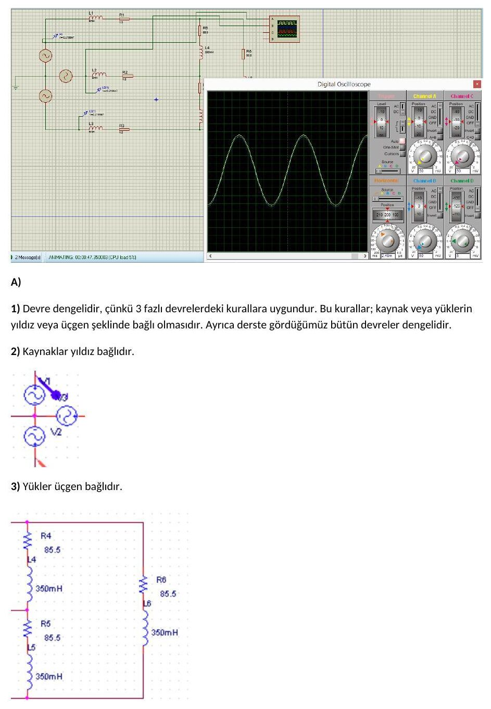
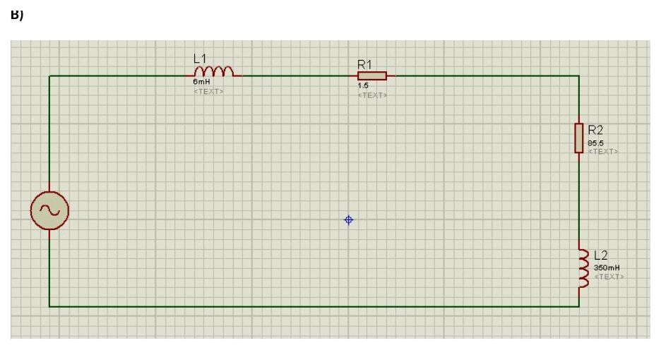
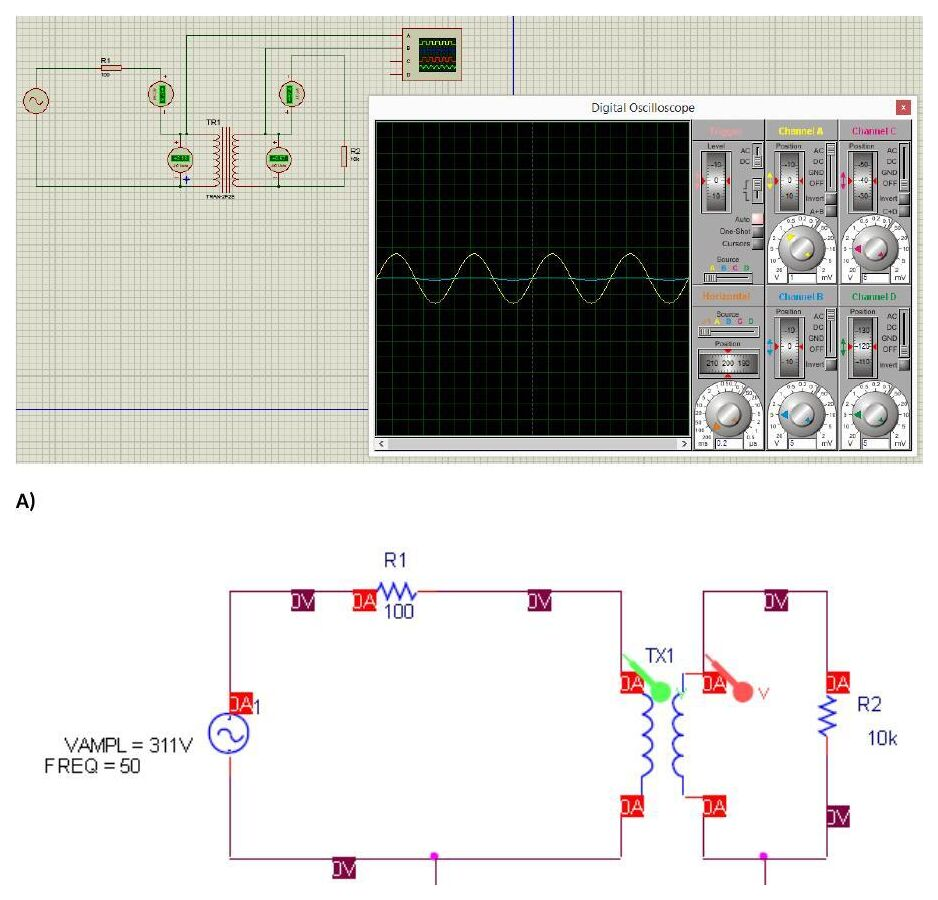

Bu yazı, Başkent Üniversitesi Elektrik-Elektronik Mühendisliği **EEM-202 Devre Teorisi-2 Laboratuvarı**'nın son iki PSpice ödevinin raporlarını içeriyor: **Hasan Can Öztürk'ün PSpice Ödev-3 (3 Fazlı Devreler) raporu** (Nisan 2015, 4 sayfa; öğrenci numarası gizlendi), aynı ödev için bir arkadaşın tek sayfalık grafik çalışması ve başka bir arkadaşın **Ödev-4 (Trafolar)** raporu (ad ve numarası çıkarıldı). Benzetimler Proteus ile yapılmış, osiloskop ekranları raporlara eklenmiş. Ödev föylerinin metni [PSpice Ödevleri 1–4](/arsiv/eem202-pspice-odevleri/) başlıklı ayrı yazıda var. Raporlardaki bazı hesaplar hatalı; doğru değerler notlarda verildi. Dosyalar yazının sonunda ZIP olarak indirilebilir.

## Ödev-3: 3 fazlı devre

Devrede 311∠0° V (tepe değer), f = 50 Hz, pozitif faz sıralı üç kaynak yıldız (Y) bağlı; her hatta 1,5 Ω direnç ve 6 mH bobin var. Yük üçgen (Δ) bağlı, her kolu **85,5 Ω + 350 mH**.

### A) Devrenin analizi

1. Devre dengelidir. (Raporun gerekçesi: kaynak ve yüklerin yıldız veya üçgen bağlı olması.)
1. Kaynaklar yıldız bağlıdır.
1. Yükler üçgen bağlıdır.

*Not: Bir üç fazlı devrenin dengeli olmasının asıl koşulu, kaynakların genliklerinin eşit ve aralarında 120° faz farkı olması ve üç faz empedansının birbirine eşit olmasıdır; bu devrede iki koşul da sağlanıyor.*

### B) Hat ve faz akımları (raporun hesabı)

- ω = 2π·50 ≈ 314 rad/s, Z_L1 = jωL1 = j1,88 Ω, Z_L2 = jωL2 = j109,9 Ω
- Raporda tek faz eşdeğeri 1,5 + j1,88 Ω hat empedansı ile 85,5 + j109,9 Ω yük empedansının seri bağlanmasıyla kurulmuş: Z = 141,65∠52,11° Ω
- I_aA = 311∠0° / 141,65∠52,11° = 2,20∠−52,11° A, I_bB = 2,20∠−172,11° A, I_cC = 2,20∠−67,89° A
- I_AB = I_aA/√3 ∠30° = 1,27∠−22,11° A, I_BC = 1,27∠−142,11° A, I_CA = 1,27∠97,89° A

*Not: Δ bağlı yük tek faz (Y) eşdeğerine geçerken üçe bölünmelidir: Z_Y = (85,5 + j109,9)/3 = 28,5 + j36,63 Ω. Doğru tek faz empedansı Z = 30 + j38,51 = 48,84∠52,10° Ω olur; buna göre I_aA = 311/48,84 = **6,37∠−52,10° A** (tepe), I_AB = I_aA/√3 ∠+30° = **3,68∠−22,10° A**. Pozitif sırada I_cC'nin açısı −52,10° + 120° = **+67,90°** olmalıdır (raporda −67,89° yazılmış).*

### C) Benzetimden okunan değerler

Raporda Proteus ölçümlerine göre V_AN = 216∠0° V, V_AB = √3·V_AN∠30° = 373,68∠30° V (V_BC = 373,68∠−90° V, V_CA = 373,68∠150° V) verilmiş. Hat empedansı üzerindeki gerilim I_aA(1,5 + j1,88) = 5,302∠−0,97° V olarak hesaplanmış ve "V_an" diye yazılmış; buradan V_ab = 9,17∠29,03° V bulunmuş. Ampermetrelerden okunan (efektif) değerler I_aA = 1,55∠−52,11° A ve faz akımları 2,68∠−22,11° A.

*Not: 1,55 A, raporun 141,65 Ω'luk (Δ→Y dönüşümü yapılmamış) empedansıyla bulunan akımın efektif değeridir (220/141,65). Üçgen yükte faz akımı hat akımından √3 kat **küçüktür** (I_AB = I_aA/√3); raporda 1,55 × 1,73 = 2,68 A yazılmış.*

### D) Güçler (raporun hesabı)

- P_yük = 1,55² · 85,5 = 250,2 W, toplam 750,6 W
- Q_yük = 1,55² · 109,9 = 263,76 VAr, toplam 791,28 VAr
- S_yük = 250,2 + j263,76 VA, toplam 750,6 + j791,28 VA
- S_kaynak = 482,05∠52,09° VA = 296,18 + j380,33 VA

*Not: Doğru tek faz eşdeğeriyle (efektif faz gerilimi 220 V) I_aA = 4,51 A (efektif) olur; yükte harcanan toplam güç P = 3·4,51²·28,5 ≈ **1735 W**, reaktif güç Q = 3·4,51²·36,63 ≈ **2231 VAr**.*

## Ödev-4: Trafolar

Kaynak v = 311 cos(314t) V (VAMPL = 311 V, 50 Hz), primer tarafında R1 = 100 Ω, sekonderde R2 = 10 kΩ yük var. Proteus'ta voltmetre/ampermetre ve osiloskopla ölçüm yapılmış.

### A) L1 = 20 H, L2 = 2000 H, k = 1

- M = k√(L1·L2) = 200 H, jωM = j62800 Ω, Z_L1 = j6280 Ω, Z_L2 = j628000 Ω
- Raporun çevre denklemleri: −311 + I1(100 + j6280) − I2(j62800) = 0 ve I2(10000 + j628000) − I1(j6280) = 0
- Raporun sonuçları: I1 = 5,50∠−88,98° A, I2 = 55,01∠−87,98° mA, V1 ≈ 34540 V, V2 ≈ 34546 V

*Not: İkinci çevre denkleminde karşılıklı endüktans terimi jωM = j62800 olmalıdır (raporda j6280 yazılmış). Doğru denklemlerle I1 ≈ **1,555∠−0,46° A**, I2 ≈ **155,5 mA**, V1 ≈ **155,5 V**, V2 ≈ **1555 V** (tepe) bulunur. k = 1 ve L2/L1 = 100 olduğundan trafo ideale çok yakın çalışır: sarım oranı n = √(L2/L1) = 10, V2/V1 = 10, I1/I2 = 10; 10 kΩ'luk yük primerden 10000/10² = 100 Ω görünür ve I1 = 311/(100 + 100) ≈ 1,555 A olur.*

### B) L1 = 10 H, L2 = 1 H, k = 0,85

- M = 0,85·√10 ≈ 2,69 H, jωM ≈ j844,66 Ω, Z_L1 = j3140 Ω, Z_L2 = j314 Ω
- Raporun sonuçları: I1 = 99,77∠−86,52° mA, I2 = 29,87∠−13,95° mA, v1(t) = 313,28 cos(314t + 3,48°) V, v2(t) = 9,38 cos(314t + 76,05°) V

*Not: Raporda çevre denklemlerinde jωM yerine j314 ve j3140 kullanılmış. jωM = j844,66 ile çözüldüğünde I1 ≈ **98,9∠−86,9° mA** (rapora yakın), I2 ≈ **8,35 mA**, v1 ≈ **310,6 V**, v2 = 10 kΩ·I2 ≈ **83,5 V** (tepe) bulunur. Doğrusal trafoda bobinlerin reaktansı yük direncine göre küçük kaldığından (ωL2 = 314 Ω ≪ 10 kΩ) gerilim, ideal trafodaki √(L2/L1) oranının da altında aktarılır.*

## İndirilebilir dosyalar

- **Ödev-3:** Hasan Can Öztürk'ün raporu (numara gizlendi) ve bir arkadaşın hat akımı grafiği ile PSpice devre çizimini içeren tek sayfalık çalışması.
- **Ödev-4:** bir arkadaşın trafo raporu (4 sayfa; ad ve numara çıkarıldı).
