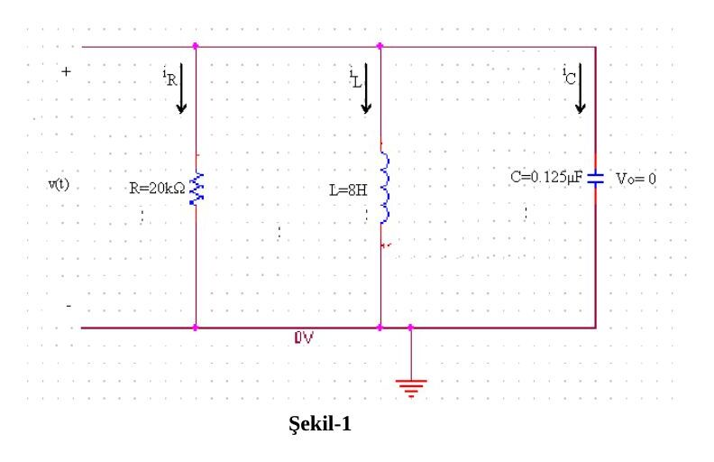
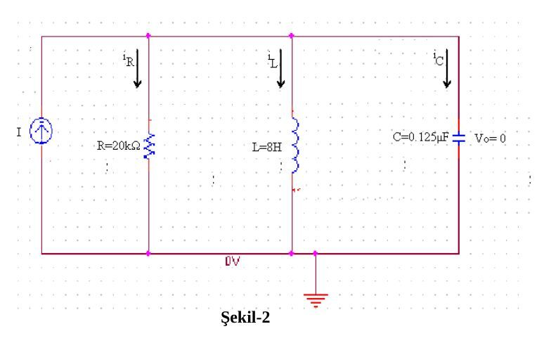
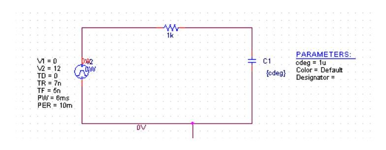
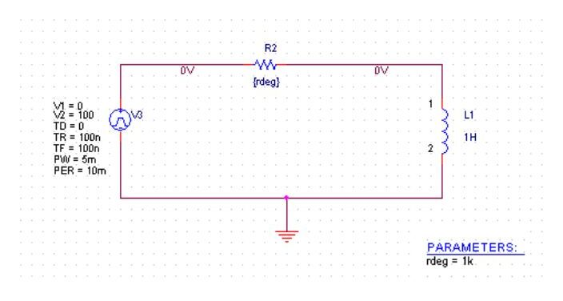
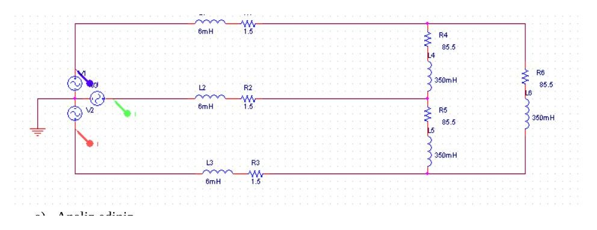
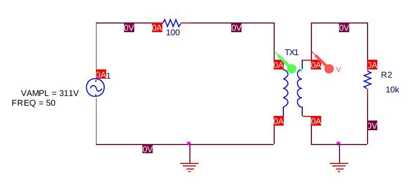

This post collects the handouts of four **PSpice assignments** given in the Başkent University Electrical and Electronics Engineering **EEM-202 Circuit Theory II Laboratory**: Assignment 1 covers the natural and step response of an RLC circuit, Assignment 2 covers RC and RL circuits, Assignment 3 covers three-phase circuits, and Assignment 4 covers transformers. The Assignment 3 and Assignment 4 handouts are dated April 2013; the due dates in the handouts also belong to that period. The handout text has been transcribed, and the PSpice schematics have been added as images. The original files of the four handouts can be downloaded as a ZIP at the end of the post.

## PSpice Assignment 1: Natural and step response of an RLC circuit

### Part 1: Natural response

**Question 1.** Using PSpice, build the circuit in Figure 1 with V₀ = 0, I₀ = −12.25 mA (the initial value of the current through the 8 H inductor), C = 0.125 µF, L = 8 H, and R = 20 kΩ.

- a. Plot v(t) versus time over the interval 0 < t < 11 ms.
- b. Plot v(t) versus time over the interval 0 < t < 1 s.
- c. Plot i_L(t) versus time over the interval 0 < t < 11 ms.
- d. By examining the plots and values, state the damping response of the circuit.

**Question 2.** If we want to observe the critically damped case of the same circuit: (a) calculate the new value of R; plot (b) v(t) and (c) i_L(t) over the interval 0 < t < 1 s.

**Question 3.** If we want to observe the overdamped case of the same circuit: (a) calculate the new value of R; plot (b) v(t) and (c) i_L(t) over the interval 0 < t < 1 s.

### Part 2: Step response

1. In the circuit in Figure 2, a current source of I = 20 mA has been connected to the previous circuit. Obtain the damping responses for R = 20 kΩ, R = 4 Ω, and R = 1 Ω.
1. Plot i_R(t), i_L(t), and i_C(t) over an appropriate time interval.
1. Compile the results into a report (three different damping responses and three different PSpice plots) and comment on them.

*Note: In this circuit, since α = 1/(2RC) and ω₀ = 1/√(LC) = 1000 rad/s, critical damping occurs at R = 4 kΩ (at R = 20 kΩ, α = 200 s⁻¹, which is underdamped). The values "R = 4 Ω and R = 1 Ω" in Part 2 were most likely meant to be 4 kΩ and 1 kΩ; with 4 Ω and 1 Ω, both cases would be heavily overdamped. The handout has been left as it was.*

> Assignment submission: Both sections must submit the assignment by Friday, March 9, at 16:30. Late assignments will be graded lower.

## PSpice Assignment 2: RC and RL circuits

**Question 1.** Using PSpice, build the circuit in Figure 1 with V_pulse = 12 V (square wave), C = 1 µF, and R = 1 kΩ.

- a. (20 points) Plot V_R(t), V_C(t), and I_C(t) versus time. (At least 5 periods must be observed. Take the value of τ into account for the period. Hint: 5τ)
- b. (15 points) Assign the values 0.5 µF, 1 µF, and 1.5 µF to the capacitor and plot V_o on the same set of axes. Calculate how τ changes.
- c. (15 points) Comment on the plot obtained when the value of C is changed in the previous part.

**Question 2.** Using PSpice, build the circuit in Figure 2 with V_pulse = 12 V (square wave), L = 1 H, and R = 1 kΩ.

- a. (20 points) Plot V_R(t), V_L(t), and I_L(t) versus time.
- b. (15 points) Assign the values 0.5 H, 1 H, and 1.5 H to the inductor and plot V_o on the same set of axes. Calculate how τ changes.
- c. (15 points) By looking at the plots of the inductor voltage and the capacitor current, comment on the similarity between them.

*Note: The handout text also gives V_pulse = 12 V for the RL circuit, whereas the PSpice source in Figure 2 shows V2 = 100 V. The handout has been left as it was.*

## PSpice Assignment 3: Three-phase circuits

For the circuit given below (6 mH and 1.5 Ω per line; 85.5 Ω and 350 mH in the load branches):

- a) Analyze it: (1) Is the circuit balanced? (2) How is the source connected? (Wye-delta) (3) How is the load connected? (Wye-delta)
- b) Calculate the phase and line currents.
- c) Draw it in PSpice and simulate it. Find the magnitudes and phases of the phase and line currents (at the load) and the phase and line voltages (at the source).
- d) Find the real, reactive, and complex powers at the load and at the source.

> Assignment submission: Both sections must submit the assignment by 17:00 on April 19, 2013. Late assignments will be graded lower.

## PSpice Assignment 4: Transformers

**Objective:** The purpose of this assignment is to understand how ideal and linear transformers work by simulating them.

### Part 1

**A.** Build the circuit given below with L1 = 20 H, L2 = 2000 H, and k = 1.

1. Obtain the signals v₁(t) and v₂(t). Compare their amplitude and phase values.
1. Find the currents i₁(t) and i₂(t). Compare them in the same way.

**B.** This time, build the same circuit with L1 = 10 H, L2 = 1 H, and k = 0.85.

1. How did the amplitude and phase of the voltages v₁(t) and v₂(t) change?
1. Compare the currents i₁(t) and i₂(t).

Report your work in detail. Your grade will be determined by the content and organization of your report.

> Assignment submission: Both sections must submit the assignment by 17:00 on May 3, 2013. Late assignments will be graded lower.
