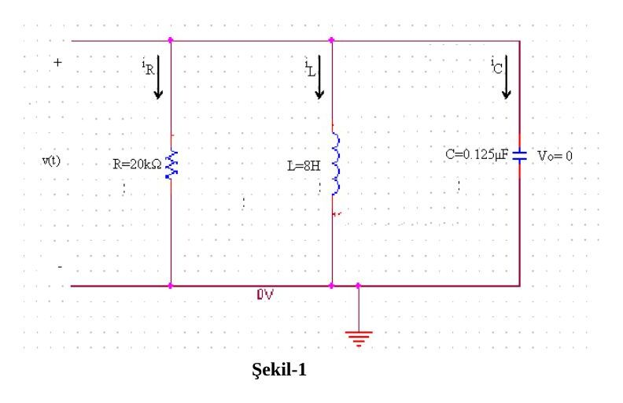
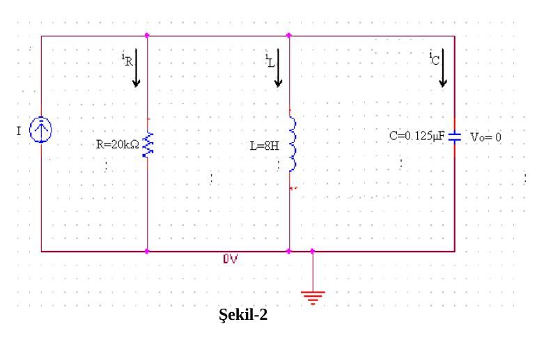
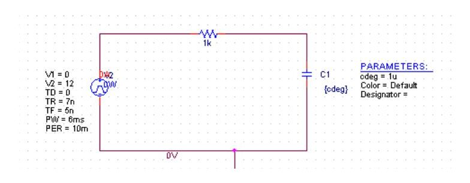
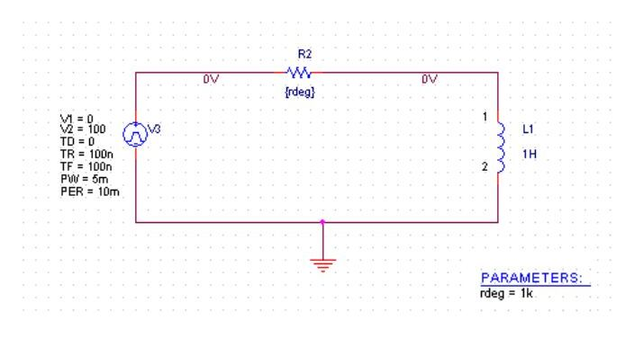
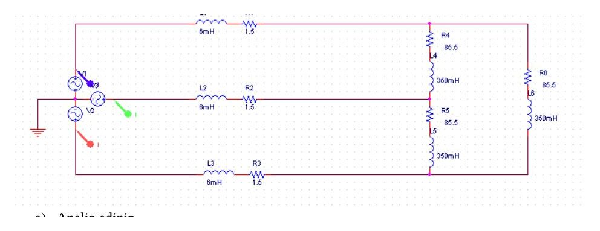
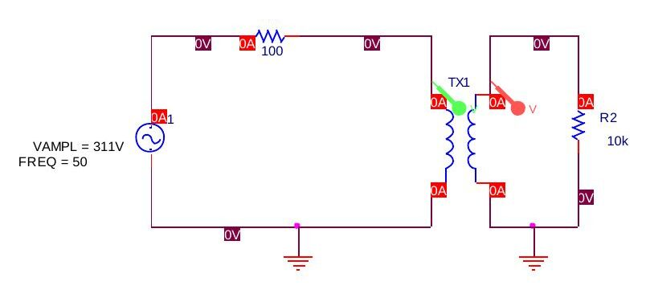

Bu yazı, Başkent Üniversitesi Elektrik-Elektronik Mühendisliği **EEM-202 Devre Teorisi-2 Laboratuvarı**'nda verilen dört **PSpice ödevinin** föylerini bir araya getiriyor: Ödev-1 RLC doğal ve basamak tepkisi, Ödev-2 RC ve RL devreleri, Ödev-3 üç fazlı devreler, Ödev-4 trafolar. Ödev-3 ve Ödev-4 föyleri Nisan 2013 tarihli; föylerdeki teslim tarihleri de o döneme ait. Föy metinleri aktarıldı, PSpice şemaları görsel olarak eklendi. Dört föyün orijinal dosyaları yazının sonunda ZIP olarak indirilebilir.

## PSpice Ödev-1: RLC doğal ve basamak tepkisi

### Bölüm-1: Doğal tepki

**Soru 1.** PSpice kullanarak V₀ = 0, I₀ = −12.25 mA (8 H değerindeki bobin üzerinden geçen akımın başlangıç değeri), C = 0.125 µF, L = 8 H, R = 20 kΩ değerleri için Şekil-1'deki devreyi kurun.

- a. Zamana karşı v(t) grafiğini 0 < t < 11 ms aralığında çizdirin.
- b. Zamana karşı v(t) grafiğini 0 < t < 1 s aralığında çizdirin.
- c. Zamana karşı i_L(t) grafiğini 0 < t < 11 ms aralığında çizdirin.
- d. Grafiklere ve değerlere bakarak devrenin sönüm tepkisini (damping response) belirtin.

**Soru 2.** Aynı devrenin kritik sönümlü durumunu görmek istersek: (a) yeni R değerini hesaplayın; (b) v(t) ve (c) i_L(t) grafiklerini 0 < t < 1 s aralığında çizdirin.

**Soru 3.** Aynı devrenin aşırı sönümlü durumunu görmek istersek: (a) yeni R değerini hesaplayın; (b) v(t) ve (c) i_L(t) grafiklerini 0 < t < 1 s aralığında çizdirin.

### Bölüm-2: Basamak tepkisi

1. Şekil-2'deki devrede, daha önceki devreye I = 20 mA'lik bir akım kaynağı bağlanmıştır. Buna göre R = 20 kΩ, R = 4 Ω ve R = 1 Ω için sönüm tepkilerini elde edin.
1. i_R(t), i_L(t) ve i_C(t)'yi uygun zaman aralığında çizdirin.
1. Sonuçları rapor hâline getirin (üç farklı sönüm tepkisi ve üç farklı PSpice grafiği) ve yorumlayın.

*Not: Bu devrede α = 1/(2RC), ω₀ = 1/√(LC) = 1000 rad/s olduğundan kritik sönüm R = 4 kΩ'da oluşur (R = 20 kΩ'da α = 200 s⁻¹, eksik sönüm). Bölüm-2'deki "R = 4 Ω ve R = 1 Ω" değerleri büyük olasılıkla 4 kΩ ve 1 kΩ olmalıydı; 4 Ω ve 1 Ω ile iki durum da çok aşırı sönümlü olur. Föy hâliyle bırakıldı.*

> Ödev teslimi: Ödevi her iki şube de 9 Mart Cuma, saat 16.30'a kadar teslim etmelidir. Geç verilen ödevler düşük notlandırılır.

## PSpice Ödev-2: RC ve RL devreleri

**Soru 1.** PSpice kullanarak V_pulse = 12 V (kare dalga), C = 1 µF, R = 1 kΩ değerleri için Şekil-1'deki devreyi kurun.

- a. (20 puan) Zamana karşı V_R(t), V_C(t), I_C(t) grafiğini çizdirin. (En az 5 periyot gözlenmeli. Periyot için τ'nun değerini dikkate alınız. İpucu: 5τ)
- b. (15 puan) Kapasitöre 0.5 µF, 1 µF, 1.5 µF değerlerini vererek V_o grafiğini aynı koordinat düzleminde çizdirin. τ'nun değişimini hesaplayın.
- c. (15 puan) Bir önceki bölümde C değerlerini değiştirdiğimizde elde edilen grafik üzerine yorum yapın.

**Soru 2.** PSpice kullanarak V_pulse = 12 V (kare dalga), L = 1 H, R = 1 kΩ değerleri için Şekil-2'deki devreyi kurun.

- a. (20 puan) Zamana karşı V_R(t), V_L(t), I_L(t) grafiğini çizdirin.
- b. (15 puan) Bobine 0.5 H, 1 H, 1.5 H değerlerini vererek V_o grafiğini aynı koordinat düzleminde çizdirin. τ'nun değişimini hesaplayın.
- c. (15 puan) Bobin voltajı ve kapasitör akımlarının grafiklerine bakarak aralarındaki benzerlik hakkında yorum yapın.

*Not: Föyün metninde RL devresi için de V_pulse = 12 V yazıyor; Şekil-2'deki PSpice kaynağında ise V2 = 100 V görünüyor. Föy hâliyle bırakıldı.*

## PSpice Ödev-3: 3 fazlı devreler

Aşağıda verilen devreyi (hat başına 6 mH ve 1.5 Ω; yük kollarında 85.5 Ω ve 350 mH):

- a) Analiz ediniz: (1) Devre dengeli mi? (2) Kaynak nasıl bağlı? (Yıldız-üçgen) (3) Yük nasıl bağlı? (Yıldız-üçgen)
- b) Faz ve hat akımlarını hesaplayınız.
- c) PSpice ile çiziniz ve benzetimini (simülasyon) yapınız. Faz ve hat akımlarının (yükteki), faz ve hat gerilimlerinin (kaynaktaki) büyüklük ve fazlarını bulunuz.
- d) Yük ve kaynaktaki aktif, reaktif ve karmaşık güçleri bulunuz.

> Ödev teslimi: Ödevi her iki şube de 19 Nisan 2013 saat 17:00'ye kadar teslim etmelidir. Geç verilen ödevler düşük notlandırılır.

## PSpice Ödev-4: Trafolar

**Amaç:** Bu çalışmanın amacı, ideal ve doğrusal trafoların benzetimini yaparak nasıl çalıştıklarını anlamaktır.

### Bölüm-1

**A.** Aşağıda verilen devreyi L1 = 20 H, L2 = 2000 H, k = 1 için kurunuz.

1. v₁(t) ve v₂(t) sinyallerini elde ediniz. Genlik ve faz değerlerini karşılaştırınız.
1. i₁(t) ve i₂(t) akımlarını bulunuz. Aynı şekilde karşılaştırınız.

**B.** Aynı devreyi bu kez L1 = 10 H, L2 = 1 H, k = 0.85 için kurunuz.

1. v₁(t) ve v₂(t) gerilimlerinin genlik ve fazı nasıl değişti?
1. i₁(t) ve i₂(t) akımlarını karşılaştırınız.

Çalışmanızı detaylı bir şekilde raporlayınız. Puanınızı raporunuzun içeriği ve düzeni belirleyecektir.

> Ödev teslimi: Ödevi her iki şube de 3 Mayıs 2013 saat 17:00'ye kadar teslim etmelidir. Geç verilen ödevler düşük notlandırılır.
