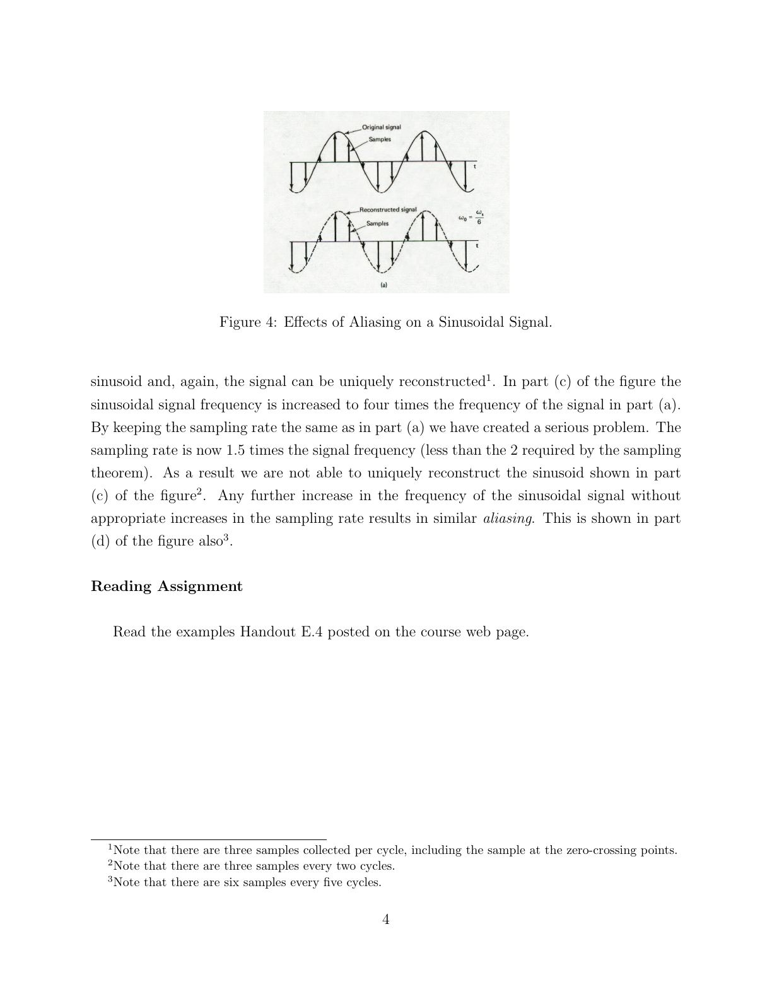

Bu yazı, **Texas A&M University, Department of Mechanical Engineering** bünyesindeki **MEEN 651 Control System Design** dersinde **Dr. Alexander G. Parlos**'un 2003 güz döneminde dağıttığı **"Lecture 2B: Sampling and Aliasing Phenomena, Sampling Rate Selection and Nyquist Frequency"** başlıklı 5 sayfalık İngilizce ders notunu içeriyor. Not, EEM202 ders klasöründe ek okuma olarak saklanmış. İçerik özgün dilinde aktarıldı, açıklamalar Türkçe; şekiller görsel olarak eklendi. Orijinal PDF yazının sonunda indirilebilir.

*Bu içerik üçüncü taraf bir kaynağa aittir; arşiv ve nostalji amacıyla kaynak belirtilerek paylaşılmıştır. Hak sahibinin talebi hâlinde kaldırılır.*

## Amaç ve tanım

The objective of this lecture is to introduce and explain some of the most basic concepts that are involved in the measurement of continuous-time signals. The basic rules regarding sampling are discussed and the consequences of incorrect sampling rate selection are mentioned.

> **Definition:** The instantaneous values of a signal at equally or unequally spaced values of time are called samples.

Sampling, if done correctly, can help us represent a continuous-time signal very accurately. The correct way of sampling a continuous-time signal is described by the so-called sampling theorem.

## Sampling of continuous-time signals

In general, if we were to sample a signal we would not expect to be able to guess the precise continuous-time signal that generated the samples. In fact, there are an infinite number of signals that pass through a finite number of points (Figure 1: three continuous-time signals with identical values at integer multiples of T).

Strangely enough, for most signals, if we take the samples sufficiently close to each other we can uniquely identify (or reconstruct) the continuous-time signal that generated the samples. This forms the basis for the accurate measurement of dynamic signals, such as vibration level.

### Impulse-train sampling

A simple way to sample a continuous-time signal is to measure it for a finite period of time using pulses (Figure 2: pulse amplitude modulation; as Δ → 0, p(t) approaches an impulse). As the duration of the pulses approaches zero, we obtain an impulse train (Figure 3) whose impulses have values corresponding to instantaneous samples of the signal at time instants spaced T seconds apart.

If the impulses are spaced arbitrarily, we cannot uniquely know the signal that generated the samples. If we sample with a predetermined sampling rate, we can uniquely determine the signal. The required sampling rate follows from the **sampling theorem**:

- **ω_s > 2ω_M** (1)

where ω_M is the maximum frequency contained in the signal and ω_s is the sampling rate. A continuous-time signal must be sampled at least twice the maximum frequency present in it. The note calls the sampling frequency ω_s the *Nyquist frequency* and the frequency 2ω_M which must be exceeded the *Nyquist rate*.

*Not: Yaygın kullanımda "Nyquist frekansı" örnekleme frekansının yarısına (ω_s/2) denir; "Nyquist oranı (rate)" ise işaretteki en yüksek frekansın iki katıdır (2ω_M). Nottaki ilk tanım bu kullanımdan farklıdır.*

## The effect of undersampling: aliasing

If the sampling rate is not high enough (undersampling), we end up with an effect called **aliasing**, which yields very inaccurate and false information about the sampled signal. In Figures 4 and 5 a sinusoid of increasing frequency is sampled with impulse trains of constant spacing:

1. (a) The sampling rate is six times the frequency of the sinusoid (six samples per cycle); the signal can be reconstructed.
1. (b) The signal frequency is doubled; the sampling rate is three times the signal frequency (three samples per cycle, including the zero-crossing samples) and the signal can still be uniquely reconstructed.
1. (c) The signal frequency is four times that of (a); the sampling rate is now 1.5 times the signal frequency (three samples every two cycles), less than the required 2, so the sinusoid cannot be uniquely reconstructed.
1. (d) Any further increase in frequency without increasing the sampling rate results in similar aliasing (six samples every five cycles).

")

Not, okuma ödevi olarak dersin web sayfasındaki "Handout E.4" örneklerine yönlendirerek bitiyor.

## İndirilebilir dosya

5 sayfalık orijinal PDF aşağıdan indirilebilir.
