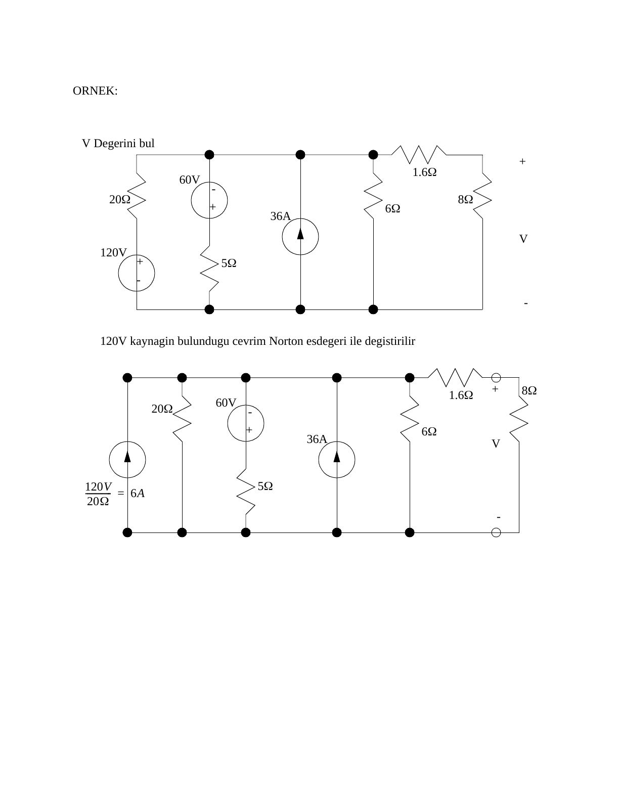

This post contains an 11-page note titled **"Circuit Solution Methods"**, stored in the course folder under the name "sorular3" (the PDF is dated May 2007; the PDF metadata lists **Fatih Tüysüz** as the author). The worked examples in the second section contain references such as "Figure 7.3(c)" and "Figure 7.11(b)"; this part may have been compiled from a textbook. The note covers Thevenin–Norton equivalents, superposition, and maximum power transfer using DC circuits, and gives worked examples; it was placed in the folder for review because the same methods are used in the phasor circuits of EEM202. The text and results are reproduced below; the original PDF can be downloaded at the end of the post.

*This content belongs to a third-party source; it is shared for archival and nostalgic purposes with the source credited. It will be removed at the request of the rights holder.*

## Using Thevenin and Norton equivalent circuits

Thevenin circuit: a source V_s with a series resistance R1. Norton circuit: a source I_s with a parallel resistance R2.

- If both circuits are short-circuited: I_t = I_n and V_t = V_n = 0 → V_s = R1·I_t, that is, **V_s/R1 = I_t = I_n**.
- If both circuits are open-circuited: V_t = V_n and I_t = I_n = 0 → **V_t = V_s** and **V_n = I_s·R2**.

These basic equalities are used both in solving circuits and in simplifying them.

### Example: finding the voltage V by source transformations

The circuit contains a 120 V source with 20 Ω, a 60 V source with 5 Ω, a 36 A current source, 6 Ω, and then a series 1.6 Ω and an 8 Ω load; V across the 8 Ω resistor is required.

1. The branch containing the 120 V source is replaced by its Norton equivalent: 120 V/20 Ω = 6 A.
1. The second voltage source and its resistor are also converted to a Norton equivalent: 60 V/5 Ω = 12 A (in the opposite direction).
1. All current sources and parallel resistors are combined: 6 − 12 + 36 = 30 A; 1/(1/20 + 1/5 + 1/6) = 2.4 Ω.
1. The current source is converted to its Thevenin equivalent: 30 A·2.4 Ω = 72 V.
1. The series resistors are added (2.4 + 1.6 = 4 Ω) and, using the voltage divider, **V = 72·8/(8 + 4) = 48 V** is obtained.

## Superposition

This is a simple technique that can be used in circuits containing more than one source:

1. Select one source in the circuit; replace all other current sources with open circuits and all other voltage sources with short circuits.
1. Analyze the circuit like an ordinary circuit.
1. Select the next source and return to the first step.
1. Add the results obtained for each source.

### Example

A 100 V source with 20 Ω and a 40 Ω resistor (V is across this resistor), 10 Ω and 2.5 Ω; a 6 A current source between the two nodes where the 20 Ω and 10 Ω meet.

- **a) Current source only (voltage source short-circuited):** 20 ∥ 40 = 13.3 Ω; 10 + 13.3 = 23.3 Ω in parallel with 2.5 Ω: 1/(1/2.5 + 1/23.3) = 2.26 Ω. The voltage across the current source is 6·2.26 ≈ 13.5 V; by the voltage divider, V = 13.5·13.3/(10 + 13.3) ≈ **7.73 V**.
- **b) Voltage source only (current source open-circuited):** 40 ∥ (10 + 2.5) = 9.52 Ω; V = 100·9.52/(20 + 9.52) = **32.25 V**.
- **c) Total:** **V = 7.73 + 32.25 = 40 V**

*Note: In part (a) the note gives "V_s = 6(2.2) = 7.73 V" and "V = 13.5 V"; the two values are mixed up. The correct values are V_s = 6·2.26 ≈ 13.5 V and V ≈ 7.73 V (the final total of 40 V is correct). In part (b) the note says "the current source is short-circuited"; according to the rule of the method, and as seen in the figure, the current source is **open-circuited**.*

## Maximum power transfer

When a load is connected to a circuit, the aim is to maximize the power delivered. With V_s and R_s belonging to the source:

- I = V_s/(R_s + R_L), V_L = I·R_L
- P_L = I·V_L = [V_s/(R_s + R_L)]²·R_L
- ∂P_L/∂R_L = 0 → **R_L = R_s** (for maximum power transfer)

## Worked examples

### Problem 1: R3 current (superposition)

Two sources U1 = 20 V and U2 = 15 V, R1 = R2 = 1 kΩ, R3 = 2.2 kΩ. The current through R3 is found by superposition.

- U1 only: R_T1 = R1 + R2∥R3 = 1 kΩ + (1 kΩ·2.2 kΩ)/3.2 kΩ = 1.69 kΩ; I_T1 = 20 V/1.69 kΩ = 11.8 mA; by the current divider, I_3(1) = (1 kΩ/3.2 kΩ)·11.8 mA = **3.69 mA**
- U2 only: R_T2 = R2 + R1∥R3 = 1.69 kΩ; I_T2 = 15 V/1.69 kΩ = 8.88 mA; I_3(2) = (1 kΩ/3.2 kΩ)·8.88 mA = **2.78 mA** (in the opposite direction)
- **I_3 = 3.69 − 2.78 = 0.91 mA (910 µA)**; the positive result shows that the current flows in the direction driven by U1.

### Problem 2: Current through the 8.65 Ω resistor (Thevenin)

A 20 V source with 5 Ω and 15 Ω; a 10 V source with 2 Ω and 8 Ω; an 8.65 Ω resistor between nodes A and B of the two sides.

- The resistor whose current is sought is removed, and its terminals are labeled A and B. By the voltage divider, U_A = 15/(5 + 15)·20 = 15 V, U_B = 8/(8 + 2)·10 = 8 V → **U_TH = U_A − U_B = 7 V**
- R_TH = 5∥15 + 2∥8 = 3.75 + 1.6 = **5.35 Ω**
- **I = 7 V/(5.35 Ω + 8.65 Ω) = 0.5 A**

## Downloadable file

The original 11-page PDF can be downloaded below.
